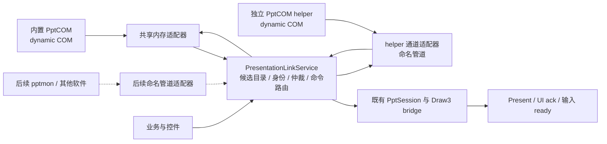
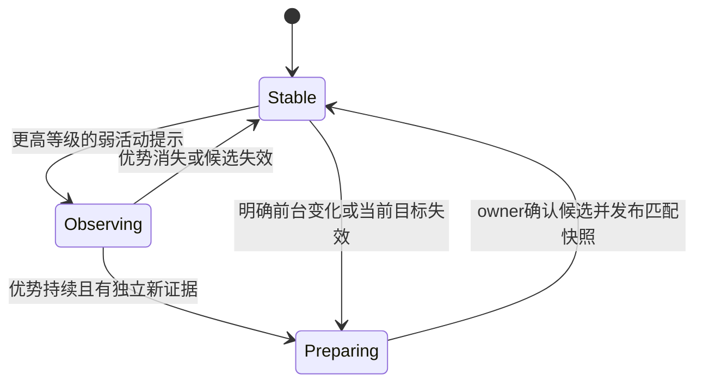

# 多来源演示联动设计草案

> P0已完成，P1源码与验收通过但签名收尾未完成；P1实际API与边界见专用multisource-service.md，生产接管和helper仍待P2-P5。活动放映优先、双向权限helper与Win7 SP1 / .NET4条件保持；P0选择命名管道作为首发helper通道，真实Win7/跨权限运行仍需后续门禁。本文API命名为设计占位，不表示已经实现。

## 1. 架构与所有权

- `PresentationLinkService` 在 native Business 层，是主程序内部服务，也是唯一最终仲裁者：接收纯值、维护候选、计算统一优先级、防抖并发布绑定。PptCOM负责发现、读取和执行，不自行与其他来源争夺最终绑定。服务不持有RCW、不访问ROT、不在render/UI线程执行同步IPC。
- `PptCOM` 保持类库输出；新 `PptCOM.Host` 为独立后台 host，引用同一类库核心，避免复制两份 COM 发现/联动实现。先以 host-local unmanaged 页码/停止槽运行原 `Initialization` 作为过渡，再引入新共享状态接口；禁止把主进程地址传给 helper。
- 每个 PptCOM 运行实例沿用当前 service owner、事件与慢维护模型。P0确认现有owner只负责部分操作，旧翻页/激活和部分事件仍有既有COM调用路径，不能把“所有调用都已在单一owner”当作迁移前提。通信线程只处理纯值，不触碰COM；不以添加通道为由切换apartment或重构这些路径。
- 旧 IPptCOMServer/IPptCOMSessionState 保留。新通道/候选/命令能力用独立 COM 查询扩展或纯 managed host API 提供，不向旧 IUnknown vtable 插入成员。
- 业务消费者最终只调用服务的观察/订阅/命令接口；兼容旧 DLL 的直读路径封装在 Legacy adapter，不能继续散落在业务/UI。

## 2. 跨权限进程拓扑

| 情况 | 内置类库 | 开关打开后的 helper |
| --- | --- | --- |
| 开关关闭 | 沿用主程序当前 token/运行方式 | 不启动 |
| host 已提升 | 观察本权限域 | 通过 GetUserToken 思路获取同用户、同交互 session 的普通用户 token，补充低权限域 |
| host 普通用户 | 观察普通用户域 | 开启选项后通过标准 UAC 启动管理员 helper，补充管理员域；主程序自身不提升 |
| UAC取消 / token / helper / 依赖失败 | 保留内置支持 | 报告未启用/失败并撤销该来源，本次取消后不重试，不改变已有类库绑定 |

权限域是覆盖意图，实际 Office 可见性还取决于 ROT、提供方实现、UIAccess、安装和损坏情况；必须实测，不能用 token 级别推导必然识别。

专用 `PptHelperProcessManager` 统一管理两个方向：已提升 host 使用普通用户 token 降权启动；普通 host 使用 `ShellExecuteExW` 的 `runas` 启动管理员 helper，并用 `SEE_MASK_NOCLOSEPROCESS` 保留进程句柄。UAC同意/凭据提示按系统行为显示，helper采用无窗口入口；取消后保留开关意图但本次启动尝试结束，由再次明确启用/重试操作发起新尝试，不自动重复弹出。专用包装复用令牌获取能力，不直接复用创建控制台的 RunTokenProgram。核查 token 读取成功、TokenUser/session/提升状态，使用确定的 exe 路径、正确引用参数、用户 profile/environment、无可见窗口的启动方式；保留 process handle，启动成功后再等 Hello/Ready。GetUserToken 在多登录用户情况下不能作为已确认的降权结果，过滤/验证失败即保持类库并报告原因。提升后同样验证实际权限与交互 session；UAC使用其他管理员账号凭据时，其SID/profile/ROT可见性不能假定等同原用户，作为P0的独立组合核查，不因此声称自动覆盖所有登录用户。

生命周期为 Stopped → Starting → Handshaking → Ready → Stopping → Stopped；Failure 独立记录。实例限于本 host session，关闭开关/host 退出后停止接收命令并通知 helper。重启次数有上限和退避，避免故障拉起循环。管理员 helper 故障重启如果再次需要 UAC，转为待用户重试，不在后台反复请求提升。

高权限 helper 自己监测启动时确认的 host 进程身份与IPC失联，按有界宽限退出；进程句柄/权限不足时用心跳与连接终止作为补充，不能假设普通用户host能够直接终止或加入job管理高权限helper。

正常退出：撤销路由 → 取消未执行请求 → owner 停止/原 FullCleanup → 发布退出确认 → 有界关闭通信 → 释放自身资源。异常断联/COM 卡住先撤销来源和保留诊断，不能以收到 Bye 当作 RCW 已释放，也不能承诺超时一定能解除 COM 阻塞。强制终止 helper 的策略留在专项验证后审阅；永不自动结束用户的 PowerPoint/WPS。

## 3. 通用模型：字段存在与能力可用分别判断

将“backend（PptCOM/pptmon）”“应用种类（PowerPoint/WPS/希沃）”“传输（shared memory/ZMQ/pipe）”“观察者权限”分开，不能用 transport 作为文稿身份或应用类型。

| 契约 | 字段与语义 |
| --- | --- |
| Envelope 必需 | protocol major/minor、message kind、host instance、source instance、source epoch、message sequence；来源重启 epoch 改变、sequence 不跨来源比较 |
| Source 必需 | backend、application kind（可 Unknown）、observer 权限/session、health、capabilities；host 本地接收时间用来判断存活，不用墙钟决定页面新旧 |
| Candidate 必需 | source-local candidateId、候选 generation、lifecycle=Active/Inactive/Unknown、quality=Valid/Busy/Unavailable/Stale、state revision；source snapshot 是完整目录或显式增量+删除 |
| Document 必需槽 | opaque identity、identity scope/confidence；允许只存在来源会话内的临时 identity。路径、标题、应用提供的文稿 GUID 为可选证据 |
| Show 必需槽 | source-local show identity；跨源关联由服务分配 LogicalShowId。可选被观察应用 PID+进程创建身份、交互 session、真实放映 HWND、窗口生命周期证据；observer PID 与 Office PID 不混用 |
| Activity 轻量证据 | showActive tri-state、providerActive tri-state、activityReasonBits、activityObservationRevision及新鲜度；可选已核验HWND/PID关联。旧本地priority仅作有版本语义的hint，抽象层计算统一rank；未知不是false |
| Page 必需槽 | pageKind=Slide/EndScreen/Unknown、1-based pageOrdinal 可空、totalPages 可空、page identity quality；未知不写成0/1/最后页，黑屏/白屏不等同结束 |
| Page 扩展 | stable page key（如 SlideID）、topology revision、完整页 ID 列表；按能力/状态校验，不是所有软件必须提供 |
| 事件扩展 | ShowStarted/ShowEnded/PageChanged/TopologyChanged/AnnotationChanged 等；包含完整目标身份和修订。PageChanged 是绝对观察或刷新提示，不是让 native 自增一页 |
| 命令 | commandId、target source epoch/candidate generation/show、routeRevision、logical show、expected page（可选）、deadline、操作和参数；执行前在源端再次校验 |
| 服务输出 | selected LogicalShowId、document/page key、统一 showSessionRevision、routeRevision、targetRevision、页码/质量/能力、选择原因；外部事实与 canvas/UI ready 分开 |

wire 使用 UTF-8、固定整数宽度，HWND/64位revision 不经浮点解析；句柄不作为可操作对象传输。上限沿用现有单文稿约束（1 MiB descriptor、32 KiB identity、10,000页）并增加候选总量及消息/分片上限，完整清单大于单帧时有界分片，重组完才替换目录。topology 在身份/拓扑变化时传，日常页事件只带引用；断线重连重发必要全量，避免每页重复扫描/传完整拓扑。

能力至少区分 ObserveLifecycle/ObservePage/PageCount/StableDocumentIdentity/StablePageIdentity/PageEvents/Next/Previous/Goto/End/Activate/NativeAnnotation。观察能力不意味着控制能力；缺 Goto 等操作明确返回 Unsupported，业务按能力显示/执行。缺页码来源可用于放映检测，不能开放页级画布输入。临时页序号来源最多使用隔离会话与已证明的页序语义，不跨退出恢复，不自动继承稳定 SlideID 的持久化墨迹。

## 4. 身份归并：文稿与正在放映的实例不同

- DocumentKey 沿用既有存储/Draw3 文稿规则，不由源名称、权限或传输组成；同文件的两个放映可具有相同文稿键但必须不同 LogicalShowId。
- Show 归并优先要求同交互 session、同被观察 PID/进程创建身份、同已验证真实放映 HWND及连续存活证据；各 source 本地 session 数值不能直接相比。
- PID/窗口重用、显式退出后再开始、观测缺口后的新场次都不能自动沿用旧 show identity。
- 没有可靠 HWND 时，可由提供方稳定 show ID或专用关联协议证明；相同路径/标题/总页数/SlideID拓扑仅说明文稿相似，不足以证明同一放映。
- 只有弱证据时保留独立候选，并保持当前赢家；宁可不自动合并，也不能误把两个放映的页面和命令拼在一起。临时身份不能成为跨来源持久身份。
- 同一个 LogicalShow 内不同来源的页、生命周期组成一份权威快照；不分别取“最快的页码”和“最准的文稿”形成不存在的组合。可补充非动态元数据，但需身份和版本证据。
- 对源切换，LogicalShow/showSessionRevision 保持，routeRevision 递增；页或真实目标变化推进 targetRevision。若新来源不能证明页面映射，按新目标/Unknown 隔离，不沿用 ready 或猜测对应墨迹页。

## 5. 统一仲裁与防反复切换

### 职责：PptCOM提供证据，抽象层拥有最终绑定

活动放映优先已由用户确认。本节补充其讨论中的优先级/防抖方案，作为已收敛的总体技术设计，P0核查已完成，本轮P1实现纯值合同与仲裁，不接入生产。PptCOM保留其dynamic读取、ROT去重、WPS特例和对象释放知识，将可获得的活动性事实和轻量候选目录上报；抽象层统一处理所有后端及权限域，最终选择放映、来源与切换时机。

不能只传一个来源自定的priority数值。PptCOM旧1/2/3中，编辑文稿、有放映窗、Active或PID/WPS判断具有不同含义；别的后端的3不一定等价。适配器先归一化为明确的活动证据种类，来源可附本地priorityHint用于诊断，不能凭任意高数值跨过统一活动等级或身份准入。

初始/重连传完整有界候选目录与必要描述；之后只传变更的candidate identity、activityObservationRevision、活动三态、reason bitmask、窗口/进程关联及相关revision。文稿拓扑不因活动提示更新而整份重传。每项证据必须来自实际读取或有效窗口复核，心跳/页消息到达/重复包不刷新该证据的新鲜度，也不算第二次独立确认。读取失败用Unknown并沿用既有短期busy合同，不强制typed cast或补不存在的HWND。

抽象层可在native侧统一观察本桌面前台窗，将同一份foreground observation revision用于所有候选；优先核查真实show窗口或已验证窗口关系，同PID编辑窗仅是弱证据。可采用有界采样，或已有消息线程上的out-of-context WinEvent唤醒+复核；P0核查API与现有观察边界；实际性能/跨权限可见性留P3-P5实机门禁。前台为0、未识别窗或Inkeys控件不推断ShowEnded，不用前台句柄替代缺失的show identity。

### 优先级：先做准入，再按活动等级比较

准入检查协议、来源存活、候选generation、明确放映生命周期与必要能力；明确Inactive不参与放映选择，有编辑文稿但没有放映不构成活动放映。状态Unknown或Busy按已有有限宽限处理，不直接伪造Inactive；来源失效则立即撤销其命令route。

以下为新协议的统一等级定义，不复用旧PptCOM分值的语义：

| activityTier | 含义 | 行为 |
| --- | --- | --- |
| 3 | 当前统一前台观察经验证关联到该真实放映窗口/放映实例 | 最强活动证据；复核仍成立且候选身份/快照可用后走快速切换路径 |
| 2 | 提供方报告该候选活动，或应用/WPS关联规则给出活动提示，但不能可靠区分到当前真实放映窗口 | 可挑战低等级候选，需要连续独立确认；不能覆盖与当前前台冲突的等级3 |
| 1 | 放映仍运行，但没有新鲜的活动提示 | 后备候选；没有明确活动目标时优先保持仍有效的当前绑定 |
| 0 / 不准入 | 只发现编辑文稿、明确Inactive或来源/候选失效 | 可保留诊断目录，不成为活动放映的可执行路由 |

同一show的重复报告先按身份归并，同一事实不因来源数量多而累加分数。活动等级按强证据优先、弱证据不得推翻仍成立的强证据计算；矛盾报告请求刷新，不进行简单投票。前台转到另一个已验证show时重新计算，旧show不能靠缓存的等级3长期占位。

同等级先保持当前有效show；无当前绑定时优先最近一次确认的外部活动show，仍并列则按稳定候选键确定，不能逐包受最后到达来源影响。来源的状态质量/能力/backend偏好只用于该show内部择优，绝不加到活动等级上使后台文稿反超前台。

点击Inkeys自有控件/画布时保留最后已确认的外部show上下文；这只是焦点交接期间的绑定策略，不伪造新的Office Active证据。另一个真实前台show被确认后仍快速切换。

### 防抖：候选更高是必要条件，但弱提示还要持续确认

维护 currentShow/currentRoute、pendingChallenger、evidenceRevision、challengerSince、lastSoftSwitch、recoveringSourceSince；pending记录源epoch、candidate generation、logical show，身份失效后不能继续累计。

- **同等级保持**：A与B都报告Active时保持A；旧包重放、同页事件、多个来源重复证据都不触发A/B轮换。
- **弱提示持续确认**：B优于A时建立pending，只在B持续占优、证据仍新鲜、取得多次独立观测且达到短观察窗口后准备切换。期间B下降、A获得更强证据或pending目标改变，则取消或重建；不能在收到一次B提示时立即绑定。
- **软切换回滞**：一次弱提示切换之后，弱提示反向切回或恢复原来源要经过稳定恢复窗口；单次优劣反转不够。软切换间隔与恢复窗口分别定义，不用一个全局冷却限制所有情况。
- **强证据快速路径**：可靠前台已从A转到B时，先复核窗口关联、统一前台revision及B当前generation，再准备B；不受软切换冷却阻挡。准备时若前台又变化，丢弃旧准备结果。当前route/候选被确认失效同样不等待防抖，先撤销再选择可用候选。
- **页变化立即传播**：上述观察窗口只影响绑定/来源切换。当前show正常PageChanged立刻走已有owner刷新/纯值发布/target链路，仍遵守Present/UI ack；不为防抖把每次翻页统一延迟。

观察窗口、需要的独立样本、证据有效期、soft switch间隔、source恢复窗口都是独立可测试参数，P0固定源码周期与隔离通道证据，P1以可控时间验证规则、P3-P5实机校准初值；本轮不承诺固定毫秒，也不直接采用原重绑的Thread.Sleep(1000)作为全局防抖。

### 来源切换与放映切换分别控制

同一LogicalShow内的sourceRank按当前可用性、新鲜度、页面/身份质量、所需能力、backend偏好比较；同等级保留当前route，权限与传输方式不自动加分。一个source恢复后不立即抢回，持续证明更优才软切换；当前route失效则验证备用快照后及时接管，不受恢复冷却限制。

不同来源sequence/stateRevision不可直接比较；活动证据过期与页状态新鲜度分别维护。页数据迟到不能把show的活动等级提高，heartbeat活着也不能令其旧页成为权威。替换来源必须验证页面映射，LogicalShow不变只推进routeRevision，不伪造结束/新场次。

### 切换提交与焦点反馈

抽象层是唯一发出SelectCandidate的角色。支持BrokerSelect的新PptCOM实例只按该请求在原owner内绑定/执行；LegacyAutoSelect仅用于旧DLL兼容阶段，两种控制模式互斥，不能类库自动抢回A、服务又选B。

切换采用“请求→owner确认匹配candidate generation并提供可用快照→服务提交”三步；再检查最新前台/挑战证据revision。旧确认不能覆盖新请求。弱挑战期间A仍可用且仍为当前目标时继续其正常页更新；明确活动show已变或A失效时撤销A命令route，不能等准备B的同时把用户动作发给后台A。B快照未就绪则输出Pending/Unknown，保留既有输入门禁，准备失败后重新选择而非无限来回重绑。

被动仲裁只改变绑定，不自动Activate候选窗口以“帮助它成为活动”。P0确认native创建新session会主动排队Focus；同show来源切换必须保留logical session，并审查该既有路径避免重复触发。显式翻页/激活所需的既有焦点交接归同一命令路由，记录操作目标与revision；本程序自己引发的焦点事件可用于确认当前目标，不能作为独立新挑战或重复计票。也不能因此忽略随后实际变成另一个show的前台变化。否则可能形成“绑定B→激活B→活动分变化→另一owner激活A”的反馈循环。

| 场景 | 预期行为 |
| --- | --- |
| DLL与helper报告同一放映 | 一个LogicalShow，不累加活动分；route择优并保持同等级稳定 |
| 两个窗口同文件或同PID不同show | 独立候选，实际窗口关联优先；不能只凭路径/PID归并 |
| A和B交替发弱Active提示 | 短脉冲不触发切换；只在挑战持续成立后提交 |
| 确认前台从普通用户A到管理员B | 切到B，由B的可用来源提供状态；不被来源权限排序或软冷却阻挡 |
| 用户点击Inkeys控件 | 维持外部show上下文，命令只发当前route |
| 当前source Busy，副源报告旧页 | 不倒退、不误结束；刷新并维持必要输入门禁 |
| 当前source失联，同show有有效备用源 | 撤销旧route，验证后接管；不产生假End |
| 同show的一个源报End、另一个仍Active | 撤销已结束路线并重新验证；旧Active不得无限续命 |
| 同show两个来源短暂质量交替领先 | 保持当前route，恢复的来源稳定更优才抢占 |
| B准备期间前台已回A或切到C | B旧确认被拒绝，不短暂发布B再跳回 |
| 所有来源不可用 | Unknown/Unavailable、撤销命令/新输入；保存/清理由既有生命周期合同决定 |

选择日志包括old/new logical show、activityTier与reason、source/route/target修订、pending/取消/快速或软切换原因；默认不记录文稿路径/内容。纯逻辑测试用可控单调时间验证稳定性及快速路径，不用实际sleep制造测试延迟。

## 6. 共享内存与传输无关的 helper 协议

### 类库状态通道

先保留旧指针兼容，新增版本化共享状态通道；新业务只读完整快照，不同时混用旧页码和新身份。host 创建并持有映射，DLL 写入纯值 snapshot。头部包含 magic、ABI version、instance/epoch、revision、长度/容量和提交标志；不含 RCW、字符串指针或跨进程地址。

初版建议用 Windows 命名/共享 mutex 保护有界字节复制、event 通知新 revision：序列化在锁外，锁内无COM/IO，消费者有界取得锁并复制后在锁外解码；abandoned/不完整提交撤销并请求全量。低影响优先，暂不引入未经验证的无锁 seqlock。C#/C++ 对齐、整数大小和 memory ordering 需合同测试，不能只靠普通 volatile 表达跨语言同步。

事件只唤醒；先取 revision 再检查与等待，醒后复核，保留有界兜底，避免 reset/event 交错丢进展。native 向类库的控制通过扩展接口入队到既有 owner 语义，调用业务线程不触碰COM且不在UI同步等待。共享内存不是COM数据同步锁。

### 独立程序公共协议

先定义传输无关的 Hello/Ready/FullSnapshot/Delta/Event/Heartbeat/Command/Result/Resync/Stop/Stopped。每个endpoint按host instance隔离，握手绑定本次启动nonce、helper实例、权限/session及协议版本。schema、候选、仲裁和业务消费者不依赖socket或管道句柄，第三方协议另设解析适配器。

每端通信owner仅处理有界纯值队列；COM owner不做阻塞IO，通信回调不接触RCW。状态可合并到最新绝对快照；关键生命周期用修订/tombstone确保可重建，不能只依赖瞬时End事件。初连/重连/sequence缺口请求全量，源epoch变化撤销旧route；heartbeat只证明通信活着，不证明Office页新鲜。

Result区分 Executed/RejectedStale/Unsupported/Failed/OutcomeUnknown。翻页等非幂等操作不因timeout自动改投另一来源重试。commandId去重限于同源epoch；执行后连接断开只能报告OutcomeUnknown并刷新绝对状态，不能宣称跨崩溃 exactly-once。命令携带身份与deadline（协商同机单调时钟单位，或传递有界有效期），源端调用Office前再次检查；已进入COM的调用不能承诺timeout可撤回。

### 传输选型与兼容门

用户确认 net40 的采用目的是 Win7 SP1 兼容；本任务把 Win7 SP1 / .NET4 纳入类库和helper运行条件，其他主项目既有平台声明保持。不为通信依赖引入更新Windows/.NET先决条件。

| 候选 | 规划评估 |
| --- | --- |
| ZMQ | 保留原设想。当前NetMQ target不包含net40，只证明这份实现不能直接采用，并不证明所有ZMQ实现不支持.NET4/Win7。P0验证具体原生libzmq/托管绑定版本、架构部署、退出和性能；满足条件可以使用。 |
| Windows命名管道 | P0选定的本机IPC首发通道；采用Win32或.NET4已有System.IO.Pipes API，避免引入新的消息库。必须补全跨权限访问、分帧、取消与重连，而不是认为换管道自动解决上述问题。 |
| 其他方案 | 只有前两项出现明确限制才评估；继续复用同一消息合同与验收，不为多种候选同时实现冗余通道。 |

P0选定首发传输为本机双向命名管道，依据和运行准入记录在P0子任务research/transport-decision.md；不同时实现“ZMQ失败自动切到pipe”的运行时协商/回退。未来替换传输只改变adapter。较新helper运行时不再作为绕过本轮Win7/.NET4约束的路线。

### ZMQ 候选细则

建议host ROUTER / helper DEALER，Windows本机loopback动态endpoint；每端一个owner持有socket，配置有界HWM、发送等待、mandatory路由检查与有界linger。先不增加PUB/SUB热通道。不能假设ZMQ ipc://等同Windows命名管道或适用全部Windows构建。

### 命名管道候选细则

每个host instance创建自有双向管道，helper主动连接；实例按交互session/启动nonce区分。优先使用byte stream + 固定宽度长度头 + 已定义UTF-8消息体，并进行部分读写/分片/超限检查。不同来源各自独立连接，不使用一个共享缓冲把身份与页码交错组合。

跨权限是必须验证的主路径：高权限host创建的pipe要允许其普通用户helper访问，普通host创建的pipe要能与提升后的helper双向通信；按实际SID/logon session/完整性级别设置访问规则并核验本次启动的peer，不能依赖默认ACL一定满足，不能用Everyone完全控制掩盖问题。限制本机连接；连接peer身份用于握手，不在COM owner上模拟对方token执行Office调用，避免改变原权限域。

.NET4实现只使用其引用程序集实际提供的接口：APM Begin/End或Win32 overlapped IO作为异步候选，不能直接照搬新框架的WaitForConnectionAsync/新取消重载。停止时取消/关闭等待中的IO并有界join；半帧EOF丢弃，断线撤销route。断线重连是新连接且需全量状态，不自动补执行旧翻页。P0同时验证Win7 API可用性与.Net4取消语义，fake测试不能替代实际跨权限链路。

自有helper管道与pptmon自有管道可能共用底层读写工具，但消息协议、能力及身份转换各自独立；首发采用pipe不代表已经支持pptmon或希沃。

## 7. 多候选能力与渐进迁移

当前 GetAnyActivePowerPoint 丢弃非赢家，单靠下游服务无法恢复它们。第一阶段用 LegacySingleCandidate adapter 保持现状验证输出；该阶段不宣称已经完成多候选需求。

后续在现有owner扫描中增加纯值Candidate inventory：先保留ROT发现/去重/释放流程，在owner内对已发现应用枚举能读取的放映候选，发布全部目录；详细状态/事件优先维护选中及备用候选，未选候选低频核查。所有临时COM acquisition按现有规则finally释放，不能把完整COM图交给服务或按每候选另起线程。

原内部赢家与外部服务不能同时竞争控制：新协议明确 LegacyAutoSelect / BrokerSelect 模式；BrokerSelect由服务发带generation的SelectCandidate，源确认后发布可用快照，非选中观察不自行重绑/执行命令。新模式是单独风险阶段，需覆盖一个PowerPoint实例多个放映窗、同进程换文稿、损坏ROT项及WPS特例；发现应用只能提供单候选时明确能力，不能虚构完整枚举。

新抽象层先旁路对照现有输出；一致后接管状态，再接管命令，最后启用helper与多候选策略。原DLL加载和接口作为回滚锚点；共享通道失败回退只由adapter做，不能新旧状态同时驱动画布。兼容开关关闭立即撤销helper路由，验证类库可接管后切换，避免丢失当前场次。

## 8. 待验证与边界

1. dynamic在受损COM实例中的具体可读属性、轮询与释放表现需要真实证据；不以fake成功代替。
2. token成功、UIAccess与ROT覆盖要按真实权限组合验证；UAC不同账号凭据下的SID/profile/ROT行为独立验证，当前不承诺覆盖任意其他登录用户的文稿。
3. 多候选扫描会增加COM调用；基线验证发现/页事件/退出的时序及CPU，失败项隔离，缓存纯值，不顺便优化或重构旧兼容逻辑。
4. 新服务到既有Draw3输入必须保留现有稳定与fallback身份规则；第三方缺失字段的桥接应有单独headless合同，不放松Office既有身份门。
5. 当前产品决策已收敛，P0/P1已完成，P2-P5未实施；首发依赖已选择命名管道，具体阈值和真实平台/权限支持仍按后续门禁验证。

P1收尾状态：源码与138项fake验收已通过；本轮SSH签名提交因1Password错误退出1，P1尚未提交或归档，待恢复签名后收尾，P2未启动。
