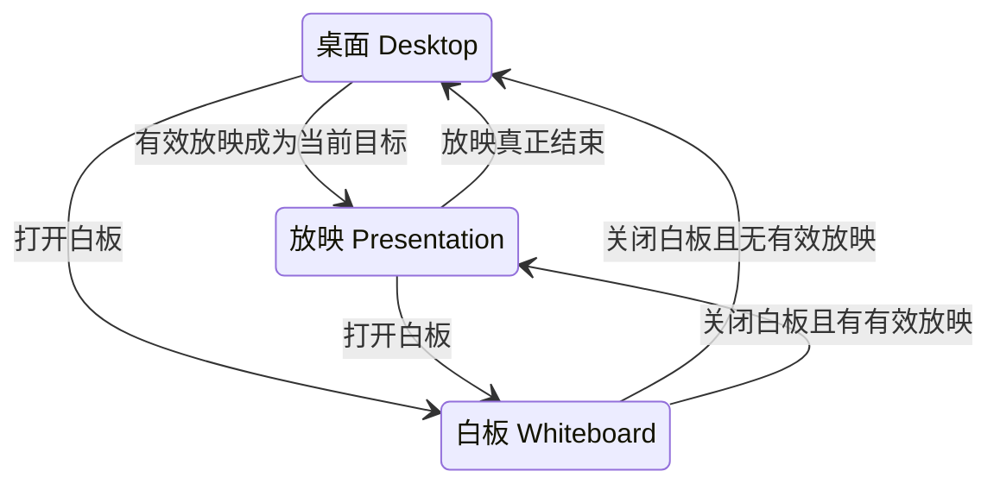

# 最终设计稿：三工作区统一交接

> 用户已明确批准并要求开始实施。本稿取代此前追加的实施方向；旧稿存于research/planning-before-final-state-machine/。原3份未验证产品/测试改动已在批准实施前备份，由本轮方案受控整合。

## 1. 设计决定

- 稳定业务状态只有Desktop、Presentation、Whiteboard。
- 在现有StateMonitoring/业务协调层保留一个场景切换协调者；沿用现有Window owner、Draw3 owner、RenderPipeline owner，不增加线程或通用状态机框架。
- 将“请求目标”“已经完成的工作区”“尚未退休的交接操作”区分为三类事实。主栏、分页、背景消费同一协调快照；稳定业务状态取Committed，准备呈现目标取其中Pending，不再各自宣告当前工作区。
- 白板背景优先复用现有Freeze HWND作为无边框全屏背景，继续保留Mag→Freeze→DrawpadPresentation→Drawpad→Bar/PPT的固定owner链。无需新窗口、reparent、Draw3 Host或device。
- 把场景原生政策合并为一次Window owner交接，复用内部owner/band/顺序核验；周期全局置前与Shell通知独立处理。
- 过渡和Selection不能落笔。工具、文档、首帧和必要窗口结果真实匹配后才开放输入。

## 2. 三态图与事件

| 当前状态/事件 | 请求目标与规则 |
| --- | --- |
| Desktop/PPT打开白板 | Whiteboard；保留源工作区工具/历史，使用同进程当前白板页 |
| Whiteboard关闭 | 按最新可信PPT会话决定Presentation或Desktop，不固定为进入前的旧目标 |
| Whiteboard中PPT开始/结束/换文稿 | 白板保持当前；只更新后台可信放映事实，关闭时再选目标 |
| 切换过程中再次请求 | 合并为最新目标；旧操作仍须真实取消/收束后退休，旧回执不得提交 |
| 同一目标重复请求 | 幂等；不重做面板清理、窗口样式、保存或焦点请求 |
| 白板最小化/恢复 | 工作区仍Whiteboard，只改变显示状态；保持页、历史、工具和Desktop基线 |
| Alt+F4/任务栏关闭白板 | 转为关闭请求，不直接销毁共享Freeze及owned链 |
| 设置显示/隐藏、外部窗口获焦 | 不改变工作区，不触发重建白板或重复激活 |

最小化、无焦点、加载/重试是视图或交接事实，不扩成业务状态。白板在有效PPT会话期间禁止最小化，沿用现有规范。

## 3. 单一权威与必要身份

概念数据只需：

- **Desired request**：最新目标及请求版本；重复同语义请求不新建版本。
- **Committed scene**：已完成工作区及当前显示状态，用于UI/业务投影。
- **Pending handoff**：可选的在途操作和其已有回执，直到完成、恢复或退休。取消回到原目标也不能仅因desired==committed而丢掉它。

优先迁移/复用现有交接epoch，不再另立第二个白板epoch。旧WhiteboardPhase、whiteboardDesired、Bar::whiteboardActive等读取接口可暂保留兼容包装，但其真值只能来自该协调结果，不再作为互相独立的权威写者。

业务请求版本不能替代PPT session/target、slot generation、工具revision、输出/content revision、device epoch或HWND generation。它们是既有资源身份，仍在相应owner边界核验，不能删成一个“ready=true”。

Bridge的目标workspace和Draw3实际应用workspace也必须区分；准备目标不等于UI已提交新场景。旧token/current检查继续拒绝跨完整白板往返的迟到PPT发布。

**准备呈现与稳定业务投影分离，避免等待环：**同一协调快照同时包含Committed和Pending。背景、画布和PPT PageControl允许按Pending目标准备/实际呈现，但其命中与业务操作保持关闭，回执只确认该Pending版本；它们不等待Committed先切过去。尤其W→P时目标页码要先实际呈现并发UI-ready，再与其他真实凭据一起进入最终提交。主栏稳定工作区/工具、Desktop基线写入仍按Committed；准备过程不把Preview当新稳定态。墨迹/需目标ready的业务关闭，合法PPT BasicControl仍按既有会话资格处理，并可经§7仅控制呈现及时完成交接，不能用InkReady门永久禁用它。Pending的UI-ready可保存，但不能单独解除场景切换准入。取消后Preview按最新版本收束，旧准备帧不能再确认新场景。

### 请求版本与现有PPT权限的迁移规则

复用现有交接epoch的递增/奇偶模型：最新目标为Whiteboard时为奇数，非Whiteboard为偶数；有效工作区/白板视图变化按现有方式推进到新的相应奇偶值。同一目标/视图重复请求不推进。这样不增加第二个业务token，但原权限函数改为从协调快照派生，不能只看奇偶放行。

| 事件/状态 | 交接版本与权限 |
| --- | --- |
| 桌面/放映↔白板、取消后回源 | 推进请求版本；Pending真实退休前绘图及旧业务权限仍关闭 |
| Whiteboard显示↔最小化、同态Hide→Show | 视图语义变化也推进版本（仍为奇数）；旧Hide/Show/帧ACK不能确认新视图 |
| 普通PPT翻页/换页、工具更改、输出/设备更新 | 不因此推进工作区业务epoch；继续使用既有PPT target/tool/output/device身份，避免取消合法长按或重置加载预算 |
| 稳定非白板且无Pending | PptInputWorkspaceEpoch仅按既有当前会话/业务资格返回当前偶数epoch；不能绕过其他权限 |
| 正在进入/处于白板（含最小化） | PPT前台场景/相关业务入口继续拒绝，后台事实/存储照常更新 |
| 正在从白板返回非白板 | PptSceneWorkspaceEpoch可给当前返回准备发布同一偶数epoch；PptInputWorkspaceEpoch仍拒绝过渡中的相关墨迹业务，直到合法提交 |

取消后即使desired又等于committed，旧在途owner责任仍保留；补偿按捕获的资源身份、仍持有的责任和最新安全覆盖执行，不要求已取消的旧业务guard重新变成true。窗口系统消息只确认本次最小化/恢复，不另发新意图让自己失效。

## 4. 一条统一切换流程

以下是操作顺序，不是新增四个业务状态，也不要求再存四组布尔标记。

### A. 接纳请求并收尾源输入

- 在现有业务提交边界关闭Host新Down准入，再发布目标工作区/工具。
- 取消原生capture、按现有规则收尾源contact；终态仍排空，不能把过渡中Down积压到切回Pen后补画。
- 一次保存源工具与UI基线；用现有slot/历史保存协议保留源内容。保存失败保留warm数据，不把磁盘写成功当作每次显示/隐藏的前置条件。
- 在交接退休前保留必要源场景资源，迟到保存完成仍按原generation/revision判断是否允许释放。

### B. 准备目标并取得真实完成凭据

- 准备正确文档/页槽和目标工具；实际Draw3 owner确认选择/工具revision，而非只观察Bridge已发布。
- 先通过下节同一场景政策请求取得原生准备回执（目标屏幕、完整HWND/client几何及region），再等待匹配的成功输出；空Selection也必须取得实际auxiliaryFullFrameClean。
- 白板准备真实背景像素；提交旧窗口前必须能区分当前请求的背景帧和旧帧，迟到ULW/Show不得确认新目标。
- PPT墨迹可用仍需可信session/target、CPU/Present与PageControl实际UI-ready匹配。既有Active/BasicControl和Unknown会话事实不等于InkReady：没有可信墨迹target/HWND时可按现有资格显示页码及对象定向翻页/退出，保持画布隐藏/穿透，不伪造墨迹ACK，也不能长期卡在等待不存在target的Pending。后台会话改变重新绑定最新身份，不重置相同目标I/O预算。
- 各owner完成主动发布现有wake/receipt，空场景也必须主动产生所欠的帧，不等待下一笔或鼠标移动。

### C. 一次应用场景窗口政策

建议用同一个场景政策请求取代StateMonitoring分别调用fullscreen/mode/topmost/穿透再拼接成功条件。它不是要求Window owner阻塞到渲染结束；同一请求按两次无等待owner回执与B交错：

1. **准备窗口政策**：应用所需geometry/region/样式/目标band，报告实际目标几何和HWND身份，然后返回消息循环；需要隐藏的共享表面只做必要隐藏。
2. **准备呈现**：Render/Host/PageControl使用上一步的实际输出目标完成匹配帧/工具/UI ACK，Window owner不持锁等待它们。
3. **完成窗口政策**：同一请求确认准备身份/几何仍当前，显示或隐藏相应表面并读回真实结果，发布Native完成回执。如果最终尺寸/region或device变化影响输出身份，返回准备并重取匹配帧，不能沿用旧ready。

这两次轻量owner调用属于同一政策交接，不是两组独立epoch或业务状态。owner内部保留现有安全物理顺序：离场先撤显式全屏，再离开白板样式、恢复返回场景band和穿透。内部使用本次目标政策参数；实际准备/完成结果在相应回执发布，不让其他模块根据半写入的mode/topmost/fullscreen缓存猜工作区。

- 当前场景窗口政策以完整目标请求为输入，只有必要状态不同才写；保留未完成FRAMECHANGED的实际刷新责任。
- 只核验目标owner链、实际band、背景/画布显隐、几何、必要样式/region、Bar>PPT和当前代际。复用已有内部相对排序。
- 不要求所有受管窗口全局相邻，不要求Bar赢得全局TOP，不等待Shell COM成功或foreground许可。
- 重复同目标仅继续未完成的物理操作；真正失败只恢复该交接实际修改的背景/画布/政策，不对整个Bar/PPT组无条件Hide/FRAMECHANGED/Show。
- 保持现有回执Queued/Executing/Committed/Rejected/Expired/Cancelled和owner恢复责任；超时停止等待不等于操作未发生，安全Hide/穿透覆盖不能被旧恢复撤销。
- 原生写入和补偿绑定本次捕获的HWND/generation及实际写集；父/窗口退休后只收束存活旧目标，不能按当前role重新取新句柄来承接旧CanvasPolicy。
- 普通Desktop/PPT周期全局Refresh及Setting自身带内Raise保持独立；其失败不能撤销已完成场景或重建白板。

### D. 提交场景并开放合法输入

正常墨迹可用提交必须满足：目标身份仍当前、真实画面/工具/必要背景与原生政策完成，PPT另需匹配UI-ready。Presentation仅控制可用及受保护安全退场按§7例外执行，不能被此正常门反向锁死。

随后只发布一次Committed scene，主栏、分页、背景和工具外观消费同一版本。Bar恢复沿现有Desktop基线算法；PPT↔Whiteboard不重拍或提前恢复Desktop基线。必要UI命中/页码仍沿现有实际呈现身份保护，过期帧不能接纳旧操作。

交接真实完成/安全退休后才清Pending并由同一结果计算准入。过渡fence只OR到现有新Down准入，不阻断ControlWake、目标准备、帧/UI ACK和终态drain；协调锁只保护快照，不跨Window同步调用或Host/Render等待。结束过渡只撤去自身Pending原因，不直接将整体AdmissionBlocked清零或清掉加载/恢复/fatal等其他闭门原因。Selection始终禁止新绘制；其他工具还须通过原有加载/恢复/fatal/呈现门。UI各窗口物理呈现不可能成为一条Win32原子调用：设计保证统一逻辑版本、真实owner结果和过渡无误输入，不承诺跨线程零帧差。

显式进入/恢复后的异步激活最多一次，绑定本次请求。激活失败不回滚、不延迟Committed，不周期重试。白板后台就绪时也完成切换；用户主动操作其他程序后不抢回焦点。

## 5. 白板完整全屏、任务栏与焦点

### 当前事实与目标

Whiteboard.cpp的PrimaryBounds本来直接取Display.primary.bounds（native rcMonitor）；Scene使用完整宽高、0圆角/0描边、fillOpacity=1。现有1px主要在旧Freeze/Magnifier定格尺寸，以及Desktop/PPT双画布的底行region。

本方案把完整白板矩形作为强约束，复用Freeze HWND的普通顶层owned popup能力；隐藏Mag owner的减1尺寸不会裁剪owned popup。窗口仍无标题栏、唯一APPWINDOW任务栏锚点，NOTOPMOST，Drawpad保持辅助TOOLWINDOW且白板时可激活；不改变Setting线程或把Setting标成全屏。

| 场景 | 背景/画布范围 | Shell与任务栏策略 |
| --- | --- | --- |
| Desktop/PPT | 白板背景隐藏；共享双画布保留完整client，实际region排除底部1物理像素 | 保持NonRude与普通overlay策略，撤销白板显式全屏 |
| Whiteboard正常显示 | 背景恰等主屏rcMonitor；白板双画布不保留底部缝隙 | 按当前可激活Freeze/Drawpad批次重申全屏；普通非置顶窗口规则 |
| Whiteboard最小化 | 不改变文档/工作区；隐藏必要成员，保留单一任务栏锚点和现有Resume行为 | 当前组FALSE；恢复时再提交最新TRUE |

Shell API只承诺相应窗口active时的全屏任务栏让位。完整尺寸和MarkFullscreenWindow不会赋予foreground权；用户正在其他应用中操作时不保证白板强行盖过它/任务栏。验收应区分“白板后台完成”与“白板为前台时任务栏让位”。

Shell继续由现有独立worker发送最新绝对状态；旧TRUE不能覆盖新FALSE。正常隐藏/退出前撤标记，Desktop/PPT仍明确NonRude，不能只调用MarkFullscreen(FALSE)就当作禁止自动全屏。

## 6. 最小化、快速重入与PPT变化

- 最小化仅关白板视图与输入；主栏按现有任务栏居中底栏显示Resume，不清Desktop基线。
- 恢复同一页时重新确认真实bounds/visible/非iconic和所欠背景帧，不重建文档或重放进入。
- 退出/取消的Hide及inactive ACK优先于minimized绘制暂停；从最小化关闭不能等待先Restore。
- 原生iconic恢复沿Win32文档使用SW_SHOWNOACTIVATE，不使用手工清WS_MINIMIZE或未证实的隐藏placement技巧。该系统调用会短暂显示既有锚点，owner立即重隐并在同一交接中继续核对；过渡输入门仍关闭，最终显示／开输入仍等必要真实输出。owned窗口可能随owner恢复，不能把准备阶段绝对零瞬态显现当系统保证。此边界不等于允许周期恢复或重复抢焦点。
- 白板关闭途中又打开：最新请求胜出，但旧Hide/模式写入必须按已有回执退休或补偿；旧帧/旧Shell TRUE/旧聚焦不能进入新请求。
- 白板期间PPT结束只更新Primary事实；关闭时返Desktop。PPT开始/换文稿也只更新背景目标，不抢走白板。
- 返回途中Primary目标变化：在最终提交边界再核验目标身份，旧结果不提交；一次收束后准备最新目标，不循环清主栏或丢失源内容。

## 7. 数据和失败结果

### 不变的数据合同

- Desktop/Presentation/Whiteboard工具、文稿、历史、Clear/Undo/Redo/slot隔离保留；普通关闭不强制Selection，恢复目标记忆，未初始化记忆才默认Selection。
- PPT的NotFound/Loaded/IoError是关键加载结果，不把Conflict/SourceChanged/Invalid折成NotFound；同目标四次250/500/1000/2000ms预算保留。
- 保存失败/未决保留warm/dirty lane；旧completion不能释放新内容。白板同进程关闭重开保留多页与主题，旧文件不自动恢复。
- fatal/consumer故障是独立单调门，普通切换、重试或UI提交不能清掉。

### 四种操作结果，不增加第四个工作区

1. **正常提交**：真实目标ready与Native完成，统一切入目标场景。
2. **Presentation仅控制可用**：既有会话资格允许BasicControl，但缺少可信墨迹target/HWND时，实际隐藏/穿透画布并完成必要窗口交接后，可提交Presentation的仅控制呈现；对象定向翻页/退出按既有资格可用，InkReady及墨迹输入仍关闭。以后取得可信target按现有目标/Frame/UI-ready链开放墨迹，不推进工作区epoch。Unknown保持既有会话判定，不擅自当作真正结束。
3. **取消/可恢复操作失败**：停止无界自动发起新尝试；仅在源场景仍有效且真实恢复后才回源并结束交接。源PPT已真正结束/换会话时，旧物理补偿可以收束，但不能复活旧Presentation；按最新合法Primary目标重新准备或安全退场。自动预算/等待期限不保证Win32调用可抢占或物理补偿必在时限内完成。恢复仍失败时Pending/现有Recovery继续持有同一实际责任，Committed不伪造成功，输入保持关闭，明确呈现可重试故障，不能不断重做Show/Hide或因超时丢掉责任。
4. **受保护目标故障/fatal**：按现有规范，核对当前完整故障token并取得真实Hide/穿透等安全清理凭据后，可结束白板窗口/UI交接，进入目标工作区既有恢复呈现。此分支不等待已停消费者的普通工具/Frame/UI-ready，不清fatal，不伪造ready或消费旧token；剩余实际责任仍保留。若物理隐藏未成功，不提前确认。

恢复未退休时的控制边界：

| 允许继续处理 | 不得越过旧责任 |
| --- | --- |
| 主栏/设置既有独立业务与渲染、状态/错误展示、与恢复写集不相交的Bar/PPT几何更新 | 画布Show、关闭穿透、新场景原生政策以及会改当前owner链的设置attach/detach |
| 按当前HWND generation锁存的Hide/开启穿透、capture取消、退出停机 | 旧snapshot不能反向显示窗口或重新开输入 |
| 用户取消/新目标可被接纳；用现有恢复token请求重试 | 取消不等于旧物理操作已撤回；新目标侵入性写入要等旧责任真实退休，或走既有受保护清理规则 |

场景窗口恢复的实际写集不包含Bar/PPT普通几何与独立Settings内容，才允许上述安全UI更新；这属于实施中必须验证的恢复域边界，不以现有全overlay屏障已自动满足它为前提。

受保护故障的安全退场只确认实际隐藏/安全输入已完成，不代表目标Frame/Native正常政策ready；剩余物理责任仍由已有owner Recovery持有，不因UI返回目标工作区而消失。新场景普通Show/重新开输入仍须通过真实恢复。Desktop/Whiteboard通过现有通知及设置绘图页的当前token重试，不只依赖PPT分页。

## 8. 保留与移除

| 保留的必要事实 | 移除的错误耦合/重复权威 |
| --- | --- |
| 三态真实文档/工具与单Host | 多处bool各自宣告当前workspace |
| 一次业务请求版本及底层真实身份 | 仅靠布尔相等接受旧回执/把所有身份压成一个epoch |
| 成功Present、必要背景与native结果 | foreground/全局TOP/全局连续/Shell成功作为完成门 |
| 原生在途副作用的真实恢复 | 一次纯排序失败触发整组画布/主栏Hide和重建 |
| 后到安全Hide/穿透与新请求取消 | 每次重试重收面板、重抢焦点、等待下一笔才唤醒 |
| PPT UI-ready与真实load结果 | 超时假成功/IoError创建空白页/旧目标恢复新场景 |

## 9. 实现范围与现有冻结补丁

已验证基线是ab79dcb9。冻结的Window.cpp、Window.ZOrderPolicy.h、window_tests.cpp三份补丁只作为候选素材；审核后逐块保留/调整，不直接堆叠为最终方案。批准实施后由负责Window的实现者逐块取舍，用户CSO与旧设置任务仍不动。

预计限于IdtState协调、Window场景政策/背景、Draw3既有准入与实际Selection Down、Bar/分页快照消费及相应测试/规范。PptCOM ABI、shader、文件格式、共享device和其他设置UI不改。

规则映射：whiteboard.md（基线/最小化/存储）；rendering-and-ui.md（owner链、线程、离场物理顺序、Setting）；draw3-integration.md（单Host/三槽/输出/Selection/1px）；canvas-freeze-boundaries.md（故障token、回执、安全覆盖、Shell）；ppt-interop/native-session-ui3.md（可信会话、页码实际UI-ready）。审核后实施前同步拟变更的协调/窗口政策条目，其余保留。

## 10. 验证与审核边界

设计只经源码/规范/官方文档审查，未修改产品，未构建/运行测试或GUI。后续验证必须调用生产协调/Window政策/输入接缝，不复制独立假状态机；私有Service/USER32未动态覆盖之处明确标记。

官方参考：[MarkFullscreenWindow](https://learn.microsoft.com/en-us/windows/win32/api/shobjidl_core/nf-shobjidl_core-itaskbarlist2-markfullscreenwindow)、[SetForegroundWindow](https://learn.microsoft.com/en-us/windows/win32/api/winuser/nf-winuser-setforegroundwindow)。
