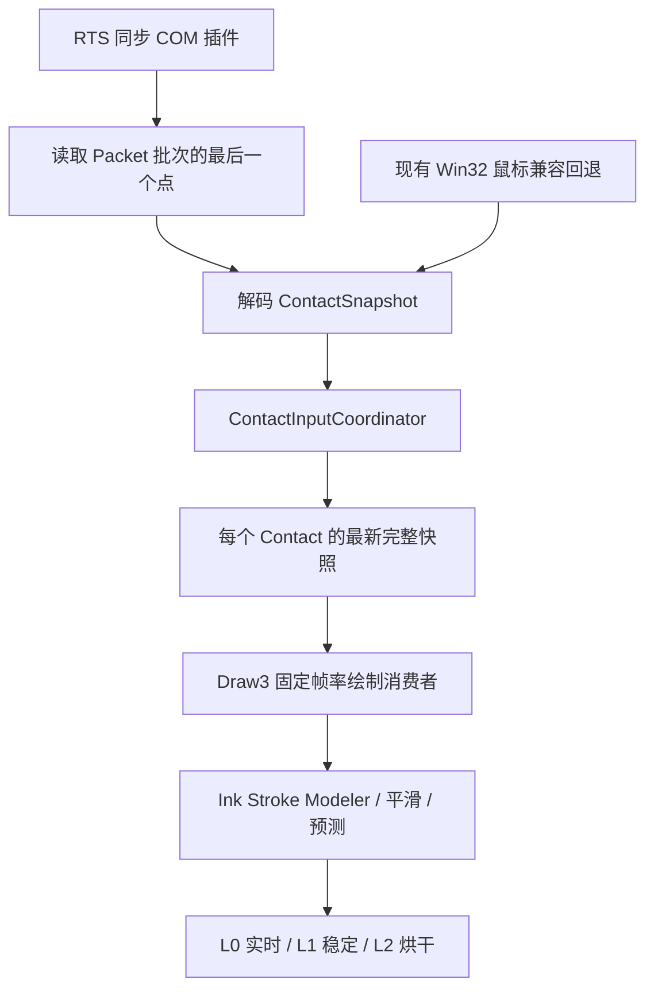
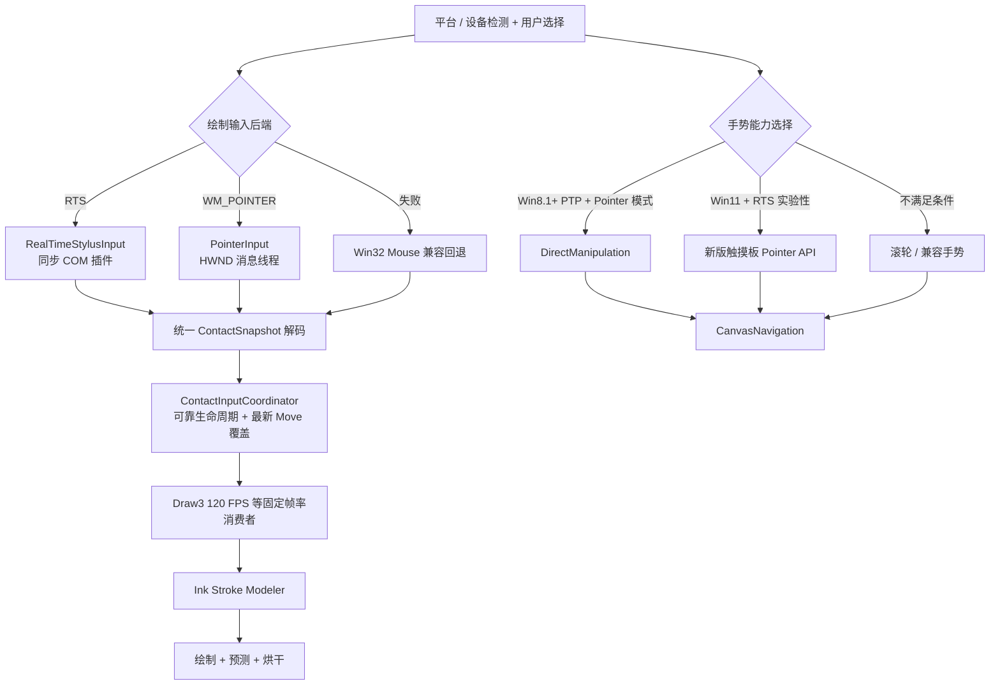

# Inkeys3 输入系统未来规划：RTS / WM_POINTER / DirectManipulation

> **讨论日期：** 2026-11-12\
> **性质：** 技术规划与实施备忘录（非已完成功能列表）\
> **代码审阅基准：** [`Alan-CRL/Inkeys` — `dev`](https://github.com/Alan-CRL/Inkeys/tree/dev)，本次审阅时 HEAD 为 `215184d4e096f262b8b4bf11471cb5b14fa53884`（2026-11-10 提交）\
> **目标平台：** Windows 7 SP1 及以上；保留现有 C++20 / Draw3 / D3D11 / D2D1.1 架构\
> **原则：** 不破坏现有低延迟 RTS 链路；输入后端可选；保持手写、触摸、触摸板导航的功能完整性；所有后端向同一 Draw3 输入模型输出。

## 1. 总体目标与核心结论

准备为 Inkeys3 引入 **RealTimeStylus（RTS）与 WM_POINTER 双输入后端**，并根据操作系统、设备类型和用户选择决定输入方式。引入 **DirectManipulation（DM）** 处理适用环境下的触摸屏/精确式触摸板导航；Windows 11 + RTS 则额外研究新版触摸板 Pointer API，以尽可能在保留 RTS 的同时实现触摸板交互。

- **教师大屏一体机：默认 RTS**。大屏课堂书写和触摸擦除优先保证现有兼容性及低负载输入处理；用户仍可在 Windows 8+ 上手动改为 WM_POINTER。
- **笔记本：Windows 8+ 默认 WM_POINTER**。手写笔/触摸屏输入交由现代 Pointer 路径，适用系统和硬件上配合 DM 处理触摸板手势；用户仍可切换 RTS。
- **Windows 7 SP1：仅 RTS（以及现有 Win32 鼠标回退）**。WM_POINTER 和 DirectManipulation 不作为 Win7 可用方案。
- **用户可明确选择后端**：`自动 / RTS / WM_POINTER`。WM_POINTER 不支持的系统需禁用该选项，而不是允许配置后运行失败。
- **固定帧率 Draw3、Ink Stroke Modeler、ContactInputCoordinator 保持不变**：新增的是输入生产者与输入路由，不重构绘制引擎。

> **重要边界：** 下文标为“拟定支持”“实验性”的组合并不表示已经验证成功。尤其是 **Windows 11 的新版触摸板 Pointer API 与同一 HWND 的 RTS 是否能共存**，尚没有在本次代码审阅中得到实机验证，不能直接承诺。

## 2. 已确定的产品策略与系统兼容矩阵

| 系统 / 场景 | 默认绘制输入 | 导航 / 触摸板策略 | 用户手动选择 | 备注 |
|---|---|---|---|---|
| Windows 7 SP1，任意设备 | RTS | 传统滚轮、旧式消息等回退 | RTS | 保留现有 Win32 鼠标兼容回退；不提供 WM_POINTER / DM |
| Windows 8.0，教师大屏 | RTS | RTS 触摸输入与现有手势实现 | 可选 WM_POINTER | DM 本身已存在，但不等于支持精确式触摸板 |
| Windows 8.0，笔记本 | WM_POINTER | 触摸屏可研究 DM；触摸板以传统鼠标/滚轮方案回退 | 可选 RTS | Windows 8.0 不按“精确式触摸板 + DM”承诺 |
| Windows 8.1，教师大屏 | RTS | 不在 RTS 模式启用 DM（产品策略） | 可选 WM_POINTER | 优先稳定书写 |
| Windows 8.1，笔记本 | WM_POINTER | **具备 Precision Touchpad 的设备**可用 DM；否则回退滚轮 | 可选 RTS | PTP 需确认设备支持 |
| Windows 10，教师大屏 | RTS | 不在 RTS 模式启用 DM（产品策略） | 可选 WM_POINTER | 保留 RTS 优先级 |
| Windows 10，笔记本 | WM_POINTER | PTP + DM；否则回退滚轮/传统手势 | 可选 RTS | RTS 模式不启用 DM |
| Windows 11，教师大屏 | RTS | 默认不依赖 DM；若有触摸板，研究新版 API | 可选 WM_POINTER | 仍优先 RTS |
| Windows 11，笔记本 | WM_POINTER | PTP + DM | 可选 RTS | RTS 模式可尝试新版触摸板 API，失败则回退 |

**明确区分两个版本事实：**

1. **DirectManipulation 从 Windows 8 引入**，可用于触摸交互。
2. **Windows Precision Touchpad 从 Windows 8.1 起得到平台支持**；因此应把“基于 DM 的精确式触摸板交互”最低系统版本设为 Windows 8.1，而不是 Windows 8.0。

**对 RTS + DM 的约束是本项目产品政策，而不是断言 Windows API 在所有情况下物理上不兼容：** Windows 10 及以下选择 RTS 时，不主动启用 DM；Windows 11 + RTS 单独开展新版触摸板 API 兼容实验。实际选择结果还取决于硬件、驱动与窗口输入路由。

### 建议设置界面

- **设备场景**：`自动 / 教师大屏 / 笔记本`。只决定默认值及场景相关策略。
- **绘制输入后端**：`自动（推荐） / RealTimeStylus / Windows Pointer`，显示当前实际生效后端及回退原因。
- **导航方式**：自动按操作系统、触摸板能力和所选输入后端选择；不让用户为了正常触摸板操作理解多个 Windows API 名称。
- **高级诊断**：展示 `RTS Extended / RTS Basic XY / WM_POINTER / Win32 Mouse Fallback`、设备分类、是否检测到 PTP、DM 是否实际启用、触点数量及取消原因。

> 不建议复用现有 `SpeedEraser::DeviceMode { LargeScreen, Laptop, Automatic }` 来代表“输入后端选择”；当前该枚举是橡皮响应与显示场景配置，不应和 RTS / WM_POINTER 绑定为一个概念。

## 3. 从 dev 代码确认的当前架构

### 3.1 现有核心路径



相关源文件：

- [`Draw3.RealtimeStylus.cpp`](https://github.com/Alan-CRL/Inkeys/blob/dev/Inkeys/Inkeys/Drawing/Draw3/Draw3.RealtimeStylus.cpp)：RTS 初始化、同步插件、Packet 解码、设备识别、接触发布。
- [`Draw3.ContactInput.cppm`](https://github.com/Alan-CRL/Inkeys/blob/dev/Inkeys/Inkeys/Drawing/Draw3/Draw3.ContactInput.cppm) 及 [`Draw3.ContactInput.cpp`](https://github.com/Alan-CRL/Inkeys/blob/dev/Inkeys/Inkeys/Drawing/Draw3/Draw3.ContactInput.cpp)：Down / Move / Up / Cancel 协调、跨线程快照、生命周期与唤醒。
- [`Draw3.DrawingController.cpp`](https://github.com/Alan-CRL/Inkeys/blob/dev/Inkeys/Inkeys/Drawing/Draw3/Draw3.DrawingController.cpp)：固定帧消费、Ink Stroke Modeler、末端处理、渲染调度。
- [`Draw3.InkPrediction.cpp`](https://github.com/Alan-CRL/Inkeys/blob/dev/Inkeys/Inkeys/Drawing/Draw3/Draw3.InkPrediction.cpp)：Modeler 参数、压力和姿态模型。
- [`Draw3.Host.cpp`](https://github.com/Alan-CRL/Inkeys/blob/dev/Inkeys/Inkeys/Drawing/Draw3/Draw3.Host.cpp)：输入模式初始化、失败回退和关闭顺序。
- [`Draw3.WindowControl.cpp`](https://github.com/Alan-CRL/Inkeys/blob/dev/Inkeys/Inkeys/Drawing/Draw3/Draw3.WindowControl.cpp)：HWND 消息处理、Pointer 光标/触觉、鼠标兼容。
- [`Input/UiPointerInput.cpp`](https://github.com/Alan-CRL/Inkeys/blob/dev/Inkeys/Inkeys/Input/UiPointerInput.cpp)：**已经有一套 UI 用的 Pointer/Touch 路由**，但它并不是 Draw3 当前正式的手写数据后端。
- [`Draw3.SpeedEraser.cpp`](https://github.com/Alan-CRL/Inkeys/blob/dev/Inkeys/Inkeys/Drawing/Draw3/Draw3.SpeedEraser.cpp)：速度橡皮与触摸面积单位变换。
- [`Draw3.CanvasNavigation.cpp`](https://github.com/Alan-CRL/Inkeys/blob/dev/Inkeys/Inkeys/Drawing/Draw3/Draw3.CanvasNavigation.cpp)：当前画布平移和惯性逻辑。

### 3.2 当前 RTS 已经实现的能力

- `SetDesiredPacketDescription` 优先请求完整九项数据，失败可回退基础 X/Y。
- `IRealTimeStylus3::put_MultiTouchEnabled(TRUE)` **已调用**，并读取状态验证；这不是需要补做的新需求。
- `IStylusSyncPlugin` 在独立 RTS 回调路径中采集数据，不依赖 Draw3 的帧率。
- `StylusDown` / `Packets` / `StylusUp` 维护每个 `(tabletContextId, contactId)` 的接触身份。
- `Packets()` 通过 `packets + (packetCount - 1) * propertyCount`，仅解码**本次回调批次的最后一个 Packet**。
- 多个回调间的 Move 再由 `ContactInputCoordinator::PublishMove()` 覆盖该触点最新状态，Draw3 帧循环只在 `sequence` 变化时消费快照。
- 触点终态与 Move 的语义不同：Down 可靠入队；Move 可覆盖和争用时丢弃；Up/Cancelled 需要可靠关闭。
- 已采用奇偶 `sequence` 保证跨字段快照一致性：写入时为奇数，写完后为偶数；读者校验前后值相同。

**关键措辞：** 当前并非“RTS 每帧只取最后一个 Packet”，而是“RTS **每次 Packets 回调**取最后一个点，随后协调器在多个回调之间覆盖最新 Move，Draw3 **每帧**只消费最新状态”。新后端应保持这两级合并的语义。

### 3.3 当前 Draw3 输入契约

`ContactSnapshot` 现有主要字段为：

```cpp
struct ContactSnapshot {
    PointF position;
    float pressure;               // 未知值为 -1
    float tilt;                   // 弧度；未知值为 -1
    float orientation;            // 弧度；未知值为 -1
    bool isInvertedCursor;
    SizeF contactSize;            // 校验成功后为 Canvas 像素
    SizeF rawContactSize;         // 保留来源原始值
    ContactAreaUnits contactAreaUnits;
    int64_t qpc;
    ContactPhase phase;           // Down / Move / Up / Cancelled
    uint64_t sequence;            // 协调器管理
    uint64_t admissionRevision;   // 协调器管理
    SpeedEraser::InputSource source;
};
```

应将该结构视为双后端的**统一输出契约**，而非重写内部模型。

## 4. RTS 与 WM_POINTER 字段迁移矩阵

| Draw3 所需信息 | 当前 RTS 来源 | WM_POINTER 获取方式 | 迁移注意 |
|---|---|---|---|
| X / Y 位置 | `GUID_X`、`GUID_Y` | `POINTER_INFO` 的原始/普通屏幕坐标 | 转换至 Draw3 Canvas 坐标，处理多屏、DPI、窗口偏移 |
| 压力 | `NORMAL_PRESSURE` + `PROPERTY_METRICS` | `POINTER_PEN_INFO.pressure` | 按 `PEN_MASK_PRESSURE` 判断有效性，再以 1024 归一化到 0~1 |
| 双轴倾斜 | RTS `X_TILT / Y_TILT` | `tiltX / tiltY` | 按有效掩码检查，从角度转弧度，核对 X/Y 正负方向 |
| 倾斜总角与方向 | RTS Azimuth/Altitude 或 XY Tilt | XY Tilt 推导 | 可以复用现有数学公式；**不要把 `rotation` 当 Azimuth** |
| 反向笔尾 | `bIsInvertedCursor` | `PEN_FLAG_INVERTED` | 还需检查是否对应橡皮端 `PEN_FLAG_ERASER` 行为 |
| 触摸面积 | `WIDTH`、`HEIGHT`、单位元数据 | `POINTER_TOUCH_INFO.rcContactRaw` | 先验证 `TOUCH_MASK_CONTACTAREA`，再以屏幕像素转画布像素 |
| 原始接触宽高 | RTS Digitizer 单位 | 原始接触矩形宽高（屏幕像素） | **两者原始单位不相同**，不能直接套用 RTS 长度变换 |
| 设备来源 | TabletContext / Cursor / Tablet 属性 | `sourceDevice`、Pointer ID、Device APIs | 映射为内部稳定的 Context ID；不要截断 HANDLE |
| 接触阶段 | StylusDown / Packets / StylusUp | Pointer Down / Update / Up | CaptureChanged / Cancelled 必须单独映射到 Cancelled |
| 时间 | RTS 回调时 `QueryPerformanceCounter()` | 回调时 QPC；可研究 `PerformanceCount` | 初版保持一致时间语义，后续实测原生时间戳 |
| Hover | `InAirPackets` / InRange | Pointer 的 `INRANGE`、非 `INCONTACT` | Hover 只更新光标，不能创建真实书写接触 |
| `sequence`、`admissionRevision` | Contact 协调器 | 同一协调器 | 不由 Pointer ID/Frame ID 代填 |

**触摸面积是专项风险：** 新版 Pointer Touch `rcContactRaw` 已是屏幕像素矩形，而 RTS 当前依赖轴属性、物理单位和分辨率计算到 Canvas 像素。应新增独立 `PointerContactAreaDecoder`，并保留 `Missing / Invalid` 等状态以接入现有手掌橡皮回退逻辑。设备不报告面积时，不能伪造一个可信面积。

**笔姿态专项风险：** Pointer Pen 提供 XY Tilt，不等于总能直接得到 RTS 偏好的 Azimuth/Altitude。应复用 `DecodeStylusAngles` 的 XY Tilt 推导路径，并在四方向倾斜及笔尾测试中验证约定。

## 5. 新版推荐架构



### 5.1 新增后端，而不是双后端同时争夺同一触点

建议新增：

- `Draw3.PointerInput.cpp/.cppm`：窗口消息解码与稳定的 Pointer 接触身份映射。
- `PointerContactAreaDecoder`：Pointer 触摸矩形的有效性检查与画布坐标转换。
- `InputBackendSelection`：产品配置、操作系统与设备能力决策、当前实际后端和故障回退。
- `TouchpadNavigationAdapter`：将 DM 或 Win11 新接口的手势转换为 CanvasNavigation 的导航命令。

现有 `ContactInputCoordinator`、`DrawingController`、Modeler 和渲染链应尽量不改。**在同一接触数据路径上，只允许一个正式绘制生产者，避免 RTS + WM_POINTER 双重发布 Down/Move/Up。**

### 5.2 WM_POINTER 的线程规则

RTS 的同步插件可以在 RTS 提供的高优先级回调线程获取数据；WM_POINTER 则通过目标 HWND 的消息线程接收事件。Pointer API 对目标消息和调用线程存在约束。

建议 WM_POINTER 路径按以下步骤实现：

1. `WndProc` 收到 `WM_POINTERDOWN / UPDATE / UP`。
2. **当场**通过 `GetPointerInfo` 和 `GetPointerPenInfo` / `GetPointerTouchInfo` 获取数据，完成快速解码并复制为值对象。
3. 对真实接触调用 `PublishDown / PublishMove / PublishUp`；对接管、取消和异常调用 `PublishCancelled` 并清理路由。
4. 立即返回消息循环；不能把复杂墨迹模型、GPU 工作、日志格式化等放在 WndProc 的热路径。
5. Draw3 继续独立以目标帧率消费最新快照。

**不要**先把 Pointer ID 交给 Draw3 渲染线程，再在那里调用 `GetPointerPenInfo()`：Windows 的 Pointer 查询与接收消息的 HWND/线程及消息时机相关，跨线程延迟查询不可靠。

### 5.3 最新点与模型消费策略：明确保留

采用“**状态可靠，移动可合并，模型按帧推进**”原则：

- 对 `WM_POINTERUPDATE`，初版直接读取当前消息关联的最新 Pointer 状态，不必解码全部历史点。
- `PublishMove()` 只更新**对应触点**的一份最新状态；多点触摸不能全部混成一个最新点。
- Down、Up、Cancelled 是不可丢失的状态边界；即使一个接触在绘制帧间完成，也要正确记录生命周期和最终坐标。
- 最新点覆盖包括位置、压力、姿态、面积和时间，必须是同一次采样的一致快照。
- 保留当前 Ink Stroke Modeler 的时序、速度橡皮处理、末端修复与预测逻辑。

`GetPointerPenInfoHistory()`、`GetPointerTouchInfoHistory()` 等 API 可以留作未来可选能力。若需要读历史，注意历史数组不是简单的正序连续点列表；不能不经排序或验证就把数组末尾当最新值。

**质量取舍：** 仅保留每帧最新点可能漏掉帧间的急转折。当前优先保持轻量、避免积压；未来如要改善高曲率笔迹，可增加“每帧保留重要转折点”的可选模式，但本轮迁移不要求改变现有算法。

### 5.4 统一时间戳策略

当前 RTS 使用回调接收时的 QPC；Pointer 的 `POINTER_INFO.PerformanceCount` 则可能反映不同采样时刻。两者不能未经验证直接混在同一逻辑中。

**第一阶段**：Pointer 后端沿用 `QueryPerformanceCounter()` 得到 `snapshot.qpc`，保持与 RTS 的既有语义一致。\
**后续性能专项**：记录原生 `PerformanceCount` 与回调接收 QPC，评估是否可通过统一的单调时钟转换改善速度计算、模型准确性及端到端延迟。每个 contact 的时间必须单调。

### 5.5 Contact 身份与来源映射

建议新后端维护 `(sourceDevice, pointerId, backendGeneration) → (internalContextId, internalContactId)`，并在 Down 时锁存来源。不要把 `HANDLE` 直接截断成 32 位整数。`source` 还需要携带设备分类和映射显示器信息，以保证速度橡皮选择正确的触控响应模型。

### 5.6 与已有 UI Pointer 的边界

仓库中的 `Input/UiPointerInput.cpp` 已处理部分 Pointer/Touch 事件；`Draw3.WindowControl.cpp` 也已经在处理 Pointer 光标、触觉反馈和部分鼠标提升消息。

新后端应在窗口 owner 层统一分发规则，避免：

- UI Pointer 与 Draw3 Pointer 重复识别同一事件；
- 将触摸/笔提升产生的兼容鼠标消息误当成额外手写接触；
- 光标、触觉和书写生命周期状态不同步；
- RTS 仍开启时，又把同一接触的 WM_POINTER 送入正式绘制队列。

## 6. DirectManipulation 与 Windows 11 特殊触摸板方案

### 6.1 WM_POINTER + DM：正常路线

- **Windows 8.0**：DM 可用于兼容的触摸屏交互，但不承诺旧式笔记本触摸板经 DM 提供精确式手势。
- **Windows 8.1+**：对于真正的 **Precision Touchpad**，优先研究 DM 的平移 / 缩放 / 惯性；若是传统触摸板，回退鼠标滚轮、水平滚轮等兼容输入。
- 同一触摸接触可能被 DM 接管，窗口后续不再按普通 `WM_POINTERUPDATE` 路径接收到完整触点序列；必须处理捕获权变化及取消行为。
- DM 输出的是导航变换，不应被转成手写笔迹。触摸板接触与触摸屏上用于书写的触点必须区分。

### 6.2 Windows 10 及以下 + RTS

按已确定产品策略，**不启用 DM**。如果设备需要触摸板导航，使用仍可获得的 Win32 滚轮等兼容路径；不要因此关闭 RTS 书写。

### 6.3 Windows 11 + RTS：实验路线

研究 Windows 11 新的 `RegisterTouchpadCapableWindow()`、`GetPointerTouchpadInfo()`、`GetPointerFrameTouchpadInfoHistory()` 等接口。希望做到：**RTS 继续负责书写，触摸板手势由新版 Pointer 路径负责**。

但需要先实测：

- 同一 HWND 绑定 RTS 后，是否仍能收到新式触摸板 Pointer 消息；
- 如不能，单独窗口/路由设计是否实际可行；
- 新接口取得的是触摸板设备相对坐标，不能直接视作屏幕触摸坐标；
- 后端切换、焦点、捕获改变、窗口穿透与 Inkeys 的置顶/多窗口体系是否相容。

此能力**未验证前不能标为正式兼容**。失败则安全回退到滚轮/传统消息，并保留 RTS 书写功能。

### 6.4 画布平移与缩放的区别

现有 `CanvasViewportState` 主要表达 `x/y` 平移；如果只做 DM 平移，适配 `CanvasNavigation` 的工作相对独立。若还要做 **双指缩放**，必须进一步设计缩放比例、缩放中心、屏幕与画布变换、笔迹坐标和缓存/脏区更新，不是仅接入 DM 即可完成。

## 7. 输入延迟与性能的判断原则

- RTS 同步插件有独立回调路径，对 UI 消息线程卡顿有明显架构优势。
- WM_POINTER 并不天然“高延迟”，但依赖 HWND 消息线程及时处理；如果该线程忙，输入信息会晚到达协调器。
- 无论哪种后端，Draw3 仍按固定目标帧率消费输入；**输入采集频率和渲染帧率应继续解耦**。
- 最新点覆盖解决的是内部数据积压与处理成本问题，不能消除系统消息线程自身已排队带来的延迟。
- 切勿给 RTS/WM_POINTER 的性能差异预设一个固定毫秒数；应在同机、同工具、同负载下对比。

建议的性能计数项：接触 Down 至入队耗时、Move 新鲜度、单帧消费年龄、模型调用成本、实际呈现时间、消息线程繁忙时的最大延迟、帧间丢点/合并数、取消率及输入源切换成功率。

## 8. 分阶段实施计划

### P0：明确输入后端配置与契约（设计阶段）

- [ ] 定义独立的 `InputBackendPreference`（Auto / RTS / Pointer）与生效状态枚举。
- [ ] 定义默认选择矩阵：教师大屏优先 RTS、Win8+ 笔记本优先 Pointer、Win7 只能 RTS。
- [ ] 设计 Pointer 来源身份、ContactSnapshot 字段语义、时间戳、取消事件的严格契约。
- [ ] 核对 Win7 兼容：新 Win8+ API 使用动态解析或不会在 Win7 加载时触发解析失败的机制。
- [ ] 明确 RTS / Pointer 切换时的停产、Drain、Cancel、重置顺序；阻止旧代生产者污染新代状态。

**完成标准：** 两后端可以无歧义地输出相同 `ContactSnapshot`，选错或不支持系统时能够正常回退。

### P1：WM_POINTER 绘制后端 MVP（最高开发优先级）

- [ ] 新增 Pointer 输入模块，接通 `WndProc` 到 `ContactInputCoordinator`。
- [ ] 支持 Pen/Touch Down、Move、Up、Cancelled、Hover，完成 Pointer ID 与设备来源绑定。
- [ ] 支持压力、双轴倾斜、笔尾/橡皮标志、接触面积及未知字段回退。
- [ ] 延续“每个回调最新点 + 每个 Contact 最新快照 + 固定帧消费”的压缩逻辑。
- [ ] 保证 RTS、Pointer、兼容鼠标不会重复发布同一触点。
- [ ] 验证窗口缩放、多显示器、DPI、切换页面、白板/PPT、输入被捕获时的异常终态。

**完成标准：** Pointer 模式能够完成正常书写、硬件压力、笔倾斜、笔尾擦除、多点触摸、手掌橡皮；Draw3 不需要增加第二套模型/渲染管线。

### P2：DM 导航与触摸板适配

- [ ] Windows 8 仅启用确认可用的触摸屏 DM 功能；Windows 8.1+ 追加 PTP 能力检测。
- [ ] 引入 DM 导航适配器，将平移/惯性变化送给 `CanvasNavigation`。
- [ ] 处理 DM 接管、`WM_POINTERCAPTURECHANGED`、接触取消及 Pen/Touch 并发。
- [ ] 对非 PTP 触摸板实现滚轮与水平滚轮回退。
- [ ] 单独设计缩放的坐标系与渲染支持；不把“DM 可用”误当成“画布缩放已完成”。

**完成标准：** Win8.1+/Win10/Win11 的 Pointer 模式下，适用 PTP 的双指导航正常、不会产生误笔迹，也不会让触点卡在 Down 状态。

### P3：Windows 11 + RTS 新触摸板 API 实验

- [ ] 在 Windows 11 真机上验证 RTS + `RegisterTouchpadCapableWindow` 是否共存。
- [ ] 在多个 HWND / DComp / 置顶穿透场景测试 Pointer 路由与焦点。
- [ ] 若共存则接入触摸板交互；若不共存，给出确定的回退策略与用户提示。
- [ ] 仅在实测满足稳定性要求后考虑正式默认启用。

**完成标准：** 有可复现的兼容性测试报告；正式构建不会因该实验破坏 RTS 书写。

### P4：输入时延与轨迹质量专项优化（后续）

- [ ] 同机对比 RTS 和 Pointer 的回调延迟、最坏情况卡顿与最终呈现延迟。
- [ ] 研究 Pointer `PerformanceCount` 对速度橡皮、Ink Stroke Modeler 的影响。
- [ ] 评估是否保留关键转折点，改进仅取最新点造成的急曲线损失。
- [ ] 根据实测决定是否需要独立输入 HWND 线程等更复杂优化。

## 9. 重点验证矩阵

| 测试环境 | 核心问题 | 验收重点 |
|---|---|---|
| 真实教师一体机（例如 UHD 630 / 4K） | RTS 默认、触摸面积异常、速度橡皮大面积操作 | RTS 不回归；输入无卡死、接触尺寸不异常放大 |
| Surface Pro 11 | RTS 与 Pointer 对照、笔压与笔倾斜 | 笔迹方向和压感一致；抬笔末端完整 |
| Windows 7 SP1 | ABI 和加载兼容 | 可启动 RTS/鼠标回退；不会因新系统 API 引用导致启动失败 |
| Windows 8.0 笔记本 | Pointer 绘制、无 PTP 的触摸板回退 | 绘制正常，导航功能说明准确 |
| Windows 8.1 + PTP | DM 早期版本兼容 | 双指操作不生成误触笔迹 |
| Windows 10 + PTP | Pointer + DM、切换 RTS 后导航回退 | 触点捕获取消与后端切换安全 |
| Windows 11 + PTP | Pointer + DM；RTS + 新触摸板 API 实验 | 兼容结果明确，失败不影响 RTS |
| 双屏、高 DPI、旋转显示 | Pointer 坐标和面积映射 | 屏幕像素 → Canvas 像素正确，无串屏 |
| 多笔/多触点及手掌 | 多源身份、Down/Up/Cancel | 每个触点独立，可靠终态与手掌橡皮行为正确 |
| UI 主线程高负载 | Pointer 迟到与队列合并 | 消息队列不无限积压；指标可观测 |

## 10. 当前最需要防范的风险

1. **RTS / Pointer 输入路由冲突**：同一个 HWND 上不能假定两者都能独立收到所有输入；应明确选择正式生产者。
2. **Pointer 消息线程延迟**：Draw3 独立 120 FPS 不等于 WndProc 不会堵塞；热路径务必轻量。
3. **触摸面积单位混用**：Pointer 原始接触矩形与 RTS 原始宽高不是同一物理语义。
4. **时间戳语义变化**：速度橡皮、停笔判断、Ink Stroke Modeler 都依赖 QPC 差值。
5. **终态与捕获丢失**：Move 可丢，Down/Up/Cancelled 不能被简单覆盖丢掉。
6. **设备来源与 Cursor ID 映射**：不能用截断 HANDLE 或未校验的 Pointer ID 作为永久设备身份。
7. **UI Pointer 重复路径**：现有 UI Pointer、画布 Pointer、鼠标提升事件及光标/触觉状态应统一仲裁。
8. **Windows 11 新 API 的兼容性未经证实**：只能列为试验项，不能将其当作可交付的既定能力。
9. **DM 不等于缩放已经实现**：画布状态及渲染坐标系仍需单独扩展。
10. **丢弃中间点的画质取舍**：符合当前防积压目标，但高速曲线可能漏转折；不应在此次迁移中无意改变。

## 11. 最终计划摘要

**本次决定：**

- 保留 RTS：教师大屏默认 RTS，Win7 兼容、低延迟输入优势继续保留。
- 新增 WM_POINTER：Windows 8+ 笔记本默认；允许用户手动选择 RTS 或 Pointer。
- 引入 DM：以 Windows 8.1+ Precision Touchpad + Pointer 模式为笔记本重点支持路线；Windows 8.0 仅按可用的触摸屏交互能力处理。
- RTS 模式在 Windows 10 及以下不启用 DM；Windows 11 + RTS 研究新版触摸板 API，未验证前不承诺。
- `ContactInputCoordinator`、固定帧率 Draw3、Ink Stroke Modeler、L0/L1/L2 基本不动。
- 新 Pointer 后端只处理输入生产、字段解码、设备身份、时间戳和生命周期，沿用每触点最新 Move 覆盖策略。

**下一步前三项优先工作：**

1. 定义双后端统一输入契约、选择/回退状态机及 Windows 7 兼容要求。
2. 完成 WM_POINTER 绘制后端 MVP，优先验证压感、笔尾、触摸面积、终态和消息线程延迟。
3. 完成 DM 导航接入，再独立研究 Windows 11 + RTS 特殊组合。

---

### 参考资料

**项目代码**

- [Inkeys `dev` 分支](https://github.com/Alan-CRL/Inkeys/tree/dev)
- [RTS 生产者](https://github.com/Alan-CRL/Inkeys/blob/dev/Inkeys/Inkeys/Drawing/Draw3/Draw3.RealtimeStylus.cpp)
- [ContactInputCoordinator 接口](https://github.com/Alan-CRL/Inkeys/blob/dev/Inkeys/Inkeys/Drawing/Draw3/Draw3.ContactInput.cppm)
- [Draw3 绘制消费者](https://github.com/Alan-CRL/Inkeys/blob/dev/Inkeys/Inkeys/Drawing/Draw3/Draw3.DrawingController.cpp)
- [画布导航](https://github.com/Alan-CRL/Inkeys/blob/dev/Inkeys/Inkeys/Drawing/Draw3/Draw3.CanvasNavigation.cpp)

**微软开发文档**

- [Windows Pointer Input Messages](https://learn.microsoft.com/en-us/windows/win32/inputmsg/pointer-input-messages)
- [POINTER_PEN_INFO](https://learn.microsoft.com/en-us/windows/win32/api/winuser/ns-winuser-pointer_pen_info)
- [POINTER_TOUCH_INFO](https://learn.microsoft.com/en-us/windows/win32/api/winuser/ns-winuser-pointer_touch_info)
- [DirectManipulation](https://learn.microsoft.com/en-us/windows/win32/directmanipulation/direct-manipulation-portal)
- [Windows Precision Touchpad](https://learn.microsoft.com/en-us/windows/win32/input-precisiontouchpad/precision-touchpad-portal)

> 文档只记录本次讨论确认的产品决策、已审阅代码现状与下一步计划，**不表示相关新功能已经在 `dev` 中实施**。API 细节与硬件兼容性以实际系统、SDK 文档和专项测试为准。
