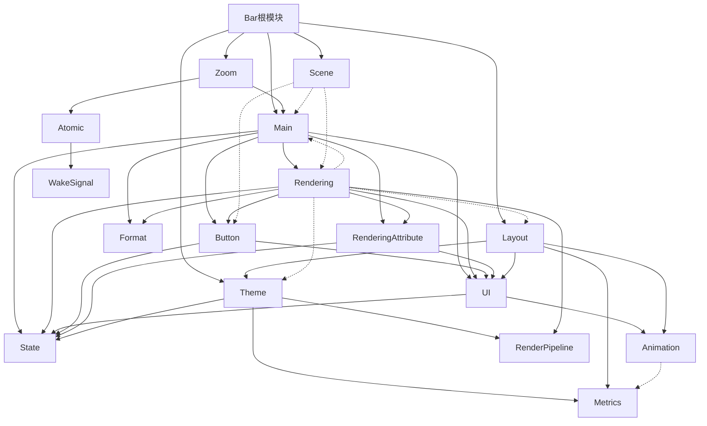

# 第一层调研：基础绘制与动效

## 最重要发现

- 【事实】第一层对主栏的反向依赖主要集中在 renderer 的 owner 适配和光照策略：`Bar.Rendering.cpp:170`（`BarUIRendering`）、`:754`（`PrepareFrameLighting`）。
- 【事实】`Bar.Format.cppm` 当前没有导入 `:State`；`:UI`、`:RenderingAttribute`、`:Rendering` 导入它后，未发现直接使用其命名符号。证据：`Bar.Format.cppm:5`、`Bar.UI.cppm:14`、`Bar.RenderingAttribute.cppm:9`、`Bar.Rendering.cppm:18`。
- 【事实】默认 `GetThemeColor` 同时承担全局样式读取和 SelectionOverlay 唤醒，显式主题重载没有该副作用。证据：`Bar.Theme.cppm:132`、`:137`、`:142`（`GetThemeColor`）。
- 【事实】renderer 同时拥有目标资源、帧生命周期和绘制缓存；SVG/PNG 位图则属于图元对象。证据：`Bar.Rendering.cppm:425`（`deviceContext`）、`Bar.UI.cppm:355`、`:405`（`cacheBitmap`）。
- 【事实】Shape/Superellipse 的常驻透明度、SVG 主 Logo 加工、15 个动画控件 helper 都带产品语义。证据：`Bar.Rendering.cpp:2870`、`:3044`、`Bar.UI.cpp:556`、`Bar.Animation.cppm:139`。
- 【事实】浅色默认常驻填充由当前常量计算为 **0.92**，相关注释仍写 **0.88**。证据：`Bar.ThemeMaterial.h:81`、`:89`、`:110`（`DefaultResidentFillOpacity`）。

## 1. 范围与证据口径

本报告仅作静态调查，没有修改文件，没有运行构建、测试或 GUI。子进程读取被环境拒绝后，改用文件 API 读取，没有重试启动子进程。

**路径约定：**下文裸文件名均相对于 `Inkeys/Inkeys/UI/Bar/`；其他位置写出仓库相对路径。`文件:行号` 均为本次读取的当前文件行号。

**计数约定：**“调用点”表示源码中的静态调用表达式位置，不表示运行次数；同一函数不同位置分别计数。生产代码与测试分开，测试中的源码字符串断言不算调用。表格未单独标注的条目均为【事实】；条件性迁移判断标为【推测】。

## 2. 文件能力与直接依赖

### 2.1 主要声明、实现与依赖

表中 `IdtMain.h`、`IdtAtomic.h`、`IdtState.h` 等分别是源文件实际包含的 `../../../` 上级头文件。

| 文件 | 主要类型／函数及定位 | 直接 import／include |
|---|---|---|
| `Bar.UI.cppm` | `BarUiStringClass:19`；继承枚举、坐标类及基类 `:132/:152/:164`；边框枚举 `:205/:210/:215`；圆角／超椭圆命中 `:223/:225`；Shape、Superellipse、SVG、PNG、Word `:229/:269/:309/:387/:417` | `:14` 导入 `:State`；`:16` 重导出 Animation。`:3` 起包含 `IdtMain.h`、`d2d1_1.h`、`wrl/client.h`、`functional`、`Bar.LogoAppearance.h`、`Bar.PresentationProbe.h` |
| `Bar.UI.cpp` | 上述图元的初始化、命中、内容切换、解码／栅格化／上传；例如 `BarUiSVGClass::CacheBitmap:470`、`BarUiPNGClass::InitializationFromMemory:690` | `:22/:24/:25` 导入 `:UI`、`Inkeys.Load`、`Inkeys.Conv.Text`。`:3` 起包含 `IdtMain.h`、LogoAppearance、D2D、WRL、`bit`、PresentationProbe；`:14/:17` 包含 stb_image、lunasvg |
| `Bar.Animation.cppm` | 四个动画全局 `:25`；值模式、曲线及极值 `:31/:39/:59`；Timeline／KeyframeTimeline `:458/:501`；事务及 Guard `:707/:725`；State／Value／Color／Pct `:745/:773/:904/:977`；推进上下文／结果 `:1078/:1086`；`MixBarUiColor:1092`、四种 `BarUiAdvanceAnimation:1093`、字体修正 `:1103`；控件 helper 见第4节 | `:6` 起包含 Windows、`IdtAtomic.h`、FontSize、`algorithm/atomic/cmath/cstdint/mutex/optional/utility`；无 import |
| `Bar.Animation.cpp` | 动画全局定义 `:19`；事务锁 `:25`；数值、颜色、透明度推进实现 | `:15` 导入 Metrics；`:6` 起包含 Windows、`IdtAtomic.h`、`algorithm/cmath` |
| `Bar.Rendering.cppm` | 光照枚举 `:41/:46`；两种光照快照 `:57/:74`；Services `:82`；renderer `:90`；SliderThumb 样式及绘制 `:557/:566` | `:17` 起导入 `:UI/:State/:Button/:Format/:RenderingAttribute`、Animation、RenderPipeline。`:3` 起包含 `IdtMain.h`、D2D、DWrite1、WRL、`array/chrono/cstdint/map/tuple`、ThemeMaterial |
| `Bar.Rendering.cpp` | renderer、文字测量、光影、图元和辅助绘制实现；`Shape:2816`、`Superellipse:2981`、`Svg:3102`、`Png:3231`、`Word:3276` | `:30` 起导入 `:Main/:Rendering/:UI/:State/:Button/:Format/:RenderingAttribute/:Layout/:Theme`、Animation、RenderPipeline、Window。`:3` 起包含 `IdtMain.h`、LogoAppearance、Configuration、I18n、D2D／helper／effects、DWrite1、WRL、Draw、State、Window.Legacy、`cstdio/algorithm/chrono/cmath/limits/memory/bit`、ThemeMaterial、PresentationProbe、Superellipse.Geometry |
| `Bar.RenderingAttribute.cppm` | `BarRenderingAttribute:11`；矩形合并 `:17`、边框外扩 `:34`、五种图元包络 `:47/:59/:102/:107/:112`、旋转包络 `:71` | `:8/:9` 导入 `:UI/:State`；`:3/:4` 包含 `IdtMain.h`、ThemeMaterial |
| `Bar.Format.cppm` | `BarFormatKey:9`、`CacheValue:27`、`BarFormatCache:33`；`GetFormat:40`、`Clean:96`、`CleanAll:115` | `:3` 包含 `IdtMain.h`；`:7` 为 `import <dwrite.h>`；没有 `import :State` |
| `Bar.Theme.cppm` | 主题模式／角色／笔色预设枚举 `:18/:25/:45`；主题查询及透明度函数 `:122` 起；预设色 `GetPresetColor:210` | `:13` 起导入 `:State`、Metrics、RenderPipeline；`:3` 起包含 Windows、`atomic`、ThemeMaterial |
| `Bar.Metrics.cppm` | 按钮／主栏／分页／启动预览常量 `:6` 起；展开宽度 `:94`；分页几何 `:101/:109/:118`；按钮布局枚举／指标／坐标及解析 `:150/:162/:181/:189/:200` | 模块声明 `:1`，没有 include／import |
| `Bar.ThemeMaterial.h` | `Color/ColorRole:10/:17`；颜色、透明度数学 `:12/:67/:72/:94/:132`；`Material/Resolve:162/:189`；`Lighting:236`；亮度／对比度／笔色校正／光照解析 `:244/:256/:264/:284/:305/:324` | `:3` 起包含 `algorithm/cmath/cstdint`；普通头文件，无模块导出 |
| `Bar.State.cppm` | 五项顶层声明见第3节 | `:3` 包含 `IdtMain.h`；无 import |
| `Bar.Layout.cppm` | 笔宽／预览几何与模式换算 `:42` 起；逻辑坐标命中 `:291`；可读文字色 `:433`；HSV 与色板映射 `:447/:454/:476/:506/:518`；预设色判断 `:539` | `:13` 重导出 Metrics；`:15` 起导入 `:UI/:Theme`、Animation、Conv.Color。`:3` 起包含 `IdtState.h`、D2D helper、`algorithm/cmath/cstddef/limits` |
| `Bar.DirtyRegion.h` | 调试常量／颜色 `:13/:19`、key `:25`、`BarDirtyRegionTracker:27`；交集／光边损伤／缩放包络／调试损伤 `:253/:264/:301/:326/:332` | `:3` 起包含 Windows、`cmath/cstdint/unordered_map/vector` |
| `Bar.FontSize.h` | `Inkeys::UI::Bar::Detail::ResolveBarFontCorrectionTarget:7` | `:3` 包含 `cmath` |
| `Bar.WakeSignal.cppm` | `WakeSignal:13`，通知、消费、截止等待、代次查询 `:18/:27/:38/:51` | `:3` 起包含 `chrono/condition_variable/cstdint/mutex` |
| `Bar.Atomic.cppm` | `BarAtomic::wait:11`、`sustainFlag:14`、`renderOnceFlag:17` | `:3` 包含 `IdtMain.h`；`:7` 导入 WakeSignal |
| `Inkeys/Inkeys/UI/Superellipse.Geometry.h` | `Inkeys::UI::CreateSuperellipsePath:13` | `:3` 起包含 D2D1.1、D2D helper、WRL、`algorithm/cmath/vector` |

### 2.2 “模块接口”与“显式导出”的区别

【事实】`Bar.State.cppm:5` 是 `export module` 声明，但其五项顶层声明本身没有 `export` 或外围 `export {}`；`Bar.UI.cppm:19`、`Bar.Format.cppm:9`、`Bar.RenderingAttribute.cppm:11` 也采用未逐项显式导出的声明。不能把这些声明全部表述为“已独立对外导出的公共 API”。

【事实】根模块目前只重导出 Theme、Main、Layout、Zoom、Scene；Main 再重导出 Rendering、Metrics。证据：`Bar.cppm:3`（根聚合）、`Bar.Main.cppm:38`（Rendering）、`:39`（Metrics）。

## 3. 主栏状态与全局依赖

### 3.1 `:State` 的完整顶层符号清单

| 符号 | 内容与证据 |
|---|---|
| `ThicknessViewMode` | Preview、Slider、FineDial；`Bar.State.cppm:7` |
| `BarStateClass` | 折叠、属性面板、More、笔型扩展、粗细、颜色选择器、控件方位；`Bar.State.cppm:14`。成员组 `drawAttributeBar:97`、`geometryAttributeBar:107`、`widgetPosition:116`；方法 `PositionUpdate:118`、两种 `ThicknessDisplayUpdate:119/:120` |
| `BarStyleClass` | 请求／应用主题、常驻透明度、DPI／UI／配置／最终缩放；`Bar.State.cppm:122` |
| `BarWidgetState` | None、Disable、Selected；`Bar.State.cppm:143` |
| `BarWidgetEmphasize` | None、Hover、Pressed；`Bar.State.cppm:149` |

### 3.2 六个分区实际使用情况

| 分区 | `:State` 实际用途 |
|---|---|
| `:UI` | 导入 `Bar.UI.cppm:14`；接口及实现未发现使用上述五个符号。图元的 `enable` 是 Animation 的 `BarUiStateClass`，不是 `BarStateClass`：`Bar.UI.cppm:242`、`Bar.Animation.cppm:745` |
| `:Rendering` | 导入 `Bar.Rendering.cppm:18`、`Bar.Rendering.cpp:33`；未发现上述五个符号的直接引用。光照中的工具枚举来自 `IdtState.h`，使用点 `Bar.Rendering.cpp:740/:797`（`PrepareFrameLighting`） |
| `:Button` | `BarButtonStateClass` 使用 `BarWidgetState/BarWidgetEmphasize`：`Bar.Button.cppm:53/:54`。实现读取 selected／disabled／pressed：`Bar.Button.cpp:1020/:2074/:2136/:2639`；还经 `barUISet.barState` 操作 `BarStateClass`，例如 `ApplyMainPresentationLocked:1008`、`PresetHoming:1704` |
| `:Format` | 当前没有该 import，也未发现五个符号引用；`Bar.Format.cppm:5/:7`（模块及唯一 import） |
| `:RenderingAttribute` | 导入 `Bar.RenderingAttribute.cppm:9`；包络计算只使用 UI 图元／动画值／材质常量，例如 `GetFrameDirtyOutset:34`、`GetWeigetRect:47` |
| `:Theme` | 使用 `BarStyleClass* currentBarThemeStyle` 和 `SetThemeStyleSource`：`Bar.Theme.cppm:120/:127`；读取主题及透明度，详见下表 |

### 3.3 第一层的全局读取位置

| 来源 | 全部相关读取位置／用途 |
|---|---|
| `barUISet`、`floating_window` | 在本任务列出的第一层文件中未发现直接读取。owner 构造器通过传入指针访问主栏，不能等同于没有主栏依赖：`Bar.Rendering.cpp:170`（`BarUIRendering`） |
| `currentBarThemeStyle` | `GetThemeColor`：`Bar.Theme.cppm:145/:150/:151/:152`，判断绑定状态并读取 dark/background/content；背景 override `:165/:166`；内容倍率 `:178/:179`；常驻填充 `:185`；边框透明度 `:193`；浅色权重 `:200`；禁用透明度 `:206` |
| 主栏光效开关 | `PrepareFrameLighting` 读取 `BarUiEdgeLightingEnabled/BarUiDynamicEdgeLightingEnabled`：`Bar.Rendering.cpp:754/:755`；`DrawPointLightFrame` 再读总开关 `:2560`。定义在更高层 `Bar.Main.cppm:54/:55` |
| 动画全局 | `Bar.UI.cpp:255/:832` 读取默认时长；`Bar.Animation.cppm:623` 读取启用开关、`:882` 默认速度、`:1125` 默认时长；renderer 在 `Bar.Rendering.cpp:822/:823/:868/:971/:1040` 读取启用、倍率、时长。定义：`Bar.Animation.cpp:19` |
| 工具状态快照 | `Bar.Layout.cppm:116/:135/:320/:333/:347/:376/:406/:417/:430` 调用 `GetStateModeSnapshot`，分别服务量程、FineDial 行程、笔宽预设／当前值／激光及预设模式判断 |
| 工具模式、笔色 | `PrepareFrameLighting` **通过参数**读取，非直接查询全局：签名 `Bar.Rendering.cpp:678`；笔型选色 `:739`、模式选色／锚点 `:793`、形状与荧光笔历史 `:907`。生产输入来自 `Bar.RenderLoop.cpp:7405`（`PrepareLightingAndDemand`） |

【事实】作为相邻第二层，Button 仍直接读取主栏样式和 renderer：`Bar.Button.cpp:2096`（`RetargetBarFixedButtonVisual`）、`:2463`（`ConfigureBarButtonVisualTargets`）。后者按字体族、locale、槽宽、字号和设备 generation 缓存 Geometry 标签测量，判断在 `:2464`。

## 4. 第一层中的产品语义及调用数量

### 4.1 图元标志、Logo、光照与主题

| 项目 | 定义／读取／静态消费者 |
|---|---|
| `themeSurface` | 定义 `Bar.UI.cppm:258/:298`。绘制读取 `Bar.Rendering.cpp:2863/:3037`（Shape／Superellipse）；包络读取 `Bar.RenderingAttribute.cppm:49/:61`；RenderLoop 材质更新／包络预测读取 `Bar.RenderLoop.cpp:4810/:8905/:9161`。生产赋值共 **6处、5个函数**：ConstructionPrompt `:66`（Initialize）、Initialization `:1312/:1321`（InitializeUI）、RenderLoop `:11948`（CalculateDirtyAndDrawPresent）、ShapeEditor `:1598`（Impl::Advance）、StatusIndicator `:472`（Draw） |
| `residentSurface` | 定义 `Bar.UI.cppm:260/:300`。绘制读取函数 **2个**：`Bar.Rendering.cpp:2871/:2875`（Shape）、`:3045/:3049`（Superellipse）。生产赋值 **9处、8个函数**：ConstructionPrompt `:66`；Initialization `:1319/:1323`；RenderLoop `:11950`；Scene `:211/:477/:879`（Impl 构造／Configure／ConfigureBackground）；ShapeEditor `:1598`；StatusIndicator `:472` |
| `PenWhenDrawing` | 枚举定义 `Bar.UI.cppm:213`；实际判定函数 **1个**，`Bar.Rendering.cpp:2529`（DrawPointLightFrame），用于笔色混合及绘制模式透明度 `:2530/:2542`；Shape／Superellipse 转交该字段 `:2914/:3079`。生产配置 **13处、8个函数**：ConstructionPrompt `:67`、EraserAttribute `:101`、GeometryAttribute `:221`、Initialization `:353/:378/:395/:440/:674/:1163`、RecallAttribute `:77`、RenderLoop `:11954`、Scene `:80`、ShapeEditor `:197` |
| 常驻背景透明度 | Shape 在 `Bar.Rendering.cpp:2873/:2881`、Superellipse 在 `:3047` 查询全局 override；Shape 还把 `pct/0.8` 当作显隐比例再组合 idle，`:2877`；Superellipse 直接限制最终填充，`:3050`。策略见 `Bar.ThemeMaterial.h:94/:101`（ResolveIdleOpacity／ResidentFillOpacityScale） |
| `mainLogoAppearance` | 定义 `Bar.UI.cppm:352`；生产写入函数 **2个**：`Bar.Initialization.cpp:360`（InitializeUI）、`Bar.RenderLoop.cpp:4825`（AdvanceAnimationsAndDeriveLayout）。读取函数 **2个**：`Bar.Rendering.cpp:3150`（Svg，判断缓存变化）、`Bar.UI.cpp:556/:614`（CacheBitmap，加工并记录快照）；ResetCache 只清缓存快照 `Bar.UI.cpp:460` |
| 主 Logo 节点加工 | 唯一生产调用 `Bar.UI.cpp:560`（CacheBitmap→ApplyAttributes）。节点规则定义 `Bar.LogoAppearance.h:51`：四个 pen 节点 `:61`、两个 screen `:63`、outline／indicator／nib／highlight `:68`、14个 ink-stop `:72`。缺节点会拒绝缓存成功，`Bar.UI.cpp:563/:566` |
| 工具模式光源锚点 | `Bar.Rendering.cpp:788`（PrepareFrameLighting）默认 MainButton；Pen→Draw、Eraser→Eraser、Shape→Geometry、Selection→Select、ClickThrough→Pierce，`:797`；不可用回退0号锚点 `:807`。生产调用 **1处**：`Bar.RenderLoop.cpp:7405`；测试 **7处**：EraserAttribute.Test `:131/:1480/:1567/:1663`、GeometryAttribute.Test `:543/:648/:802` |
| 默认主题副作用 | `Bar.Theme.cppm:142`（GetThemeColor）将 dark/background/content 拼 key，变化时请求 `Client::SelectionOverlay`，`:153/:155`；未绑定默认 Light，`:145`。显式 mode／bool 重载只转发颜色计算，`:132/:137` |

【事实】默认主题重载的生产静态调用共 **290处、9个文件**；不是290个不同函数。分文件为：

| 文件 | 调用数与定位示例 |
|---|---|
| `Bar.Button.cpp` | 13；`:222`（按钮初始化）、`:2083`（RetargetBarFixedButtonVisual） |
| `Bar.ConstructionPrompt.cpp` | 16；`:69`（Initialize）、`:265`（Draw） |
| `Bar.EraserAttribute.cpp` | 22；`:98`（Initialize）、`:316`（Advance） |
| `Bar.GeometryAttribute.cpp` | 29；`:217`（Initialize）、`:734`（Advance） |
| `Bar.Initialization.cpp` | 74；`:340`（InitializeUI） |
| `Bar.RecallAttribute.cpp` | 10；`:74`（Initialize）、`:250`（Advance） |
| `Bar.RenderLoop.cpp` | 84；`:1555`（SubmitTargetsAndLayout）、`:1575`（Refill lambda） |
| `Bar.Scene.cpp` | 18；`:76`（InitializeShape）、`:881`（ConfigureBackground） |
| `Bar.ShapeEditor.cpp` | 24；`:190`（InitShape）、`:2105`（Impl::Draw） |

### 4.2 Animation 中的具体控件 helper

全部定义在 `Bar.Animation.cppm`。下表“生产／测试”为静态调用点数；测试调用均位于 `InkeysHeadlessTests/animation_tests.cpp`。

| helper（定义行） | 产品含义 | 生产调用证据；数量 | 测试数量；首处证据 |
|---|---|---|---|
| `ResolveBarThicknessPreviewMorph:155` | 曲线／荧光笔预览交替 | RenderLoop `:10094`；1 | 3；`:248` |
| `ResolveBarThicknessPresetVisualKind:171` | 荧光笔数字、其他圆 | RenderLoop `:750/:755/:2439`；3 | 5；`:367` |
| `ResolveBarThicknessPresetOpacity:185` | 圆／数字淡出再淡入 | RenderLoop `:10860`；1 | 3；`:303` |
| `BarThicknessPresetRetargetsCircle:195` | 圆预设目标判定 | RenderLoop `:2497`；1 | 3；`:313` |
| `BarThicknessPresetRetargetsNumber:201` | 数字目标切换判定 | RenderLoop `:2482`；1 | 2；`:316` |
| `BarPenTypeSupportsExtension:209` | 三种笔型可扩展、Laser除外 | Layout `:64`（PenModeSupportsAnnotationLine）；1 | 5；`:388` |
| `ResolveBarPenTypeExtensionSlot:225` | 笔型映射扩展槽 | RenderLoop `:3642/:5452`；2 | 4；`:422` |
| `ResolveBarAnnotationPopupTitle:247` | 软笔固定粗细不支持提示 | RenderLoop `:5831`；1 | 3；`:445` |
| `ResolveBarLaserPreviewPhase:266` | Laser芯／壳进退状态机 | RenderLoop `:2533`；1 | 10；`:457` |
| `ResolveBarLaserPreviewTargetPolicy:317` | Laser各层目标策略 | RenderLoop `:2539`；1 | 4；`:501` |
| `ResolveBarLaserPreviewEnvelopeThickness:345` | Laser包络粗细 | RenderLoop `:10028`；1 | 2；`:563` |
| `ResolveBarLaserPreviewLayerGeometry:363` | Laser端点／Slider交接 | RenderLoop `:10075/:10196`；2 | 6；`:579` |
| `ResolveBarPenTypeExtensionAnchor:386` | 扩展入口跟随笔型按钮 | RenderLoop `:5480`；1 | 1；`:399` |
| `ResolveBarPenTypeExtensionColor:396` | 扩展入口沿用按钮颜色 | RenderLoop `:5528`；1 | 1；`:416` |
| `ResolveBarPenTypeExtensionPresentation:408` | 扩展入口交互与透明度 | RenderLoop `:5460`；1 | 1；`:406` |

## 5. `BarUIRendering` 与 Services

### 5.1 构造方式与服务实现

| 构造／服务 | 当前事实 |
|---|---|
| 默认构造 | `Bar.Rendering.cppm:93`。生产消费者为 `Bar.Scene.cpp:139/:200`（Impl::renderer／构造）、`Bar.ShapeEditor.cpp:585/:720`（Impl::renderer／构造） |
| Services 注入构造 | `Bar.Rendering.cppm:94`：接收并移动 `BarUIRenderingServices`。本次检索未发现生产代码调用这一构造入口 |
| owner 构造 | 声明 `Bar.Rendering.cppm:95`、实现 `Bar.Rendering.cpp:170`；生产入口 `Bar.Main.cppm:860`（`BarUISetClass():spec(this)`）；空 owner 直接返回 `Bar.Rendering.cpp:172` |
| typography | 现有签名 `std::function<BarFormatCache*()>`，`Bar.Rendering.cppm:84`。owner 实现返回 `owner->barMedia.formatCache.get()`，`Bar.Rendering.cpp:174` |
| resetDeviceCaches | 现有签名 `std::function<void()>`，`Bar.Rendering.cppm:85`。owner 实现重置 svgMap、pngMap 和按钮图标缓存，`Bar.Rendering.cpp:175` |
| mainLightingInput | 现有签名 `std::function<BarUiMainLightingInput()>`，`Bar.Rendering.cppm:86`。owner 实现读取主按钮／主栏／五种 preset 按钮位置及加锁的光标快照，`Bar.Rendering.cpp:181/:184/:192/:211` |

【事实】没有 typography 回调或其返回空时，`GetTypographyCache` 用共享 DWriteFactory 创建 `ownedTypography_`；`Bar.Rendering.cpp:220`。没有 mainLightingInput 时使用空输入，`:791`。没有 reset 回调时 renderer 不遍历外部图元，`:375`。

### 5.2 成员与方法分类

“纯绘制”在此表示**内容绘制责任**，不表示数学意义上的无状态函数。

| 类别 | 成员／方法与证据 |
|---|---|
| 目标／帧生命周期 | `deviceContext/targetBitmap/gdiInteropRenderTarget/deviceGeneration/尺寸`，`Bar.Rendering.cppm:425`；Ensure／Recreate／Discard，`Bar.Rendering.cpp:312/:324/:361`；Begin／Finish／End，`:470/:481/:486`；dirty clip，`:495/:519`；Clear 在 Begin 内 `:478`；PushPanelOpacity `:456`；bounds cull `:433`；资源／尺寸／代次 getter，`Bar.Rendering.cppm:186` 起 |
| 设备及绘制缓存 | 画刷、圆角／几何／精确遮罩、超椭圆几何、FineDial文字布局、预览渐变，`Bar.Rendering.cppm:254` 起；实际容器及效果／DC，`:512` 起、`:547`；文字格式服务／本地缓存 `:247`；标签拟合缓存 `:544` |
| 内容绘制 | Shape／Superellipse／Svg／Png／Word，`Bar.Rendering.cpp:2816/:2981/:3102/:3231/:3276`；ColorPalette `:3467`；DrawRing `Bar.Rendering.cppm:241`、DrawProgressRing `Bar.Rendering.cpp:1448`；点光 `:2511`、阴影 `:2724`、顶部高光 `:2768`、SliderThumb `:3482` |
| 同类中的跨层内容 | 主栏光源状态机 `PrepareFrameLighting:678`；粗细预览路径／渐变及 FineDial selector／数字布局 `Bar.Rendering.cpp:1280/:1495/:1600/:1641`；常驻内容／idle 状态 `Bar.Rendering.cppm:176` |

### 5.3 缓存归属与失效

| 缓存 | 归属、键及失效 |
|---|---|
| 目标资源 | renderer 创建 epoch.d2dDevice 的新 DC、GDI_COMPATIBLE 目标位图和 GDI interop；成功后才替换旧资源，`Bar.Rendering.cpp:332/:336/:350`。generation、尺寸或资源不完整都会触发重建，`:315` |
| renderer画刷／遮罩 | `DiscardDeviceDependentCaches` 统一释放，`Bar.Rendering.cpp:373`；尺寸变化同样走 Recreate→Discard，`:321/:351`。单色画刷由首次传入 DC 创建，随后只改颜色，`:1266`；缓存未记录独立的 DC identity |
| 点光渐变 | RGB＋光源类型命中，中心／半径原地更新；`Bar.Rendering.cpp:1204` |
| 遮罩／几何 | 圆角、线宽、模糊半径按¼像素键 `Bar.Rendering.cpp:1725`；几何另含宽高和 variant `:2329`；超椭圆按宽高／指数／segments重建、位置只重建平移几何 `:2943/:2963` |
| 精确A8遮罩 | 连续8帧晋升，`Bar.Rendering.cpp:2147`；EndDraw失败清除候选／成品，必要时本设备停用柔光 `:536/:545`；精确遮罩创建失败关闭该路径 `:2158` |
| DWrite格式 | key 包含集合指针、字族、字号、字重、样式、stretch、对齐、locale，`Bar.Format.cppm:9`；Clean删除未使用项，CleanAll清空，`:96/:115`。设备缓存清理没有清空 ownedTypography；EndFrameDraw对其Clean，`Bar.Rendering.cpp:491` |
| 字体派生缓存 | locale变化清标签拟合和FineDial布局，`Bar.Rendering.cpp:291`；小数字号政策变化清FineDial布局，`:230`；标签拟合键 `Bar.Rendering.cppm:544` |
| SVG位图 | 存在 `BarUiSVGClass::cacheBitmap`，`Bar.UI.cppm:355`；由传入DC上传，`Bar.UI.cpp:596`。内容提交ResetCache，`:462`；颜色、Logo快照、静止尺寸、动画放大阈值决定刷新，`Bar.Rendering.cpp:3138` |
| PNG位图 | 存在 `BarUiPNGClass::cacheBitmap`，`Bar.UI.cppm:405`；CPU预乘BGRA数据保留 `Bar.UI.cpp:718/:733`；传入DC创建位图 `:792`；重新解码／ResetCache释放位图，`:738/:800` |

【事实】SVG/PNG对象没有保存用于自动比较的设备 generation／DC 指针，成员见 `Bar.UI.cppm:350`、`:400`。其设备归属由上传DC及外部重置链维持：

- 主栏：renderer清设备缓存→owner回调→svgMap/pngMap/按钮缓存；`Bar.Rendering.cpp:375/:175`。
- 分页：generation变化重置17个按钮SVG及环资源；`Bar.Scene.cpp:979`（EnsureDeviceResources）；显式释放同时重置SVG／PNG，`:949`（ReleaseDeviceResources）。
- 编辑器：generation变化重置按钮SVG、colorWheel及几何；`Bar.ShapeEditor.cpp:2245`（EnsureDeviceResources）；显式释放在 `:2340`。
- 【待测】同一图元跨不同设备使用时的结果，以及只换DC／目标尺寸时上述缓存策略的资源域表现；依据为上述上传和重置位置，未作运行验证。

### 5.4 生命周期调用点索引

记号：**E**=EnsureDeviceResources，**D**=DiscardDeviceResources，**B**=BeginFrameDraw，**F**=FinishFrameDrawCommands，**N**=EndFrameDraw，**P/O**=Push/PopFrameDirtyClip，**H**=HandleFrameEndDrawResult。每个数字都是该行对应符号的调用点；同一行重复调用只列一次。E包含场景转发入口。

| 生产文件／调用者 | 全部调用位置 |
|---|---|
| `Bar.RenderLoop.cpp`／`CalculateDirtyAndDrawPresent` | E:9327；D:9368,12283,12639；B:9636；F:12097；N:12251 |
| `Bar.Scene.cpp`／Reset、ReleaseDeviceResources、同名转发方法 | D:944,949；E:980；H:985 |
| `Bar.ShapeEditor.cpp`／EnsureDeviceResources、Present、ReleaseDeviceResources | E:2253；B:2273；F:2275；N:2297；D:2340 |
| `Inkeys/Inkeys/UI/PageControl/PageControl.cpp`／呈现链 | E:1496；B:1581；F:1624；N:1633,1683 |
| `Inkeys/Inkeys/UI/Whiteboard/Whiteboard.cpp`／背景呈现链 | E:438；B:541；F:545；N:583 |
| `Inkeys/Inkeys/UI/SelectionOverlay/SelectionOverlay.cpp`／Render | E:106，经ShapeEditorSurface；Present:108进入其B/F/N链 |

【事实】内部调用关系：Ensure→Recreate `Bar.Rendering.cpp:321`；Recreate→Discard `:351`；Discard→DiscardDeviceDependentCaches `:363`；Begin→P `:475`；Finish→O `:483`；End→H `:490`。没有单独的 renderer Clear 方法，透明清空在 Begin 的 `:478`。

| 测试文件／测试函数域 | 全部调用位置 |
|---|---|
| `Bar.EraserAttribute.Test.cpp` | E:212,324,408,409,1479,1566,1662,1708,1885,1907,2643,2732,2846,2847,2906,2995,3088,3128,3181；D:236,364,588,2698,2731,2903,2928,2930,3234,3237；B:221,428,483,541,2788,2883,2915,2921,2998,3092；F:222,434,488,544,2790,2889,2917,2926,3001,3095；N:223,435,488,544,2794,2892,2917,2926,3002,3096；P:1953,2193,2357,2393,2451,2494,2538,2668,2740,3199；O:1969,2202,2360,2420,2460,2498,2542,2670,2742,3201；H:342,2743,3202 |
| `Bar.GeometryAttribute.Test.cpp` | E:260,786,836；D:836,850,1521,1812 |
| `Bar.MultiTarget.Test.cpp` | D:541,1614,2214,2264 |
| `Bar.RenderLoop.cpp`／RunIdleBackingResourceLifecycleTest | E:13326,13333,13362；D:13365 |
| `Bar.ShapeEditor.cpp`／RunShapeEditorOffscreenTest | E:2792,2852,3005,3018,3434,3726,3856,4019,4147,4177,4290,4421；B:2806,2862,3441,3466；F:2833,2876,3443,3481；N:2834,2877,3444,3482 |
| `Bar.StatusIndicator.cpp`／RunOffscreenTest | E:596；H:606 |
| `Inkeys/Inkeys/UI/PageControl/PageControl.cpp`／离屏测试域 | E:3968,3981,4088,4103,4432,4759,4789,4812；B:3971,3984,4062,4072,4106,4433,4763,4793,4816；F:3972,3985,4063,4073,4109,4435,4764,4794,4817；N:3973,3986,4064,4074,4110,4435,4765,4795,4818 |

## 6. 当前依赖方向与迁移中的结

以下箭头表示实际依赖，`-.->` 表示实现文件中的反向依赖：

【事实】图的依据：`Bar.cppm:3`；`Bar.Main.cppm:31`；`Bar.Rendering.cppm:17`；`Bar.Rendering.cpp:30`；`Bar.UI.cppm:14`；`Bar.Button.cppm:13`；`Bar.RenderingAttribute.cppm:8`；`Bar.Theme.cppm:13`；`Bar.Layout.cppm:13`；`Bar.Zoom.cppm:8`；`Bar.Atomic.cppm:7`；`Bar.Animation.cpp:15`；`Bar.Scene.cpp:23`，符号分别为各模块的 import／export-import 声明。

| 分类 | 已存在的结 |
|---|---|
| 【事实】更高层类型反向进入renderer | owner构造器使用 `BarUISetClass`、`BarUISetSuperellipseEnum`、`BarUISetShapeEnum`、`BarButtonPresetEnum`；`Bar.Rendering.cpp:170/:184/:185/:192` |
| 【事实】主栏调度器访问renderer内部 | renderer声明 `BarUISetClass/BarRenderLoopCoordinator/BarStatusIndicatorPanel` 为friend；`Bar.Rendering.cppm:551`。RenderLoop直接调用受保护粗细预览／FineDial方法，`Bar.RenderLoop.cpp:10235/:10350/:10657/:10726` |
| 【事实】主题含产品状态及调度 | `Bar.Theme.cppm:120` 的 `BarStyleClass*` 与 `:155` 的 SelectionOverlay请求 |
| 【事实】“布局数学”同时带业务快照 | `Bar.Layout.cppm:303`（GetBarThicknessPresetMetrics）依赖PenWidth业务；`:320`等无快照重载读取全局；颜色预设判断依赖Theme，`:539` |
| 【事实】图元还依赖呈现观察协议 | `Bar.UI.cppm:330/:367` 暴露／保存 `Ui3SvgBitmapProof/Ui3SvgObjectObservation`；renderer在clear、clip、bounds cull中接观察协议，`Bar.Rendering.cpp:439/:477/:515` |
| 【推测】跨模块机械搬迁会形成回路 | 若保留Rendering→Bar Main／Button的上述依赖，同时Bar改为导入UI3，则产生UI3→Bar→UI3依赖回路；证据为当前Main→Rendering `Bar.Main.cppm:38` 与反向owner适配 `Bar.Rendering.cpp:170`。这不是已确认的当前编译错误 |
| 【推测】RenderPipeline仍是独立边界问题 | renderer共享工厂／字体集合来自RenderPipeline，`Bar.Rendering.cpp:124`；RenderPipeline实现又使用Bar.FramePacing，`Inkeys/Inkeys/UI/RenderPipeline/RenderPipeline.cpp:32/:754`。是否形成新模块环取决于迁移范围 |

## 7. Bar目录外消费者

### 7.1 生产文件

下表只列本任务第一层符号；“间接”表示经场景／主栏对象调用。

| 文件 | 用到的第一层符号及证据 |
|---|---|
| `Inkeys/Inkeys/UI/PageControl/PageControl.cpp` | `BarUiValueClass:224`、`BarUiAnimationEnabled:1186`、`BarUiAnimationAdvanceContextClass:1187`、`BarUiAnimationSpeedRate:1188`、`BarUiAdvanceAnimation:1190`；`BarButtonDefaultOperationDurationSeconds:154`；`BarDirtyRegionTracker:1536`、`ResolveBarDebugDamage:1558`、`IntersectBarDirtyRect:1574`、`ResolveBarDebugFrameColor:1595`、调试线宽／inset `:1602/:1604/:1606`；renderer方法见5.4。测试段另用 `GetThemeColor/BarThemeColorEnum:4271`、`ResolveBarButtonVisualMetrics/BarButtonVisualLayoutKind:4382`、`GetThemeDisabledContentOpacity:4593`、`BarUiFrameLightingSnapshot:4661`、`BarMainBarFillOpacity:5039` |
| `Inkeys/Inkeys/UI/PageControl/PageControl.cppm` | PPT compact／标准长短边、drag slot、compact开关、按钮边长／gap、白板分页宽高，`:280`起；`ResolveBarPptStandardPaginationGeometry:385`；`BarButtonFrameThicknessDip:1252` |
| `Inkeys/Inkeys/UI/Whiteboard/Whiteboard.cpp` | 经BarPageSurface调用renderer的 `GetTargetBitmapSize:430`、`GetDeviceGeneration:431`、B/F/N `:541/:545/:583` |
| `Inkeys/Inkeys/UI/SelectionOverlay/SelectionOverlay.cpp` | 经ShapeEditorSurface调用 `EnsureDeviceResources:106`、`Present:108`；未发现直接构造第一层图元 |
| `Inkeys/Inkeys/UI/Setting/Setting.cpp` | `GetThemeDefaultResidentBackgroundOpacity:3355` |
| `Inkeys/Inkeys/UI/StartupPreview/StartupPreview.cppm` | `BarDarkSurfaceColorChannel:24`、`BarDarkSurfaceFrameColorChannel:26`、`BarMainBarFillOpacity:27`、`BarMainButtonCollapsedFillOpacity:28`、`BarMainBarFrameOpacity:29` |
| `Inkeys/Inkeys/UI/StartupPreview/StartupPreview.State.cppm` | 默认主栏／预览宽度 `:13/:15`；`StartupPreviewEnabledDefault:19`、缓存宽度上下限 `:21/:23`；主按钮间距／主栏高／圆角 `:26/:27/:29` |
| `Inkeys/Inkeys/UI/StartupPreview/StartupPreview.State.cpp` | `CalculateExpandedTotalWidthDip:103`（CalculateStartupBarTotalWidthDip） |
| `Inkeys/Inkeys/UI/StartupPreview/StartupPreview.Drawing.h` | `CreateSuperellipsePath:21` |
| `Inkeys/Inkeys/UI/StartupPreview/StartupPreview.Effects.Policy.h` | `BarThemeMaterial::Rgb:138`、`DefaultResidentFillOpacity:149`、`LightColor/ColorRole:157`（Appearance／ResolveAppearance） |
| `Inkeys/Inkeys/Other/Other.Config.cppm` | `StartupPreviewEnabledDefault:592`、`StartupPreviewCachedWidthDefaultDip:594` |
| `Inkeys/IdtPlug-in.cpp` | 经 `barUISet.barState.fold` 读取并改变 `BarStateClass`，`:1575/:1576`；主栏唤醒调用 `:1028`（UpdateRendering） |
| `Inkeys/IdtState.cpp` | 导入Bar `:30`，经主栏调用 `UpdateRendering:1318/:1355/:1378`；未发现直接使用图元／renderer／主题数学 |
| `Inkeys/IdtMain.cpp` | 导入Bar `:16`；调用高层 `SetThemeMode/SetResidentOpacity/SetAnimationOptions/SetEdgeLightingOptions:3322`起；未发现直接使用第一层图元或renderer |
| `Inkeys/Inkeys/UI/RenderPipeline/RenderPipeline.cpp` | 导入的是相邻独立模块 `Bar.FramePacing:32`，使用 `TryWaitForRemainingFrameTime:754`；未发现直接使用本任务列出的第一层符号 |
| `Inkeys/Inkeys/UI/Ppt/Ppt.cpp` | 导入Bar `:18`；本次未发现第一层符号直接消费 |

### 7.2 仓库测试消费者

| 文件 | 第一层符号／符号组 |
|---|---|
| `InkeysHeadlessTests/animation_tests.cpp` | `ResolveBarFontCorrectionTarget:110`；Value／FontCorrection／AdvanceContext／Advance `:122`起；按钮Metrics／布局枚举 `:214`；第4.2节全部15个helper；Color／Pct `:412/:1046`；Curve／ApplyCurve／ApplyCurveRange `:662/:722/:774`；Timeline／KeyframeTimeline／Result `:795/:804/:818`；AnimationEnabled `:849`、CurveSpec／SetLayoutPositionTarget `:878/:883`；MixColor `:289`；ImmediateContentUpdate／KeepContentVisible `:1248/:1268` |
| `InkeysHeadlessTests/bar_bottom_dock_tests.cpp` | `ResolveBarFontCorrectionTarget:323`、`BarDirtyRegionTracker:632` |
| `InkeysHeadlessTests/bar_display_transition_tests.cpp` | Value／Advance／AdvanceContext `:64/:67` |
| `InkeysHeadlessTests/bar_logo_tests.cpp` | ThemeMaterial `:103`；Value／Pct／Color／AdvanceContext／Advance `:151`起 |
| `InkeysHeadlessTests/bar_theme_tests.cpp` | ThemeMaterial `:25`；深色通道 `:27/:29`；主栏frame／fill、按钮hover／cursor／pressed、主按钮折叠fill `:124/:126/:153/:185/:186/:192/:430`；Value／Advance `:335/:337` |
| `InkeysHeadlessTests/dirty_region_tests.cpp` | DirtyRegionTracker／ResolveDebugDamage／ResolveLightBorderDamage／ResolveScaledDirtyBounds `:12`起 |
| `InkeysHeadlessTests/eraser_attribute_tests.cpp` | ButtonGap／OneSide／TwoSide `:69/:173/:179`；AdvanceContext／Timeline `:230/:243` |
| `InkeysHeadlessTests/page_control_tests.cpp` | ApplyCurve／CurveEnum `:31`；FrameThickness／ResolveButtonChildTopLeft `:111/:117`；CompactPaginationEnabled／TwoSide `:367/:372` |
| `InkeysHeadlessTests/recall_attribute_tests.cpp` | TwoSide／MainButtonGap `:32/:40`；AdvanceContext／DefaultOperationDur／Timeline `:77/:78/:108`；Pct／Advance／DisabledContentOpacity `:328`起。`:461`起的SVG／Word名称是源码字符串断言，不是实例调用 |
| `InkeysHeadlessTests/wake_signal_tests.cpp` | `WakeSignal:15` |
| `InkeysHeadlessTests/whiteboard_ui_tests.cpp` | ButtonGap／TwoSide `:246/:248` |

## 8. Metrics、Theme与Material的责任分类

这里的“通用”指可用于多个UI3消费者；具体数值仍是当前产品视觉政策。

| 文件／分类 | 常量或函数及证据 |
|---|---|
| Metrics／通用控件视觉 | 网格gap／边长、圆角、描边、2×2图标文字槽、按压／hover／禁用／光效／时长：`Bar.Metrics.cppm:6/:30`起；`ResolveBarButtonChildTopLeft:189`；标准按钮布局分支 `ResolveBarButtonVisualMetrics:200` |
| Metrics／主栏专用 | MainBar尺寸／圆角／fill／frame `:47`起；主按钮尺寸／折叠fill／间距 `:56`起；A1/More/A2列数、默认展开宽度、CalculateExpandedTotalWidthDip `:64/:94` |
| Metrics／翻页专用 | PPT compact开关、长短边、drag slot、白板分页尺寸 `:11`起；分页几何 `:101/:118`；PageHorizontal／Vertical／TwoTwo分支 `:242`起 |
| Metrics／白板操作行 | StandardFourOne固定140 DIP，`ResolveBarButtonVisualMetrics:221` |
| Metrics／启动预览 | 默认缓存宽度、启用开关、上下限 `:75`起 |
| Theme／通用主题查询 | ThemeMode／Color角色、显式主题GetThemeColor、alpha处理：`Bar.Theme.cppm:18/:25/:60/:132/:137` |
| Theme／产品配置与调度 | currentBarThemeStyle、SetThemeStyleSource、默认GetThemeColor、常驻透明度／当前权重／禁用查询 `:120/:127/:142/:163`起 |
| Theme／画笔预设 | `BarThemePresetColorEnum:45`、`GetPresetColor:210`，固定11色 |
| Material／通用数学 | Rgb、ClampWeight、Mix、MixColor、RelativeLuminance、ContrastRatio：`Bar.ThemeMaterial.h:12/:67/:72/:132/:244/:256` |
| Material／共享视觉规则 | ColorRole／LightColor `:17/:41`；选中／边框／禁用透明度 `:116/:122/:127`；阴影／高光材质、Material／Resolve `:145/:162/:189`；ObjectEdgeLight `:230` |
| Material／常驻场景 | LightResidentSurfaceOpacityScale、ResidentBaseFillOpacity、IdleBackground／Content、ResolveIdleOpacity、ResidentFillOpacityScale、DefaultResidentFillOpacity：`:81/:89/:90/:91/:94/:101/:110` |
| Material／绘图工具显示策略 | CorrectLightPenColor、ResolveLighting、ResolveCursorLighting、DisplayPenColor：`:264/:284/:305/:324`；处理笔色显示／边缘光，不是任意颜色数学 |
| 形状栏归属 | 三文件中未发现单独命名的形状样式栏尺寸集；实际toolbar／弹出层使用MainBarFillOpacity／DrawAttributeSurfaceOpacity，`Bar.ShapeEditor.cpp:1598/:1600`（Impl::Advance） |

【事实】`DefaultResidentFillOpacity` 用 `0.80×1.15=0.92`；`Bar.ThemeMaterial.h:109` 和 `Bar.Theme.cppm:169` 的“Light 0.88”注释与计算不一致。这里仅记录差异，未判断预期数值。

## 9. 现有日志

【事实】指定第一层文件中共发现 **17处** `Inkeys::Log`，全部在 `Bar.Rendering.cpp`，全部使用 `Module::Bar`。以下均位于绘制／EndDraw同步链的失败分支，属于可能进入渲染热路径的日志，而不是无条件逐帧日志。

| 行号 | 所属符号 | 级别／事件 |
|---|---|---|
| `:554` | `HandleFrameEndDrawResult` | Error；A8遮罩提交失败 |
| `:1253` | `GetFrameGradientBrush` | Error；边框点光渐变创建失败 |
| `:1328` | `GetThicknessPreviewGradientBrush` | Error；粗细预览渐变失败 |
| `:1388` | `GetColorPickerHueGradientBrush` | Error；色相渐变失败 |
| `:1435` | `GetColorPickerToneGradientBrush` | Error；明暗覆盖失败 |
| `:1535` | `GetThicknessPreviewPath` | Error；预览路径失败 |
| `:1565` | `GetThicknessPreviewStrokeStyle` | Error；圆头样式失败 |
| `:1591` | `GetRoundStrokeStyle` | Error；圆头样式失败 |
| `:1630` | `GetThicknessFineDialSelectorGeometry` | Error；FineDial selector失败 |
| `:1758` | `GetRoundedRectDiffuseMask` | Error；遮罩DC失败 |
| `:1780` | 同上 | Error；Gaussian Blur Effect失败 |
| `:1873` | 同上 | Error；预模糊遮罩失败 |
| `:2159` | `ResolveRoundedRectExactMask` | Warn；精确遮罩失败、回退九宫格 |
| `:2363` | `GetGeometryDiffuseMask` | Error；几何遮罩DC失败 |
| `:2385` | 同上 | Error；Gaussian Blur Effect失败 |
| `:2472` | 同上 | Error；几何预模糊遮罩失败 |
| `:2798` | `DrawSurfaceMaterialHighlight` | Error；顶部高光失败 |

【事实】失败标志由设备缓存清理重置，`Bar.Rendering.cpp:397`起（`DiscardDeviceDependentCaches`）；精确遮罩失败直接置 unavailable，`:2158`。因此不能把“有日志”理解为每帧必然重复输出。  
【待测】这些失败分支的实际触发频率和日志耗时，本次没有运行验证。

## 10. 迁移／封装前必须先解决的事项

以下是已有耦合事实清单，不是实现方案。

| 【事实】事项 | 证据 |
|---|---|
| renderer仍认识完整主栏owner、preset和主栏对象表 | `Bar.Rendering.cpp:170/:184/:192`（owner构造） |
| 基础光照仍读取Main中的光效全局，并解释产品工具枚举 | `Bar.Main.cppm:54`；`Bar.Rendering.cpp:754/:797`（PrepareFrameLighting） |
| 默认主题查询仍绑定BarStyleClass，并唤醒具体SelectionOverlay客户端 | `Bar.Theme.cppm:120/:142/:155` |
| Shape／Superellipse绘制仍查询全局常驻背景设置，且idle组合方式不同 | `Bar.Rendering.cpp:2873/:2877/:3047/:3050` |
| SVG数据模型和栅格化仍包含主Logo节点协议及呈现观察协议 | `Bar.UI.cppm:330/:352`；`Bar.UI.cpp:560` |
| renderer同时管理目标DC／位图／GDI interop和内容绘制 | `Bar.Rendering.cpp:324/:470`；`Bar.Rendering.cppm:425` |
| 图元设备缓存的失效依赖owner／场景外部重置链 | `Bar.Rendering.cpp:175/:375`；`Bar.Scene.cpp:979`；`Bar.ShapeEditor.cpp:2245` |
| Animation含15个产品控件helper，Layout含工具业务快照与笔宽解析 | `Bar.Animation.cppm:139`；`Bar.Layout.cppm:303/:320` |
| 调度器及状态指示面板依赖renderer受保护能力 | `Bar.Rendering.cppm:551`；`Bar.RenderLoop.cpp:10235/:10657` |
| 当前声明的显式导出程度不一致，不能只按文件移动理解公共API | `Bar.State.cppm:5/:7`；`Bar.UI.cppm:12/:19`；`Bar.Rendering.cppm:82/:90` |
| 浅色默认常驻透明度注释与当前计算不一致 | `Bar.ThemeMaterial.h:81/:89/:109/:110` |
| 第一层现有日志全部仍归Module::Bar，且使用Error／Warn | `Bar.Rendering.cpp:554/:2159` |

## 11. 未能确认的事项

- 【待测】三类生产宿主的当前外观、动画、命中、设备丢失恢复及重试行为；相关入口为 `Bar.RenderLoop.cpp:9636`、`PageControl/PageControl.cpp:1581`、`Bar.ShapeEditor.cpp:2273` 的绘制事务。
- 【待测】SVG／PNG跨不同设备或不同DC复用时的资源域表现；相关代码为 `Bar.UI.cpp:596/:792` 的上传和 `Bar.Scene.cpp:979` 的generation重置。
- 【待测】尺寸变化但generation不变时，默认renderer场景保留图元缓存的运行结果；依据为 `Bar.Rendering.cpp:316` 与 `Bar.Scene.cpp:979` 的不同判定条件。
- 【待测】日志失败路径的阻塞时间、触发频率及对帧时间的影响；现有调用位置见第9节。
- 【推测】把第一层机械迁入新模块会暴露Bar↔UI3环形依赖；尚未通过实际模块拆分或编译确认，依据为 `Bar.Main.cppm:38` 与 `Bar.Rendering.cpp:170` 的双向语义依赖。
- 【推测】浅色常驻默认值应以0.88还是0.92为预期，无法仅由冲突注释与实现确定；证据为 `Bar.ThemeMaterial.h:81/:109/:110`。
- 【待测】已有测试是否通过。本次按只读调研约束未执行，报告中的“存在测试调用”不代表测试通过。