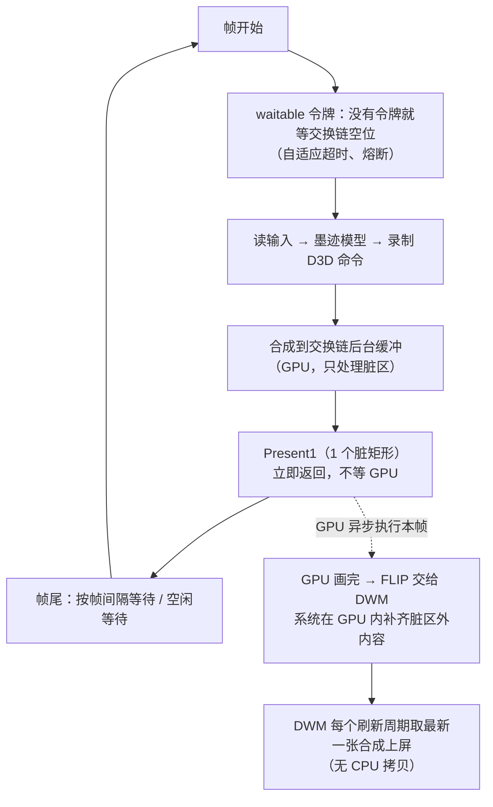
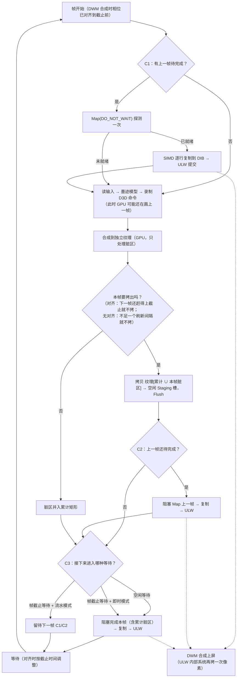

# 第2步-B 设计：ULW 独立纹理、CPU/GPU 重叠与合成时机对齐

> 状态：规划完成，待用户审阅批准（未 `task.py start`）。分支 `refactoring/draw`（HEAD bcc11421）。
> 行号以 bcc11421 为准；C=`Draw3.DrawingController.cpp`、R=`Draw3.Renderer.cpp`、P=`Draw3.TransparentPresentation.cpp`。

## 1. 已确认决策（2026-11-18 用户）

| 编号 | 决策 |
| --- | --- |
| D1 | ULW 模式不建交换链，Draw3 直接画到一张独立 `ID3D11Texture2D`（RT\|SRV），之后仍经 Staging 读回到 DIB 交给 ULW。不采用 GDI 兼容纹理 + `GetDC`。 |
| D2 | 读回完成时机**自适应**：GPU 跟得上时在本帧空闲时间内完成并立即提交（延迟同现状，即时模式）；GPU 跟不上时转为下一帧算完再提交（流水模式），CPU 计算与 GPU 绘制重叠，CPU 最多领先一帧。 |
| D3 | 性能页“渲染与兼容”节新增“ULW 模式下异步读回”，默认开、重启生效，紧跟 waitable 开关；配置键 `Experimental.Inkeys3.Draw3.EnableUlwAsyncReadback`。关闭 = 同步读回、不节流、不对齐（独立纹理与 SIMD 复制仍保留）。 |
| D4 | 不把 `UpdateLayeredWindowIndirect` 移到独立线程；B 完成后用实机日志（`ulw_ms` 平均与长尾）评估是否需要。 |
| D5 | 辅助输出 SelectionUlw（DrawpadPresentation）保持同步路径，只改主画布 ULW。 |
| D6 | ULW 提交不超过显示刷新率（预设帧率高于刷新率时）：跳过的帧合并脏区，下次一起读回（§5.8）。 |
| D7 | 逐行复制改为单遍 SIMD（SSE2 / NEON），结果逐字节不变，保留标量版本作回退和基准（§5.9）。不受开关影响。 |
| D8 | 检测 DWM 是否在合成（启动与 `WM_DWMCOMPOSITIONCHANGED`）并记日志，刷新间隔来源随之切换（§5.10）。 |
| D9 | 原阶段 E 的 ULW 部分并入 B：DWM 合成时 ULW 提交对齐合成时机（§5.11）。 |
| D10 | DComp 的合成时机对齐留在父任务阶段 E（Win8+ 可用 `IDCompositionDevice::GetFrameStatistics`），阶段 D（Win7 DWM GPU 路径）也可能复用；B 的合成时钟模型做成可共用组件。 |

## 2. 目标与非目标

- 目标：ULW 主画布做到“CPU 计算时 GPU 在画、GPU 在画时 CPU 在算/提交”，排队上限一帧；GPU 快时延迟不变差；DWM 合成时让提交恰好赶在合成之前，降低平均延迟；整帧场景的 CPU 复制更快。
- 非目标：DComp 路径不变；不引入 GPU 查询自旋，不用 Win8+ 才有的 `EnqueueSetEvent`/Fence（Win7 是 ULW 的主要用户）；不改脏区算法（仍单矩形，多矩形脏区已记入中期重构第5步）；不做提交线程；不做 Win7 DWM GPU 呈现路径（阶段 D）。

## 3. 拷贝次数：ULW 与 DComp 的区别

“独立纹理”和“交换链 buffer 0”在 ULW 模式下拷贝次数**完全相同**：现在 ULW 模式的交换链从不 Present，只被当作普通纹理用，去掉它只省一张闲置缓冲。真正的差别在 ULW 和 DComp 之间：

| 步骤（只处理脏区） | ULW（现状 = 方案后） | DComp |
| --- | --- | --- |
| ① Draw3 合成到最终目标 | GPU 写最终纹理 | GPU 写交换链后台缓冲 |
| ② 显存 → CPU 可读内存 | **GPU 拷贝**：最终纹理 → Staging（独显经 PCIe 回传，核显为内存拷贝） | 无 |
| ③ CPU 复制 | **CPU 逐行复制**：Staging → DIB，顺带把透明像素 α 补成 1（主窗命中）。这是 Inkeys 自己的代码 `CopyAndInspectUlwDirtyRows`；ULW 只接受 HDC 里的 DIB，Staging 内存归驱动所有、行宽也不同，无法直接交给 ULW | 无 |
| ④ 交给系统 | **系统内部拷贝**（`UpdateLayeredWindowIndirect` 自己完成，Inkeys 不写代码也去不掉）：DIB 脏区 → 窗口重定向表面，DWM 合成时当纹理读取；具体怎样进入 GPU 可读内存由系统和驱动决定。DWM 未合成时由 GDI 直接画到屏幕 | `Present1`：缓冲直接交给 DWM，不拷贝像素 |
| ⑤ 局部 Present 的补齐 | 无（DIB 持久） | FLIP 模型由系统在 GPU 内同步上一帧（显存→显存，开销很小） |
| ⑥ DWM 合成桌面 | 有 | 有 |

结论：ULW 每帧跨两次 CPU/GPU 边界（②、④）外加 CPU 复制③；DComp 像素始终在显存。阶段 B 不减少拷贝次数，改的是：拷贝和 CPU 计算能同时进行（§5.1–5.6）、多余的提交不做（§5.8）、提交时机贴近合成（§5.11）、③本身更快（§5.9）。

## 4. B1：独立纹理（无交换链）

- `Impl::TryInitialize`（P:1247）：ULW 模式跳过 `CreateSwapChain`，`swapChain` 保持空；`renderer->Init(..., nullptr, ...)` 走已有离屏分支（R:456–466，`BGRA8`、`RENDER_TARGET|SHADER_RESOURCE`）。DComp 与已禁用的 DWM 玻璃模式不变。
- `InkRenderer::Resize`（R:578）：允许 `swapChain == nullptr`，跳过 `GetDesc1/ResizeBuffers`，保留 L2/L1/激光的逻辑不变，`CreateSizeDependentResources(nullptr, …)` 重建纹理。C:15537 原样传入 `presentation_.SwapChain()`（ULW 下为空）。
- `PublishInformation`（P:969）：ULW 下改为“最终目标：独立纹理 W×H BGRA8”，并显示读回模式（异步/同步）、DWM 状态。`LogSwapChainRuntimeDescription` 在 ULW 下跳过。
- 帧延迟句柄只属于 DComp waitable 交换链，不受影响。
- 显存（4K，每张约 31.6 MiB）：现状 = 交换链 2 + Staging 1 + DIB 1；方案后（异步）= 纹理 1 + Staging 2 + DIB 1，**总量相同**；同步 = 纹理 1 + Staging 1 + DIB 1。

## 5. B2：异步读回、节流、SIMD 与合成对齐

### 5.1 结构

`UlwDirtyRectPresenter` 增加异步模式（只给主画布用）：

- `stagingSlots[2]`：两张全尺寸 Staging，轮流使用。
- `pending`：最多一条待完成记录 `{slot, dirty, presentFull, contentRevision, submitQpc, generation}`。
- `accumulatedDirty`：被节流跳过、尚未拷出的脏区并集（§5.8）。
- 最终纹理只有一张：GPU 按命令顺序执行，“拷贝 N 到槽”先于“画第 N+1 帧”完成，后续改写不影响已入队的拷贝。
- DIB 持久，各次提交**按顺序**只写自己的脏区，所以每个槽只需包含本次提交的脏区。

### 5.2 一帧里的三个完成点

> 2026-11-18 开工核对（Codex 只读）后修订：即时模式改在 `Present` 内完成（原为帧尾），阻塞经现有帧外补等通道（`ConsumePresentLatencyWait`）计入等待；帧尾只在进入空闲等待前完成，覆盖主循环全部空闲等待（含前段 idle/Hold、后台维护分支）。原因：帧尾处本帧指标已结算，无法满足 §5.7 口径；前段空闲等待原方案未覆盖。

| 点 | 位置 | 动作 |
| --- | --- | --- |
| C1 帧开头 | C:21768 附近，`PrepareFrameLatency` 之后（恢复/Resize 之后、读输入之前），`BeginUlwFrame` | 有待完成帧 → `Map(DO_NOT_WAIT)` 探测一次，已就绪就复制并提交，未就绪不等待。累计脏区**不在这里拷出**（此时纹理还是上一帧内容，拷出会占用本周期、挤掉本帧更新内容；Codex 最终审阅 P2）。 |
| 帧尾拷出 | 三个固定帧截止等待分支开头（计算本帧工作耗时之前），`ServiceUlwBeforeFrameWait` | 被节流累计的脏区到点就拷出（纹理已含本帧最新内容）；笔停在原地不再产生脏区时也能在一个周期内上屏。 |
| C2 提交背压 | `Present` 内，本帧拷贝入队并 `Flush` 之后 | 上一帧仍待完成 → 阻塞 `Map` → 复制 → ULW，保证 CPU 最多领先一帧、DIB 按顺序写入。 |
| 即时完成 | `Present` 内，C2 之后 | 即时模式（或流水模式每 500 ms 的试验帧）立即阻塞完成本帧；流水模式其余帧留到下一帧 C1/C2。整帧（Resize、恢复、输出交接、清屏）一律立即完成，不节流。 |
| C3 空闲前 | 每个空闲等待之前（前段 idle/Hold、后台维护分支、帧尾光栅失败与 `!active.empty()` 两个空闲分支），`CompleteUlwBeforeIdle` | 阻塞完成待完成帧并拷出累计脏区，停笔后最后一帧必定上屏。固定帧截止等待分支不完成，只做 §5.11 的相位微调。 |

- 每次拷贝入队后 `context->Flush()`，否则命令可能留在缓冲区，C1 永远探测不到就绪。
- Win7 没有 GPU 完成事件；阻塞 `Map` 是驱动内核等待（同现状），不自旋；`DO_NOT_WAIT` 每帧最多探测一次（C1），不轮询。
- `Present` 先做 §5.8/§5.11 的“本帧是否拷出”判定：不拷出时只合并脏区，不占用槽，也不产生待完成帧。

### 5.3 自适应模式（纯状态机，新头文件，可无窗口单测）

- **即时模式**（默认）：C3 阻塞完成，记录阻塞耗时 `mapWaitMs`。
- 即时 → **流水**：连续 3 帧“总耗时超出帧预算，且 `mapWaitMs` ≥ 帧间隔的 25%”（GPU 拖慢了这一帧）。
- 流水 → 即时：每 500 ms 试一帧即时完成；试验帧总耗时 ≤ 帧间隔的 90% 时切回，否则继续流水。
- 空闲等待前、Resize、输出切换一律立即完成，不受模式影响。
- 阈值是初始值，集中为常量，实机后可调。

### 5.4 回执语义

- `Present()` 返回成功 = 本帧已写入最终纹理，并已进入提交流程（拷贝入队、或被节流合并到下一次提交），且本次调用中完成的提交都成功。被节流跳过的帧不做背压，上一帧的待完成提交可留到下一帧 C1/C2（没有新拷贝入队，CPU 领先量不增加）。帧循环里依赖“Present 成功”的逻辑（光标旧位置、形状预览计时、文稿 ready、运行指标 `PresentReturned`、画布调试“输入→上屏”）全部保持现有代码，按“已提交”理解，与 DComp `Present1` 同口径（`Present1` 返回时也只是提交）。
- 实际上屏比这个回执晚一段 `commitLag`（本帧写入纹理到包含它的 ULW 返回）：流水模式最多约一帧，节流/对齐时最多约一个刷新周期。单独记入诊断（§6），不混入现有指标。文稿 ready 可能比画面早这么一段，可以接受。
- 延后完成失败（`Map` 或 ULW 失败）→ `SetFailure` + `needsFullReadback`，完成接口返回 false，帧循环 `window_.RequestFullPresent()`，下一帧走现有恢复并整帧读回。最终纹理始终正确，整帧重读即可；`accumulatedDirty` 只服务节流，不用于失败恢复。

### 5.5 必须先完成或丢弃待完成帧的时机

| 时机 | 处理 |
| --- | --- |
| Resize（`Presenter::Resize`） | 丢弃 pending、清空 `accumulatedDirty`、`needsFullReadback`（DIB 会重建） |
| 输出切到 SelectionUlw（`SetOutputTarget`） | 先阻塞完成主画布待完成帧并拷出累计脏区，再走辅助同步路径；失败时 `SetFailure`，帧循环随后的恢复检查处理；待恢复时不 `Map` |
| `ReleaseAttempt` / 恢复 / 设备丢失 / Shutdown / 降级 | 丢弃（不 `Map` 已移除的设备） |
| 进入空闲等待 | 阻塞完成（C3），含累计脏区 |
| 帧循环外的 Present（`ClearCanvas` 等，C:15487/15521） | 均为整帧，立即完成，不留待完成帧 |
| 熔断后残留的待完成帧/累计脏区 | 下一次 `Present` 仍经异步入口收尾（完成残留、并入累计脏区后走同步） |
| 本帧光栅/合成失败（最终纹理可能被部分覆写） | `DiscardUlwAccumulated`：丢弃累计脏区并要求下一次整帧读回（不 Map）；已冻结在槽里的提交照常完成。覆盖之后的输出切换、C1 熔断收尾、C3 等跨帧入口（Codex 复核 P2） |
| 强制提交（整帧、C3、熔断收尾） | 节流槽位从本次提交重新起算，不预支未来周期；普通提交保留槽位余数 |

### 5.6 熔断与开关

- `Map(DO_NOT_WAIT)` 返回 `WAS_STILL_DRAWING` 以外的错误、但设备未移除 → 本会话改走同步读回（Warn 日志一次）并整帧读回。设备移除 → 现有恢复流程。
- 开关关闭或熔断 = 同步读回：保持现有 `Present` 流程（单 Staging，`Map(READ, 0)`，每帧提交），只把源换成独立纹理、复制换成 SIMD。

### 5.7 等待与工作耗时的口径（阶段 C 前提）

`Map` 阻塞时间计入等待、不计入工作耗时，与 A 的 waitable 等待同口径：`Present` 内的阻塞（C2、即时完成）经 `ConsumePresentLatencyWait` 从 Present 耗时扣除并计入 `frameLatencyWaitMs_` / `metricsState_->frame.latencyWaitMs`；C1 直接累加；C3 发生在空闲前，本帧指标已结算，只累加 `frameLatencyWaitMs_`。§5.11 的相位调整体现在固定帧截止等待的时长里，本来就不计入工作耗时。逐行复制和 ULW 调用计入工作耗时。异步关闭的同步路径保持现状（`Map` 仍算在 Present 耗时里）。

### 5.8 提交节流：每个刷新周期最多一次 ULW

- **为什么 DComp 不需要、ULW 需要**：DComp 每帧 `Present1`（SyncInterval 0），DWM 每周期只取最新一张，多余的帧由系统丢弃，几乎无成本。ULW 每次调用系统都立即拷贝像素，加上我们的回读与复制，多余提交全是白做。
- **刷新间隔**：DWM 合成时用 `DwmGetCompositionTimingInfo`（现有 `QueryCompositionRefreshMilliseconds`）；否则用窗口所在显示器的 `EnumDisplaySettings` 刷新率；再失败按 60 Hz。只在 `target_fps` 高于刷新率时启用。
- **简单间隔规则**（DWM 未合成、对齐关闭或流水模式时使用）：本帧照常合成到纹理；提交槽位按刷新周期推进（保留余数，落后超过一个周期时从本次提交重新起算），`Present` 时未到下一个槽位（留半个帧间隔容差吸收抖动）只把脏区并入 `accumulatedDirty` 并返回成功；到槽位后把 `accumulatedDirty ∪ 本帧脏区` 拷到槽，走 §5.2。长期提交率不超过刷新率（单测覆盖 240/60、120/90、240/165、144/120 与抖动序列）。
- **延迟代价**：简单间隔规则下提交落在刷新周期任意位置，平均多旧约半个周期减半个帧间隔（60 Hz、预设 240 时约 6 ms，最坏约 12.5 ms）。DWM 合成时由 §5.11 消除。
- 必须立即提交的时机见 §5.5。

### 5.9 单遍 SIMD 逐行复制

- 位置：§3 第③步 `CopyAndInspectUlwDirtyRows`（P:226），`Map` 成功之后、ULW 之前，纯 CPU。
- 现状每行两遍：`memcpy`，再逐像素标量循环，做命中底层 α 修正（等价于 `α ≤ 127 ? α + 1 : α`，仅主画布）、全透明累计、预乘检查（B、G、R ≤ α）。
- 改为一遍：每次读 16 字节（4 个 BGRA 像素），寄存器内完成 α 修正（α 有符号比较 ≥ 0 生成掩码，只加到 α 通道）、α 或运算累计全透明、`max_epu8(像素, α 复制到四通道) == α 复制值` 判断预乘，再写入 DIB；行尾不足 4 像素走标量。x86/x64 用 SSE2，ARM64 用 NEON，编译期选择；保留标量模板作回退。
- 像素诊断采样帧（`InspectPixels=true`）继续走标量，诊断语义不变。
- 收益集中在大脏区（翻页、漫游、Resize 整帧）；小笔迹本来就不慢。用 benchmark 实测，不预设数字。

### 5.10 DWM 状态特判

- 启动时与 `WM_DWMCOMPOSITIONCHANGED`（已有 `compositionChangedRequested_` → 主循环刷新 presenter）时用 `DwmIsCompositionEnabled` 检测，记录一行日志：DWM 是否合成、刷新间隔及来源（DWM / 显示器 / 默认 60 Hz）、对齐是否启用。
- DWM 未合成（Win7 Basic / 经典主题 / DWM 未运行）时 ULW 由 GDI 直接画屏，读回流程不变，只用显示器刷新率做简单间隔节流，不对齐。
- 阶段 D 可直接复用这部分检测与日志。

### 5.11 对齐 DWM 合成时机（原阶段 E 的 ULW 部分）

**原理**：DWM 每个刷新周期在垂直同步附近合成一次，取各窗口当时最新的内容。提交刚好落在合成之后要白等将近一个周期；落在合成之前不久等待最短。目标：每个刷新周期里最后一次赶得上合成的提交，带着尽量新的输入。

**合成时钟模型**（纯逻辑组件，无窗口单测；阶段 D/E 复用）：
- `DwmGetCompositionTimingInfo(nullptr)` 读 `qpcVBlank` 与 `qpcRefreshPeriod`，推算下一次垂直同步 `nextVBlank`。
- 约每 250 ms 重读校正漂移，不逐帧调用；启动、`WM_DWMCOMPOSITIONCHANGED`、Resize/显示器变化时立即重读。读取失败、周期不合理（<1 ms 或 >100 ms）或 DWM 未合成 → 关闭对齐，回到 §5.8 简单间隔规则。
- `deadline = nextVBlank − margin`，margin 初始 2 ms（常量，实测调整）。
- `commitEstimate` = 近期“Map 等待 + 逐行复制 + ULW”的 EMA 与近期最大值中较大者，宁可高估。
  - 实机后修正（2026-11-18）：只记录入队后当场完成的普通提交。整帧提交（Debug 下 30–48 ms）和延后完成的提交不计入，否则估计被撑大约 16 次提交，对齐时机随之偏离截止（实测 `leadAvgMs` 升到 20–35 ms）。

**按预设帧率与刷新率的关系分别处理**：

| 组合 | 帧循环 | ULW 提交 | 上屏效果 |
| --- | --- | --- | --- |
| 预设高于刷新率（240/60） | 照常 240 帧/秒（读输入、算墨迹、GPU 画进纹理都每帧做） | 若下一帧来提交也赶得上 deadline，本帧只合并脏区；否则本帧就是本周期最后赶得上的一帧，立即拷出提交 | 每周期 1 次、且是最新那帧，与 DComp 下 DWM 取最新缓冲一致；多余帧只花计算与 GPU 绘制，不花回读与 ULW |
| 预设等于刷新率（60/60） | 固定帧截止等待分支中调整帧开始相位，使 `帧开始 + 工作时长 EMA + commitEstimate ≈ deadline` | 每帧 1 次 | 输入尽量晚读，平均比不对齐少约半个周期 |
| 预设是刷新率的约数（30/60、60/120） | 同上，对齐到每隔 N 个垂直同步 | 每帧 1 次 | 每帧停 N 个周期，节奏均匀 |
| 预设低于刷新率且非约数（60/75、120/144） | 不调相位（强行锁相会让帧间隔忽长忽短） | 每帧立即提交 | 与现状相同；日志 `aligned=0 reason=non-divisor`（建议预设选刷新率或其约数） |
| DWM 未合成 | 照常 | 简单间隔节流（仅预设高于刷新率时） | GDI 直接画屏，可能撕裂，无法对齐 |

- 相位调整平滑：`WaitForFrameDeadline` 目标每帧最多移动帧间隔的 10%。Down/Up 等打断式唤醒的帧不等对齐，立即处理。
- **适用条件**：主画布 ULW + DWM 合成 + 即时模式。流水模式吞吐优先，不调相位，只保留简单间隔节流。Win8+ 动态刷新率靠 250 ms 重读跟随。
- **开关**：跟随“ULW 模式下异步读回”；另加无界面配置键 `Experimental.Inkeys3.Draw3.UlwCompositionAlign`（默认 true），用于实机开/关对照。
- **局限**：ULW 拿不到“是否赶上合成”的系统回执，只能看预测值（§6）；实际延迟靠用户实机或高速摄像对照开/关。

## 6. 诊断（均为 Debug 级别，默认不输出）

- 每秒汇总：`[Draw3Diag][ulw-pipeline] mode=immediate|pipelined immediate= deferred= probeHit= backpressure= skipped= mapWaitAvgMs= mapWaitMaxMs= commitLagAvgMs= commitLagMaxMs= rowsAvgMs= ulwAvgMs=`。
- 每秒汇总（对齐启用时）：`[Draw3Diag][ulw-align] aligned= periodMs= marginMs= leadAvgMs= leadMinMs= lateCount=`（lead = deadline − 实际提交结束，正为提前）。
- DWM 状态行（§5.10）、模式切换、熔断、对齐启停（含原因）各记一行。
- 现有 `[Draw3Diag][ulw-pixels]`：`copy_map_ms` 拆出 `map_wait_ms`，并记录完成点（C1/C2/C3）。
- 热路径不加锁、不分配；字符串只在汇总时格式化。

## 7. 流程图

### 7.1 DComp 通道（不变，用作对照）



### 7.2 ULW 通道（方案后）



### 7.3 时间关系对比

```text
现状同步 ULW（单线程串行，GPU 慢时整帧被拖长）：
CPU : [算 N][等GPU......][复制+ULW N][睡]   [算 N+1][等GPU......][复制+ULW N+1]
GPU :       [画N+拷贝]                             [画N+1+拷贝]

方案后·即时模式（GPU 快：与现状相同；DWM 合成时整帧挪到截止前）：
CPU : [睡....][算 N][等][复制+ULW N]|合成|[睡....][算 N+1][等][复制+ULW N+1]|合成|
GPU :              [画N]                              [画N+1]

方案后·流水模式（GPU 慢：算 N+1 与画 N 重叠，提交 N 与画 N+1 重叠）：
CPU : [算 N+1][取N 复制+ULW N][睡][算 N+2][取N+1 复制+ULW N+1][睡]
GPU : [画 N .........][画 N+1 .........][画 N+2 .........]

方案后·预设 240 / 刷新 60（每帧都算和画，只在截止前拷出最新一帧）：
CPU : [算1][算2][算3][算4 + 拷出提交]|合成|[算5][算6][算7][算8 + 拷出提交]|合成|
```

## 8. 兼容性核对

- 画布调试：调试板、标记、快照、激光、底纹都经 `backBufferRTV` 写入，名称与语义不变。
- 主窗命中底层 α、像素诊断：仍在逐行复制里完成，SIMD 结果逐字节一致。
- SelectionUlw：同步，不变；切换前先完成主画布待完成帧并拷出累计脏区。
- 运行期 DComp → ULW 降级、强制 ULW：经 `TryInitialize` 走同一条无交换链分支。
- Win7 SP1 + KB2670838：不再对 layered HWND 建从不 Present 的 FLIP 链；`DO_NOT_WAIT`、`Flush`、Staging 在 D3D11 / WARP 上可用；`DwmGetCompositionTimingInfo` 在 Win7 DWM 合成时可用，未合成时回退。需要用户实测（含 Basic 主题）。
- A2 光标节拍、鼠标笔迹采样：帧循环照常按预设帧率运行，不受节流影响；对齐只调整固定帧截止等待的相位。
- 无窗口测试原本就用离屏分支，不受影响。

## 9. 测试

- 无窗口单测（`InkeysHeadlessTests`）：
  - 自适应状态机：切换阈值、试验帧、空闲前强制完成、熔断后不再回到异步。
  - 节流与对齐：简单间隔跳过与合并、预设不高于刷新率时不节流、“下一帧是否赶得上”判定、相位逐步收敛（每帧 ≤10%）、约数与非约数帧率、DWM 未合成/读取失败/周期异常回退。
- `--draw3-ulw-copy-benchmark`：SIMD 与标量逐字节对照（随机像素、各种宽度与行尾、主画布/辅助两种）并输出两者耗时。
- Inkeys 自测：双槽顺序（N 与 N+1 脏区交错时 DIB 等于同步路径）、节流合并后 DIB 等于每帧提交、Resize 丢弃、`DO_NOT_WAIT` 未就绪时 C2 阻塞完成。
- `Renderer` 无交换链 `Resize` 的保留 L2/L1 测试。
- `Draw3.HiddenWindowTest` 已有强制 ULW 场景（需用户授权运行）。
- 实机（用户）：本机强制 ULW 与 Win7（Aero 与 Basic 各一）；预设 30/60/120/240 对应不同刷新率；书写、大橡皮、漫游、`Start-StressLoad` GPU 加压；看 `[ulw-pipeline]`、`[ulw-align]`；异步开关与对齐配置键开/关对照。
