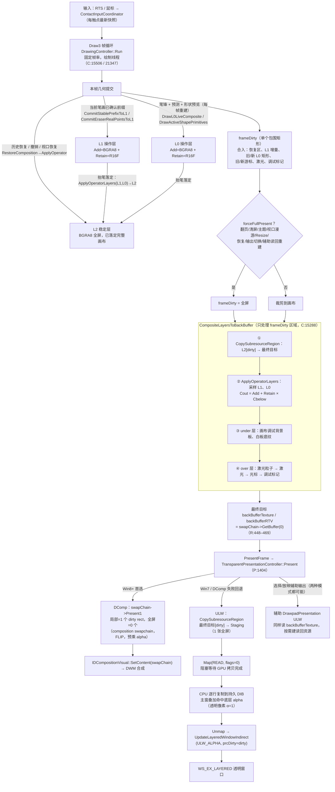
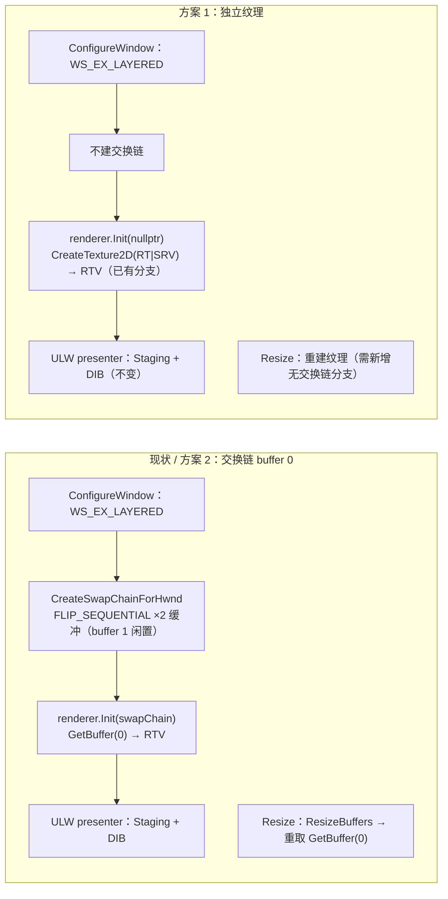
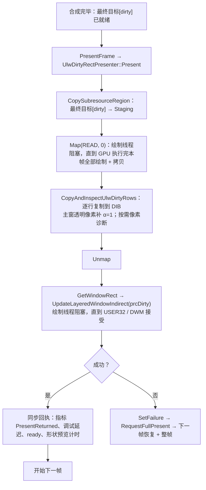
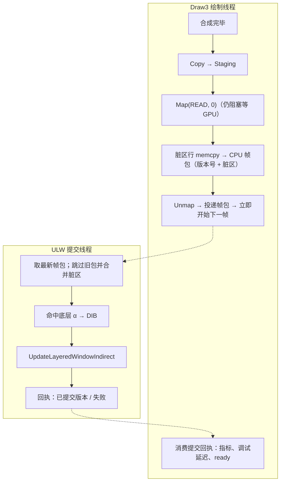
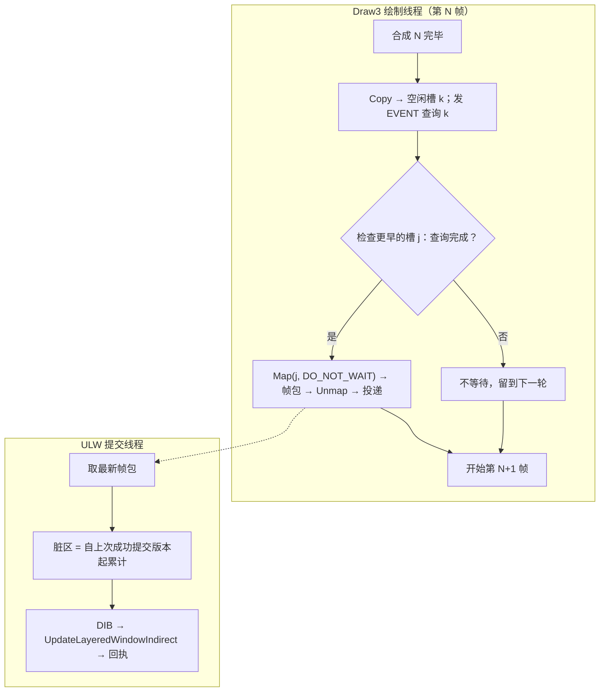

# Draw3 透明画布呈现链路现状（refactoring/draw @ 7047db94）

> 来源：Claude 独立读码 + Codex（gpt-6.1-sol / high / fast，只读）调查，见 `codex-investigation-20261117.md`。
> 行号以 7047db94 为准；简称 C=`Draw3.DrawingController.cpp`、R=`Draw3.Renderer.cpp`、P=`Draw3.TransparentPresentation.cpp`。
> 用户实测前提：Win7 SP1 + KB2670838 上 `CreateSwapChainForHwnd` + `FLIP_SEQUENTIAL` 可用（不以微软文档为准）。

## 1. 端到端流程图



> 注：ULW 模式下同样创建了一条绑定到主 HWND 的双缓冲 FLIP 交换链，但**从不 Present**，只用 buffer 0 作为渲染目标（P:1015–1026、1126）。

## 2. 三层墨迹（L0 / L1 / L2）

| 层 | 内容 | 生命周期 |
| --- | --- | --- |
| L2 | 已经落定的整页画布（含漫游时逐 tile 恢复的历史结果） | 持久；抬笔落定、撤销、恢复、视口变化时更新 |
| L1 | 当前笔画中“不会再改”的稳定前缀（橡皮也写这里） | 笔画期间增量写入，抬笔后合入 L2 并清空 |
| L0 | 当前笔画末端笔锋 + 预测段 + 形状预览 | 每帧重建；抬笔后清空 |

L1/L0 不是普通颜色层，而是“操作层”：`Add`（颜色增量）+ `Retain`（保留下层比例），用于让橡皮、高光等能正确作用于下层。

## 3. 脏区如何工作

1. **每帧从空矩形开始**（C:21930），把本帧所有变化的区域合并成**一个包围矩形**（`UnionRectInPlace`）。光标/激光/调试标记会同时合入“旧位置 + 新位置”，以便先擦掉上一帧的痕迹。
2. **合成只碰脏区**：先把 L2 的脏区拷到最终目标，再在脏区内叠 L1/L0 和上下装饰层。脏区之外的像素依赖最终目标“保留上一帧内容”。
   - ULW：buffer 0 从不 Present，内容天然持久。
   - DComp：FLIP 交换链 Present 后 buffer 0 身份会被 D3D11 运行时轮换；局部 `Present1` 时，脏区外的内容由系统用上一帧补齐（`DXGI_PRESENT_PARAMETERS` 文档：应用只需更新 dirty rect 内的每个像素）。
3. **呈现端使用同一个矩形**：DComp 作为 `Present1` 的 dirty rect；ULW 作为 GPU→Staging 的拷贝范围和 `prcDirty`。
4. **整帧触发**：翻页、清屏、主题、视口漫游、Resize、设备/呈现恢复、输出目标切换、辅助读回重建等直接 `forceFullPresent`。
5. **失败处理**：当前**没有**“累计未提交脏区”。ULW/Present 失败 → `RequestFullPresent()` + 恢复流程 → 下一帧整帧重呈现。旧研究备忘中“累计区域”的描述是候选方向，不是现状。
6. 已知代价：单包围矩形会把相距较远的两处小变化（如大光标旧/新位置）合成一大块（见第5步文档 §4.4）。

## 4. 当前 ULW 时间关系（同一线程串行）

```text
Draw3 绘制线程：合成 N → Copy N → Map 等 GPU → CPU 复制/alpha → ULW N → 合成 N+1 ...
GPU：            执行 N 的绘制与 Copy ─┘(Map 在此阻塞)        空闲等待下一批命令
```

## 5. ULW 渲染目标：方案对比

| 维度 | 方案 1：ULW 模式用独立 `ID3D11Texture2D` 作最终目标 | 方案 2：保留 HWND 交换链 buffer 0（现状） |
| --- | --- | --- |
| Renderer 改动 | 小：`CreateSizeDependentResources(nullptr, …)` 已有离屏纹理分支（R:456–466，目前供无窗口测试用）；需给 `Resize()` 补无交换链分支 | 无 |
| 呈现器改动 | ULW 模式不再 `CreateSwapChain`，renderer 以 `nullptr` 初始化；`SwapChain()` 在 ULW 下返回空；诊断/信息面板改记录纹理描述 | 无 |
| 显存 | 少一张全屏缓冲（FLIP 至少 2 张、只用 1 张；4K 约省 32 MiB） | 维持 2 张 |
| 平台依赖 | ULW 路径不再依赖“对 layered HWND 建 FLIP 链但不 Present”这种未被验证的组合 | 保留该组合（行为待实测，代码无法证明有无副作用） |
| 扩展性 | 纹理可加 `SHADER_RESOURCE`（现分支已带），为将来 GPU 侧预处理（如命中底层 alpha）或多读回槽流水线留余地 | 交换链缓冲仅 `RENDER_TARGET_OUTPUT` |
| 画布调试/可视化 | 不受影响：调试板、标记、快照、激光、底纹都经 `backBufferRTV` 写入，名称与语义保留 | 不受影响 |
| DComp 路径 | 不变（DComp 仍用 composition swapchain） | 不变 |
| 流水线收益 | **本身不消除** Copy/Map/CPU/ULW 串行，两方案都需另做异步化 | 同左 |

### 异步流水线（两方案共同的后续工作）需注意的兼容点

以下逻辑都以“`Present()` 同步返回成功 = 本帧已上屏”为前提，ULW 一旦异步化必须重新定义回执：

- `PresentFrame` 的 `metricsState_->PresentReturned` 与画布调试面板的“输入→上屏延迟”（以 Present 返回为终点）。
- `publishWorkspaceReadyAfterPresent()`、`recordShapePreviewPresented()`、`observer_.presented` 回调。
- 辅助输出的 `committedFullFrameClean` / 全透明校验与 `ReleaseAuxiliaryReadbackResources` 的版本核对。
- 失败后的整帧重试（异步后需要“从最后成功提交版本累计脏区”）。

## 6. 合成完毕之后：现状 vs 各方案的步骤对比

### 6.1 初始化 / Resize（方案 1 与现状的唯一实质差别）



### 6.2 每帧：现状同步 ULW（方案 1 的每帧步骤与此完全相同，只是源从 buffer 0 换成独立纹理）



### 6.3 阶段 1 候选：独立 ULW 提交线程（方案 1/2 均可叠加）



收益：ULW 调用不再占绘制线程；`Map` 等 GPU 仍在。

### 6.4 阶段 2 候选：多 Staging 槽 + GPU 完成查询



收益：绘制线程不再等 GPU 和 USER32；代价是排队深度、版本顺序、累计脏区、Resize/隐藏/设备丢失时的代次处理，以及回执语义变化。

## 7. DComp 路径是否已做到 CPU/GPU 重叠

**事实：**

- waitable 交换链：创建时带 `DXGI_SWAP_CHAIN_FLAG_FRAME_LATENCY_WAITABLE_OBJECT` 并 `SetMaximumFrameLatency(1)`（P:972–1006）；全仓库**没有调用 `GetFrameLatencyWaitableObject`**，没有任何地方等待这个句柄。设备级另有 `IDXGIDevice1::SetMaximumFrameLatency(1)`（GraphicsInitialization:156，对不带 waitable 标志的交换链生效）。
- 帧节奏由 Draw3 自己控制：有活动接触/漫游/动画时，一帧 = 输入消费 + 模型计算 + 录制 D3D 命令 + `Present1`，之后 `WaitForFrameDeadline(1000/target_fps - workMs)` 睡到下一帧（C:23500–23535）。`workMs` 包含 Present 耗时。
- DComp 每帧生产路径中**没有 CPU 读 GPU 的同步点**：无 `Map(READ)`、无 `GetData` 查询、无 Staging 读回。`Map` 只用于常量/动态缓冲（WRITE_DISCARD / NO_OVERWRITE）。唯一的显式等待是输出交接屏障时的 `DwmFlush()`（P:1432，非每帧）。读回只出现在测试/探针（Renderer 自测、RendererDebugOverlay/RendererPattern 测试、`RunLaserRasterFailureProductionProbe`）。

**结论：** D3D11 命令本来就是异步提交的。`Present1` 返回时 GPU 往往还在执行第 N 帧，绘制线程随即睡眠或开始第 N+1 帧的输入与墨迹计算，两者自然重叠。重叠靠的是“D3D11 异步命令队列 + Present1 不等 GPU 完成”，而**不是** waitable 对象。

**推断 / 待实测：**

- 未等待 waitable 句柄时，帧延迟上限是否仍由 `Present1` 内部阻塞执行，各系统/驱动可能不同；可用现有 `lastPresentDurationMs_` / 运行指标 `presentWallMs` 观察 Present1 是否出现接近一帧的阻塞。
- 若 GPU 单帧耗时超过帧预算（如 4K 大橡皮），排队受最大帧延迟 1 限制，CPU 会在 Present1（或下一次资源写入）处被 GPU 拖住，属于正常背压。

**对照 ULW：** ULW 在 Copy 后紧接 `Map(READ, 0)`，强制 CPU 等 GPU 执行完本帧**全部**已排队命令，再同步做 CPU 复制与 ULW 提交，重叠被完全打断。§6.4 的多 Staging + 完成查询，本质就是把 ULW 恢复到与 DComp 同样的“CPU 不等 GPU”的关系。

## 8. 候选：DComp 正式使用 waitable 对象（未定案）

**用户约束：** 仅在 waitable 交换链创建成功时启用（Win8.1+）；创建失败的设备保持现状，**不引入** Win7 GPU 信号量 / 查询自旋等兼容方案（早期 Win7/Win11 测试中强等待在自旋时出现过丢信号问题）。目标是最多排队一帧、降低延迟。

**收益在哪里：** GPU 跟得上时（小脏区书写），队列不会满，现状延迟已接近最低，waitable 没有收益。收益出现在 GPU/合成成为瓶颈时（4K 大橡皮、整屏漫游）：现状是“先读输入→算墨迹→录命令→在 Present1 处被拖住”，输入在阻塞期间变旧；改为“帧开头先等交换链有空位→再读最新输入→算→画→Present1”，输入更新鲜，排队上限由句柄显式执行。

**必须处理的坑（代码事实）：**

1. **空帧不 Present。** `frameDirty` 为空或光栅失败时本帧不调用 Present（C:23230 附近）。waitable 句柄是计数信号量：等到一次就消耗一个名额，只有 Present 后被 DWM 释放才回补。若每帧都等、但空帧不 Present，名额会被耗尽，下一次等待一直超时。需要“令牌”语义：等到后持有，直到成功 Present 才释放；未持有令牌时才去等。
2. **等待点。** 放在帧截止等待（`WaitForFrameDeadline`）之后、消费输入之前；Down/Up 唤醒的帧同样要过这一步。
3. **必须有超时。** 窗口隐藏、最小化、DWM 暂停合成、输出交接时句柄可能长时间不发信号。超时后不能卡住绘制线程：可跳过本帧 Present（保留脏区到下一帧），并限频记日志。
4. **生命周期。** 句柄属于具体交换链：重建/恢复/模式切换时 `CloseHandle`，ResizeBuffers 须保留 waitable 标志（现代码已原样保留 Flags）。
5. **只作用于 DComp。** ULW（无论纹理还是缓冲区方案）不使用。
6. **帧率与刷新率。** `Present1(SyncInterval=0)`；target_fps 高于显示刷新率时，句柄会把帧节奏压到合成节奏，需与固定帧率计时、画布调试的 FPS/延迟统计协调。

**验证方式：** 同机 A/B（开/关），对比画布调试的输入→上屏延迟、`presentWallMs`、新增的等待耗时、p95/p99 帧时间；场景含小笔书写、4K 大橡皮、惯性漫游、隐藏/最小化/切换工作区。

### 8.1 现状的一个不确定点：排队上限此刻是否真的生效

- 微软对该标志的说明：使用 waitable 标志后，交换链的延迟必须用 `IDXGISwapChain2::SetMaximumFrameLatency` 设置，**不再使用** `IDXGIDevice1::SetMaximumFrameLatency`。文档没有说明“不等待句柄时 `Present1` 是否仍按上限阻塞”。
- 因此 Win8.1+ 上现在是“带 waitable 标志 + 从不等待”：设备级上限 1 已不适用，交换链级上限 1 是否在 `Present1` 内执行**未知**（取决于运行时/驱动）。最坏情况下 GPU 吃紧时可能排队超过 1 帧，延迟反而变大。
- Win8.0 及以下（waitable 创建失败后回退为同样 FLIP_SEQUENTIAL、仅去掉 waitable 标志的交换链）仍由设备级 `SetMaximumFrameLatency(1)` 在 `Present` 内阻塞执行，这是系统内建、无需应用等待的机制。

**待实测（建议并入阶段0）：** GPU 吃紧场景下记录每帧 `Present1` 耗时与输入→上屏延迟，分别测“现状（带标志不等待）”和“去掉 waitable 标志（设备级上限）”。

### 8.2 三种排队控制方式对比

| 方式 | 适用 | 如何限制排队 | 丢信号风险 | 延迟表现 |
| --- | --- | --- | --- | --- |
| A. 设备级上限（`IDXGIDevice1::SetMaximumFrameLatency(1)`，不带 waitable 标志的交换链，FLIP 或 BitBlt 模型均可） | Win7（未来 Win7 DWM 方案）、Win8.0、也可用于 Win8.1+ | DXGI 在 `Present` 内部阻塞 | 无应用侧信号，不需要超时 | GPU 吃紧时，阻塞前已读的输入会变旧 |
| B. waitable 正确使用（令牌 + 超时 + 熔断） | Win8.1+ | 帧开头等句柄 | 有，由令牌/超时/熔断兜底 | 最好：等到空位后才读输入 |
| C. 应用侧 GPU 事件查询等待 | 任意 | 自旋或轮询 `GetData` | 用户历史上踩过（自旋丢信号） | **不采用** |

### 8.3 超时与熔断建议

- **waitable 等待超时**：取“一个预设帧间隔”，即 `1000 / target_fps`（120 FPS ≈ 8.3 ms，60 FPS ≈ 16.7 ms），并设下限（如 4 ms）防止过低帧率配置造成长睡。超时**不是错误**，只表示本帧不提交 GPU 帧，CPU 继续消费输入（Down/Up 可靠性不受影响），脏区留到下一帧。
- **熔断**：窗口可见且合成正常（排除隐藏、最小化、输出交接、设备恢复）时，连续超时达到阈值（如连续 3 帧或累计 ≥ 100 ms），判定该设备 waitable 信号不可靠：本会话对该交换链关闭 waitable（重建为不带 waitable 标志的 FLIP 交换链，回到方式 A），日志记一次 Warn。熔断后不再尝试，避免“帧率和延迟都更低”。
- **方式 A 不需要超时**：阻塞由 DXGI 在 `Present` 内部完成，只做耗时观测。
- **ULW 阶段2 的 GPU 完成查询**：不自旋、不阻塞，每帧只用 `GetData(DONOTFLUSH)` 或 `Map(DO_NOT_WAIT)` 检查一次；某槽超过约 3 个预设帧间隔仍未完成，就回退为现有的阻塞 `Map(READ)`（驱动内核等待，不是自旋）取该槽，连续发生则熔断回同步路径。
