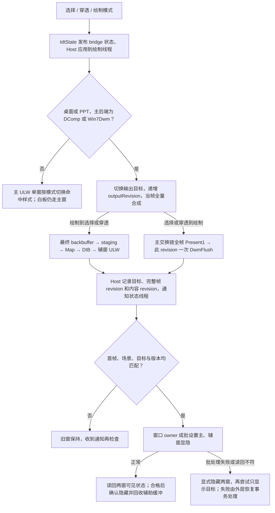
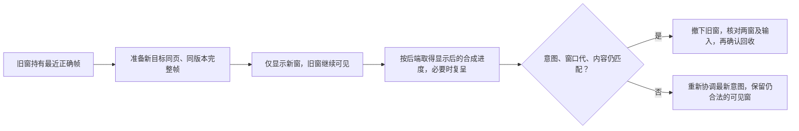

# 绘制与选择／穿透的画布交接

- 调查问题：有墨迹时，哪个线程准备哪一块窗口的像素，旧窗口在哪一步撤下，怎样保证用户持续看到同一页墨迹。
- 范围：生产 Draw3、IdtState、Window Service，基线为阶段 A 之后、A2 实现之前。本次为源码与 API 文档调查。
- 日期：2026-11-21。

## 当前路径

| 生产文件与行号 | 已确认的行为 |
| --- | --- |
| `Inkeys/IdtState.cpp:692`、`Inkeys/Inkeys/Drawing/Draw3/Draw3.Host.cpp:1869`、`Draw3.Bridge.h:192`、`Draw3.TransparentPresentation.cppm:37` | 选择与穿透均属于 computer interaction。桌面/PPT 的 GPU 主后端切到 SelectionUlw；白板选择仍是拖动。主后端已是 ULW 时沿用同一主窗口。 |
| `Draw3.DrawingController.cpp:21857`、`:21928`、`:23761`，`Draw3.TransparentPresentation.cpp:2292` | 只有输出实际变更才增加输出版本，切换要求完整帧。辅助 staging 被回收后的首个实际视觉帧也要求全量。主 ULW 模式切换不会仅为了目标不变而强制整帧。 |
| `Draw3.TransparentPresentation.cpp:852`、`:877`、`:973`、`:1002`、`:2468` | 主→辅时，绘制线程在旧主窗仍可见时完成同步 GPU 拷贝、阻塞 Map、逐行复制和 UpdateLayeredWindowIndirect。辅助无点击垫底，alpha 全零可以作为空页判断的一部分。 |
| `Draw3.TransparentPresentation.cpp:105`、`:1920`、`:2125`、`:2498`，`Draw3.Presentation.h:83` | 辅→主时，DComp 与 Win7Dwm 都走全帧 Present1，随后为本次切换执行一次 DwmFlush。Flush 失败会重新 arm 当前 revision 并启动恢复。Win7Dwm 采用 HWND 的 sequential 单缓冲，DComp 使用 composition 交换链。 |
| `Draw3.Host.cpp:1137`、`Draw3.PresentationState.h:17`、`Inkeys/IdtState.cpp:1052`、`:1119`、`:1164`、`:1214` | 状态线程在常规路径先同步命中样式，然后等 firstFrameReady、场景、目标、输出版本、内容版本和 PPT 页身份。目标未准备时保留当前可见窗。仅在有成功全帧时 Host 更新 ready 目标与输出版本；成功帧可以更新内容版本。无文档内容且辅助全帧 alpha 为零时才进入合法双隐藏。 |
| `Inkeys/Inkeys/Window/Window.cpp:1492`、`:4262`、`:4543`、`:4603`、`:4639` | 辅窗的 owner 是 Freeze，主窗的 owner 是辅窗，两者各为顶层 owned HWND。普通路径用同一 HDWP 批次提交两窗显隐，读回最终可见位；不是逐个执行两次 ShowWindow。批处理失败或读回不符时明确执行双隐藏再显示，目标仍失败时再次双隐藏。捕获释放失败也先双隐藏。外层命令有快照并尝试回滚（`:3985`）；回滚不能撤销已发生的显示间隙。 |
| `Inkeys/IdtState.cpp:1250`、`:4489`、`:4539`，`Draw3.Host.cpp:2096` | 成对显隐成功且版本仍匹配后才发送辅助隐藏回执。绘制 owner 校验 Host 代、产品/输出/内容版本、成功次数、尺寸再释放。通知可即时唤醒；250 ms 是兜底轮询。 |

表中简写的 `Draw3.*` 文件均在 `Inkeys/Inkeys/Drawing/Draw3/`。

## 和闪屏直接相关的两个边界

1. **目前已有内容就绪屏障，缺少目标窗口显示后的交接步骤。** 辅窗 ULW 提交和主窗 DwmFlush 都发生在修改显隐之前。同一批次能合并窗口管理操作，最终可见位也能全部正确，但这两件事各自都不能证明某一刷新周期的屏幕像素来自新 HWND。常规批次造成闪屏的频率仍需实测。失败分支的双隐藏空档可由控制流直接确认。微软将 EndDeferWindowPos 定义为一轮刷新内提交窗口位置操作，DwmFlush 只等待本应用已排队的 DirectX 更新。[EndDeferWindowPos](https://learn.microsoft.com/en-us/windows/win32/api/winuser/nf-winuser-enddeferwindowpos) · [DwmFlush](https://learn.microsoft.com/en-us/windows/win32/api/dwmapi/nf-dwmapi-dwmflush)
2. **Win7Dwm 的隐藏主窗需要单独处理提交结果。** PresentSwapChain 与交接屏障均按 `SUCCEEDED(hr)` 计数，且 Flush 的结果覆盖原 HRESULT。Win7Dwm 的 blt 模型可能得到 `DXGI_STATUS_OCCLUDED`——它是正值，含义是内容不可见。仅检查 `SUCCEEDED` 可能产生过早 ready；若改成一直等隐藏 HWND 返回 `S_OK`，又可能形成“等显示才能提交、等提交才能显示”的环。尚无目标机器日志证明此分支触发了用户所见闪烁。flip 模型不会返回这项状态。[微软 DXGI 状态码](https://learn.microsoft.com/en-us/windows/win32/direct3ddxgi/dxgi-status)

## 建议交接协议

- 将上述流程限定为同一有效场景、有墨迹、实际需要两窗互换时。窗口 owner 分两次提交显隐：第一次只显示新窗（不激活、不移动、不升顶）；第二次仅撤旧窗。复用原 owner/Z 序、命中门、capture 释放和辅助隐藏回执。主 ULW 继续单窗穿透，白板继续由自己的窗口事务管理；关机、最小化、空页和受保护故障仍可有意双隐藏。
- 主→辅复用现有完整同步 ULW 提交；收到 ready 后当即显示辅窗。核对窗口实际可见和最新版本，观察一次展示之后的合成进度，尽快撤下旧主窗。辅→主在旧辅助帧覆盖期间准备 GPU 全帧；如果隐藏时已完成有效提交，显示主窗后验证；若 Win7 返回 occluded，在旧辅窗持续可见时显示已准备的主窗并请求同版本全帧复呈。把“纹理已准备、可显示目标”和“可退休来源”作为两件事。可见复呈失败时保留有效来源并有界重试。必须验证主窗重新显示时不会露出退休 Laser 或上一页内容。
- 使用现有 revision 通知驱动正常路径，不人为等待 250 ms 或固定 sleep。评估在交接期安排一次显示后的 DWM 合成观测；DwmFlush 是候选同步机制，回执仍需和显示时刻、当前 revision 关联。CPU 显隐读回、帧率或一次 Flush 都不是单个 HWND 像素已扫描输出的通用证明。选定方案须通过屏幕帧证据，避免每帧 flush，避免给正常往返额外叠加两个全帧等待。不要在 UI/窗口线程阻塞等待绘制线程，而让绘制线程同时持有窗口租约反向等待。
- 交接记录绑定 Host/window generation、模式意图、输出目标/版本、内容版本、场景与显示尺寸。每一次显示、撤旧和回收前复查；Hide 失败保留已显示的新目标并重试收尾。过期操作不能隐藏后来成为来源的窗口。部分 native 写入仍须服从已有回滚、关机与安全隐藏覆盖。不同 PPT 页或故障中的旧内容只在既有场景安全合同允许时保留，尤其不能把旧页面呈现为新页面的 ready。
- 短暂双显示可能使荧光笔加深，用户已接受。进入穿透时，旧主窗即便设置 WS_EX_TRANSPARENT 仍不能完全等同于物理隐藏后的系统穿透；缩短重叠、处理捕获和按住输入，验证底层窗口真正收到新的点击。辅助读回缓冲应在真实隐藏之后回收，暂不以长期驻留额外整屏 DIB 作为优化。

## 验收与定位

| 验证手段 | 观测点与通过条件 |
| --- | --- |
| 无窗口逻辑测试 | 在既有 `InkeysHeadlessTests/draw3_bridge_tests.cpp:776` 屏障用例旁测试双向动作序列及故障注入。覆盖目标未就绪、过期回执、同版本重复回执、遮挡／复呈、显示失败、撤旧失败、重复切换和 A2 降到主 ULW。任何普通有墨迹交接在目标显示确认前都不能发出撤旧动作，失败或取消不能释放仍显示的辅助像素。 |
| 窗口层与状态合同 | 现有 `InkeysHeadlessTests/window_tests.cpp:1852` 检查终态；另需验证中间态、输入、capture 释放与快速反向、区域/设备变化、真实故障的恢复。核对 `Draw3.HiddenWindowTest.cpp:1096` 等最终选择规则。窗口测试另行获得 GUI 验证授权后执行。 |
| 逐帧实机 | 在同一桌面/PPT 页固定一块有色背景＋不透明标记＋半透明荧光标记，分别录 DComp、真实 Win7 Aero Win7Dwm 双向切换。用屏幕录制或外部高速相机对墨迹内固定 ROI 与背景参照逐刷新比对，排除光标/Bar 覆盖。交接期不得出现不透明标记消失的刷新帧；荧光标记可短暂加深但必须及时恢复。覆盖高 GPU 负载和 4K、快速往返、手指按住、末笔抬起、上一帧激光消散。ULW 单窗、白板、无墨迹应维持现有语义。 |
| 延迟与日志 | 同时记录 request、实际 Present1 HRESULT、辅助 ULW 完成、目标 HWND show、显示后合成/复呈、旧 HWND hide、回收时刻及各 revision；报告请求→新窗可用和双显示时长的中位数、P95、最大值及最高压力场景。先区分“准备耗时但旧图仍可见”和“两个表面都看不到”，再优化耗时最长的步骤。 |

关联约束见 `.trellis/spec/native-desktop/draw3-integration.md:367`、`:430`、`:640` 和 `.trellis/spec/native-desktop/memory-resource-lifecycle.md:32`。本次没有运行 GUI、测量闪屏时长或证明两个后端的最终可视效果。
