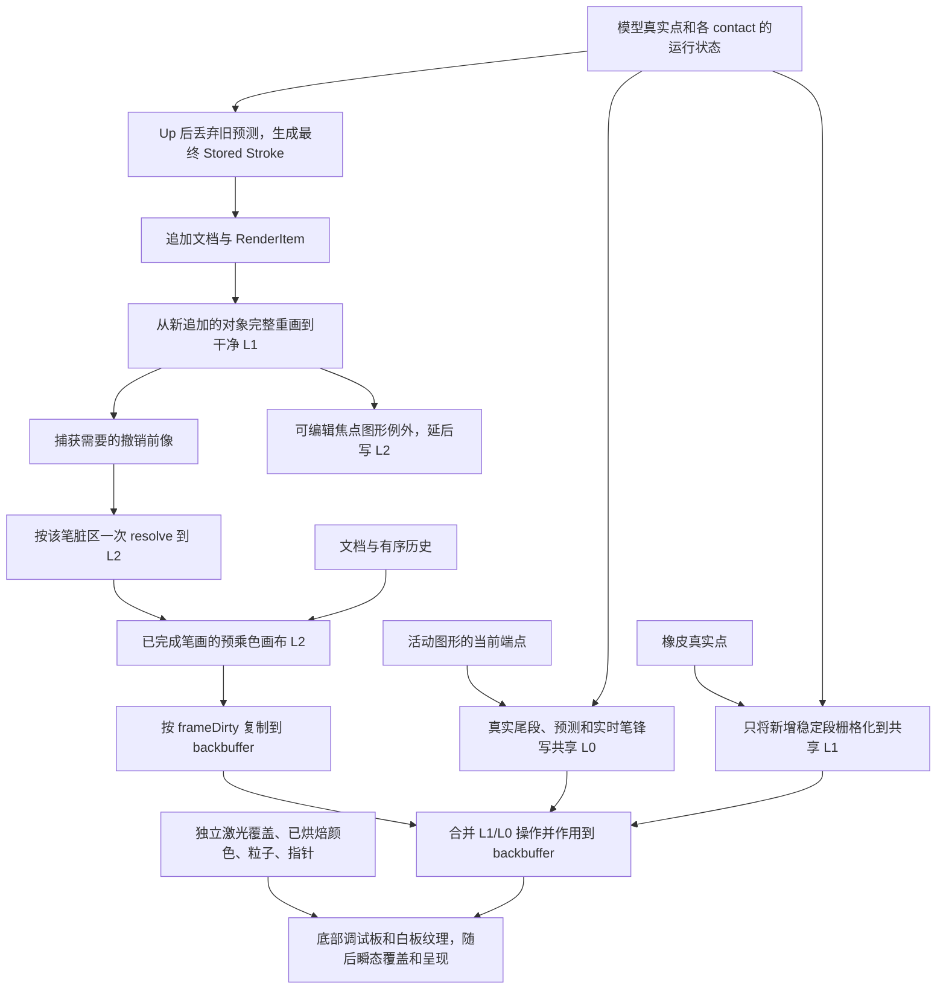

# 画布纹理、抬笔与覆盖率

- 调查问题：哪些清空或拷贝可以消除？活动 L1 的哪些内容可以进入 L2？
- 范围：主产品 Draw3 渲染线程、CPU 终态和阶段 A 的仓库内证据。
- 日期：2026-11-21。以下源码路径均相对 `Inkeys/Inkeys/Drawing/Draw3/`，行号以本次调查工作区为准。

## 当前数据流

L0 和 L1 各含 BGRA8 Add 和 R16_FLOAT Retain 两个渲染目标。空层为 (0,1)。同一笔的覆盖按分量 `MAX(Add)`、`MIN(Retain)` 合并，再用双源混合 `Add + Retain × 下层`。有序操作则用后一个操作作用于前一个。同笔自交处只施色一次，不同笔、擦除和背景的先后则有意义。正常活动帧使用 coverage union；有序 L0 预览是笔锋调试着色分支。生产合成已按矩形从 L2 复制到 backbuffer，内部调用 D3D11 的 CopySubresourceRegion，不能按接口名误记成整屏拷贝。图中省略了视口不清晰时的可信 L2 快照分支。见 `Draw3.Renderer.cpp:137,149,414,755`、`Assets/inkPixelShader.hlsl:533`、`Draw3.DrawingController.cpp:15487,23811,23841,23867`。

## L0 当帧清理是否有效

- 非终态活动帧经 ShouldRebuildSharedL0 判定后，对上一次写过的范围清理一次，并重画共享层的所有活动尾部。未变化的纯图形帧可保留旧 L0。多触点已申报的 bounds 做并集，额外外扩 2 px 后裁剪。已知空或已知完全屏外直接返回；已知小范围且驱动支持 ClearView 才对两张 RTV 各作一次矩形清理；未申报、无能力或裁剪后面积严格大于半屏，回到两个整面 ClearRenderTargetView。恰好一半仍走矩形。纯橡皮/激光不写普通 L0，L0 已知空时物理 clear 为零。Up 和 RebuildActiveLayers 目前直接调用整层版本。见 `Draw3.Renderer.cpp:242–345,718`、`Draw3.Renderer.cppm:32`、`Draw3.StrokeGeometry.cpp:2748`、`Draw3.DrawingController.cpp:6103,6164,23664`。
- 正确性证据包括 WARP 的两处分开写入、只清声明区域、再次清理不发起覆盖、未知范围或缺 Context1 回到整面，以及预测消失时旧/新 dirty 并集。阶段 A 的 R7 记录只有普通笔做了上屏确认。4K 每个 operator 层的逻辑大小约 47.46 MiB（3840×2160×6）；这是逻辑覆盖量，不能当作 DRAM 实传。阶段 A 的骁龙 p95 0.39 ms 是一组无压力 GPU 包执行时间，不能据此推出 clear 所花时间或兆芯的合适交叉点。见 `Draw3.Renderer.cpp:1377–1462`、`Draw3.StrokeGeometry.cpp:1543–1566`，以及阶段 A `prd.md` R7 和 `research/gpu-stress-latency-experiments.md` 第三轮。
- 建议保留阶段 A 策略作为 B 的基线。先记录 idle 唤醒数、每笔 clear/resolve/copy 次数和矩形面积。4K 小尾部、多指距离很远的稀疏包围盒、1/4、1/2、3/4、全屏分别比较成对 full clear 与成对 rect clear 的 GPU 时间及整帧 p95。用连续帧异步读取 timestamp/disjoint，预热、交替路径、记录适配器/驱动/功能位，排除队列拥塞和读回同步；测试待机也要区分完全无帧和停笔动画。半屏是现有启发式；一个 clear 命令少于另一组命令并不保证更快。

## 活动态稳定前缀与完成态

| 工具或条件 | 当前行为与复用边界 |
|---|---|
| 普通笔 | 从最后真实点的时间倒推「保护的笔锋时长 + 当前预测时长」，保留跨界连接点，只推进 committedIndex；实际宽度在 L0 的副本上收尖并作公切线投影。即使预测突然消失，还有真实笔锋保护窗。端点接纳门激活期间暂停前缀提交。稳定段不回写预测值。见 `Draw3.StrokeGeometry.cpp:394,493,2623,2652`、`Draw3.DrawingController.cpp:23222–23283`。|
| 抬笔拟合 | Up 清空 predictedResults、predictedPoints 和 l0DrawPoints。FinalizeStoredStroke 从真实点生成 Stored，允许异常终态局部拟合回看物理模型窗口约 160 ms、最多 512 参考点，重映射 committed 边界，处理最终 taper、连接点及公切线。单测明确断言拟合改到原 committedIndex 之前。实时预测回缩测试证明了特定轨迹的锚点正确，**未授予整张 L1 永久复用资格**。也要考虑从屏幕坐标到 Stored 再减视口后的浮点舍入。见 `Draw3.StrokeGeometry.cpp:767–884,904–952,1323–1384,1543–1566`。|
| 硬笔 | 活动态笔锋保护时长为零，预测时长仍计入；按工具的 Stored style 和实际完成数据判断资格，不能只按当前选择按钮。|
| 荧光笔 | 笔色透明度上限为 0.35；共享层保存变换，opacity 已在画笔颜色中。L1 缓存划过的稳定 sweep，L0 含真实尾部、预测 sweep 或单点矩形；完成态用 Stored 真实中心线重建整组 sweep。同笔多段与自交只使用一次覆盖，不同笔要逐笔叠加。见 `Draw3.Bridge.h:26`、`Draw3.DrawingController.cpp:360,6058`、`Draw3.StrokeGeometry.cpp:2633,2670,1144`。|
| 橡皮及边擦边写 | 无预测、无普通 L0；单点或真实点新增段直接向 L1 提交 Erase 操作。圆形与非圆形走不同几何。共享 L1 可能混有仍在写的笔、倒转笔或手掌橡皮；即使荧光笔和普通笔互斥，也不能认为 L1 只属于当前笔。历史按成功追加的 RenderItem 逐个应用，擦后写和写后擦必须能区分。见 `Draw3.StrokeGeometry.cpp:2699,1145`、`Draw3.DrawingController.cpp:23007,23249,23454,23543`。|
| 图形 | 活动期无 L1 稳定段，实时末点可来自预测，最终以真实 Up 定形。旧解析图形按 kind 批绘，通用图形按对象有序；多步骤构造可仅更新预览；完成的焦点图形可占用 L1，延后采前像和写 L2。空触点数不能证明 L1 为空。通用图形有独立的 material/composite 层，预览、提交、重放都会用到。见 `Draw3.DrawingController.cpp:6103,23027,23404,23475,23601`、`Draw3.RendererShapes.cpp:145,284–351`。|
| 激光 | 不占用普通 L1/L0，不进文档。每支维护 coverage，单支符合条件可用增量路径，多支按 Down 顺序合成。整批结束才烘入瞬态稳定颜色，之后 Hold/Fade。普通层的结束分支当前仍会被激光 Up 触发。粒子与普通层有独立生命周期。见 `Draw3.DrawingController.cpp:5556–5678,23217,23343,23415,23867`。|

## 普通单笔 Up 的命令账

| 顺序 | 当前操作 | 去留判断 |
|---|---|---|
| 1 | 发现任意结束 contact，清 L1/L0（4 个整面 RTV clear），再检查 Laser、cancel、constructionStepOnly 等。 | 单笔正常完成且无其他写入时，下一步会再次清同一对层；应把是否需要单位操作层的判断移到真正消费处。|
| 2 | 每个成功追加的持久笔画在 DrawStoredStroke 前再清 L1/L0（4 个整面 clear），整笔画进 L1，获取撤销前像，在该笔脏区 resolve 一次写 L2。 | 不同完成笔画之间有真实写入，不能统一删除逐笔隔离。仅 L1 写过的这一轮可以免去已知为空的 L0；保留前像在首次 L2 写入之前。|
| 3 | RebuildActiveLayers 先清 L1/L0（4 个整面 clear）再重画未结束 contact 的前缀和尾部；结束 contact 排除，focus 按需重画。 | 当前 L1 内确有完成笔画，后续显示会继续采样它，必须让它物理回到单位操作，或在重新清理前完全跳过该层的所有读取。L0 已知空可省；没有幸存笔画可跳过重放。|

普通单笔合计 **12 次整面 clear**，4K 约 **284.8 MiB 逻辑覆盖**；N 条同帧进入逐笔正常绘制共 4(N+2) 次。纯 Laser Up 或 Cancel 也可能走首尾两轮，共 8 次。以上只计该结束分支中 L0/L1，独立 shape、laser、history、设备恢复 pass 额外计。对应 `Draw3.DrawingController.cpp:23402–23415,23465–23481,23543–23606,6164–6206`、`Draw3.Renderer.cpp:299`。

## 两条建议路径的等价条件

1. **先合成覆盖，再写 L2。** 前段和尾段共用连接点，可能重复覆盖同一边缘或自交区。若把两段各自按 source-over 绘到 L2，一处各为 0.5 的覆盖最终成为 0.75；荧光笔各为 0.35 则成为 0.5775。换先后顺序也一样。即使不透明画笔，AA 边缘仍有这个问题。普通几何 pass 本身输出两个 MRT，不能把 L2 单色 RTV 直接绑定到原笔画绘制调用就获得同样结果。建议让在位前缀和去预测后的 **Stored 最终尾段** 在 operator 空间并集，最后仅一次对 L2 双源 resolve。
2. **单笔、小范围。** L1 必须能证明只含这笔的有效前缀，未被重建失败、焦点图形、并发橡皮、调试着色或 generation 切换污染。证明最终 Stored 和已栅格化前缀在样式、屏幕位置、半径、线段、接缝与 AA 上相同。可选把最终尾段补进 L1 后只读一层 resolve；也可回收旧 L0 后画最终尾段，直接使用已有双层 CoverageUnion resolve。以实际 Map、采样及清理命令比较。Up 必须覆盖最后的真实终点及撤去旧预测的 dirty；不得复用上一帧 L0 颜色或本帧已清空的 l0DrawPoints。
3. **混合来源、大范围或终态改了前缀。** 共享 MAX/MIN 已丢失每笔身份，多笔像素不可逆拆分。一般路径按完成顺序把单个 Stored 重画到隔离的 operator 工作区，捕获旧 L2 前像，逐笔 resolve；结束后按原顺序重建幸存 contact。初版可直接复用 L1 作工作区，配合按需清理，免增两张全屏常驻纹理。有精确的纯属区域证据时才考虑局部保留；仅比较脏区占比不能证明笔画独占，超过半屏也不等于重新跑几何一定更省。记录半屏为用来比较快慢的候选切换点，小范围语义不符仍必须走一般路径。若改为最长时间窗冻结终态前缀，需权衡更多活几何成本，首先验证现有拟合效果。
4. **逐步删除重复清理。** 由 renderer 记每层身份、是否可能被写及保守矩形，覆盖 bind 后局部绘制失败、直接 RTV、CopySubresourceRegion、创建/Resize、设备恢复和焦点路径；未知即回退整清。先合并没有 intervening write 的两次 clear，再把真正需要的清理变成已知空跳过或旧包络矩形 clear。仅靠“下一次写入前清”会让空闲合成读到旧 L1。已确认两层都空时可以在 L2 脏区 copy 后跳过 operator resolve；保留底板和瞬态 pass。若延迟物理清理，保证所有普通、焦点、快照、调试、恢复读者均遵循相同状态。
5. **其他高收益点。** 通用图形每对象至少一轮 clear composite，每相邻材质组一轮 clear material，当前各为全尺寸双 RTV；`Draw3.RendererShapes.cpp:319–351` 已计算并裁剪本次 resolve 矩形。可仅初始化将读的区域，同时保证所有 resolve 取样边界（包括 texel 边缘和采样滤波）与分组顺序。激光 `BeginLaserBake` 每次把已提交色整张 CopyResource 到 scratch；单支增量失败转完整路径时，可在同次 bake 再拷一次。scratch 成功后与 committed 对调，错误前可能已有部分写入。若改为局部复制，必须维护整张目标的已有内容；可选先在改动矩形内复制旧底色到 scratch，全部图层成功后把该矩形写回原 committed（不整张交换）。失败仍从原底色重试，保护矩形外有效颜色，必要时保留整张拷贝＋交换路径。见 `Draw3.Renderer.cpp:369–410`、`Draw3.DrawingController.cpp:5588–5678`。
6. **低频拷贝和阶段 C 接口。** 普通 owner resize 先保留 L2 及 L1 的交集，再清 L2 从文档恢复，并重建活动层；这条成功且中间不呈现的路径可以评估显式“调用方将重建”模式，其他调用仍可能依赖保留行为。设备恢复中显式清 L1/L0 后又调用自带清理的 RebuildActiveLayers。可信 L2 快照刷新是独立整图拷贝，留给阶段 C 与白板视口平移一起处理；把 B 的每次 L2 写入范围、旧/新 dirty、可信状态与 generation 交给下一阶段即可。见 `Draw3.Renderer.cpp:654–695`、`Draw3.DrawingController.cpp:15680,22000,22074–22108,23811`、`Draw3.RendererSnapshot.cpp:172`。

## 验收和资料

- 像素基准用同一 Stored 顺序做完整重放，对比整张 L2、Add/Retain 及最终普通合成。覆盖半透明画笔与荧光笔接缝/自交、多个半透明笔交叉、写擦交错与同时 Up、预测突然消失或急变速/端点拟合修改已提交位置、只点击、短笔、形状焦点落定前后、越界和视口小数原点、Cancel、Map 中途失败、Undo/Redo、Resize 和设备重建。分别覆盖阈值等于/略超过一半、无 ClearView、合法空层和未知层。给每笔计数，确认重复整面清理消失，失败时历史真值和前像处理仍与原路径一致。
- 相关规范：`.trellis/spec/native/runtime-and-rendering.md` 的历史顺序、激光与脏矩形合同；`.trellis/spec/native/terminal-tail-reconstruction.md`；`.trellis/spec/shaders/cpu-gpu-contracts.md`；`.trellis/spec/native-desktop/draw3-integration.md`。本节无外部性能数据。本次结论来自生产源码与已归档验证，本轮 Adreno 的 4K GPU 对照见 [离屏测试记录](offscreen.md)；旧显卡／兆芯的交叉点和全部组合的显示结果待实机验证。
