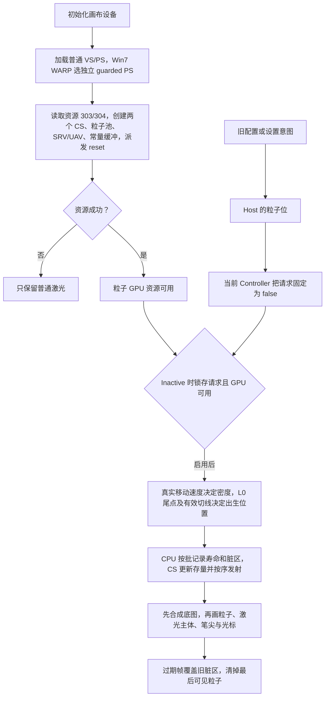

# Draw3 SM5 着色器与激光粒子调查

- 调查问题：当前实际提交哪些 GPU 工作，哪些门禁阻止粒子可见，怎样在保留老设备像素与失败回退的前提下降低成本？
- 范围：主产品 `Inkeys/Inkeys/Drawing/Draw3/`、工程和设置发布链。下文 `Draw3.*`、`Assets/*` 均相对于该产品目录。
- 日期：2026-11-21。源码基线为阶段 A 后、A2 实施前。本页记录源码与当前 CSO 的离线检查。

## 已有 GPU 管线

| 程序 | 当前构建产物 | 热路径与证据 |
| --- | --- | --- |
| ink VS / PS | 22,476 / 41,500 B，STAT 640 / 1,300 条指令 | 一套程序按每个 draw 的 shape type 处理笔画、光标、采样合成、激光、历史等。入口见 `Assets/inkVertexShader.hlsl:47`、`Assets/inkPixelShader.hlsl:328`。一次 draw 实际走其中一条路径。 |
| shape VS / PS | 3,400 / 6,252 B，60 / 167 条 | 通用图形按图元求距和覆盖率，材质 resolve 直接用整数像素坐标读 Add / Retain。见 `Assets/shapePixelShader.hlsl:20`、`Draw3.RendererShapes.cpp:256`。 |
| particle UpdateCS / EmitCS | 3,572 / 5,360 B，72 / 115 条 | 已是两个独立 `cs_5_0`。一组 64 线程，共用粒子 UAV，Emit 写入 CPU 指定的循环槽。见 `Assets/laserParticleUpdateCS.hlsl:20`、`Assets/laserParticleEmitCS.hlsl:16`、`Draw3.LaserParticleSystem.cpp:224`。 |

以上数值读取工作区 6 个 DXBC 的 SHDR/SHEX 类型、版本与 STAT 块，全部为 5.0。指令数是整个字节码程序的静态计数，实际耗时需按分支与像素量测量。工程入口是 `Inkeys/Inkeys.vcxproj:1529–1570,1605–1647`，FXC 读取预处理副本并输出 CSO；CS 已由 `Inkeys/Inkeys.rc:523,525` 嵌入。无需新增着色器模型或另一套编译器。

### 为什么程序已有 CS，屏幕上仍没有粒子

1. **偏好与 UI。** `Inkeys/Inkeys/Other/Other.Config.cppm:523` 的已有键 `Drawing.Laser.ParticlesEnabled` 默认 false。`Inkeys/IdtMain.cpp:883–890,3249` 检验往返并在启动时发布保存值。设置页 `Inkeys/Inkeys/UI/Setting/Setting.cpp:4014–4020` 只有禁用说明行；通用多指/笔锋/预测和激光多指两处重新发布时把粒子参数直接写成 false（3975、4055）。
2. **请求与生效。** `Draw3.Host.cpp:3193–3198,1850–1856` 可传递粒子 bit 1（数值 2），独立于多指总开关。`Draw3.DrawingController.cpp:15214,15389–15398` 在构造和 setter 处强制 false。无窗口生产测试 12488–12500 明确断言历史 true 配置无效。`Draw3.InkPrediction.cppm:236` 保留了配置字段和旧合同注释。
3. **关闭后的真实开销。** `Draw3.Renderer.cpp:882–892` 在初始化中尝试创建并 reset 粒子系统，失败只记一次诊断，画布仍可启动。`Draw3.LaserParticleSystem.cpp:75–156` 检查 FL ≥ 11_0、两个 CS、DEFAULT structured buffer（2048 × 80 B）、SRV、UAV、两个动态 CB 及首次 reset 提交。`Draw3.RendererLaser.cpp:431–448` 的零面积 viewport 预热也会调用粒子 draw。启动、设备恢复和新建激光 coverage 的路径均有预热入口（Controller 21687、22034，Renderer 504、RendererLaser 328）。关闭的是可见的逐帧发射/绘制，初始化及有效资源上的部分预热/重置仍会提交工作。
4. **生命周期。** `Draw3.DrawingController.cpp:22497–22546` 在 Inactive 锁存请求与资源能力，关闭时将旧 bounds 纳入重绘、清 tracker 和 GPU 状态。23164–23212 只给未结束且已有切线的激光发射；真实速度决定数量，预测只影响锚点与切线。23319–23331 同批次只登记一次保守 bounds，并按粒子最长寿命延长最短 Hold；23379–23392 只在活跃、到期或新发射时 Step，最后到期可以只清不画。23704–23715 合并旧/新区域。23868–23895 先画粒子，再按顺序画激光主体、笔尖、光标，最终背板提交。Clear、切页、离开工具、resize/设备 epoch 的瞬态状态要分别验证（18540、18554–18588、19621–19630、22029）。粒子没有文档历史与 L2 所有权。
5. **GPU 边界。** Step 在读写转换前解绑 VS t8，CS 通过 u0 访问相同 DEFAULT 资源，阶段结束解绑 u0/b0/CS，draw 后再解绑 VS t8。Update 常量 Map 失败会释放粒子系统，Emit Map 失败跳过本请求且不推进环槽。Dispatch 是异步命令，方法成功仅说明提交，像素结果需独立验证。`Draw3.LaserParticleSystem.cpp:224–263,320–353`、`Draw3.RendererLaser.cpp:388–428`。

### 恢复产品开关

- 先恢复原设计参数，以当前产品定义作为效果基线。`Draw3.LaserParticles.cppm:19–55` 给出最大每帧 120、寿命 0.55–0.75 秒、速度 18–40 DIP/s、基础半径 0.28–1.4 DIP。较早 demo 的规格有不同数值。启用时沿用现有颜色、密度、seed、运动、alpha 和持留逻辑。
- 建议把禁用行恢复成真正 toggle，沿用存储键和旧偏好，令两处设置写回传真实粒子值。恢复 Controller 对请求的构造/等值检测/wake，同时保留在 Inactive 边界生效的语义。既能通过 UI 开启，也能关闭以复现纯激光基线。建议保留当前新装默认关闭直至目标机验证；若产品决定默认开启，仅需单独调整新配置默认并保留显式 false。
- 有效状态应同时包含已锁存偏好与本代粒子资源可用性。普通切换跟随当前 Active/Hold/Fade 约定。若运行中 Update/Reset 导致粒子系统不可用，需要本帧或下一帧立即撤销有效发射、重绘旧 bounds、清 CPU tracker，避免可用性因偏好锁存延至 Inactive，仍持续登记无效的 dirty/hold。故障限制在粒子域，设备丢失走既有画布恢复。单一 Emit Map 失败只跳过这一批。能力与用户偏好分开保存，故障不改写偏好。
- 可以单独 A/B 按需初始化和预热：仅在第一次请求且选中激光时准备池、reset 和预热 shape 10，以设备 epoch 记一次失败，重复试笔无重试风暴。保留 shape 7/8/9/11/12/13 的既有预热和离开/恢复语义，核对 Adreno 冷启动首笔成本再决定迁移时机。该项属于可独立回退的性能改动，启用粒子本身已有全部 GPU 资源。

## 保持像素一致的优化优先级

| 候选 | 条件与收益来源 | 验证重点 |
| --- | --- | --- |
| **1. 跳过恒等运算，优先于改 HLSL 算术** | `Draw3.Renderer.cpp:149–202` 每次合成需映射矩形与全局常量、设置四张 SRV、双源 draw。`Assets/inkPixelShader.hlsl:531–550` 实际读取两层的 Add/Retain。如果已证明两层在该矩形都是 (0,1)，可以跳过该次合成；仅一层非空则可用仅取该层两张纹理的窄路径。目标背板仍须完成相应 L2/背景更新。先做低风险的跳过，再测单层专用 PS 的节省是否足以覆盖绑定成本。 | 单层 erase 的 Add 恒零而 Retain 非一，不能按颜色判断空；同笔交点保留 MAX/MIN，有序多工具保持 `liveAdd + liveRetain * stableAdd`。双源 blend 仍由 `Draw3.Renderer.cpp:771–781` 执行。 |
| **2. 减少 shape 与 laser 的着色像素** | 通用图形每个材质组 clear，再 resolve；旧图元有序路径 clear 材质层并整屏 resolve（`Draw3.RendererShapes.cpp:145–151,319–351`）。优先限制已知 bounds、跳过可证明为空的 scratch/pass，保留组内半透明共覆盖、完整对象事务。Laser bake 的 `CopyResource` 是从已提交 t6 到整屏 scratch，完成后交换，增量失败再 Begin 以恢复旧底（`Draw3.Renderer.cpp:369–412`，Controller 5602、5646）。若改为区域事务，应只提交成功的候选矩形或确保交换后矩形外与最新 t6 完全一致。 | 邻接 AA、取消、部分提交/重试、粗笔自交、多色 contact、Hold/Fade、上一笔远离当前笔区域。不能局部拷贝底色之后盲目交换两张整屏纹理。 |
| **3. 定点优化激光胶囊 SDF** | `Assets/inkPixelShader.hlsl:34–53,279–300` 对相同端点和采样位置分别算芯、外壳两次胶囊距离。可试共享长度、段轴与局部投影，保留两套半径、退化/包含圆分支及算术精度；FXC 可能已消除重复表达式。 | 对比 Release DXBC 与 GPU timestamps；若已优化或耗时未改善，就保留原程序。极细笔的两套坐标（`input.pixPos` 和真实像素中心 `input.pos.xy`，645–656）、导数 AA 与平滑曲线均不可顺手合并。 |
| **4. 激光粒子池固定扫描成本** | 当前活跃帧 Update 扫 2048 槽（32 组），DrawInstanced(6,2048)，死槽顶点在 VS 早退。若实测仅少量粒子时 VS/CS 成为瓶颈，可另测 CPU 按环槽和最长寿命维护保守连续区间，跨尾部拆分；保留实例 ID、槽覆写顺序和随机序列。第一版优先沿用现有池，避免以回读、Append/Consume 或间接 draw 增加兼容变量。 | 稀疏、满池、多指、环绕、最后到期，帧率对相同 wall time 的影响；区间切分前后颜色混合顺序和画面须一致。 |

**两条兼容边界。** 实际硬件 VendorId 为 0x1D17 且选项开启时，已有 Ink/荧光笔结构上传使用 DEFAULT 和 UpdateSubresource；其他路径及合成独立缓冲有各自所有者。`Draw3.Renderer.cpp:43–69,166,730,1161–1165`。粒子池本来就是 GPU 写 DEFAULT structured buffer；兆芯 CPU 型号、Win7 名称及兼容开关均不足以判定这条 CS 路径是否能正确输出像素。FL11_0 支持 SM5，低于该级别继续沿用现有能力回退，不引入 CS4.x 或 WARP 强制切换。[Microsoft 的 DirectCompute 能力说明](https://learn.microsoft.com/en-us/windows/win32/api/d3d11/ns-d3d11-d3d11_feature_data_d3d10_x_hardware_options)

旧 Win7 WARP 曾出现完整 PS 创建成功、绘制输出却全透明的实机记录。OS 6.1 + 实际 WARP 默认选独立 guarded 完整程序，诊断可按精确 0/1 对照。保留 `Draw3.ShaderCompatibility.h:8–18` 和 `Draw3.Renderer.cpp:875–881` 的选择与失败策略。改到普通墨迹 HLSL 的效果/新分支时，须同步兼容程序或明确路由到独立、已验证的专用 PS；原兼容矩阵继续回归。2026-10-10 的闭环验收覆盖当时的主画布与光标，不能推导当前粒子效果已在 Win7 或兆芯实测通过。[Win7 历史结项](../../archive/2026-10/10-02-win7-main-canvas/closure-20261010.md)

## 验证计划、规范与限制

1. 固定同一工具链、配置、设备/驱动、种子、输入、帧间隔、DPI、目标背景。编译 `InkeysRepo.sln` 的 Debug|ARM64 确认依赖与 6 个 SM5 目标/资源；性能对照另用同配置的 Release。保存普通/guarded 程序 SHA、反汇编与寄存器/资源绑定，检查 80 字节结构和两种 CB 对齐。
2. 离屏入口包括 `--draw3-renderer-upload-test`、`--draw3-laser-resources-test`、`--draw3-laser-raster-failure-test` 和 `--draw3-shape-renderer-test`。另外两项 `--draw3-renderer-pixel-test`、`--draw3-renderer-pixel-test-hardware` 会创建隐藏 HWND（HiddenWindowTest.cpp:3167–3176），与纯离屏测试分别记录。改写 Controller 旧强制关闭断言，补请求相同无 wake、有效开启/硬件失败、修改通用设置后仍保持、关闭及活跃期切换测试。现有测试入口本身不能证明粒子可见。
3. 对固定输入逐像素比较普通墨迹和既有激光主体各通道（含透明背景、半透明重叠、细线、粗笔自交、笔尖退化、边缘与跨脏区）。开启粒子后另与同种子/时间/样式的原粒子管线离屏参考比较。包含无有效切线、预测回缩、多个发生器、发射过量、环槽覆盖、最后到期及重启恢复；加入 GPU 输出证据并检查 D3D debug layer 的 t8/u0 冲突与失败重放。正常绘制不回读 GPU；测试可用 staging。
4. 记录 GPU timestamps 与 disjoint、粒子 Dispatch/DrawInstance 数、PS 调用数和 4K 负载帧的 p50/p95/p99，区分首次预热和稳态。无数据或 disjoint 的 GPU 样本标记无效。对照现代硬件、实际低端/旧设备、兆芯实际适配器及兼容开关、Win7 WARP guarded / Win7 可用硬件。ARM64 或 WARP 的本机结果只覆盖实测组合。[Microsoft 的 D3D11 计时与管线统计](https://learn.microsoft.com/en-us/windows/win32/api/d3d11/ne-d3d11-d3d11_query)

相关项目合同包括 `.trellis/spec/native-desktop/draw3-shaders.md`、`settings-performance-and-drawing.md`、`settings-attention-notes.md`、`memory-resource-lifecycle.md`，以及 `.trellis/spec/shaders/cpu-gpu-contracts.md` 的 coverage 与 CS 章节。实现时更新旧“粒子永久禁用”测试及设置说明，粒子数值以当前产品源码为准。本报告未运行产品、未修改源文件，未取得旧设备、兆芯、真实桌面或性能胜出的新证据。
