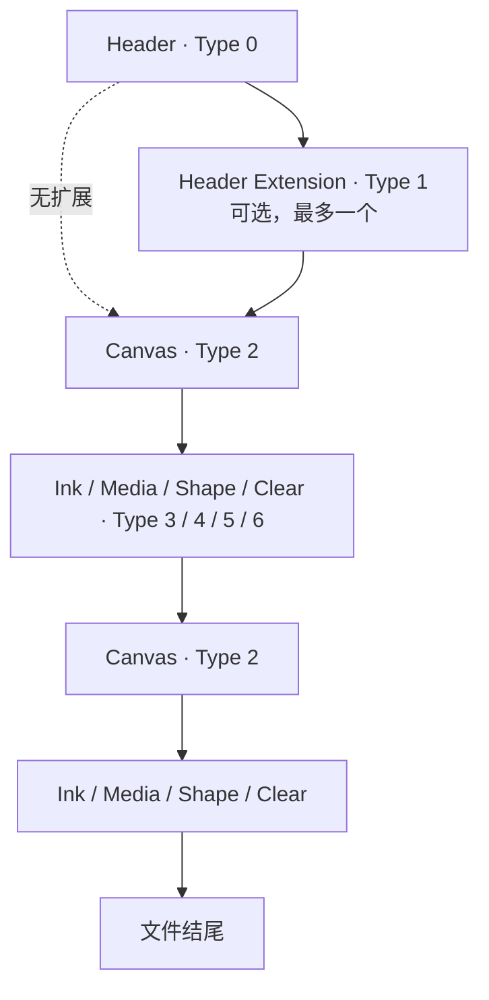

# UInk 1.1 规范（单文件版）

> 版本：UInk 1.1 Beta（`Header.version = 11`）。
>
> 本文件在网站构建时由 `docs/standard/` 的各页面自动拼接生成，内容与网页版一致；如有出入，以网页版为准：https://www.inkeys.top/standard/
>
> 规范性用词：**必须**、**不得**、**应**、**可以**。

## 目录

1. UInk（/standard/）
2. UInk 规范（/standard/intro.html）
3. 快速开始（/standard/quick-start.html）
4. 分级与认证（/standard/levels.html）
5. 兼容与回退（/standard/compatibility.html）
6. 墨迹主文件（/standard/file/main.html）
7. 保存、追加与恢复（/standard/incremental.html）
8. 资源包（/standard/file/extra.html）
9. Header 块（/standard/blocks/header.html）
10. Header Extension 块（/standard/blocks/headerExtension.html）
11. Device 结构（/standard/blocks/device.html）
12. Canvas 块（/standard/blocks/canvas.html）
13. Ink 块（/standard/blocks/ink.html）
14. Shape 块（/standard/blocks/shape.html）
15. Media 块（/standard/blocks/media.html）
16. Clear 块（/standard/blocks/clear.html）
17. Color Map（/standard/common/color.html）
18. 笔尖与端帽（/standard/common/nib.html）
19. 块类型与编码（/standard/type.html）
20. 图形预设注册表（/standard/appendix/shape-presets.html）
21. 实现一致性与样例（/standard/conformance.html）
22. 版本与变更（/standard/version.html）
23. 术语表（/standard/glossary.html）

---

## UInk

> 网页版：https://www.inkeys.top/standard/

### 通用：同一个文件，在不同软件里打开

支持的等级不同，看到的画面也不同，但每一笔都在原处。点下面的等级，看同一页板书在不同读取器里的样子。

每一级具体要实现什么、不支持时怎样显示，见[分级与认证](/standard/levels.html)和[兼容与回退](/standard/compatibility.html)。

### 集合：一块白板，一个文件

一块白板的所有页面、一份 PPT 每张幻灯片上的批注，都保存在同一个 `.uink` 里，批注跟着幻灯片走。翻页、换页时，软件只需把改动的那一页追加到文件末尾，不用重写整个文件。

文件由哪些块组成、怎样排列，见[墨迹主文件](/standard/file/main.html)。

### 使用 UInk 的软件

- [智绘教Inkeys](https://www.inkeys.top/)：面向多场景的 Windows 屏幕批注工具。
- [ICC-CE](https://github.com/InkCanvasForClass/community)：InkCanvasForClass 社区版，课堂批注与白板软件。

### 开始实现

写一个能显示 UInk 的最小读取器，只需要三步：

1. **读 Header**：逐个解码 MessagePack 对象，确认第一个是版本 10–19 的 Header。见[快速开始 · 检查 Header](/standard/quick-start.html#_2-检查-header)。
2. **按 Canvas 分页**：每个 Canvas 开始一页，后面的内容块都属于它；同一页出现多次时以最后一次为准。见[快速开始 · 建立页面](/standard/quick-start.html#_3-建立页面)。
3. **绘制 Ink**：按点坐标和每点宽度画出笔迹，颜色用 `fallback`，跳过橡皮。见[快速开始 · 画一页](/standard/quick-start.html#_4-画一页)。

- [规范正文](/standard/intro.html)：从规范介绍开始，逐页阅读。
- [分级与认证](/standard/levels.html)：确定要实现到哪一级，并对照检查清单。
- [公开样例](/standard/conformance.html#公开样例)：用样例文件验证读取器在每一级的显示结果。
- [单文件规范（给 AI 助手）](/dist-standard/uink-v11/spec.md)：全部规范页面合成一个 Markdown 文件。

让 AI 助手帮你实现时，可以把[单文件规范](/dist-standard/uink-v11/spec.md)或 [llms.txt](/standard/llms.txt) 交给它。

---

## UInk 规范

> 网页版：https://www.inkeys.top/standard/intro.html

**UInk 是开放的墨迹文件规范。** 一个 `.uink` 文件可以装下一整块白板、一整份 PPT 的全部批注：多页、多块屏幕、笔迹、图形、图片与 PDF。不同的批注与白板软件按同一套规则读写它，换一款软件打开，每一笔都在原处。

::: tip UInk 1.1 Beta
当前版本 `Header.version = 11`。1.0 → 1.1 的变化见[版本与变更](/standard/version.html)。
:::

### 两个特点

#### 通用

UInk 把功能分成五个等级。只实现最基础的**核心级**——多页、笔迹、基础图形——就能正确显示任何 UInk 文件的主要内容；更高的等级让荧光笔、虚线、图片、PPT 绑定等内容也原样呈现。软件遇到自己不支持的内容时，有明确的回退方式，不会因此打不开文件。

→ [分级与认证](/standard/levels.html) · [兼容与回退](/standard/compatibility.html)

#### 集合

一个白板的所有页面、一份 PPT 每张幻灯片上的批注，都在同一个 `.uink` 里。文件可以同时包含多个场景（屏幕批注、白板、PPT）、多块屏幕和多个图层；白板翻页、PPT 换页时，只需把改动的那一页追加到文件末尾。

→ [墨迹主文件](/standard/file/main.html) · [保存、追加与恢复](/standard/incremental.html)

### 文件

::: file-tree

- lesson.uink 主文件：MessagePack 对象流
- lesson.uink.extra 资源包：ZIP，可选
  - images
    - diagram.png
  - documents
    - handout.pdf

:::

- **主文件** `filename.uink` 是一串连续的 [MessagePack](https://msgpack.org/) 对象，保存全部页面、笔迹、图形与媒体引用。它始终是内容的权威来源。
- **资源包** `filename.uink.extra` 是 ZIP，保存图片、PDF、音视频等资源，可以没有。资源缺失时，笔迹与图形照常显示。

### 一眼看懂结构

> 图示：overview — 一个 .uink 拆开：Header → Header Extension（屏幕、场景）→ 一个个 Canvas（页面）→ 每页上的 Ink、Shape、Media、Clear

| 块 | 作用 |
| --- | --- |
| [Header](/standard/blocks/header.html) | 文件开头：身份与版本 |
| [Header Extension](/standard/blocks/headerExtension.html) | 注册屏幕（Device）与场景（Workspace），可选 |
| [Canvas](/standard/blocks/canvas.html) | 一页（在某块屏幕上的某个图层），以及页码、背景、PPT 绑定、平移缩放 |
| [Ink](/standard/blocks/ink.html) | 一条笔迹：普通笔、荧光笔、橡皮 |
| [Shape](/standard/blocks/shape.html) | 一个图形：直线、矩形、圆、多边形；复杂图形由多个部件组成 |
| [Media](/standard/blocks/media.html) | 一张图片、一页 PDF、一段音视频 |
| [Clear](/standard/blocks/clear.html) | 一次可以撤回的清空 |

### 设计取舍

- **保证内容与布局一致，不保证像素一致。** 笔迹的曲线插值、抗锯齿、箭头外形可以因软件而不同；点的位置、宽度、颜色与顺序必须一致。
- **快速保存，不怕崩溃。** 书写时可以每抬一次笔就追加到文件末尾；软件崩溃时最多丢掉最后一个没写完的对象。
- **不保存重做。** 文件保存当前内容和撤回分组，撤回的粒度由软件决定。
- **未知内容可以跳过。** 新版本增加的块和字段，旧软件会跳过，其余内容照常显示。

### 从哪里开始

| 你想 | 阅读 |
| --- | --- |
| 先写一个能显示 UInk 的最小读取器 | [快速开始](/standard/quick-start.html) |
| 确定自己要实现到哪一级 | [分级与认证](/standard/levels.html) |
| 逐条核对规则 | 各块页面中的编号规则，以及[实现一致性与样例](/standard/conformance.html) |
| 让 AI 助手帮你实现 | [单文件版规范](/dist-standard/uink-v11/spec.md)、[llms.txt](/standard/llms.txt) |
| 查一个词的意思 | [术语表](/standard/glossary.html) |

---

## 快速开始

> 网页版：https://www.inkeys.top/standard/quick-start.html

本页带你写一个**核心级读取器**：读出所有页面，画出笔迹与基础图形。代码是接近 TypeScript 的伪代码，换成任何语言都一样。完整规则见各块页面；括号里的编号是对应的规则。

### 准备

需要一个能**逐个解码**连续 MessagePack 对象的库，例如 JavaScript 的 `@msgpack/msgpack`（`decodeMulti`）、C# 的 `MessagePack-CSharp`、C++ 的 `msgpack-c`（`unpacker`）、Python 的 `msgpack`（`Unpacker`）。

主文件里没有外层数组：对象一个接一个排列（FILE-6）。

### 1. 读出全部对象

```ts
const objects = []
try {
  for (const obj of decodeMulti(bytes)) objects.push(obj)
} catch {
  // 结尾的对象不完整或中间损坏：保留已经读到的对象（FILE-16、FILE-17）
}
```

### 2. 检查 Header

```ts
const header = objects[0]
if (!Array.isArray(header) || header.length !== 7 || header[0] !== 0
    || header[1] < 10 || header[1] > 19) {
  throw new Error('不是 UInk 1.x 文件')                    // VER-3、HDR-2
}
```

`version` 大于 `11` 时照常读取，必要时提示用户“文件来自更新的版本”（VER-4）。

### 3. 建立页面

```ts
let i = 1
const ext = objects[i]?.type === 1 ? objects[i++] : null   // Header Extension，可选
const firstDevice = ext?.devices?.[0]?.guid ?? null         // 核心级只显示第一个 Device（FILE-9）

const canvases = new Map()                                  // 唯一键 → { canvas, blocks }
let current = null
for (; i < objects.length; i++) {
  const o = objects[i]
  if (o?.type === 2) {
    const key = [o.workspaceGuid ?? '', o.deviceGuid ?? '', o.pageGuid, o.layerIndex].join('|')
    current = { canvas: o, blocks: [] }
    canvases.set(key, current)                              // 同一个键再次出现：后者替代前者（FILE-8）
  } else if (current && [3, 4, 5, 6].includes(o?.type)) {
    current.blocks.push(o)                                  // 内容块属于前一个 Canvas（FILE-3）
  }                                                         // 其他 Type ID：跳过（TYPE-9）
}
```

然后按 Workspace 注册顺序、`pageIndex` 排序列出页面；只取 `deviceGuid` 等于 `firstDevice`（或省略）的 Canvas；同一页的多个图层按 `layerIndex` 从小到大叠加（FILE-9）。

### 4. 画一页

```ts
function drawCanvas(blocks) {
  // Clear（Inkeys 附加级）的推荐回退：只画最后一个 Clear 之后的内容（CLEAR-7）
  const lastClear = blocks.findLastIndex(b => b.type === 6)
  for (const b of blocks.slice(lastClear + 1)) {
    if (b.type === 3) drawInk(b)
    else if (b.type === 5) drawShape(b)
    // Media（type 4）属于标准级，核心级可以跳过
  }
}
```

#### 笔迹

```ts
function drawInk(ink) {
  if (ink.inkType === 0) return                 // Erase 属于 Inkeys 附加级：必须跳过（INK-11）
  const color = rgb(ink.color.fallback)         // 核心级只用 fallback（COLOR-2）
  let x = 0, y = 0
  const pts = ink.points.map((p, k) => {
    x = k === 0 ? p.x : x + p.x                 // 首点绝对，其余为位移；用 float64 累加（INK-4）
    y = k === 0 ? p.y : y + p.y
    return { x, y, w: p.width }
  })
  // 最简单的画法：每个点画一个直径为 w 的圆，相邻两点之间画一个梯形把圆连起来。
  // 这就是“圆形笔尖 + 圆头”（NIB-1）。其他 inkType 一律按普通笔画（INK-13）。
  strokeVariableWidth(pts, color)
}
```

#### 图形

```ts
function drawShape(s) {
  const g = s.geometry
  switch (s.shapeType) {
    case 0: case 1: polyline(g.points); break                       // Line、Polyline
    case 6: polygon(g.points); break                                // Polygon，自动闭合
    case 2: rect(g.centerX, g.centerY, g.width, g.height, g.rotation ?? 0); break
    case 3: rect(g.centerX, g.centerY, g.size, g.size, g.rotation ?? 0); break
    case 4: ellipse(g.centerX, g.centerY, g.width / 2, g.height / 2, g.rotation ?? 0); break
    case 5: ellipse(g.centerX, g.centerY, g.radius, g.radius, 0); break
    default: return                                                 // 不认识的几何：跳过（SHAPE-20）
  }
  if (s.fill) fillWith(rgb(s.fill.color.fallback))
  if (s.stroke) strokeWith(rgb(s.stroke.color.fallback), s.stroke.width)   // 圆头、圆角（NIB-4）
}
```

到这里，你的读取器已经满足核心级读取的主要要求。对照[核心级检查清单](/standard/levels.html#核心级)补齐剩下的几项，再用[公开样例](/standard/conformance.html#公开样例)验证。

### 5. 写一个最小文件

写入时必须使用规定的**精确类型与位宽**（TYPE-1）。很多 MessagePack 库会自动选择最短的整数编码，这时需要手动指定类型。

```ts
const header = [
  u16(0), u16(11), str8(uuid()),       // type、version、guid
  u32(1), u32(1), u32(1),              // deviceNum、workspaceNum、pageNum
  u64(Math.floor(Date.now() / 1000)),  // time
]
const canvas = {
  type: u16(2), pageGuid: uuid(), pageIndex: u32(0), pageNumber: u32(1),
  layerIndex: u32(0), layerNumber: u32(0),
}
const ink = {
  type: u16(3), contentId: u32(0), undoId: u32(0), inkType: i32(1),
  color: { fallback: u32(0x000000) }, opacity: f32(1), texture: i32(0),
  points: [
    { x: f32(100), y: f32(100), width: f32(4) },
    { x: f32(50), y: f32(20), width: f32(4) },   // 相对前一点的位移
  ],
}
write(encode(header), encode(canvas), encode(ink))  // 三个对象直接首尾相接
```

这个文件没有 Header Extension，使用隐式的 Device 与 Workspace（HEXT-3），所以 Canvas 不写 `workspaceGuid` 与 `deviceGuid`。

### 下一步

- 想正确显示荧光笔、虚线和箭头：[基础级](/standard/levels.html#基础级)。
- 想支持图片、PPT 与撤回：[标准级](/standard/levels.html#标准级)。
- 想在书写过程中实时保存：[保存、追加与恢复](/standard/incremental.html)。

---

## 分级与认证

> 网页版：https://www.inkeys.top/standard/levels.html

UInk 的功能分成四个主等级和一个附加等级。等级告诉实现者“要对接什么”：只做核心级，就能和其他 UInk 软件正确互通；做到更高等级，能保留的内容就更多。

::: tip 等级不写进文件
文件里没有“等级”字段，可以自由组合任何功能。等级是**实现**的一致性等级：读取器和写入器分别对照本页的检查清单验证，然后声明自己达到的等级。
:::

### 五个等级

> 图示：levels-stack — 四个主等级逐级包含，Inkeys 附加级像一块插件叠在任一级旁边

| 等级 | 一句话 | 典型实现 |
| --- | --- | --- |
| **核心级** Core | 多页的笔迹和基础图形都画在原处 | 任何支持多页与矢量的绘图软件、文件预览器 |
| **基础级** Basic | 笔迹和图形的外观正确 | 笔记、白板类软件 |
| **标准级** Standard | 课堂批注软件的日常场景 | ICC-CE、Inkeys |
| **完整级** Full | 全部能力 | 规范参考实现 |
| **Inkeys 附加级** | Inkeys 特有的橡皮与 Clear | Inkeys |

- 高等级包含低等级的全部要求：标准级读取器必须同时满足核心级和基础级。
- Inkeys 附加级可以叠加在任一主等级上，例如“标准级 + Inkeys 附加级”。
- 读取器遇到自己等级之外的内容时，按[兼容与回退](/standard/compatibility.html)处理：核心内容必须正常显示，不得因此拒绝整个文件。

### 分级矩阵

每格列出该等级**新增**的要求。

| 板块 | 核心级 | 基础级 | 标准级 | 完整级 | Inkeys 附加级 |
| --- | --- | --- | --- | --- | --- |
| **文件与编码** | Header、对象流、跳过未知块与键、截断尾块恢复、读取 version 10 / 11 | — | 增量写入 | — | — |
| **页面** | 多页（`pageGuid` / `pageIndex`）、隐式单例、按页追加的读取规则 | 页面背景、显示页码 | Workspace 类型、PPT 绑定（`slideId`、绑定方式、保留页、结束页）、当前页、`viewport` | 多图层、多 Device、嵌套 Workspace | — |
| **[Ink](/standard/blocks/ink.html)** | Pen：点坐标、每点宽度、`fallback` 颜色；圆头；可以忽略透明度 | `opacity`、Highlighter、`nib`、`cap` | — | Advanced Highlighter、`texture`、`renderOnlyWhenLatest` | Erase Ink 与橡皮笔尖 |
| **[Shape](/standard/blocks/shape.html)** | 七种基础几何（含旋转）、描边颜色与宽度、单色填充；可以忽略透明度 | `opacity`、虚线、箭头、圆角、`lineCap` / `lineJoin` | 图形对象层 `object` | 图形预设与 `construction`、`renderOnlyWhenLatest` | — |
| **[Media](/standard/blocks/media.html)** | — | — | 图片（PNG / JPEG / SVG）、`transform`、`opacity`、`fit`、`crop` | PDF、音频、视频 | — |
| **[Clear](/standard/blocks/clear.html)** | — | — | — | — | Clear 与跨 Clear 撤回 |
| **[颜色](/standard/common/color.html)** | `fallback`（sRGB） | — | — | HDR（`space` + `components`） | — |
| **撤回** | 不要求 | — | `undoId` 分组撤回 | — | — |

### 声明等级

读取与写入分别声明，格式为：

```text
UInk 1.1 读取：标准级 + Inkeys 附加级；写入：基础级
```

- 读取等级：软件能正确显示到哪一级的内容。
- 写入等级：软件写出的文件最多用到哪一级的能力。写入器永远可以只使用更低等级的能力。

### 检查清单

声明某一等级前，逐项确认该等级及以下各级的清单，并用[公开样例](/standard/conformance.html#公开样例)验证。

#### 核心级

读取：

- [ ] 验证 Header，接受 version `10`–`19`；同主版本更高次版本与 version 10 都尽力读取。（VER-3、VER-4、VER-5、HDR-2）
- [ ] 跳过不认识的块与键；结尾不完整时只丢弃最后一个对象；中间损坏时停止读取。（TYPE-8、TYPE-9、FILE-16、FILE-17）
- [ ] 按 `pageIndex` 列出全部页面，包括空白页；同一个 Canvas 唯一键出现多次时以最后一次为准。（FILE-7、FILE-8、FILE-9、SAVE-14）
- [ ] 按点坐标与每点宽度画出 Pen 笔迹，颜色使用 `fallback`；不认识的 `inkType` 按 Pen 画。（INK-4、INK-5、INK-7、INK-13、NIB-1、COLOR-2）
- [ ] 画出七种基础 Shape（含旋转）的描边与单色填充；曲线与自由图形按采样点连线，不做平滑。（SHAPE-1–SHAPE-4、SHAPE-19–SHAPE-22、SHAPE-24）
- [ ] 跳过 Erase Ink；遇到 Clear 时按回退规则处理。（INK-11、CLEAR-7）
- [ ] 回退结果不写回源文件；含不支持内容的文件默认另存为。（COMPAT-1–COMPAT-3、TYPE-12）

写入：

- [ ] 使用精确的 MessagePack 类型与位宽，写入 `version = 11`。（TYPE-1、VER-2、HDR-1）
- [ ] 每个 Canvas 的 `contentId` 从 0 开始连续编号，`undoId` 只增不减。（INK-2、INK-3）
- [ ] 私有字段只写在 `extra` 中。（TYPE-4）
- [ ] 完整保存先写临时文件再替换，不改变文件与页面的 GUID。（SAVE-1、SAVE-2、VER-7）

#### 基础级

读取：

- [ ] 按块级 `opacity` 绘制；荧光笔整条覆盖后合成一次。（INK-9、INK-10）
- [ ] 按 `nib` 与 `cap` 绘制笔尖形状与端帽。（NIB-1–NIB-8）
- [ ] 绘制虚线、箭头、圆角、`lineCap` / `lineJoin`。（SHAPE-3、SHAPE-7、SHAPE-9、SHAPE-10、SHAPE-26、NIB-4、NIB-5）
- [ ] 绘制页面背景颜色与图案。（CANVAS-8–CANVAS-10）

写入：

- [ ] 点线使用 Round 或 Square 端帽。（NIB-5、SHAPE-7）

#### 标准级

读取：

- [ ] 识别 Workspace 类型；PPT 页面按 `slideId` 或页码绑定，绑定失败时保留为未绑定页；保留页不放进正常页序。（HEXT-7、HEXT-10、HEXT-14、CANVAS-11–CANVAS-15）
- [ ] 应用 `viewport`；笔迹、图形、Media 同样受 `viewport` 映射。（CANVAS-16–CANVAS-22）
- [ ] 显示图片 Media，支持 `transform`、`opacity`、`fit`、`crop`；安全读取资源包；资源缺失时保留布局。（MEDIA-1–MEDIA-7、MEDIA-12、MEDIA-13、EXTRA-1–EXTRA-11）
- [ ] 把图形对象层的多个部件当作一个对象；对象层不完整时退回独立 Shape。（SHAPE-11–SHAPE-14）
- [ ] 按 `undoId` 分组撤回。（INK-3）

写入：

- [ ] 增量写入只追加完整的块；崩溃恢复后先截断再追加。（SAVE-6–SAVE-9、SAVE-20、SAVE-22–SAVE-24）
- [ ] 按页追加与整理（如果使用）。（SAVE-10–SAVE-19）
- [ ] 存在资源时按顺序提交资源包与主文件。（SAVE-5、EXTRA-12–EXTRA-17、MEDIA-14）

#### 完整级

读取：

- [ ] 按 `layerIndex` 合成多图层；支持多 Device、Window 与嵌套 Workspace。（FILE-11–FILE-13、DEV-5–DEV-7、HEXT-11、HEXT-12）
- [ ] 使用 HDR 颜色；绘制 Advanced Highlighter 的点级样式锚点。（COLOR-2、INK-12）
- [ ] 显示 PDF 页、播放音视频。（MEDIA-8–MEDIA-11）
- [ ] 按注册预设的 `construction` 重建可编辑图形。（SHAPE-15、PRESET-1–PRESET-23）
- [ ] 执行 `renderOnlyWhenLatest` 规则。（INK-15）

写入：

- [ ] 写入 HDR 颜色时，同时写出代表 SDR 外观的 `fallback`。（COLOR-1）
- [ ] Advanced Highlighter 的点级 `color` 与 `opacity` 成对写出。（INK-12）
- [ ] 形状修正时，先写标记 `renderOnlyWhenLatest` 的原稿，再写未标记的修正结果。（INK-15）
- [ ] 预设对象的部件写成 `construction` 经 `transform` 变换后的最终几何；编辑后用重建结果替换全部部件并使用新的 `revision`；闭合虚线按 PRESET-23 拆段。（SHAPE-12、SHAPE-13、PRESET-1、PRESET-2、PRESET-23）
- [ ] 多 Device 与 Window 组成的 Device 树不得有循环。（DEV-7）

#### Inkeys 附加级

读取：

- [ ] Erase Ink 按对象流顺序作用于之前的 Ink 与 Shape，不作用于 Media；支持橡皮笔尖形状。（INK-11、NIB-2）
- [ ] Clear 把此前的可见结果清空，并保留旧区间供撤回。（CLEAR-1–CLEAR-6）

写入：

- [ ] 导出给低等级软件时，烘焙橡皮、删除 Clear 之前的内容，生成新的紧凑文件。（COMPAT-5、COMPAT-6、[兼容导出](/standard/compatibility.html#兼容导出)）

---

## 兼容与回退

> 网页版：https://www.inkeys.top/standard/compatibility.html

不同软件支持的等级不同。本页回答三个问题：读取器遇到不支持的内容怎么显示；写入器怎样导出给低等级软件；不同版本之间如何兼容。

### 原则

- **COMPAT-1** 读取器不得因为文件含有自己不支持的内容而拒绝整个文件。核心级内容（多页、笔迹、基础图形）必须正常显示。
- **COMPAT-2** 回退只影响本次显示，不得自动写回源文件。
- **COMPAT-3** 文件含有读取器不支持的内容时，保存默认应另存为；用户明确确认可能丢失内容后，才可以覆盖原文件（见 TYPE-12）。
- **COMPAT-4** 回退后显示结果可能和原软件不同时，读取器应提示用户，例如“此文件使用了 Inkeys 橡皮，当前软件无法显示擦除效果”。

### 读取回退

> 图示：fallback-ladder — 同一页内容在核心、基础、标准、完整、+Inkeys 下的显示差异（与主页分级演示共用）

| 内容 | 所属等级 | 不支持时的显示 |
| --- | --- | --- |
| 块级 `opacity` | 基础 | 按不透明绘制 |
| Highlighter | 基础 | 按 Pen 绘制 |
| `nib` 笔尖描述 | 基础 | 圆形笔尖，`width` 当作直径 |
| `cap`、`lineCap`、`lineJoin` | 基础 | 圆头、圆角连接 |
| 页面背景 | 基础 | 透明或软件默认背景 |
| `dashArray`、箭头、圆角 | 基础 | 实线、无端头、直角 |
| Workspace 类型、PPT 绑定 | 标准 | 当作普通白板页面显示 |
| `viewport` | 标准 | 按 `{ x: 0, y: 0, scale: 1 }` 显示 |
| 图形对象层 | 标准 | 每个部件当作独立 Shape 显示，不能整体编辑 |
| 图片 Media | 标准 | 不显示 |
| 图形预设 `construction` | 完整 | 退回对象层或普通 Shape，不拒绝整页 |
| PDF、音频、视频 | 完整 | 保留布局占位，提示不支持 |
| 多图层 | 完整 | 按 `layerIndex` 从小到大叠加，当作一层显示 |
| 多 Device | 完整 | 只显示第一个注册 Device 的 Canvas，或由软件让用户选择 |
| HDR 颜色 | 完整 | 使用 `fallback` |
| Advanced Highlighter 点级样式 | 完整 | 使用块级颜色与透明度 |
| `renderOnlyWhenLatest` | 完整 | 忽略，原稿与修正结果同时显示 |
| **Erase Ink** | Inkeys | **必须跳过，不得按普通笔画出**（INK-11） |
| **Clear** | Inkeys | 推荐只显示最后一个 Clear 之后的内容；做不到时提示用户内容可能不正确（CLEAR-7） |
| 不认识的块、键、枚举值 | — | 按 TYPE-9、TYPE-8 与各字段的回退规则处理 |

### 兼容导出

写入器可以生成“目标等级兼容版”：只使用目标等级的能力，让低等级软件得到和原软件尽量一致的画面。

- **COMPAT-5** 兼容导出必须生成紧凑文件：每个 Canvas 唯一键只出现一次。
- **COMPAT-6** 兼容导出必须生成新的逻辑文件（新的 `Header.guid`），不得覆盖原文件。

| 内容 | 导出到不支持它的等级时 |
| --- | --- |
| Erase Ink | 把擦除结果烘焙进笔画几何：被擦到的 Ink 与 Shape 切断成剩余片段，删除 Erase Ink |
| Clear | 删除最后一个 Clear 及其之前的全部内容 |
| `renderOnlyWhenLatest` | 删除当前被隐藏的原稿，其余内容去掉该标记 |
| 多图层 | 合并到第 0 层：按 `layerIndex` 顺序依次写入内容块 |
| 多 Device | 只导出一个 Device 的 Canvas |
| PDF | 可以把当前页栅格化为 PNG 图片 Media；或删除 |
| 图片 Media（导出到核心级、基础级） | 可以删除；不得把位图转换成笔迹 |
| HDR 颜色、点级样式 | 只保留 `fallback` 与块级样式 |
| 透明度、笔尖、虚线等外观字段 | 保留：低等级读取器会自动忽略，不影响内容位置 |

> 图示：export-bake-eraser — Erase Ink 烘焙前后：一条笔迹被擦断成两段

#### 示例：Inkeys 导出给 ICC-CE

1. 选择目标等级：标准级（不含 Inkeys 附加级）。
2. 每页只保留最后一个 Clear 之后的内容。
3. 把 Erase Ink 烘焙进笔画，切断后的片段共享原来的 `undoId`。
4. 重新编号 `contentId` 与 `undoId`，按推荐顺序写出紧凑文件。

### 版本兼容

| 场景 | 行为 |
| --- | --- |
| 1.1 读取器打开 1.0 文件 | 不保证完全兼容，尽力读取（VER-5） |
| 1.0 读取器（已按勘误更新）打开 1.1 文件 | 忽略新字段，按 1.0 规则显示；未整理的按页追加文件可能显示不正确 |
| 1.0 读取器（未更新）打开 1.1 文件 | 拒绝读取（1.0 原文只接受 `version = 10`） |
| 1.1 读取器打开 1.2、1.3…… 文件 | 尽力读取（VER-4） |
| 任何 1.x 读取器打开 2.0 文件 | 拒绝读取（VER-3） |

完整规则见[版本与变更](/standard/version.html)。

---

## 墨迹主文件

> 网页版：https://www.inkeys.top/standard/file/main.html

**主文件 `filename.uink` 是一串连续的 MessagePack 对象**：开头是 Header，然后是可选的 Header Extension，之后是一个个 Canvas，每个 Canvas 后面跟着它的内容块。读取器从头到尾读一遍，就能还原出所有页面。

::: tip 等级
- **核心级**：对象流结构、页面枚举、按页追加的读取规则、容错。
- **标准级**：多个 Workspace（屏幕批注、白板、PPT 同在一个文件）。
- **完整级**：多 Device、多图层、嵌套 Workspace 的合成。
:::

### 文件结构

> 图示：file-stream — 对象流：Header → Header Extension → Canvas → 内容块 → Canvas → 内容块 …… EOF；每个 Canvas 的作用域用括号标出



- **FILE-1** 第一个块必须是 Header。
- **FILE-2** Header Extension 可选，最多一个；存在时必须紧跟 Header。
- **FILE-3** 内容块（Ink、Shape、Media、Clear）属于它前面最近的 Canvas；一个 Canvas 的作用域到下一个 Canvas 或文件结尾为止。
- **FILE-4** 第一个 Canvas 之前不得出现内容块。
- **FILE-5** Canvas 可以没有内容，用来表示空白页或空白图层。
- **FILE-6** 文件没有包裹所有对象的外层 Array；对象一个接一个直接排列。

### 页面从哪里来

一个文件可以同时装下多个白板、屏幕批注和 PPT。它们由两棵注册树描述，Canvas 再把两者连起来：

- **Workspace 树**（场景）：白板、PPT 等，各自维护一组页面，可以父子嵌套。
- **Device 树**（显示区域）：显示器（Display）与窗口（Window）。
- **Canvas**：某一页在某个 Device 上的某个图层，用 `workspaceGuid`、`deviceGuid`、`pageGuid`、`layerIndex` 定位。

注册表缺失时，读取器为它建立一个[隐式单例](/standard/glossary.html#文件与结构)；Canvas 可以省略对应的 GUID。最简单的文件只有 Header 和若干 Canvas。

> 图示：registry-trees — 左边 Workspace 树（PPT ← 演示内白板），右边 Device 树（显示器 ← 板中板窗口），中间一排 Canvas 用连线分别指向两棵树

- **FILE-7** 页面由 Canvas 的 `pageGuid` 标识，在所属 Workspace 内按 `pageIndex` 排序；Canvas 在对象流中的位置不决定页序。
- **FILE-8** 同一个 [Canvas 唯一键](/standard/glossary.html#页面与画布)在文件中出现多次时，后出现的 Canvas 连同它的全部内容块，整体替代先出现的那一个（[按页追加](/standard/incremental.html#按页追加)）。被替代的 Canvas 与内容不再显示，也不参与编号。
- **FILE-9** 核心级读取器按以下方式列出页面：按 Workspace 注册顺序，逐个 Workspace 按 `pageIndex` 列出页面；每一页取第一个注册 Device 上的 Canvas（隐式单例时只有一个），该 Device 上没有这一页的 Canvas 时，按注册顺序取第一个有这一页 Canvas 的 Device；同一页的多个图层按 `layerIndex` 从小到大叠加显示。
- **FILE-10** 一页在某个 Device 上的显示视口始终铺满该 Device；`viewport` 决定视口对着 Canvas 的哪一块区域（见 [Canvas 块](/standard/blocks/canvas.html#viewport)）。

#### 合成顺序（完整级）

- **FILE-11** 同一页、同一 Device 内，`layerIndex` 越大越靠前。
- **FILE-12** 子 Workspace 合成在父 Workspace 之上；同级 Workspace 按注册顺序合成，后注册的在上。
- **FILE-13** Window Device 按 `zIndex` 合成，越大越靠前；相同时后注册的在上。

#### 常见场景

| 场景 | 写法 |
| --- | --- |
| 一块白板，多页 | 一个 `workspaceType = 1` 的 Workspace；每页一个 Canvas |
| 一份 PPT 的批注 | 一个 `workspaceType = 2` 的 Workspace，`hostId` 标识演示文稿；每张幻灯片一个 Canvas，用 `slideId` 绑定 |
| 双屏同步翻页的白板 | 一个 Workspace；同一页在两个 Device 上各有一个 Canvas，共享 `pageGuid` 与 `pageIndex`，笔迹各自独立 |
| 双屏各自翻页 | 每块屏幕一个 Workspace |
| PPT 里打开的小白板 | 子 Workspace 用 `parentWorkspaceGuid` 指向 PPT Workspace，并引用一个 Window Device |
| 空白页 | 只写 Canvas，不跟内容块 |

### 内容顺序

- **FILE-14** 同一个 Canvas 中，Ink、Shape、Media、Clear 按对象流顺序处理，读取器不得按块类型重新排序。顺序决定绘制的先后，也决定 Erase 与 Clear 作用于哪些内容。
- **FILE-15** `contentId` 在每个 Canvas 内从 `0` 开始按对象流顺序连续编号；`undoId` 从 `0` 开始只增不减。详见 [Ink 块](/standard/blocks/ink.html#编号与撤回)。

### 资源包

Media 引用的图片、PDF 等资源放在同名的 `filename.uink.extra` ZIP 中，见[资源包](/standard/file/extra.html)。资源包可以没有；主文件始终是内容的权威来源，资源缺失时笔迹与图形照常显示。

### 容错

先确定能读到哪里：

- **FILE-16** 文件结尾落在最后一个对象中间时，丢弃这个不完整的对象，保留之前所有完整的对象。
- **FILE-17** 非最后一个对象解码失败，或对象之间出现无法解码的字节时，保留失败位置之前的完整对象，停止读取余下字节；不得逐字节搜索下一个对象的开头。
- **FILE-18** 不认识的 Type ID：跳过这个完整对象，继续读取（TYPE-9）。
- **FILE-19** 能完整解码但字段无效的已知块：按该块页面的规则跳过或回退，继续读取。

再建立页面模型：

- **FILE-20** 不认识的 `workspaceType`：按普通白板加载，不执行宿主绑定。
- **FILE-21** 不认识的 `deviceType`：当作本次加载临时使用的根显示区域。
- **FILE-22** Workspace 或 Device 的父引用形成循环：断开造成循环的引用，把对应项当作临时根项。
- **FILE-23** Canvas 引用的 GUID 不存在：建立临时的 Workspace 或根 Device，并报告警告。
- **FILE-24** 以上临时结果只用于本次显示，不得自动写回源文件。

### 示例

两块显示器上的同一页 PPT：

```jsonc
[0, 11, "5fe30f46-be92-49b6-b921-a60706febf10", 2, 1, 1, 1700000000]
{
  "type": 1,
  "devices": [
    { "guid": "11111111-1111-4111-8111-111111111111", "deviceType": 0,
      "x": 0, "y": 0, "width": 3840, "height": 2160 },
    { "guid": "22222222-2222-4222-8222-222222222222", "deviceType": 0,
      "x": 3840, "y": 0, "width": 1920, "height": 1080 }
  ],
  "workspaces": [
    { "guid": "aaaaaaaa-aaaa-4aaa-8aaa-aaaaaaaaaaaa", "workspaceType": 2,
      "hostId": "INKEYS-PPT-7B58E2A1", "currentPageIndex": 0 }
  ]
}
{
  "type": 2,
  "workspaceGuid": "aaaaaaaa-aaaa-4aaa-8aaa-aaaaaaaaaaaa",
  "deviceGuid": "11111111-1111-4111-8111-111111111111",
  "pageGuid": "cccccccc-cccc-4ccc-8ccc-cccccccccccc",
  "pageIndex": 0, "pageNumber": 1, "layerIndex": 0, "layerNumber": 0,
  "slideId": 256
}
// 第一块屏幕上这一页的 Ink / Shape / Media
{
  "type": 2,
  "workspaceGuid": "aaaaaaaa-aaaa-4aaa-8aaa-aaaaaaaaaaaa",
  "deviceGuid": "22222222-2222-4222-8222-222222222222",
  "pageGuid": "cccccccc-cccc-4ccc-8ccc-cccccccccccc",
  "pageIndex": 0, "pageNumber": 1, "layerIndex": 0, "layerNumber": 0,
  "slideId": 256
}
// 第二块屏幕上这一页的内容，与第一块屏幕互相独立
```

### 相关

- [块类型与编码](/standard/type.html)
- [保存、追加与恢复](/standard/incremental.html)
- [资源包](/standard/file/extra.html)
- [Header Extension 块](/standard/blocks/headerExtension.html)
- [Canvas 块](/standard/blocks/canvas.html)

---

## 保存、追加与恢复

> 网页版：https://www.inkeys.top/standard/incremental.html

UInk 有两种保存方式。**完整保存**重写整个文件；**增量写入**只在文件末尾追加完整的块，速度快，崩溃时最多丢失最后一个没写完的块。增量写入又分两种：向最后一个 Canvas 追加内容块，以及把任意一页的完整新版本追加到末尾（**按页追加**）。

::: tip 等级
- **核心级读取器**：崩溃恢复（FILE-16、FILE-17）与“同一页以最后出现的版本为准”（FILE-8）。
- **写入器**：增量写入与按页追加都是可选的；软件可以只做完整保存。
:::

> 图示：save-modes — 三条时间线：完整保存（整个文件替换）、向末尾 Canvas 追加内容块、按页追加（第 2 页的新版本出现在文件末尾，旧版本变灰）

### 完整保存

- **SAVE-1** 完整保存必须先写临时文件，校验后再整体替换目标文件；不得在原文件上边读边写。
- **SAVE-2** 完整保存输出紧凑文件：每个 Canvas 唯一键只出现一次，已撤回的内容被移除，`contentId` 与 `undoId` 重新编号，Header 中的统计重新计算。
- **SAVE-3** Canvas 推荐按 Workspace 注册顺序、`pageIndex`、Device 注册顺序、`layerIndex` 排列，方便流式读取与人工检查。
- **SAVE-4** 仍可通过撤回恢复的内容必须保留：被 Clear 隐藏的旧区间（Inkeys 附加级）、被 `renderOnlyWhenLatest` 隐藏的原稿（完整级）。UInk 不保存重做。
- **SAVE-5** 存在资源包时，按[资源包的提交顺序](/standard/file/extra.html#提交顺序)先提交资源包，最后原子替换主文件。

### 向最后一个 Canvas 追加

用于书写过程中的实时保护：每抬一次笔，把这一笔追加到文件末尾。

- **SAVE-6** 只能追加完整的块。没写完的笔迹不得写入，也不得只写一个 Map 的一部分等以后补齐。
- **SAVE-7** 只有文件中最后一个 Canvas 可以继续追加内容块。
- **SAVE-8** 新块的 `contentId` 接着这个 Canvas 的最后一个编号；`undoId` 不得小于前一块。追加 Clear 时使用新的、更大的 `undoId`。
- **SAVE-9** Erase Ink、Shape、Media、Clear 都可以这样追加。会切断已有笔迹的普通板擦不行（INK-16）：它要么整页重新追加，要么完整保存。

### 按页追加

用于白板、PPT 这类多页文件：某一页改动后，把这一页的完整新版本追加到文件末尾，不必重写其他页。

> 图示：page-append — 文件中依次是 P1 P2 P3，随后追加 P2′；读取器显示 P1 P2′ P3，旧 P2 被替代；整理后文件变成 P1 P2′ P3

- **SAVE-10** 追加的是完整的 Canvas 及其全部内容块。读取器遇到相同 Canvas 唯一键时，以最后出现的为准（FILE-8）。
- **SAVE-11** 一页在多个 Device 或多个图层上有多个 Canvas 时，每个 Canvas 单独替代；只追加改动过的那些即可。
- **SAVE-12** 新版本 Canvas 的 `contentId` 与 `undoId` 都从 `0` 开始。
- **SAVE-13** 新页面也用同样方式追加：一个带新 `pageGuid` 的 Canvas。它成为最后一个 Canvas 后，可以继续按 SAVE-7 追加内容块。
- **SAVE-14** 页面元数据与 `viewport` 的修改、页面重排都可以通过追加新版本表达。重排后 `pageIndex` 可能暂时重复或有空洞：读取器按 `pageIndex` 排序，相同值按最后出现的位置排序，再为本次显示重新编号。
- **SAVE-15** 被替代的旧版本仍留在文件中，占用空间。写入器应在合适的时机[整理](/standard/incremental.html#整理)。

#### 整理

- **SAVE-16** 整理就是一次完整保存：只保留每个 Canvas 唯一键的最后一个版本，输出紧凑文件。
- **SAVE-17** 何时整理由软件决定，例如被替代的数据超过一定比例时、软件空闲时、关闭文件时。导出给其他软件时必须先整理（COMPAT-5）。

### 必须完整保存的情况

- **SAVE-18** 以下情况不能用追加表达，必须完整保存：
  - 新增、删除或修改 Device 与 Workspace 注册项（Header Extension 位于文件开头，无法追加）；
  - 删除页面（UInk 不定义删除标记）；
  - 从中间损坏中恢复后（SAVE-24）；
  - 任何无法保证追加结果与当前画面一致的情况。

  修改旧页上的内容、撤回或重做后，可以选择整页追加新版本，也可以完整保存；不得只追加改动的部分来“修补”旧版本。

- **SAVE-19** 新增 Workspace 时，必须在同一次完整保存中注册它并写入它的至少一个 Canvas。

### Header 是快照

- **SAVE-20** 增量写入不得修改 Header。Header 中的 `deviceNum`、`workspaceNum`、`pageNum`、`time` 保持最近一次完整保存时的值。
- **SAVE-21** 读取器以实际读到的对象重新计算页数等状态；Header 统计与实际不符不是错误，也不得用 Header 统计预分配内存。

### 崩溃恢复

读取时（FILE-16、FILE-17）：

1. 文件结尾恰好在对象边界：正常结束。
2. 文件结尾落在最后一个对象中间：丢弃它，保留之前的全部对象。
3. 中间某个对象或对象之间的字节无法解码：保留之前的对象，停止读取，不尝试寻找下一个对象。
4. 能完整解码但字段无效的块：按该块的规则跳过，继续读取。

恢复读取不会自动修改源文件。准备再次追加前：

- **SAVE-22** 确定安全追加位置：不完整尾块的起始位置；或中间解码失败的起始位置；或末尾连续的无效块中第一个的起始位置。
- **SAVE-23** 把文件截断到安全追加位置，然后检查最后一个有效 Canvas：没有内容时，新内容从 `contentId = 0`、`undoId = 0` 开始；有内容时接着编号。
- **SAVE-24** 如果无效块位于有效块之前（文件中间损坏），必须完整保存，不得从中间截断后直接追加。

### 推荐做法

| 场景 | 推荐 |
| --- | --- |
| 书写过程中 | 每次抬笔后向最后一个 Canvas 追加 |
| 白板翻页、PPT 换页 | 把离开的那一页按页追加 |
| 关闭文件、显式保存 | 视被替代数据的多少决定是否整理 |
| 撤回、修改旧页 | 整页追加新版本，或完整保存 |
| 删除页面、修改注册表 | 完整保存 |
| 导出给其他软件 | 整理后再导出，必要时[兼容导出](/standard/compatibility.html#兼容导出) |

### 相关

- [墨迹主文件](/standard/file/main.html)
- [资源包](/standard/file/extra.html)
- [兼容与回退](/standard/compatibility.html)

---

## 资源包

> 网页版：https://www.inkeys.top/standard/file/extra.html

**资源包 `filename.uink.extra` 是一个普通的 ZIP 文件**，存放 Media 引用的图片、SVG、PDF、音视频。它只是资源的容器：资源的位置、大小、顺序和撤回信息都记录在主文件的 [Media 块](/standard/blocks/media.html)里，ZIP 中没有额外的索引。

::: tip 等级
标准级（图片）起需要读取资源包；核心级与基础级读取器可以完全忽略它。
:::

### 文件

::: file-tree

- lesson.uink MessagePack 主文件
- lesson.uink.extra ZIP 资源包，可选
  - images
    - diagram.png
  - documents
    - handout.pdf

:::

- **EXTRA-1** 资源包与主文件同名，扩展名多一个 `.extra`，放在同一目录。
- **EXTRA-2** 资源包可以不存在。主文件始终是内容的权威来源；资源包缺失时，笔迹与图形必须照常显示。

### 资源路径

- **EXTRA-3** `Media.path` 是 ZIP 根目录下的相对路径，使用 `/` 分隔，写入前规范化为 Unicode NFC。
- **EXTRA-4** 路径不得以 `/` 开头，不得是 URI、盘符路径或其他绝对路径；不得包含 `\`、NUL、控制字符、空路径段、`.` 或 `..`。
- **EXTRA-5** ZIP 条目名使用同样的规范化规则。规范化后条目名重复时，相关资源一律视为不可用，读取器不得任选其一继续。

### 安全读取

资源包可能来自不可信的来源。

- **EXTRA-6** 不得把资源包直接解压到工作目录。
- **EXTRA-7** 读取任何条目、分配缓冲区或启动解码器之前，先检查资源预算：至少包括条目数、单个条目大小、解压后总大小与压缩比。具体数值由软件决定。
- **EXTRA-8** 流式解压与解码时持续累计实际用量，不得只信任 ZIP 中声明的大小。超出任一预算时立即停止，把该资源当作缺失。
- **EXTRA-9** SVG 必须当作静态图像处理：禁用脚本、事件处理器、外部网络资源、外部文件引用与其他可执行内容；无法安全降级时不显示该资源。
- **EXTRA-10** `mimeType` 不认识、与内容嗅探结果明显不符、或解码器拒绝内容时，该资源视为不可用。

### 资源缺失

- **EXTRA-11** 资源包不存在、条目不存在或资源不可用时，读取器保留 Media 的位置与顺序，提示资源缺失；是否画占位框由软件决定。一个资源出错不得影响其他内容。

### 提交顺序

完整保存时，主文件和资源包要按顺序替换，保证任何时刻旧主文件都能找到自己需要的资源。

> 图示：extra-commit — 时间线：①准备包含新旧资源并集的临时资源包 ②生成临时主文件 ③替换资源包 ④原子替换主文件 ⑤清理不再引用的条目

- **EXTRA-12** 确定新主文件要引用的资源集合。
- **EXTRA-13** 生成临时资源包，内容为旧主文件与新主文件引用资源的**并集**，并校验。
- **EXTRA-14** 生成并校验临时主文件，但先不替换。
- **EXTRA-15** 先用临时资源包替换目标资源包，最后原子替换主文件。
- **EXTRA-16** 主文件替换成功后，才可以删除不再被引用的条目或整个资源包；崩溃留下的多余资源可以以后再清理。
- **EXTRA-17** 同一路径的资源内容发生变化时，写入器应换用新的路径（例如在文件名中加入内容摘要），避免旧主文件在替换完成前读到新内容。

### 相关

- [Media 块](/standard/blocks/media.html)
- [保存、追加与恢复](/standard/incremental.html)

---

## Header 块

> 网页版：https://www.inkeys.top/standard/blocks/header.html

- Type ID：`0`
- 类型：Array

**Header 是文件的第一个块**，记录文件身份、规范版本，以及最近一次完整保存时的统计快照。读取器靠它确认这是一个 UInk 文件。

::: tip 等级
核心级。所有读取器与写入器都必须支持。
:::

### 结构

Header 是固定长度的数组 `array(7)`：

| 索引 | 字段 | 类型 | MessagePack 编码 | 负载长度 |
| --- | --- | --- | --- | --- |
| 0 | `type` | uint16 | uint16 | 2 字节 |
| 1 | `version` | uint16 | uint16 | 2 字节 |
| 2 | `guid` | string(36) | str8 | 36 字节 |
| 3 | `deviceNum` | uint32 | uint32 | 4 字节 |
| 4 | `workspaceNum` | uint32 | uint32 | 4 字节 |
| 5 | `pageNum` | uint32 | uint32 | 4 字节 |
| 6 | `time` | uint64 | uint64 | 8 字节 |

> 图示：header-bytes — Header 的字节布局：数组头 0x97，随后 7 个字段按编码类型分格标注

### 字段

| 字段 | 说明 |
| --- | --- |
| `type` | 固定为 `0` |
| `version` | 规范版本号，1.1 为 `11`，见[版本与变更](/standard/version.html) |
| `guid` | 文件首次创建时生成的 UUID，格式 `xxxxxxxx-xxxx-xxxx-xxxx-xxxxxxxxxxxx` |
| `deviceNum` | 最近一次完整保存时的 Device 数量；使用隐式单例时为 `1` |
| `workspaceNum` | 最近一次完整保存时的 Workspace 数量；使用隐式单例时为 `1` |
| `pageNum` | 最近一次完整保存时各 Workspace 的页数之和；同一页跨 Device、跨图层只计一次，空白页也计入 |
| `time` | 最近一次完整保存完成时的 Unix UTC 时间戳，单位秒 |

### 规则

- **HDR-1** 写入器必须严格按上表写出 `array(7)`：字段顺序、数值位宽与 `guid` 的 str8 编码都不得改变，不得用 MessagePack 的最小整数编码代替固定宽度。
- **HDR-2** 读取器必须验证数组长度、`type = 0`、`version` 范围（VER-3）与 36 字符的 UUID 格式。数值字段可以按 TYPE-5 接受能无损转换的其他编码。
- **HDR-3** `guid` 标识一个逻辑文件。增量写入、完整保存、移动、重命名都不得改变它；“另存为”新的逻辑文件时必须生成新的 UUID（VER-7）。
- **HDR-4** 统计字段是快照。增量写入不得修改 Header（SAVE-20）；完整保存时重新计算全部统计字段。
- **HDR-5** 读取器以实际读到的对象重新计算状态，不得因快照与实际不符而拒绝文件，也不得按快照中的数量预分配内存。

### 示例

```json
[0, 11, "5fe30f46-be92-49b6-b921-a60706febf10", 2, 1, 12, 1700000000]
```

### 回退

Header 无效时（HDR-2 任一检查失败），读取器必须拒绝按 UInk 解析该文件，没有回退方式。

### 相关

- [版本与变更](/standard/version.html)
- [块类型与编码](/standard/type.html)
- [保存、追加与恢复](/standard/incremental.html)

---

## Header Extension 块

> 网页版：https://www.inkeys.top/standard/blocks/headerExtension.html

- Type ID：`1`
- 类型：Map
- 可选

**Header Extension 是文件的“目录”**：注册文件里有哪些显示区域（Device）和哪些使用场景（Workspace），Canvas 通过 GUID 引用它们。只有一块屏幕、一个场景的简单文件可以不写它。

::: tip 等级
- **核心级**：读取注册表；注册表缺失时建立隐式单例；按注册顺序列出 Workspace。
- **标准级**：识别 `workspaceType`（屏幕批注、白板、PPT）、`hostId`、`currentPageIndex`。
- **完整级**：多 Device、嵌套 Workspace 的合成。
:::

### 字段

| 字段 | 类型 | 要求 | 等级 | 说明 |
| --- | --- | --- | --- | --- |
| `type` | uint16 | Required | 核心 | 固定为 `1` |
| `name` | string | Optional | — | 文件显示名称 |
| `explanation` | string | Optional | — | 文件说明 |
| `devices` | `Array<Map>` | Optional | 核心 | Device 注册表，见 [Device](/standard/blocks/device.html) |
| `workspaces` | `Array<Map>` | Optional | 核心 | Workspace 注册表，见下文 |
| `extra` | Map | Optional | — | 软件私有字段 |

### Workspace 注册项

| 字段 | 类型 | 要求 | 等级 | 说明 |
| --- | --- | --- | --- | --- |
| `guid` | string(36) | Required | 核心 | Workspace 的永久 UUID |
| `workspaceType` | int32 | Required | 标准 | 场景类型，见下表 |
| `name` | string | Optional | — | 显示名称 |
| `parentWorkspaceGuid` | string(36) | Optional | 完整 | 父 Workspace 的 UUID |
| `hostId` | string | Optional | 标准 | 宿主（例如一份演示文稿）的稳定标识 |
| `currentPageIndex` | uint32 | Optional | 标准 | 保存时正在显示的页，缺省为 `0` |
| `extra` | Map | Optional | — | 软件私有字段 |

| `workspaceType` | 场景 | 说明 |
| --- | --- | --- |
| `0` | Screen Annotation | 屏幕批注 |
| `1` | Whiteboard | 白板 |
| `2` | Presentation | PPT / 演示文稿 |
| `3`–`127` | 保留 | 留给后续版本 |
| `128`+ | 私有 | 软件自定义 |

### 规则

#### 位置

- **HEXT-1** Header Extension 最多一个；存在时必须紧跟 Header，后面只能是第一个 Canvas 或文件结尾。

#### 注册表与隐式单例

- **HEXT-2** `devices` 与 `workspaces` 中的 `guid` 在各自注册表内不得重复。
- **HEXT-3** Header Extension 缺失、或某个注册表缺失或为空时，读取器为它建立一个隐式单例：隐式 Device 是当前渲染目标的整个显示区域；隐式 Workspace 是 `workspaceType = 0` 的屏幕批注。
- **HEXT-4** 隐式单例没有 GUID，Canvas 省略对应的 `deviceGuid` 或 `workspaceGuid`。读取器不得为它生成 UUID 并写回文件。
- **HEXT-5** 一个注册表写了显式条目，Canvas 就必须写对应的 GUID，并且能在注册表中找到。同一个注册表内不得混用显式条目与隐式单例；两个注册表一个显式、一个隐式是允许的。
- **HEXT-6** 使用隐式单例时，Header 中对应的 `deviceNum` 或 `workspaceNum` 写 `1`。

#### 场景识别

- **HEXT-7** 白板只用 `workspaceType = 1` 表示，PPT 只用 `workspaceType = 2` 表示，不需要额外的私有标记。PPT 按页码绑定时仍使用 `workspaceType = 2`，绑定方式写在 Canvas 的 `binding` 中。
- **HEXT-8** PPT Workspace 推荐把一个稳定标识写入演示文稿（例如 `Presentation.Tags`），并在 `hostId` 中保存同一个值，用来确认打开的是同一份演示文稿。
- **HEXT-9** 每个显式 Workspace 至少应有一个 Canvas；没有内容的 Canvas 表示已创建的空白首页。
- **HEXT-10** `currentPageIndex` 按读取器排好的页序解释（含按页追加后的重新编号，SAVE-14）。它位于文件开头，只在完整保存时更新，按页追加期间可能落后于实际。缺失或指向不存在的页时，读取器显示第 0 页并报告警告。

#### 嵌套（完整级）

- **HEXT-11** 子 Workspace 跟随父 Workspace 的显示与生命周期，合成在父 Workspace 之上。
- **HEXT-12** 父子 Workspace 不要求引用相同或有父子关系的 Device。

#### 容错

- **HEXT-13** 注册表出现重复 UUID、损坏条目或父引用循环时，读取器报告警告，只在本次加载中修复（FILE-22），不得写回源文件。
- **HEXT-14** 读取器遇到不认识的 `workspaceType` 时，按普通白板加载，保留 Canvas 与内容，不执行宿主绑定（FILE-20）。

### 示例

```jsonc
{
  "type": 1,
  "name": "物理课",
  "devices": [
    { "guid": "11111111-1111-4111-8111-111111111111", "deviceType": 0,
      "x": 0, "y": 0, "width": 3840, "height": 2160 }
  ],
  "workspaces": [
    { "guid": "aaaaaaaa-aaaa-4aaa-8aaa-aaaaaaaaaaaa", "workspaceType": 2,
      "name": "第三章 力", "hostId": "INKEYS-PPT-7B58E2A1", "currentPageIndex": 3 },
    { "guid": "bbbbbbbb-bbbb-4bbb-8bbb-bbbbbbbbbbbb", "workspaceType": 1,
      "name": "演示中打开的白板",
      "parentWorkspaceGuid": "aaaaaaaa-aaaa-4aaa-8aaa-aaaaaaaaaaaa" }
  ]
}
```

### 回退

| 读取器缺少的能力 | 显示方式 |
| --- | --- |
| `workspaceType`、`hostId`（核心级、基础级） | 所有 Workspace 都当作普通页面序列显示 |
| 嵌套 Workspace（完整级以下） | 子 Workspace 当作独立的页面序列，按注册顺序列出 |

### 相关

- [Device 结构](/standard/blocks/device.html)
- [Canvas 块](/standard/blocks/canvas.html)
- [墨迹主文件](/standard/file/main.html)

---

## Device 结构

> 网页版：https://www.inkeys.top/standard/blocks/device.html

- 类型：Map
- 位置：Header Extension 的 `devices` 注册表

**Device 描述一块显示区域在哪里、有多大**：可以是一台显示器（Display），也可以是显示器里的一个窗口或“板中板”（Window）。Device 不是顶层块，只出现在注册表里。

::: tip 等级
- **核心级**：只需要知道有哪些 Device，按 FILE-9 取第一个 Device 的 Canvas 显示。
- **完整级**：多 Device 的位置、Window 嵌套与 `zIndex` 合成。
:::

### 单位

- **DEV-1** Device 的位置与尺寸使用像素：Display 使用系统虚拟桌面的像素坐标，Window 使用父 Device 的像素坐标。Canvas 的坐标与笔迹宽度使用所属 Device 的像素（INK-6）。
- **DEV-2** 文件不记录 DPI 缩放。同一个文件在 DPI 不同的屏幕上打开时，笔迹相对屏幕的物理大小可能不同；需要保持视觉大小的软件可以调整 Canvas 的 `viewport.scale`。
- **DEV-3** Device 只描述显示区域本身，不描述它正在看 Canvas 的哪一部分；那是 Canvas `viewport` 的职责。Device 的 `x` / `y` 不得当作 `viewport` 使用。

### 公共字段

| 字段 | 类型 | 要求 | 说明 |
| --- | --- | --- | --- |
| `guid` | string(36) | Required | Device 的永久 UUID |
| `deviceType` | int32 | Required | `0` Display、`1` Window；`2`–`127` 保留，`128`+ 私有 |
| `name` | string | Optional | 显示名称 |
| `hardware` | Map | Optional | 物理显示器的匹配信息，只用于 Display |
| `extra` | Map | Optional | 软件私有字段 |

### Display

| 字段 | 类型 | 要求 | 说明 |
| --- | --- | --- | --- |
| `x` | int32 | Required | 在系统虚拟桌面中的 X 原点，可以为负 |
| `y` | int32 | Required | 在系统虚拟桌面中的 Y 原点，可以为负 |
| `width` | uint32 | Required | 宽度，大于 `0` |
| `height` | uint32 | Required | 高度，大于 `0` |

#### Hardware Map

全部字段可选，只用于把 Device 匹配到实际的显示器：

| 字段 | 类型 | 说明 |
| --- | --- | --- |
| `name` | string | 硬件报告的名称 |
| `id` | string | 平台提供的硬件标识 |
| `identifiers` | `Map<string, string>` | 其他标识，键和值都是 string |
| `physicalWidth` | uint32 | 原生分辨率宽度，大于 `0` |
| `physicalHeight` | uint32 | 原生分辨率高度，大于 `0` |
| `scaleFactor` | float32 | 保存时系统的显示缩放比例，仅供参考，有限正数 |

- **DEV-4** `hardware` 中的信息不参与坐标计算。硬件无法匹配时，读取器仍使用保存的几何或当前显示区域继续加载。

### Window

| 字段 | 类型 | 要求 | 说明 |
| --- | --- | --- | --- |
| `parentDeviceGuid` | string(36) | Required | 父 Display 或 Window |
| `x` | float32 | Required | 相对父 Device 的 X |
| `y` | float32 | Required | 相对父 Device 的 Y |
| `width` | float32 | Required | 宽度，大于 `0` |
| `height` | float32 | Required | 高度，大于 `0` |
| `zIndex` | uint32 | Required | 同一父 Device 下的叠放顺序，越大越靠前 |

> 图示：device-tree — 两台显示器并排（第二台原点 x=3840），第一台上有一个板中板 Window，标出各自的 x/y/width/height

- **DEV-5** Window 可以嵌套 Window，可以部分超出父区域，超出部分由宿主裁剪。
- **DEV-6** `zIndex` 相同时，后注册的 Window 在上（FILE-13）。
- **DEV-7** Device 树不得有循环。`parentDeviceGuid` 找不到或形成循环时，读取器断开该引用，把这个 Window 当作临时的根显示区域，并报告警告（FILE-22）。
- **DEV-8** 不认识的 `deviceType`：当作本次加载临时使用的根显示区域（FILE-21）。

### 示例

```jsonc
[
  {
    "guid": "11111111-1111-4111-8111-111111111111",
    "deviceType": 0,
    "name": "主显示器",
    "x": 0, "y": 0, "width": 3840, "height": 2160,
    "hardware": { "id": "DISPLAY\\ACR1234", "scaleFactor": 1.5 }
  },
  {
    "guid": "22222222-2222-4222-8222-222222222222",
    "deviceType": 1,
    "name": "板中板",
    "parentDeviceGuid": "11111111-1111-4111-8111-111111111111",
    "x": 120.0, "y": 80.0, "width": 1280.0, "height": 720.0,
    "zIndex": 10
  }
]
```

### 回退

| 读取器缺少的能力 | 显示方式 |
| --- | --- |
| 多 Device（完整级以下） | 只显示第一个注册 Device 的 Canvas，或由软件让用户选择 |
| Window 合成（完整级以下） | Window 上的 Canvas 当作独立页面显示，不叠加到父 Device 上 |

### 相关

- [Header Extension 块](/standard/blocks/headerExtension.html)
- [Canvas 块](/standard/blocks/canvas.html)

---

## Canvas 块

> 网页版：https://www.inkeys.top/standard/blocks/canvas.html

- Type ID：`2`
- 类型：Map

**Canvas 是“某一页在某块屏幕上的某个图层”**。它后面跟着的 Ink、Shape、Media、Clear 都画在这个 Canvas 上，直到下一个 Canvas 出现。Canvas 还保存这一页的元数据：页码、背景、PPT 绑定，以及平移缩放状态 `viewport`。

::: tip 等级
- **核心级**：`pageGuid`、`pageIndex`、`layerIndex`、`workspaceGuid`、`deviceGuid`；同一个唯一键以最后出现的为准。
- **基础级**：`pageNumber`、`background`。
- **标准级**：`viewport`；PPT 的 `slideId`、`binding`、`pageState`、`pageKind`。
- **完整级**：多图层（`layerIndex > 0`）合成、`layerNumber`。
:::

### 字段

| 字段 | 类型 | 要求 | 等级 | 说明 |
| --- | --- | --- | --- | --- |
| `type` | uint16 | Required | 核心 | 固定为 `2` |
| `workspaceGuid` | string(36) | Conditional | 核心 | 使用显式 Workspace 注册表时必填 |
| `deviceGuid` | string(36) | Conditional | 核心 | 使用显式 Device 注册表时必填 |
| `pageGuid` | string(36) | Required | 核心 | 页面的永久 UUID |
| `pageIndex` | uint32 | Required | 核心 | 页面在 Workspace 内的顺序，从 `0` 开始 |
| `pageNumber` | uint32 | Required | 基础 | 界面上显示的页码，不参与排序 |
| `layerIndex` | uint32 | Required | 核心 | 图层顺序，从 `0` 开始 |
| `layerNumber` | uint32 | Required | 完整 | 界面上显示的图层号，不参与排序 |
| `viewport` | Map | Optional | 标准 | 平移与缩放，只写在第 0 层，见 [viewport](/standard/blocks/canvas.html#viewport) |
| `background` | Map | Optional | 基础 | 页面背景，只写在第 0 层，见[页面元数据](/standard/blocks/canvas.html#页面元数据) |
| `pageState` | int32 | Optional | 标准 | 页面状态，只写在第 0 层 |
| `pageKind` | int32 | Optional | 标准 | 页面类型，只写在第 0 层 |
| `binding` | int32 | Optional | 标准 | PPT 绑定方式，只写在第 0 层 |
| `slideId` | int32 | Conditional | 标准 | PowerPoint 的 `SlideID`，见 [PPT 绑定](/standard/blocks/canvas.html#ppt-绑定) |
| `extra` | Map | Optional | — | 软件私有字段 |

### 页面身份

- **CANVAS-1** `pageGuid` 在整个文件中唯一，页面重排或完整保存后保持不变；复制出的新页面必须生成新的 UUID。
- **CANVAS-2** 同一页在多个 Device、多个图层上的 Canvas 共享 `pageGuid` 与 `pageIndex`。
- **CANVAS-3** 紧凑文件中，同一 Workspace 内 `pageGuid` 与 `pageIndex` 一一对应，`pageIndex` 从 `0` 开始连续。按页追加时可能暂时重复或有空洞，读取器按 SAVE-14 处理。
- **CANVAS-4** 每个 `(Workspace, Device, pageGuid)` 下，`layerIndex` 从 `0` 开始连续。不同 Device 的图层数可以不同。
- **CANVAS-5** `(Workspace, Device, pageGuid, layerIndex)` 是 Canvas 唯一键。同一个键出现多次时，后出现的整体替代先出现的（FILE-8）。
- **CANVAS-6** `pageNumber` 与 `layerNumber` 只用于显示，可以跳号或重复。
- **CANVAS-7** 复制页面时，新页面继承原页面的 `viewport` 与页面元数据。

### 页面元数据

页面元数据属于“某页在某个 Device 上”，与 `viewport` 一样只写在第 0 层：

- **CANVAS-8** `viewport`、`background`、`pageState`、`pageKind`、`binding` 只能写在 `layerIndex = 0` 的 Canvas 上，其他图层继承第 0 层。读取器遇到写在其他图层上的这些字段时忽略它们并报告警告。

#### `background`（基础级）

| 字段 | 类型 | 要求 | 说明 |
| --- | --- | --- | --- |
| `color` | [Color Map](/standard/common/color.html) | Required | 背景颜色 |
| `pattern` | int32 | Optional | `0` Blank（缺省）、`1` Dots 点阵、`2` Grid 方格；`3`–`127` 保留，`128`+ 私有 |

> 图示：background-patterns — 同一页在 Blank、Dots、Grid 三种图案下的样子

- **CANVAS-9** 图案的间距、线色由软件决定。不认识的 `pattern` 按 Blank 显示。
- **CANVAS-10** 没有 `background` 时，背景透明（屏幕批注、PPT）或由软件决定（白板）。

#### `pageState`、`pageKind`、`binding`（标准级）

| 字段 | 值 | 含义 |
| --- | --- | --- |
| `pageState` | `0` Active（缺省） | 正常页面 |
| | `1` Retained | 保留页：内容仍保存，但不在正常页序中显示。例如 PPT 中对应幻灯片已被删除的批注 |
| `pageKind` | `0` Normal（缺省） | 普通页面 |
| | `1` EndScreen | PPT 放映结束后的黑屏页，可以没有 `slideId` |
| `binding` | `0` SlideId（缺省） | 按 `slideId` 绑定幻灯片 |
| | `1` PageIndex | 按顺序绑定：第 `pageIndex` 页对应第 `pageIndex + 1` 张幻灯片 |

- **CANVAS-11** 标准级读取器不把保留页放进正常页序；可以单独列出，供用户查看或重新绑定。
- **CANVAS-12** 不认识的 `pageState`、`pageKind`、`binding` 取值按缺省值处理。

### PPT 绑定

- **CANVAS-13** `workspaceType = 2` 时，`binding = 0`（缺省）的普通页面必须写 `slideId`；`binding = 1` 或 `pageKind = 1` 的页面可以不写。
- **CANVAS-14** 按 `slideId` 绑定时，读取器用 `Slides.FindBySlideID` 定位幻灯片。找不到时，必须保留该 Canvas 并标记为未绑定，提示用户；不得按 `pageIndex`、当前页或其他幻灯片自动重新附着。用户通过明确的重新绑定操作选择新幻灯片后，写入器保存新的绑定。
- **CANVAS-15** 同一张幻灯片在多个 Device 上显示时，各 Canvas 共享 `pageGuid` 与 `slideId`，内容各自独立。

### viewport

`viewport` 描述 Device 左上角对着 Canvas 的哪个位置，以及放大了多少倍。

| 字段 | 类型 | 要求 | 说明 |
| --- | --- | --- | --- |
| `x` | float32 | Required | Device 左上角对应的 Canvas X，可以为负 |
| `y` | float32 | Required | Device 左上角对应的 Canvas Y，可以为负 |
| `scale` | float32 | Required | 缩放比例，有限正数；`1` 表示一个 Canvas 单位对应一个 Device 像素 |

> 图示：viewport-mapping（交互）— 拖动与缩放 Device 取景框，实时显示 x / y / scale 与公式的计算结果

Canvas 坐标与 Device 坐标的换算：

```text
deviceX = (canvasX − viewport.x) × viewport.scale
deviceY = (canvasY − viewport.y) × viewport.scale

canvasX = deviceX / viewport.scale + viewport.x
canvasY = deviceY / viewport.scale + viewport.y
```

- **CANVAS-16** `viewport` 缺失时为 `{ x: 0, y: 0, scale: 1 }`。
- **CANVAS-17** 内容块（Ink、Shape、Media）都按同一个 `viewport` 映射；笔迹宽度、描边宽度同样乘以 `scale`。
- **CANVAS-18** Device 当前能看到的 Canvas 范围宽 `Device.width / scale`、高 `Device.height / scale`。Device 尺寸变化时保持左上角不变，向右下扩大或缩小可见范围。
- **CANVAS-19** `viewport.x` / `y` 是 Canvas 坐标，与 Device 自身的 `x` / `y` 没有关系（DEV-3）。
- **CANVAS-20** UInk 不注册视口旋转、错切或非等比缩放。
- **CANVAS-21** 所有 Workspace 类型都可以使用 `viewport`。软件可以不允许用户平移缩放，但遇到合法的非默认 `viewport` 时必须按本节公式显示。
- **CANVAS-22** `viewport` 缺少字段、`x` / `y` 不是有限数、或 `scale` 不是有限正数时，整个 `viewport` 无效，使用缺省值。

### 其他规则

- **CANVAS-23** Canvas 不保存自身的边界；它的显示视口始终铺满所引用的 Device（FILE-10）。
- **CANVAS-24** 使用显式注册表时，`workspaceGuid` 或 `deviceGuid` 缺失或找不到，读取器建立临时 Workspace 或根 Device，并报告警告（FILE-23）。
- **CANVAS-25** `pageGuid`、`pageIndex` 缺失或无效时，读取器可以按对象流顺序生成临时页面；`layerIndex` 缺失或无效时，在临时页面下按对象流顺序生成临时图层。临时结果不得写回文件。

### 示例

```jsonc
{
  "type": 2,
  "workspaceGuid": "aaaaaaaa-aaaa-4aaa-8aaa-aaaaaaaaaaaa",
  "deviceGuid": "11111111-1111-4111-8111-111111111111",
  "pageGuid": "cccccccc-cccc-4ccc-8ccc-cccccccccccc",
  "pageIndex": 0,
  "pageNumber": 1,
  "layerIndex": 0,
  "layerNumber": 0,
  "viewport": { "x": -320.0, "y": 180.0, "scale": 1.5 },
  "background": { "color": { "fallback": 16777215 }, "pattern": 1 }   // 白色点阵
}
```

PPT 结束页：

```jsonc
{
  "type": 2,
  "workspaceGuid": "aaaaaaaa-aaaa-4aaa-8aaa-aaaaaaaaaaaa",
  "pageGuid": "dddddddd-dddd-4ddd-8ddd-dddddddddddd",
  "pageIndex": 24, "pageNumber": 25, "layerIndex": 0, "layerNumber": 0,
  "pageKind": 1                                                         // 没有 slideId
}
```

### 回退

| 读取器缺少的能力 | 显示方式 |
| --- | --- |
| `background`（核心级） | 透明或软件默认背景 |
| `viewport`（核心级、基础级） | 按 `{ x: 0, y: 0, scale: 1 }` 显示 |
| PPT 绑定、`pageState`、`pageKind`（核心级、基础级） | 所有页面按 `pageIndex` 作为普通页面显示，保留页也显示 |
| 多图层（完整级以下） | 按 `layerIndex` 从小到大叠加，当作一层显示 |

### 相关

- [墨迹主文件](/standard/file/main.html)
- [Header Extension 块](/standard/blocks/headerExtension.html)
- [Device 结构](/standard/blocks/device.html)
- [保存、追加与恢复](/standard/incremental.html)

---

## Ink 块

> 网页版：https://www.inkeys.top/standard/blocks/ink.html

- Type ID：`3`
- 类型：Map

**Ink 表示一条完整的笔迹**：从落笔到抬笔的一串点，每个点带一个宽度。普通笔、荧光笔和橡皮都用 Ink 表示，用 `inkType` 区分。

::: tip 等级
- **核心级**：Pen 的点坐标、每点宽度、`fallback` 颜色；可以忽略透明度，端头一律画成圆头。
- **基础级**：块级 `opacity`、Highlighter、笔尖描述 `nib`、端帽 `cap`。
- **完整级**：Advanced Highlighter 的点级样式、`texture`、`renderOnlyWhenLatest`。
- **Inkeys 附加级**：Erase Ink 与橡皮笔尖形状。
:::

### 什么时候用

- 用户用笔、荧光笔写下的每一笔。
- Inkeys 附加级的橡皮擦过的轨迹（Erase Ink）。
- 直线、矩形等可编辑图形用 [Shape](/standard/blocks/shape.html)，不用 Ink。

### 字段

“等级”列表示读取器从哪一级开始必须理解该字段。标为 Required 的字段，无论写入器声明哪个等级都必须写入。

| 字段 | 类型 | 要求 | 等级 | 说明 |
| --- | --- | --- | --- | --- |
| `type` | uint16 | Required | 核心 | 固定为 `3` |
| `contentId` | uint32 | Required | 核心 | Canvas 内的内容序号，见 INK-2 |
| `undoId` | uint32 | Required | 标准 | 撤回组编号，见 INK-3 |
| `inkType` | int32 | Required | 核心 | 笔的种类，见下表 |
| `color` | [Color Map](/standard/common/color.html) | Required | 核心 | 块级颜色；核心级只用 `fallback` |
| `opacity` | float32 | Required | 基础 | 块级透明度，`0`–`1` |
| `texture` | int32 | Required | 完整 | 纹理编号：`0` 为默认，`1`–`127` 保留，`128`+ 私有 |
| `points` | `Array<Map>` | Required | 核心 | 至少一个点，见[轨迹点](/standard/blocks/ink.html#轨迹点) |
| `nib` | Map | Optional | 基础 | 笔尖描述，见[笔尖与端帽](/standard/common/nib.html) |
| `cap` | int32 | Optional | 基础 | 端帽，只对圆形笔尖有效，缺省为 Round；矩形笔尖忽略（NIB-3），见[笔尖与端帽](/standard/common/nib.html) |
| `renderOnlyWhenLatest` | bool | Optional | 完整 | 缺省为 `false`，见 INK-15 |
| `extra` | Map | Optional | — | 软件私有字段 |

#### `inkType`

| 值 | 名称 | 等级 | 含义 |
| --- | --- | --- | --- |
| `0` | Erase | Inkeys | 擦除轨迹 |
| `1` | Pen | 核心 | 普通笔 |
| `2` | Highlighter | 基础 | 荧光笔 |
| `3` | Advanced Highlighter | 完整 | 点上可以带颜色与透明度锚点的荧光笔 |
| `4`–`127` | 保留 | — | 留给后续版本 |
| `128`+ | 私有 | — | 软件自定义 |

#### 轨迹点

| 字段 | 类型 | 要求 | 等级 | 说明 |
| --- | --- | --- | --- | --- |
| `x` | float32 | Required | 核心 | 首点为绝对坐标，之后为相对前一点的位移 |
| `y` | float32 | Required | 核心 | 同上 |
| `width` | float32 | Required | 核心 | 该点的笔迹宽度，必须大于 `0` |
| `color` | Color Map | Conditional | 完整 | Advanced Highlighter 的点级颜色，与 `opacity` 成对出现 |
| `opacity` | float32 | Conditional | 完整 | Advanced Highlighter 的点级透明度，与 `color` 成对出现 |

> 图示：ink-points — 一条笔迹的点：首点绝对坐标、后续点的相对位移箭头、每点宽度画成圆

### 规则

#### 编号与撤回

- **INK-1** Ink 的 `type` 固定为 `3`。笔的种类只由 `inkType` 决定。
- **INK-2** `contentId` 在同一个 Canvas 内由 Ink、Shape、Media、Clear 共用：按对象流顺序从 `0` 开始连续递增。它只在当前文件版本内有效，完整保存后会重新编号，不能当作稳定的对象身份。
- **INK-3** `undoId` 从 `0` 开始，只增不减。对象流中 `undoId` 相同且连续的内容块是一个撤回组，一次撤回会把它们一起撤销。

#### 几何

- **INK-4** `points` 至少有一个点。首点是 Canvas 绝对坐标，之后每个点保存相对前一点的位移。读取器应使用 float64 累加位移，避免长笔迹累积误差。
- **INK-5** `width` 必须大于 `0`。圆形笔尖（包括没有 `nib`）时，`width` 是该点处笔迹的直径；矩形笔尖时，`width` 是笔尖高度，见[笔尖尺寸](/standard/common/nib.html#笔尖尺寸)。
- **INK-6** 坐标与宽度的单位是 Device 像素。缩放由 Canvas 的 `viewport.scale` 表达，渲染时宽度随之缩放。
- **INK-7** 读取器必须保持点的顺序、位置与宽度含义。点与点之间的曲线插值、轮廓生成与抗锯齿由软件决定；单点 Ink 按同样的笔尖画成一个点。
- **INK-8** 读取器必须忽略不认识的点键。1.1 不注册压感、倾斜、时间等输入通道；笔锋效果应直接体现在每点的 `width` 中。

#### 绘制

- **INK-9** Pen 使用块级 `color` 与 `opacity` 绘制。核心级读取器可以忽略 `opacity`，按不透明绘制。
- **INK-10** Highlighter 必须先生成整条笔迹的完整覆盖区域，再把它作为一个整体以 alpha source-over 合成到画布上；不得逐段合成，以免重叠处颜色变深。
- **INK-11** Erase 属于 Inkeys 附加级。**未实现 Inkeys 附加级的读取器必须跳过 `inkType = 0` 的 Ink，不得把它当作普通笔画出来。** 实现该级的读取器按对象流顺序，把 Erase 作用于同一 Canvas 中在它之前的 Ink 与 Shape；Erase 不作用于 Media。擦除的具体效果（裁剪、透明）由软件决定。
- **INK-12** Advanced Highlighter 的点级 `color` 与 `opacity` 必须成对出现，构成样式锚点。第一个锚点之前沿用第一个锚点的样式，最后一个锚点之后沿用最后一个锚点的样式，锚点之间平滑过渡（插值方法由软件决定）。没有任何锚点时使用块级样式。合成方式同 INK-10。
- **INK-13** 读取器遇到不认识或不支持的 `inkType`（`0` 除外）时，必须保留几何，按 Pen 绘制。
- **INK-14** 读取器遇到不认识的 `texture` 时，必须按 `0` 绘制，不得丢弃整条 Ink。

> 图示：ink-highlighter-composite — 荧光笔整条合成与逐段合成的对比：后者在折返处出现深色重叠

> 图示：ink-erase-order — Erase 只擦掉对象流中在它之前的笔迹，之后写的笔迹不受影响

#### 末尾最新组（完整级）

- **INK-15** `renderOnlyWhenLatest` 用于“形状修正”：先保存原始笔迹并标记为 `true`，再保存修正后的图形；修正结果存在时原稿隐藏，撤回修正结果后原稿重新显示。完整级读取器对每个 Canvas 执行：
  1. 从最后一个内容块开始向前扫描。
  2. 遇到 Media 直接越过。
  3. 遇到 Clear 停止。
  4. 遇到标记为 `true` 的 Ink 或 Shape，把它加入末尾最新组，继续向前。
  5. 遇到第一个未标记的 Ink 或 Shape 停止。
  6. 末尾最新组和所有未标记的内容正常显示；其余标记为 `true` 的内容隐藏。

  这条规则只影响显示，不改变 `undoId`；隐藏的原稿仍是有效内容，完整保存时必须保留。低等级读取器忽略该字段。

> 图示：ink-render-latest — 原稿（标记）+ 修正结果（未标记）的显示；撤回结果后原稿重新出现

#### 保存

- **INK-16** 会切断已有笔迹的普通板擦，必须把擦除结果写成剩余的完整片段，并执行完整保存；同一次擦除产生的片段可以共享一个 `undoId`。不得通过追加让旧笔迹和新片段同时存在。
- **INK-17** Erase Ink 是一条新的完整 Ink，可以直接追加到文件末尾。

#### 容错

- **INK-18** 有限但越界的 `opacity` 钳制到 `0`–`1`；NaN 与 Infinity 使该字段无效。
- **INK-19** 没有点、点结构损坏或缺少必填字段的 Ink，读取器跳过它，报告警告，继续读取后续内容。

### 示例

以下均为 MessagePack Map 的可读伪 JSON。

::: tabs

@tab 普通笔（核心级）

```jsonc
{
  "type": 3,
  "contentId": 0,
  "undoId": 0,
  "inkType": 1,
  "color": { "fallback": 255 },        // 0x0000FF，蓝色
  "opacity": 1.0,
  "texture": 0,
  "points": [
    { "x": 120.0, "y": 240.0, "width": 6.0 },  // 首点：绝对坐标
    { "x": 4.5, "y": 1.0, "width": 6.2 }       // 相对前一点的位移
  ]
}
```

@tab 荧光笔（基础级）

```jsonc
{
  "type": 3,
  "contentId": 1,
  "undoId": 1,
  "inkType": 2,
  "color": { "fallback": 16776960 },   // 0xFFFF00，黄色
  "opacity": 0.4,
  "texture": 0,
  "nib": { "shape": 1, "aspect": 0.125, "orientation": 0 },
  "points": [
    { "x": 100.0, "y": 300.0, "width": 24.0 },  // width 是笔尖高度
    { "x": 180.0, "y": 0.0, "width": 24.0 }
  ]
}
```

@tab 矩形橡皮（Inkeys 附加级）

```jsonc
{
  "type": 3,
  "contentId": 2,
  "undoId": 2,
  "inkType": 0,
  "color": { "fallback": 0 },
  "opacity": 1.0,
  "texture": 0,
  "nib": { "shape": 1, "aspect": 0.6666667, "orientation": 0 },
  "points": [
    { "x": 320.0, "y": 180.0, "width": 24.0 },  // width 是笔尖高度：16 × 24
    { "x": 8.0, "y": -2.0, "width": 24.0 }
  ]
}
```

:::

### 回退

| 读取器缺少的能力 | 显示方式 |
| --- | --- |
| 块级 `opacity`（核心级） | 按不透明绘制 |
| Highlighter（核心级） | 按 Pen 绘制，宽度含义不变 |
| `nib`、`cap`（核心级） | 圆形笔尖、圆头，`width` 当作直径 |
| Advanced Highlighter 点级样式（基础级、标准级） | 按 Highlighter 绘制，使用块级样式 |
| `texture`（完整级以下） | 按默认纹理绘制 |
| `renderOnlyWhenLatest`（完整级以下） | 忽略标记，全部显示 |
| Erase Ink（未实现 Inkeys 附加级） | 跳过，不显示（INK-11） |

导出到低等级时怎么处理 Erase Ink 与 `renderOnlyWhenLatest`，见[兼容导出](/standard/compatibility.html#兼容导出)。

### 相关

- [笔尖与端帽](/standard/common/nib.html)
- [Color Map](/standard/common/color.html)
- [Shape 块](/standard/blocks/shape.html)
- [Clear 块](/standard/blocks/clear.html)
- [Canvas 块](/standard/blocks/canvas.html)
- [保存、追加与恢复](/standard/incremental.html)

---

## Shape 块

> 网页版：https://www.inkeys.top/standard/blocks/shape.html

- Type ID：`5`
- 类型：Map

**Shape 是一个可以直接画出来的参数化图形**：直线、折线、矩形、正方形、椭圆、圆、多边形。它保存最终几何、单色描边与单色填充，任何支持 Shape 的读取器都能画出相同的外观。复杂图形（箭头、立体图形等）由多个 Shape 部件组成，再用图形对象层 `object` 组合成一个可编辑的整体。

::: tip 等级
- **核心级**：七种几何（含旋转）、描边颜色与宽度、单色填充；可以忽略透明度。
- **基础级**：`opacity`、虚线、箭头、圆角、`lineCap` / `lineJoin`。
- **标准级**：图形对象层 `object`：多个部件作为一个对象选择、移动、删除。
- **完整级**：对象层中的 `construction` 与注册预设（可跨软件重新编辑）、私有几何、`renderOnlyWhenLatest`。
:::

### 什么时候用

- 用户画的直线、箭头、矩形、圆、多边形、立体图形等。
- 手写笔迹被识别为图形后的结果。
- 曲线（圆弧、抛物线、双曲线、函数图像）与不规则的自由图形：按顺序取点，写成 Polyline 或 Polygon，见[曲线与自由图形](/standard/blocks/shape.html#曲线与自由图形)。UInk 1.1 不注册曲线方程，也不注册贝塞尔曲线。

### 字段

| 字段 | 类型 | 要求 | 等级 | 说明 |
| --- | --- | --- | --- | --- |
| `type` | uint16 | Required | 核心 | 固定为 `5` |
| `contentId` | uint32 | Required | 核心 | 与 Ink 共用的内容序号（INK-2） |
| `undoId` | uint32 | Required | 标准 | 撤回组编号（INK-3） |
| `shapeType` | int32 | Required | 核心 | 几何类型，见下表 |
| `geometry` | Map | Required | 核心 | 由 `shapeType` 决定的几何数据 |
| `stroke` | Map | Conditional | 核心 | 描边；Line、Polyline 必填 |
| `fill` | Map | Conditional | 核心 | 填充；只用于闭合图形 |
| `object` | Map | Optional | 标准 | 图形对象层，见[图形对象层](/standard/blocks/shape.html#图形对象层) |
| `renderOnlyWhenLatest` | bool | Optional | 完整 | 缺省为 `false`，规则同 INK-15 |
| `extra` | Map | Optional | — | 软件私有字段 |

#### `shapeType`

| 值 | 名称 | 几何 |
| --- | --- | --- |
| `0` | Line | 两个端点 |
| `1` | Polyline | 至少两个点的折线 |
| `2` | Rectangle | 矩形或圆角矩形，宽高可以不同 |
| `3` | Square | 正方形，编辑时保持等比 |
| `4` | Ellipse | 椭圆，宽高可以不同 |
| `5` | Circle | 圆，编辑时保持等比 |
| `6` | Polygon | 至少三个点的闭合多边形 |
| `7`–`127` | 保留 | — |
| `128`+ | 私有 | — |

> 图示：shape-geometry — 七种几何并排：标出 points、centerX/centerY、width/height、size、radius、rotation 与圆角半径

### 几何

所有坐标都是 Canvas 绝对坐标（不采用 Ink 的相对位移），单位为 Device 像素，必须是有限数。

#### Line、Polyline、Polygon

`geometry.points` 是 `Array<Map>`，每个点为 `{ x: float32, y: float32 }`。

- **SHAPE-1** Line 恰好两个点；Polyline 至少两个点；Polygon 至少三个点。
- **SHAPE-2** Polygon 按顺序连接各点，并自动连接最后一点与第一点；写入器不得重复写入首点。填充使用非零环绕规则。三角形等基础多边形用 Polygon 表示。

#### Rectangle 与 Ellipse

| 字段 | 类型 | 要求 | 等级 | 说明 |
| --- | --- | --- | --- | --- |
| `centerX` | float32 | Required | 核心 | 中心 X |
| `centerY` | float32 | Required | 核心 | 中心 Y |
| `width` | float32 | Required | 核心 | 宽度，大于 `0` |
| `height` | float32 | Required | 核心 | 高度，大于 `0` |
| `rotation` | float32 | Optional | 核心 | 弧度，顺时针为正，缺省为 `0` |
| `cornerRadiusX` | float32 | Optional | 基础 | 只用于 Rectangle，圆角横向半径，缺省为 `0` |
| `cornerRadiusY` | float32 | Optional | 基础 | 只用于 Rectangle，圆角纵向半径，缺省为 `0` |

- **SHAPE-3** 圆角的两个字段必须同时出现：都为 `0`（直角），或都大于 `0` 且分别不超过 `width / 2`、`height / 2`。只出现一个或取值不合规时，读取器按直角显示并报告警告。Ellipse 上出现圆角字段时忽略。

#### Square

| 字段 | 类型 | 要求 | 说明 |
| --- | --- | --- | --- |
| `centerX` | float32 | Required | 中心 X |
| `centerY` | float32 | Required | 中心 Y |
| `size` | float32 | Required | 边长，大于 `0` |
| `rotation` | float32 | Optional | 弧度，缺省为 `0` |

#### Circle

| 字段 | 类型 | 要求 | 说明 |
| --- | --- | --- | --- |
| `centerX` | float32 | Required | 圆心 X |
| `centerY` | float32 | Required | 圆心 Y |
| `radius` | float32 | Required | 半径，大于 `0` |

### 曲线与自由图形

UInk 只有七种几何，没有“曲线”类型。**任何曲线或不规则图形，都在曲线上按顺序取足够密的点，用直线段依次连起来**：不闭合的写成 Polyline，闭合的写成 Polygon。读取器只要按顺序连线就能画出来，不需要知道它原来是什么曲线，所以核心级读取器也能正确显示。

以双曲线 x² / a² − y² / b² = 1 为例：

1. **取点**：用参数式 x = a·cosh t、y = b·sinh t，让 t 从小到大，依次算出曲线上的点，再加上中心坐标。
2. **取多密**：点要密到折线与真实曲线的距离不超过 0.25 个单位（SHAPE-24），肉眼看不出棱角。弯得厉害的地方（顶点附近）多取点，平直的地方少取点；`a = 120`、`b = 90`、`t ∈ [−1.9, 1.9]` 时，每支约 30 个点。
3. **断开的分别写**：双曲线有左右两支，互不相连，各写成一个 Polyline（SHAPE-25）。不要把两支连成一条折线，否则中间会多出一条线。
4. **辅助线**：渐近线是两条普通的 Line，可以加虚线。
5. **组合成一个对象**（可选，标准级）：用图形对象层把两支与两条渐近线组成一个对象，编辑时一起选择、移动；没有对应的预设，所以不写 `preset`。

闭合的自由图形（心形、手绘轮廓、函数围成的区域）同理：沿边界取点，写成 Polygon，首点不重复写入（SHAPE-2），可以填充。

> 图示：shape-curves（交互）— 双曲线写成两条 Polyline：滑块改变每支的采样点数，折线逐渐贴近真实曲线；渐近线是两条虚线 Line，四个部件组成一个对象

- **SHAPE-24** 七种几何以外的曲线与不规则图形必须写成按顺序采样的点：不闭合的写成 Polyline，闭合的写成 Polygon。写入器应让折线与原曲线的最大距离不超过 0.25 个单位（与 PRESET-6 相同）；读取器按普通 Polyline、Polygon 绘制，不得猜测或平滑成其他曲线。
- **SHAPE-25** 一条曲线由几段互不相连的部分组成时（例如双曲线的两支），每段写成一个 Shape，不得用多出来的线段把它们连起来。需要整体编辑时，用图形对象层组合（SHAPE-11），没有注册预设时不写 `preset`。

### 描边与填充

#### Stroke Map

| 字段 | 类型 | 要求 | 等级 | 说明 |
| --- | --- | --- | --- | --- |
| `color` | Color Map | Required | 核心 | 描边颜色 |
| `opacity` | float32 | Required | 基础 | 描边透明度，`0`–`1` |
| `width` | float32 | Required | 核心 | 描边宽度，大于 `0` |
| `dashArray` | `Array<float32>` | Optional | 基础 | 虚线的线段与间隔长度，缺失或为空时是实线 |
| `dashOffset` | float32 | Optional | 基础 | 虚线图案的起始偏移，缺省为 `0`；正值让图案朝起点方向移动（SHAPE-26） |
| `lineCap` | int32 | Optional | 基础 | 端帽，缺省为 Round，见[笔尖与端帽](/standard/common/nib.html) |
| `lineJoin` | int32 | Optional | 基础 | 拐角，缺省为 Round |
| `startMarker` | int32 | Optional | 基础 | 起点端头，缺省为 `0` |
| `endMarker` | int32 | Optional | 基础 | 终点端头，缺省为 `0` |

#### Fill Map

| 字段 | 类型 | 要求 | 等级 | 说明 |
| --- | --- | --- | --- | --- |
| `fillType` | int32 | Required | 核心 | `0` Solid；`1`–`127` 保留，`128`+ 私有 |
| `color` | Color Map | Required | 核心 | 填充颜色 |
| `opacity` | float32 | Required | 基础 | 填充透明度，`0`–`1` |

#### Marker

| 值 | 名称 | 含义 |
| --- | --- | --- |
| `0` | None | 无端头 |
| `1` | OpenArrow | 开放式箭头，具体外形由软件决定 |
| `2`–`127` | 保留 | — |
| `128`+ | 私有 | — |

> 图示：shape-stroke — 实线、虚线 {16, 8}、dashOffset 偏移、点线 {0, 3w}（圆头）、点划线，以及 OpenArrow 端头

#### 规则

- **SHAPE-4** 每个 Shape 至少有 `stroke` 或 `fill` 之一。Line、Polyline 必须有 `stroke`，不得有 `fill`。闭合图形可以只有描边、只有填充，或两者都有。
- **SHAPE-5** 描边在一个 Shape 内使用同一种颜色、透明度与固定宽度。
- **SHAPE-6** `width`、`dashArray`、`dashOffset` 的单位与坐标相同（Device 像素），是保存时最终可见的长度。软件缩放图形后要保存换算后的结果；读取器不得再额外缩放这些值。
- **SHAPE-7** 非空 `dashArray` 必须包含偶数个非负有限值，且总和大于 `0`。长度为 `0` 的线段在 Round 端帽下画成圆点（NIB-5）；写入器表达点线时必须使用 Round 或 Square 端帽。`dashArray` 或 `dashOffset` 无效时按实线显示。
- **SHAPE-26** `dashOffset` 是虚线图案的起始相位：路径上距起点 `s` 处，对应 `dashArray` 图案中的位置 `(s + dashOffset) mod 图案总长`。因此正值让虚线图案朝起点方向移动，负值朝终点方向移动。这与 SVG 的 `stroke-dashoffset`、Canvas 2D 的 `lineDashOffset` 相同；Direct2D 的 `dashOffset` 与 `dashes` 以描边宽度为单位，换算时除以 `width`。
- **SHAPE-8** 线型（实线、虚线、点线）只由 `dashArray` 表达，不得把一条虚线的每一小段拆成单独的 Shape。唯一的例外：为了让闭合图形的虚线在拐角处对称，写入器可以把闭合描边拆成若干条 Polyline 部件（各自带 `dashOffset`），并用图形对象层组合（SHAPE-11）。
- **SHAPE-9** Marker 只用于 Line、Polyline；闭合图形上出现时忽略并报告警告。箭头写成一个带 Marker 的 Line 或 Polyline，不额外生成 Shape。需要精确控制箭头外形时，可以改用图形对象层，把杆和头写成两个部件。
- **SHAPE-10** UInk 不注册 `miterLimit` 字段。Miter 拐角应按限值 4 绘制：尖角长度（外侧尖端到内侧拐点的距离）超过描边宽度的 4 倍时（约小于 29° 的尖角），该拐角按 Bevel 绘制，与 SVG 的缺省值相同。软件采用其他限值不算错误；抗锯齿由软件决定。

### 图形对象层

复杂图形由多个 Shape 部件组成。例如一个立方体是 12 条边（被遮挡的边是虚线），一个圆柱是两个椭圆的可见弧与不可见弧加两条侧边。图形对象层把这些部件标记为同一个对象，让编辑器可以整体选择、移动、删除；完整级编辑器还可以从 `construction` 重新生成它们，继续编辑参数。

> 图示：shape-object（交互）— 一个立方体拆成 12 个部件：悬停任一部件高亮整个对象；第一个部件带完整的 object，其余部件只带 ref 与 partIndex

#### 首个部件的 `object`

| 字段 | 类型 | 要求 | 等级 | 说明 |
| --- | --- | --- | --- | --- |
| `id` | string(36) | Required | 标准 | 对象的 UUID，在文件内唯一，不得全为 0 |
| `revision` | uint64 | Required | 标准 | 修订号，至少为 `1`；对象内容每次变化都使用新的值 |
| `preset` | string | Optional | 标准 | 预设名称，例如 `cuboid`、`arrow`，见[图形预设注册表](/standard/appendix/shape-presets.html)；缺失表示没有预设的普通对象组 |
| `partCount` | uint32 | Required | 标准 | 部件总数（含辅助部件），至少为 `1` |
| `transform` | `Array<float32>(6)` | Optional | 标准 | 对象的仿射矩阵，布局与 Media 相同（MEDIA-2），缺省为单位矩阵 |
| `construction` | Map | Optional | 完整 | 重建对象所需的参数，只在有 `preset` 时使用，由预设定义 |
| `style` | Map | Optional | 完整 | 编辑用的样式，见[附录](/standard/appendix/shape-presets.html#style) |
| `aux` | uint32 | Optional | 完整 | 辅助标记位掩码，见[附录](/standard/appendix/shape-presets.html#aux) |

#### 后续部件的 `object`

| 字段 | 类型 | 要求 | 说明 |
| --- | --- | --- | --- |
| `ref` | string(36) | Required | 首个部件的 `id` |
| `partIndex` | uint32 | Required | 部件序号，从 `1` 到 `partCount − 1` |

#### 规则

- **SHAPE-11** 一个对象的全部部件必须在同一个 Canvas 中按 `partIndex` 顺序连续出现，首个部件（`partIndex` 为 `0`）带完整的 `object`，并共享同一个 `undoId`。
- **SHAPE-12** 每个部件本身都是完整、可直接绘制的 Shape，几何已经是最终结果。读取器不得再把 `transform` 应用到部件上；`transform` 只用于编辑器从 `construction` 重新生成部件。
- **SHAPE-13** 标准级读取器把一个对象的全部部件当作一个整体选择、移动、删除。编辑后，写入器更新全部部件的几何、使用新的 `revision`，并保持部件连续。没有 `preset` 或 `construction` 的对象，以部件本身为准。
- **SHAPE-14** 部件缺失、数量与 `partCount` 不符、顺序不连续、`ref` 找不到首个部件，或 `id` 重复时，读取器把相关部件当作独立的 Shape 显示，报告警告；不得拒绝整页。
- **SHAPE-15** 完整级读取器认识 `preset` 且 `construction` 有效时，可以据此重建对象供编辑；重建结果与文件中的部件不一致时，以文件中的部件为准显示。不认识的预设退回对象层（SHAPE-13）。

### 撤回、追加与擦除

- **SHAPE-16** Shape 与 Ink、Media、Clear 共用 `contentId`，按对象流顺序处理（FILE-14）。
- **SHAPE-17** 完整的 Shape 可以追加到最后一个 Canvas；修改、移动或删除已有 Shape 时，整页追加新版本或完整保存（SAVE-18）。
- **SHAPE-18** Inkeys 附加级的 Erase Ink 作用于在它之前的 Shape（INK-11）。

### 容错

- **SHAPE-19** 缺少 `type`、`contentId`、`undoId`、`shapeType`、`geometry` 或必要样式的 Shape，跳过并报告警告。
- **SHAPE-20** 不认识的 `shapeType`：跳过整个 Shape，不得猜测成其他几何。
- **SHAPE-21** 不认识的 Marker 按 None 显示，保留线条本身；不认识的 `fillType` 按 Solid 显示。
- **SHAPE-22** 字段无效且没有对应回退规则时，该几何或样式无效；最终没有有效几何、Line / Polyline 没有有效描边、或闭合图形的描边与填充都无效时，跳过整个 Shape。
- **SHAPE-23** 有限但越界的 `opacity` 钳制到 `0`–`1`。

### 示例

::: tabs

@tab 虚线双向箭头（基础级）

```jsonc
{
  "type": 5,
  "contentId": 2,
  "undoId": 1,
  "shapeType": 0,
  "geometry": { "points": [ { "x": 120.0, "y": 240.0 }, { "x": 420.0, "y": 240.0 } ] },
  "stroke": {
    "color": { "fallback": 255 },
    "opacity": 1.0,
    "width": 4.0,
    "dashArray": [16.0, 8.0],
    "lineCap": 0,
    "startMarker": 1,
    "endMarker": 1
  }
}
```

@tab 圆角矩形（基础级）

```jsonc
{
  "type": 5,
  "contentId": 3,
  "undoId": 2,
  "shapeType": 2,
  "geometry": {
    "centerX": 360.0, "centerY": 240.0, "width": 240.0, "height": 120.0,
    "cornerRadiusX": 24.0, "cornerRadiusY": 16.0
  },
  "stroke": { "color": { "fallback": 255 }, "opacity": 1.0, "width": 4.0 },
  "fill": { "fillType": 0, "color": { "fallback": 16777215 }, "opacity": 1.0 }
}
```

@tab 对象的首个与第二个部件（标准级）

```jsonc
{
  "type": 5, "contentId": 4, "undoId": 3, "shapeType": 0,
  "geometry": { "points": [ { "x": 100.0, "y": 300.0 }, { "x": 260.0, "y": 300.0 } ] },
  "stroke": { "color": { "fallback": 0 }, "opacity": 1.0, "width": 3.0 },
  "object": {
    "id": "eeeeeeee-eeee-4eee-8eee-eeeeeeeeeeee",
    "revision": 2,
    "preset": "cuboid",
    "partCount": 12,
    "transform": [1.0, 0.0, 0.0, 1.0, 0.0, 0.0]
  }
}
{
  "type": 5, "contentId": 5, "undoId": 3, "shapeType": 0,
  "geometry": { "points": [ { "x": 260.0, "y": 300.0 }, { "x": 260.0, "y": 180.0 } ] },
  "stroke": { "color": { "fallback": 0 }, "opacity": 1.0, "width": 3.0, "dashArray": [12.0, 18.0] },
  "object": { "ref": "eeeeeeee-eeee-4eee-8eee-eeeeeeeeeeee", "partIndex": 1 }
}
// ……其余 10 个部件
```

@tab 双曲线（核心级；组合为标准级）

```jsonc
// 左支：Polyline，顶点 (640, 540)，坐标已经加上中心 (760, 540)
{
  "type": 5, "contentId": 0, "undoId": 0, "shapeType": 1,
  "geometry": { "points": [
    { "x": 349.87, "y": 834.13 },  // t = −1.9
    // ……按 t 从小到大依次取点，顶点附近更密
    { "x": 640.0, "y": 540.0 },    // t = 0，顶点
    // ……
    { "x": 349.87, "y": 245.87 }   // t = 1.9
  ] },
  "stroke": { "color": { "fallback": 0 }, "opacity": 1.0, "width": 4.0 },
  "object": {
    "id": "eeeeeeee-0016-4000-8000-000000000001",
    "revision": 1,
    "partCount": 4                 // 左支、右支、两条渐近线；没有 preset
  }
}
// 右支：另一个 Polyline，partIndex 1
// 两条渐近线：Line，dashArray [12, 8]，partIndex 2、3
```

完整数据见公开样例 `core-shape-curves.uink`。

:::

### 回退

| 读取器缺少的能力 | 显示方式 |
| --- | --- |
| `opacity`（核心级） | 按不透明绘制 |
| 虚线、Marker、圆角（核心级） | 实线、无端头、直角 |
| `lineCap`、`lineJoin`（核心级） | 圆头、圆角 |
| 图形对象层（核心级、基础级） | 每个部件当作独立 Shape，外观不变 |
| `construction`（完整级以下） | 按对象层整体编辑，不能修改参数 |
| `renderOnlyWhenLatest`（完整级以下） | 忽略标记，全部显示 |

### 相关

- [笔尖与端帽](/standard/common/nib.html)
- [图形预设注册表](/standard/appendix/shape-presets.html)
- [Color Map](/standard/common/color.html)
- [Ink 块](/standard/blocks/ink.html)

---

## Media 块

> 网页版：https://www.inkeys.top/standard/blocks/media.html

- Type ID：`4`
- 类型：Map

**Media 把一个外部资源放到页面上**：图片、SVG、PDF 的某一页、音频或视频。主文件只保存资源的路径、位置、大小与播放参数，资源本身放在[资源包](/standard/file/extra.html) `filename.uink.extra` 中。

::: tip 等级
- **标准级**：图片（PNG、JPEG、SVG）及其 `width`、`height`、`transform`、`opacity`、`fit`、`crop`。
- **完整级**：PDF 页、音频、视频及播放参数。
- 核心级与基础级读取器跳过 Media。
:::

### 字段

#### 公共字段

| 字段 | 类型 | 要求 | 等级 | 说明 |
| --- | --- | --- | --- | --- |
| `type` | uint16 | Required | 标准 | 固定为 `4` |
| `contentId` | uint32 | Required | 标准 | 与 Ink、Shape、Clear 共用的内容序号（INK-2） |
| `undoId` | uint32 | Required | 标准 | 撤回组编号（INK-3） |
| `path` | string | Required | 标准 | 资源在资源包中的路径（EXTRA-3、EXTRA-4） |
| `mimeType` | string | Required | 标准 | 资源的 MIME 类型，例如 `image/png` |
| `extra` | Map | Optional | — | 软件私有字段 |

#### 视觉媒体

图片、SVG、PDF 页、视频增加：

| 字段 | 类型 | 要求 | 等级 | 说明 |
| --- | --- | --- | --- | --- |
| `width` | float32 | Required | 标准 | 变换前的框宽度，大于 `0` |
| `height` | float32 | Required | 标准 | 变换前的框高度，大于 `0` |
| `transform` | `Array<float32>(6)` | Optional | 标准 | 仿射矩阵，缺省为单位矩阵 |
| `opacity` | float32 | Optional | 标准 | `0`–`1`，缺省为 `1` |
| `fit` | int32 | Optional | 标准 | 资源如何放进框里，缺省为 `0` Fill |
| `crop` | Map | Optional | 标准 | 只显示资源的一部分，见下文 |

#### `fit`

| 值 | 名称 | 效果 |
| --- | --- | --- |
| `0` | Fill | 拉伸铺满框，不保持比例 |
| `1` | Contain | 保持比例完整放进框内，居中，空白处透明 |
| `2` | Cover | 保持比例铺满框，居中，超出部分裁掉 |
| `3` | None | 按资源原始像素大小（1 资源像素 = 1 Canvas 单位）放在框的左上角，超出部分裁掉 |
| `4`–`127` | 保留 | — |
| `128`+ | 私有 | — |

> 图示：media-fit（交互）— 同一张横图放进竖框，切换 Fill / Contain / Cover / None，并叠加 crop 矩形

#### `crop`

| 字段 | 类型 | 要求 | 说明 |
| --- | --- | --- | --- |
| `x` | float32 | Required | 裁剪区域左上角 X |
| `y` | float32 | Required | 裁剪区域左上角 Y |
| `width` | float32 | Required | 裁剪区域宽度，大于 `0` |
| `height` | float32 | Required | 裁剪区域高度，大于 `0` |

单位是资源自身的坐标：位图为像素，SVG 为 `viewBox` 单位，PDF 页为点（1/72 英寸）。

#### PDF 页（完整级）

| 字段 | 类型 | 要求 | 说明 |
| --- | --- | --- | --- |
| `pageCount` | uint32 | Optional | 文档总页数，大于 `0` |
| `pageIndex` | uint32 | Optional | 当前显示的页，从 `0` 开始，缺省为 `0` |

#### 音频与视频（完整级）

| 字段 | 类型 | 缺省 | 说明 |
| --- | --- | --- | --- |
| `autoplay` | bool | `false` | 打开页面时自动播放 |
| `loop` | bool | `false` | 循环播放 |
| `volume` | float32 | `1` | 音量，`0`–`1` |
| `startTime` | float64 | `0` | 起播位置，单位秒 |
| `playbackRate` | float32 | `1` | 播放速度，有限正数 |

### 规则

#### 几何

- **MEDIA-1** 视觉媒体的框是左上角 `(0, 0)`、右下角 `(width, height)` 的矩形，单位为 Canvas 单位；先按 `crop` 取出资源的一部分，再按 `fit` 放进框里，最后应用 `transform`，并随页面 `viewport` 映射（CANVAS-17）。
- **MEDIA-2** `transform` 按 `[a, b, c, d, e, f]` 保存：

  ```text
  x' = a × x + c × y + e
  y' = b × x + d × y + f
  ```

  矩阵负责缩放、旋转、错切与平移。缺失、长度不是 6 或含有非有限数时，使用单位矩阵并报告警告。
- **MEDIA-3** `crop` 超出资源范围时，取与资源范围的交集；交集为空或字段无效时忽略 `crop`。不认识的 `fit` 按 Fill 处理。

#### 内容顺序

- **MEDIA-4** Media 与 Ink、Shape、Clear 共用 `contentId` 与 `undoId`，按对象流顺序绘制（FILE-14）。
- **MEDIA-5** Erase Ink 不作用于 Media（INK-11）；Clear 会清掉之前的 Media。

#### 资源

- **MEDIA-6** 资源包、条目或资源不可用时，保留 Media 的位置与顺序，提示资源缺失；不得影响笔迹、图形与其他 Media（EXTRA-11）。
- **MEDIA-7** SVG 按静态图像处理（EXTRA-9）。
- **MEDIA-8** UInk 注册 `application/pdf` 为标准文档类型。Word、PowerPoint 等其他文档可以作为私有类型使用，不保证跨软件互通。

#### PDF 与播放

- **MEDIA-9** 能解析 PDF 时以实际页数为准；与 `pageCount` 不符时采用实际页数并报告警告。越界的 `pageIndex` 钳制到有效范围。资源缺失时，可以用 `pageCount` 与 `pageIndex` 显示页码占位。
- **MEDIA-10** `startTime` 小于 `0` 时取 `0`，超过时长时取末尾；无效的 `playbackRate` 取 `1`。
- **MEDIA-11** 自动播放可能受平台权限、静音策略或用户设置限制；无法自动播放不是错误。

#### 容错

- **MEDIA-12** 有限但越界的 `opacity`、`volume` 钳制到 `0`–`1`。
- **MEDIA-13** 缺少 `path`、`mimeType`，或视觉媒体缺少 `width` / `height` 的 Media，跳过并报告警告，不影响后续内容。

#### 保存

- **MEDIA-14** 存在 Media 时，完整保存按[资源包的提交顺序](/standard/file/extra.html#提交顺序)进行。

### 示例

::: tabs

@tab 图片（标准级）

```jsonc
{
  "type": 4,
  "contentId": 2,
  "undoId": 1,
  "path": "images/diagram.png",
  "mimeType": "image/png",
  "width": 800.0,
  "height": 450.0,
  "transform": [1.0, 0.0, 0.0, 1.0, 120.0, 80.0],
  "opacity": 0.9,
  "fit": 1,                                         // Contain
  "crop": { "x": 0.0, "y": 40.0, "width": 1600.0, "height": 900.0 }
}
```

@tab PDF 页（完整级）

```jsonc
{
  "type": 4,
  "contentId": 3,
  "undoId": 2,
  "path": "documents/lesson.pdf",
  "mimeType": "application/pdf",
  "width": 1280.0,
  "height": 720.0,
  "transform": [1.0, 0.0, 0.0, 1.0, 80.0, 60.0],
  "pageCount": 24,
  "pageIndex": 5
}
```

@tab 音频（完整级）

```jsonc
{
  "type": 4,
  "contentId": 4,
  "undoId": 3,
  "path": "audio/explanation.mp3",
  "mimeType": "audio/mpeg",
  "volume": 0.8,
  "startTime": 2.5
}
```

:::

### 回退

| 读取器缺少的能力 | 显示方式 |
| --- | --- |
| Media（核心级、基础级） | 跳过 |
| PDF、音频、视频（标准级） | 保留布局占位，提示不支持 |

导出到核心级、基础级时可以删除 Media；PDF 可以把当前页栅格化为 PNG，见[兼容导出](/standard/compatibility.html#兼容导出)。

### 相关

- [资源包](/standard/file/extra.html)
- [Canvas 块](/standard/blocks/canvas.html)
- [兼容与回退](/standard/compatibility.html)

---

## Clear 块

> 网页版：https://www.inkeys.top/standard/blocks/clear.html

- Type ID：`6`
- 类型：Map

**Clear 表示一次可以撤回的“清空画布”**。它让同一个 Canvas 在它之前画出的内容全部消失，之后的内容从空白开始画；但之前的内容仍保留在文件里，撤回 Clear 时可以恢复。

::: tip 等级
Inkeys 附加级。未实现该级的读取器按 [CLEAR-7](/standard/blocks/clear.html#回退) 处理；写入器导出给其他软件时，删除 Clear 及其之前的内容（见[兼容导出](/standard/compatibility.html#兼容导出)）。
:::

### 字段

| 字段 | 类型 | 要求 | 说明 |
| --- | --- | --- | --- |
| `type` | uint16 | Required | 固定为 `6` |
| `contentId` | uint32 | Required | 与 Ink、Shape、Media 共用的内容序号（INK-2） |
| `undoId` | uint32 | Required | 撤回组编号，Clear 独占一组 |
| `extra` | Map | Optional | 软件私有字段 |

Clear 没有范围、几何或类型筛选：它总是清空整个 Canvas 的全部可见内容。

### 规则

#### 显示

> 图示：clear-intervals（交互）— 内容流 A、Clear1、B、Clear2、C 排成一行；逐步撤回时显示画面依次变为 C → 空 → B → 空 → A

- **CLEAR-1** 读取器按对象流顺序合成 Canvas：遇到 Clear 时，把此前形成的全部可见结果重置为透明；Clear 之后的内容从透明开始继续合成。
- **CLEAR-2** Clear 只作用于它所在的 Canvas，不影响同一页的其他 Device、其他图层、其他页面或其他 Workspace，也不改变 Canvas 的页面身份、`viewport` 与图层顺序。
- **CLEAR-3** Clear 清掉此前的全部可见内容，包括 Media。它不修改也不删除之前的块。

#### 撤回

- **CLEAR-4** Clear 必须独占一个撤回组：它的 `undoId` 必须大于前一个内容块；Clear 是 Canvas 的第一个内容时 `undoId = 0`；Clear 之后的第一个内容块的 `undoId` 必须大于 Clear。
- **CLEAR-5** 对于内容流 `A, Clear1, B, Clear2, C`，当前显示 C。从尾部逐组撤回：撤回 C 后画布为空；撤回 Clear2 后显示 B；继续撤回 B、Clear1 后依次为空、显示 A。软件可以在当前区间已经撤空时，把“撤回 Clear”呈现为一次恢复，但文件中的顺序不变。
- **CLEAR-6** 完整保存时，可以移除已经撤回的尾部内容与 Clear；仍可通过撤回恢复的旧区间必须保留。软件明确放弃 Clear 历史时，可以删除最后一个有效 Clear 及其之前的全部内容，使当前区间成为 Canvas 的开头。

#### 回退

- **CLEAR-7** 未实现 Inkeys 附加级的读取器遇到 Clear 时，应只显示该 Canvas 最后一个 Clear 之后的内容（这只需在绘制前找到最后一个 Clear）。做不到时，必须提示用户“此页的显示可能包含已被清空的内容”。

#### 写入

- **CLEAR-8** 写入器不得用新 Canvas、新图层、全屏 Erase Ink 或私有字段模拟 Clear。
- **CLEAR-9** 规范不限制一个 Canvas 中 Clear 的数量。Inkeys 每页最多保留一个 Clear，只支持撤回到上一个区间，更早的内容在保存时丢弃。
- **CLEAR-10** 完整的 Clear 可以追加到最后一个 Canvas（SAVE-8）；撤回或重做 Clear、修改旧区间、压缩 Clear 历史时，整页追加新版本或完整保存。
- **CLEAR-11** 写入器应避免连续写出不产生效果的 Clear（空 Canvas 上的 Clear、紧跟另一个 Clear 的 Clear）；读取器遇到时照常处理，画面为空。

#### 容错

- **CLEAR-12** 缺少 `type`、`contentId` 或 `undoId`，字段类型错误，或与相邻内容共用 `undoId` 的 Clear 无效，报告警告。
- **CLEAR-13** 忽略无效 Clear 会改变画面，因此含有无效 Clear 的文件不得直接覆盖保存，默认只读恢复或另存为。

### 示例

```jsonc
{ "type": 6, "contentId": 2, "undoId": 2 }
```

这个 Clear 清空 `contentId` 为 `0`、`1` 的内容形成的画面；`contentId = 3` 起从空白画布开始。

### 回退

| 读取器 | 显示方式 |
| --- | --- |
| 实现 Inkeys 附加级 | 按 CLEAR-1 至 CLEAR-5 显示与撤回 |
| 未实现 Inkeys 附加级 | 只显示最后一个 Clear 之后的内容；做不到时提示用户（CLEAR-7） |

导出给其他软件时删除 Clear 及其之前的内容，见[兼容导出](/standard/compatibility.html#兼容导出)。

### 相关

- [Ink 块](/standard/blocks/ink.html)
- [Canvas 块](/standard/blocks/canvas.html)
- [保存、追加与恢复](/standard/incremental.html)

---

## Color Map

> 网页版：https://www.inkeys.top/standard/common/color.html

**Color Map 是 UInk 统一的颜色结构**：一个必填的 sRGB 颜色 `fallback`，加上可选的 HDR 颜色。Ink 的颜色、Shape 的描边与填充、页面背景都使用它。

::: tip 等级
- **核心级**：`fallback`。
- **完整级**：`space` + `components`（HDR 与精确色彩）。
:::

### 字段

| 字段 | 类型 | 要求 | 等级 | 说明 |
| --- | --- | --- | --- | --- |
| `fallback` | uint32 | Required | 核心 | `0xRRGGBB` 格式的 sRGB 颜色 |
| `space` | string | Conditional | 完整 | 色彩空间，与 `components` 成对出现 |
| `components` | `Array<float32>(3)` | Conditional | 完整 | 该色彩空间中的三个分量 |

已注册的 `space`：

| 值 | 分量 |
| --- | --- |
| `srgb` | 使用 sRGB 传递函数，三个分量都在 `0`–`1` 之间 |
| `scrgb` | 线性分量，可以大于 `1` 表示 HDR 高亮，必须是有限数 |

> 图示：color-fallback — 同一个 HDR 黄色在 HDR 屏幕上的显示与 SDR 回退色并排

### 规则

- **COLOR-1** 写入器必须保证 `fallback` 不超过 `0xFFFFFF`，并让它代表扩展颜色在 SDR 屏幕上应有的样子。
- **COLOR-2** 读取器按以下顺序选择颜色：
  1. `space` 与 `components` 都缺失：使用 `fallback`。
  2. 只出现其中一个：扩展颜色无效，使用 `fallback`。
  3. `space` 不认识、`components` 长度不是 3、任一分量不是有限数、或 `srgb` 分量超出 `0`–`1`：使用 `fallback`。
  4. 否则使用扩展颜色。
- **COLOR-3** 容错读到超过 `0xFFFFFF` 的 `fallback` 时，可以只取低 24 位。`fallback` 缺失或类型错误时，所在的颜色或样式无效，按所属块的容错规则处理。
- **COLOR-4** 色域映射与 HDR / SDR 色调映射由软件决定；UInk 不保证不同屏幕上的颜色逐像素一致。

### 示例

```jsonc
{
  "fallback": 16763904,                // 0xFFCC00
  "space": "scrgb",
  "components": [1.8, 0.65, 0.1]
}
```

### 回退

| 读取器缺少的能力 | 显示方式 |
| --- | --- |
| HDR（完整级以下） | 使用 `fallback` |

### 相关

- [Ink 块](/standard/blocks/ink.html)
- [Shape 块](/standard/blocks/shape.html)
- [Canvas 块](/standard/blocks/canvas.html)

---

## 笔尖与端帽

> 网页版：https://www.inkeys.top/standard/common/nib.html

**笔尖描述 `nib` 说明一条 Ink 用什么形状的笔尖写成，端帽说明笔迹两端的形状。** 同一套字段还用于 Shape 描边的 `lineCap` 与 `lineJoin`。没有这些字段时，笔迹按圆形笔尖、圆头绘制，这也是核心级读取器的画法。

::: tip 等级
- **基础级**：`nib`、Ink 的 `cap`、Shape 描边的 `lineCap` 与 `lineJoin`。
- **Inkeys 附加级**：Erase Ink 上的 `nib`（矩形、方形橡皮）。
- 核心级读取器忽略这些字段，按圆形笔尖、圆头绘制。
:::

### Nib Map

| 字段 | 类型 | 要求 | 说明 |
| --- | --- | --- | --- |
| `shape` | int32 | Optional | `0` Circle（缺省）、`1` Rectangle；`2`–`127` 保留，`128`+ 私有 |
| `aspect` | float32 | Conditional | 矩形笔尖的宽 ÷ 高，必须大于 `0`；`shape = 1` 时必填 |
| `orientation` | int32 | Optional | `0` Fixed（缺省）、`1` FollowDirection |

> 图示：nib-shapes — 圆形笔尖、1:8 竖直矩形（荧光笔）、2:3 矩形与 1:1 方形（橡皮）沿同一路径扫过的形状

#### 笔尖尺寸

设某点的 `width` 为 `w`，矩形笔尖的宽为 `W`、高为 `H`，`a = aspect`。

- 圆形笔尖：直径 = `w`。
- 矩形笔尖：`H = w`，`W = a × H`。例如 `w = 24` 时，1:8 荧光笔是 3 × 24，2:3 矩形橡皮是 16 × 24，1:1 方形橡皮是 24 × 24。

> 图示：nib-size — 圆形、1:8、2:3、1:1 四种笔尖在 width = 24 时的宽高标注

#### 方向

- `Fixed`：矩形与 Canvas 坐标轴对齐，高沿 Canvas Y 方向，不随书写方向转动。
- `FollowDirection`：矩形的宽沿该点的书写方向，高与书写方向垂直。每个点的书写方向按 NIB-8 确定。

> 图示：nib-orientation — 同一条折线分别用 Fixed 与 FollowDirection 的 1:4 矩形笔尖书写，标出拐点处取平分方向

### 端帽

`cap`（Ink）与 `lineCap`（Shape 描边）使用同一个枚举：

| 值 | 名称 | 笔迹两端的形状 |
| --- | --- | --- |
| `0` | Round | 端点处加一个直径等于该处宽度的半圆 |
| `1` | Square | 端点沿书写方向向外延伸半个宽度，形成方头 |
| `2` | Butt | 在端点处截止，不延伸 |
| `3`–`127` | 保留 | — |
| `128`+ | 私有 | — |

Ink 的端帽只对圆形笔尖有效；矩形笔尖的两端始终是笔尖矩形自身的边（NIB-3）。

`lineJoin`（只用于 Shape 描边）：

| 值 | 名称 | 折线拐角 |
| --- | --- | --- |
| `0` | Round | 圆角 |
| `1` | Miter | 尖角；尖角过长时按 Bevel 绘制，见 SHAPE-10 |
| `2` | Bevel | 斜切角 |

> 图示：caps-joins — Round / Square / Butt 端帽与 Round / Miter / Bevel 拐角并排对比；Miter 超过限值 4 时退回斜切

### 规则

- **NIB-1** 没有 `nib` 时，笔尖为圆形，`width` 是直径。
- **NIB-2** 笔迹是笔尖沿点序列扫过的区域。点与点之间如何插值由软件决定（INK-7），但笔尖形状、大小与方向必须符合本页定义。
- **NIB-3** Ink 的 `cap` 只对圆形笔尖有效，缺少时按 Round。矩形笔尖的两端始终是笔尖矩形自身的边，不再向外延伸：读取器忽略矩形笔尖上的 `cap`，写入器可以不写。
- **NIB-4** Shape 描边缺少 `lineCap` 时按 Round，缺少 `lineJoin` 时按 Round。
- **NIB-5** 长度为 `0` 的虚线段（`dashArray` 中的 `0`）在 Round 端帽下画成圆点，在 Square 端帽下画成方点，在 Butt 端帽下不可见。写入器表达点线时必须使用 Round 或 Square 端帽。
- **NIB-6** `shape = 1` 而 `aspect` 缺失或无效（非正数、NaN、Infinity）时，读取器按圆形笔尖绘制并报告警告。
- **NIB-7** 不认识的 `shape`、`orientation`、`cap`、`lineCap`、`lineJoin` 取值，读取器按各自的缺省值处理。
- **NIB-8** `FollowDirection` 笔尖在每个点的书写方向：首点取第一段的方向，末点取最后一段的方向，中间的点取进入方向与离开方向（单位向量）的平分方向；两者正好相反时取离开方向。长度为 `0` 的段跳过；只有一个点或所有点重合时，按 `Fixed` 绘制。点与点之间的方向如何过渡由软件决定（INK-7）。

### Inkeys 的取值

| 笔 | `shape` | `aspect` | `orientation` | 端帽 |
| --- | --- | --- | --- | --- |
| 普通笔 | Circle | — | — | Round |
| 荧光笔 | Rectangle | `0.125`（1:8） | Fixed | —（笔尖的边） |
| 圆形橡皮 | Circle | — | — | Round |
| 矩形橡皮 | Rectangle | `0.6666667`（2:3） | Fixed | —（笔尖的边） |
| 方形橡皮 | Rectangle | `1` | Fixed | —（笔尖的边） |

Inkeys 软件内部用“与同尺寸圆形橡皮面积相等”的习惯决定矩形、方形橡皮的大小。写入文件时，Inkeys 把软件内部的橡皮尺寸 `s` 换算成笔尖高度 `H = (s / 2) × √(π / a)`，写进点的 `width`；文件中只保存直观的宽高，读取器不需要知道这个换算。

### 回退

| 读取器缺少的能力 | 显示方式 |
| --- | --- |
| `nib`（核心级） | 圆形笔尖，`width` 当作直径 |
| `cap`、`lineCap`、`lineJoin`（核心级） | 圆头、圆角 |

荧光笔按圆形笔尖回退时，`width` 原本表示笔尖高度，当作直径后笔迹粗细不变，只是两端与转角变圆。

### 相关

- [Ink 块](/standard/blocks/ink.html)
- [Shape 块](/standard/blocks/shape.html)

---

## 块类型与编码

> 网页版：https://www.inkeys.top/standard/type.html

主文件由一个接一个的 MessagePack 对象组成，每个顶层对象叫一个**块**。块的第一个字段 `type`（Header 中是数组第 0 项）就是 Type ID，读取器靠它判断块的种类。

### Type ID

| Type ID（uint16） | 块 | MessagePack 类型 | 读取器从哪一级开始需要支持 |
| --- | --- | --- | --- |
| `0` | [Header](/standard/blocks/header.html) | Array | 核心级 |
| `1` | [Header Extension](/standard/blocks/headerExtension.html) | Map | 核心级 |
| `2` | [Canvas](/standard/blocks/canvas.html) | Map | 核心级 |
| `3` | [Ink](/standard/blocks/ink.html) | Map | 核心级 |
| `4` | [Media](/standard/blocks/media.html) | Map | 标准级 |
| `5` | [Shape](/standard/blocks/shape.html) | Map | 核心级 |
| `6` | [Clear](/standard/blocks/clear.html) | Map | Inkeys 附加级 |

[Device](/standard/blocks/device.html) 是 Header Extension 注册表里的嵌套 Map，没有 Type ID，也不会作为顶层块出现。

`7` 及以上的 Type ID 保留给后续版本，UInk 不定义私有 Type ID：软件私有数据写在各块的 `extra` 中（TYPE-4）。写入器不得写出未注册的 Type ID；读取器遇到时按 TYPE-9 跳过。

::: warning `type` 与 `inkType`
Ink 块的 `type` 固定为 `3`；笔的种类（擦除、普通笔、荧光笔……）由块内的 `inkType` 区分。不存在独立的 Eraser 块，也没有 `penType` 字段。
:::

### 写入规则

- **TYPE-1** 写入器必须使用字段表声明的精确 MessagePack 类型与位宽。例如 `uint16` 不得写成正整数 fixint，`float32` 不得写成 float64。
- **TYPE-2** Header 还要遵守固定数组布局，见 [Header 块](/standard/blocks/header.html)。
- **TYPE-3** 重新保存时，读取阶段容错接受的数值必须规范化为字段表声明的类型。
- **TYPE-4** 软件私有字段必须放进所在 Map 的 `extra`，不得作为未注册的顶层键写入。

### 读取规则

- **TYPE-5** 数值字段可以容错接受其他 MessagePack 数值编码，但必须同时满足：源值与目标都是数值（`bool` 不算数值）；转换不改变数值（整数目标要求源值是整数，浮点目标要求能被精确表示）；转换后的值通过字段自身的范围检查。
- **TYPE-6** `bool`、`string`、Array、Map 不允许用其他类型代替。
- **TYPE-7** 同一个 Map 中重复出现任一已知键时，包含该 Map 的整个块无效。
- **TYPE-8** 读取器必须忽略不认识的键，且不认识的键不得改变已知字段的含义。
- **TYPE-9** 遇到不认识的 Type ID 时，如果该对象能完整解码，读取器必须跳过它并继续读取下一块，不得因此拒绝整个文件。无法确定对象结束位置时，按[崩溃恢复规则](/standard/incremental.html#崩溃恢复)停止读取。后续版本的内容块可能占用 `contentId` 编号，因此读取器不得因为 `contentId` 不连续而拒绝文件，绘制顺序仍以对象流顺序为准。
- **TYPE-10** 遇到自己等级之外但已注册的块（例如标准级以下的读取器遇到 Media），读取器按该块页面的“回退”一节处理。

### 私有编号

各枚举字段的 `128` 及以上为私有编号，由软件自行定义。UInk 不提供全局厂商命名空间，也没有 `vendorId`；只有事先约定了相同含义的软件之间才能互通。读取器遇到不认识的私有编号时，按对应字段的回退规则处理。

### 保存含未知内容的文件

- **TYPE-11** UInk 不要求写入器原样保留不认识的块或键。
- **TYPE-12** 软件自己创建、且确认所有内容都能理解的文件，可以直接覆盖保存。外部导入、或含有读取器不认识或不支持内容的文件，默认应另存为新文件；只有用户明确确认可能丢失内容后，才可以覆盖原文件。

---

## 图形预设注册表

> 网页版：https://www.inkeys.top/standard/appendix/shape-presets.html

**本附录登记 UInk 1.1 的图形预设**：每个预设的名称、`construction` 参数，以及如何从参数生成部件。完整级编辑器据此重建图形，让用户在另一款软件里继续拖动顶点、修改边数或高度。

::: tip 等级
完整级。低等级读取器直接显示文件中的部件，不需要阅读本附录（SHAPE-12、SHAPE-15）。
:::

### 通用约定

- **PRESET-1** 显示永远以文件中的部件为准。编辑器从 `construction` 重建的部件可以与文件中的部件有细微差异（浮点误差、采样点数），这不是错误；用户编辑后，以重建结果替换全部部件。
- **PRESET-2** `construction` 中的坐标都是对象的**局部坐标**（`transform` 之前），y 轴向下，单位与 Canvas 相同。最终部件 = 局部几何经对象 `transform` 变换后的结果。
- **PRESET-3** 点写成 `{ x: float32, y: float32 }`，与 Shape 几何一致。
- **PRESET-4** `construction` 只写对该预设有意义的键；读取器忽略不认识的键，缺少的键使用本页的缺省值。缺少必需的键或取值无效时，对象退回对象层（SHAPE-15），不拒绝整页。
- **PRESET-5** 不认识的 `preset` 名称：退回对象层。私有预设使用 `x-厂商-名称` 形式，例如 `x-inkeys-protractor`。
- **PRESET-6** 曲线按 **0.25 个 Canvas 单位**的最大误差采样成折线：半径为 `R` 的圆弧，每段角度 `step = 2 × acos(1 − tol / R)`，其中 `tol = 0.25 / max(1, M)`，`M` 为对象 `transform` 线性部分的最大奇异值；`R ≤ tol` 时 `step = π / 2`。

#### `construction` 字段

| 字段 | 类型 | 缺省 | 说明 |
| --- | --- | --- | --- |
| `start` | Point | — | 起点；含义随预设变化 |
| `end` | Point | — | 终点；含义随预设变化 |
| `vertices` | `Array<Point>` | — | 顶点表；编辑后的三角形、四边形，或折线、多边形 |
| `mode` | int32 | 见各预设 | 创建方式：`0` Drag（拖出外框）、`1` Center（圆心 + 半径） |
| `constraint` | int32 | `0` | `0` Free、`1` Isosceles 等腰、`2` Equilateral 等边 |
| `constraintVertex` | uint32 | `0` | 三角形的约束顶点下标 `a`（`0`–`2`）；底边为顶点 `(a+2)%3 → (a+1)%3` |
| `cornerRadius` | float32 | `0` | 矩形圆角半径 |
| `sides` | uint32 | `3` | 边数 |
| `sweep` | float32 | — | 圆弧扫角，弧度；正值为顺时针（y 轴向下） |
| `height` | float32 | — | 立体的高，沿屏幕竖直方向；负值向上，不得为 `0` |
| `baseSize` | Point | — | 长方体底面的长（`x`）与宽（`y`） |
| `radius` | float32 | — | 圆柱、圆锥、棱柱、棱锥底面外接圆半径 |
| `baseRotation` | float32 | `0` | 底面绕竖直轴旋转的角度，弧度；投影方向不变 |
| `mirrored` | bool | `false` | 斜轴方向：`false` 向右上 45°，`true` 向左上 135° |
| `offset` | Point | `{0, 0}` | 顶面或锥顶相对底面中心的偏移（模型坐标，随 `baseRotation` 旋转） |
| `right` | bool | `false` | 直棱柱、直棱锥：为 `true` 时 `offset` 必须为 `{0, 0}` |

#### style

`object.style` 保存编辑用的样式。部件上的 `stroke` / `fill` 是它的计算结果。

| 字段 | 类型 | 缺省 | 说明 |
| --- | --- | --- | --- |
| `stroke` | bool | `true` | 是否描边；`stroke` 与 `fill` 至少一个为 `true` |
| `fill` | bool | `false` | 是否填充；只用于可填充的预设 |
| `strokeColor` | Color Map | 黑色 | 描边颜色 |
| `fillColor` | Color Map | 黑色 | 填充颜色 |
| `strokeOpacity` | float32 | `1` | 描边透明度 |
| `fillOpacity` | float32 | `1` | 填充透明度 |
| `width` | float32 | `2` | 线宽，**局部单位**；部件的描边宽度 = `width × √\|det T\|` |
| `linePattern` | int32 | `0` | `0` Solid、`1` Dashed、`2` Dotted、`3` DashDot |
| `dashOffset` | float32 | `0` | 虚线偏移，Canvas 单位，不随 `transform` 缩放 |

- **PRESET-7** `linePattern` 按下表换算成部件的 `dashArray`（`w` 为部件的描边宽度），并使用 Round 端帽：

  | `linePattern` | `dashArray` |
  | --- | --- |
  | Solid | 空 |
  | Dashed | `[4w, 6w]` |
  | Dotted | `[0, 3w]` |
  | DashDot | `[4w, 5w, 0, 5w]` |

#### aux

`object.aux` 是辅助标记的位掩码：

| 位 | 名称 | 适用预设 | 生成的辅助部件 |
| --- | --- | --- | --- |
| `1` | Center | `circle`、`regular-polygon`、`arc`、`sector` | 圆心处一个实心 Circle |
| `2` | Foci | `ellipse` | 两个焦点处各一个实心 Circle |
| `4` | Diagonals | `rectangle`、`rounded-rectangle`、`parallelogram`、`rhombus`、`trapezoid` | 两条对角线（顶点 0→2、1→3），Dashed |

- **PRESET-8** 辅助部件排在本体部件之后，计入 `partCount`。点是只有填充、没有描边的 Circle：半径为 `max(部件描边宽度, 2)`，颜色取描边颜色、透明度取 `strokeOpacity`（没有描边时取填充颜色与 `fillOpacity`）；只有填充、没有描边的对象不生成辅助部件。不适用的位忽略。

### 平面预设

记 `s = start`、`e = end`，`l = min(s.x, e.x)`、`r = max(s.x, e.x)`、`t = min(s.y, e.y)`、`b = max(s.y, e.y)`、`w = r − l`、`h = b − t`、`cx = l + w/2`、`cy = t + h/2`。

> 图示：preset-planar — 平面预设一览：每个图形上标出 start、end 与派生出的顶点

| `preset` | 必需参数 | 局部几何 | 部件 |
| --- | --- | --- | --- |
| `line` | `start`、`end` | 线段 `s → e` | Line ×1 |
| `arrow` | `start`、`end` | 杆 `s → e`；箭头见 PRESET-9 | Line + Polyline |
| `rectangle` | `start`、`end` | 外框 `(l, t)`–`(r, b)`；圆角 `min(cornerRadius, min(w, h) / 2)` | Rectangle ×1 |
| `rounded-rectangle` | `start`、`end` | 同上，圆角固定为 `min(w, h) × 0.2` | Rectangle ×1 |
| `circle` | `start`、`end`、`mode` | 见 PRESET-10 | Circle ×1 |
| `ellipse` | `start`、`end` | 外框内切椭圆，中心 `(cx, cy)`，半轴 `w/2`、`h/2` | Ellipse ×1 |
| `triangle` | `start`、`end` | 见 PRESET-11 | Polygon ×1 |
| `parallelogram` | `start`、`end` | `k = (e.x − s.x) / 4`；顶点 `s`、`(e.x − k, s.y)`、`e`、`(s.x + k, e.y)` | Polygon ×1 |
| `rhombus` | `start`、`end` | 外框四边中点：`(cx, t)`、`(r, cy)`、`(cx, b)`、`(l, cy)` | Polygon ×1 |
| `trapezoid` | `start`、`end` | `(l + w/4, t)`、`(r − w/4, t)`、`(r, b)`、`(l, b)` | Polygon ×1 |
| `regular-polygon` | `start`（中心）、`end`（第一个顶点）、`sides`（3–14） | 第 `i` 个顶点 = 把 `e − s` 绕 `s` 旋转 `2πi / sides`（顺时针） | Polygon ×1 |
| `polyline` | `vertices`（≥ 2） | 依次连接 | Polyline ×1 |
| `polygon` | `vertices`（≥ 3） | 简单多边形：不自交、面积不为 0 | Polygon ×1 |
| `arc` | `start`（圆心）、`end`（起点）、`sweep` | 见 PRESET-12 | Polyline ×1 |
| `sector` | 同 `arc` | 见 PRESET-12 | Polygon ×1 |

- **PRESET-9** 箭头：`d = (e − s) / |e − s|`，箭头长 `L = 3 × style.width`，`base = e − d × L`，`n = (−d.y, d.x)`。箭头部件是三点 Polyline `[base + n × 1.5 × style.width, e, base − n × 1.5 × style.width]`，**始终为实线**，即使杆是虚线。箭头不使用 Marker（SHAPE-9）。
- **PRESET-10** 圆：`mode = 1`（Center）时圆心 `s`、半径 `|e − s|`；`mode = 0`（Drag）时边长 `side = max(w, h)`，半径 `side / 2`，圆心 `s + (sx, sy) × side / 2`，其中 `sx`、`sy` 为 `e − s` 对应分量的符号（为 `0` 时取 `+1`）。`circle` 的 `mode` 缺省为 `1`。
- **PRESET-11** 三角形：有 `vertices`（3 点）时直接使用。否则：`constraint = 2`（等边）时以 `s` 为中心、`e` 为第一个顶点作正三角形（同 `regular-polygon`）；其余情况顶点为 `(cx, t)`、`(r, b)`、`(l, b)`。`constraint = 1`（等腰）的 `vertices` 必须满足约束顶点在底边的中垂线上。
- **PRESET-12** 圆弧：圆心 `s`，半径 `R = |e − s|`，起始角 `atan2(e.y − s.y, e.x − s.x)`，扫角 `sweep`，`0 < |sweep| ≤ 2π`。按 PRESET-6 计算段数 `max(2, ceil(|sweep| / step))`，等角采样（含两端）。扇形在弧点之后加上圆心闭合；`|sweep| = 2π` 时不加圆心，并去掉与首点重合的末点。
- **PRESET-13** `parallelogram`、`rhombus`、`trapezoid` 被编辑后写入 `vertices`（4 点）：平行四边形满足 `v0 + v2 = v1 + v3`；菱形还要求四边等长；梯形 `constraint = 0` 时上下底保持水平（`v0.y = v1.y`、`v2.y = v3.y`），倾斜放进 `transform`。

### 立体预设

立体用斜二测投影画在平面上：底面在“模型平面”里，通过投影变成平行四边形或椭圆，再沿屏幕竖直方向拉出高度。

> 图示：preset-solids（交互）— 长方体、圆柱、圆锥、棱柱、棱锥；拖动 baseRotation 与 mirrored，隐藏边实时变成虚线

| `preset` | 必需参数 | 底面 | 部件 |
| --- | --- | --- | --- |
| `cuboid` | `start`（底面中心）、`height`、`baseSize` | 矩形 `(±baseSize.x/2, ±baseSize.y/2)` | Line ×12 |
| `cube` | 同上，`baseSize.x = baseSize.y = \|height\|` | 正方形 | Line ×12 |
| `cylinder` | `start`、`height`、`radius` | 圆 | Line + Polyline，数量随可见性变化 |
| `cone` | `start`、`height`、`radius` | 圆，顶面收成锥顶 | Line + Polyline |
| `prism` | `start`、`height`、`radius`、`sides`（3–8） | 正 `sides` 边形 | Line ×3n |
| `pyramid` | `start`、`height`、`radius`、`sides`（3–8） | 正 `sides` 边形，顶面收成锥顶 | Line ×2n |

`end` 不参与立体的几何。

#### 投影

- **PRESET-14** 投影系数 `(kx, ky)`：`cuboid`、`cube`、`prism`、`pyramid` 为 `(k, −k)`，其中 `k = 1 / (2√2) ≈ 0.3535533906`；`mirrored = true` 时 `kx` 取负。`cylinder`、`cone` 为 `(0, −1/3)`，不受 `mirrored` 影响。
- **PRESET-15** 模型点 `(x, y, z)` 先绕竖直轴旋转 `θ = baseRotation`：`x' = cosθ·x − sinθ·y`，`y' = sinθ·x + cosθ·y`；再投影为局部点 `start + (x' + kx·y', ky·y' + z)`。底面 `z = 0`，顶面 `z = height`；顶面与锥顶的模型坐标再加上 `offset`。
- **PRESET-16** 圆柱、圆锥的底面圆周按 PRESET-6 采样，`R` 取 `radius × M'`（`M'` 为矩阵 `[[1, 0], [kx, ky]]` 的最大奇异值），段数至少 32 且向上取整为 4 的倍数；第一个采样点为模型点 `(radius·cosθ, −radius·sinθ)`，使四个轴端点落在投影椭圆的极值上。另外在两条轮廓母线的切点处插入采样点：令视线 `V` 见 PRESET-17，`a = V.x − V.z·offset.x / height`，`b = V.y − V.z·offset.y / height`，`c = cone ? −V.z·radius / height : 0`；`|c| < hypot(a, b)` 时，在角度 `atan2(b, a) ± acos(c / hypot(a, b))` 处插入半径为 `radius` 的点，然后按角度重新排序。

#### 隐藏边

- **PRESET-17** 视线向量 `V = (kx·cosθ − sinθ, −kx·sinθ − cosθ, ky)`。取立体内部点 `I = (offset.x / 2, offset.y / 2, height / 2)`，每个面的法线 `n` 取朝外方向（与“面上一点 − I”的点积为正）。`dot(n, V) < −10⁻⁶ × |n|` 的面是**背面**。
- **PRESET-18** 一条边**隐藏**，当且仅当与它相邻的两个面都是背面。隐藏边写成虚线（`linePattern = Dashed`），可见边沿用对象样式。

#### 部件顺序

- **PRESET-19** 底面顶点按以下顺序编号：长方体、正方体为 `v0 = (−bx/2, −by/2)`、`v1 = (bx/2, −by/2)`、`v2 = (bx/2, by/2)`、`v3 = (−bx/2, by/2)`（`bx`、`by` 为 `baseSize.x`、`baseSize.y`）；棱柱、棱锥为 PRESET-15 旋转前的正多边形顶点，`v0 = (radius, 0)`，依次按 `2π / sides` 顺时针旋转。底边 `i` 为 `vi → v(i+1)`，侧面 `i` 由底边 `i` 与对应的顶边或锥顶构成，侧棱 `i` 从 `vi` 出发。对每个 `i = 0 … n−1` 依次输出：底边 `i`、顶边 `i`（锥体没有）、侧棱 `i`。圆柱、圆锥没有直的底边与顶边，侧棱只在轮廓母线处输出；底面（与圆柱顶面）的圆周按可见性切段，从可见性变化处开始，同一可见性的连续弧合并成一个 Polyline。
- **PRESET-20** 立体只描边，不填充；对象 `transform` 只能是等比缩放、翻转与平移（不能旋转），朝向由 `baseRotation` 表达。

### 闭合虚线

- **PRESET-21** 闭合图形（矩形、圆、多边形等）的虚线以四个锚点固定相位：设轮廓周长为 `P`，从轮廓起点量起的距离为 `d`，则 `quarter = P / 4`，`centered = d − quarter × floor(d / quarter + 0.5)`，相位坐标为 `|centered| + (Dotted ? 0 : 2w)`。锚点处总是一段实线的中点（点线时为一个点），图案向两侧对称展开。相位坐标与 `dashOffset` 的方向一致（SHAPE-26）。
- **PRESET-22** 轮廓起点：多边形为第一个顶点；直角矩形为左上角；圆角矩形为右上角圆弧的起点，顺时针；圆与椭圆为局部角度 `0` 处 `(cx + rx, cy)`。
- **PRESET-23** 写入部件时，有填充先写一个只有填充的部件；再把描边按 `[kP/8, (k+1)P/8]` 拆成 8 条 Polyline，奇数段反向，每段 `dashOffset = style.dashOffset + (Dotted ? 0 : 2w)`（SHAPE-8）。读取器按普通虚线规则绘制这 8 段即可得到对称的外观。

### 旧版图形

以下预设没有 `construction`，以部件本身为准（SHAPE-13）：

| `preset` | 部件 |
| --- | --- |
| `legacy-solid-line` | Line，实线 |
| `legacy-dashed-line` | Line，`dashArray = [4w, 6w]` |
| `legacy-outline-rectangle` | Rectangle，只描边，带小圆角 |
| `legacy-filled-rectangle` | Rectangle，只填充 |

### 相关

- [Shape 块](/standard/blocks/shape.html)
- [笔尖与端帽](/standard/common/nib.html)

---

## 实现一致性与样例

> 网页版：https://www.inkeys.top/standard/conformance.html

本页说明规范用语的含义、如何自证达到某个等级，并列出用于验证的公开样例。

### 规范用语

| 用语 | 含义 |
| --- | --- |
| **必须** | 不满足就不符合该规则所属的等级 |
| **不得** | 禁止的行为，约束力与“必须”相同 |
| **应** | 推荐做法；不照做时，要保证不会造成内容错位、静默丢失或安全风险 |
| **可以** | 可选，不影响互通 |

字段表中的“要求”列：

| 值 | 含义 |
| --- | --- |
| **Required** | 必须写入，并通过字段检查 |
| **Optional** | 可以省略；写入时仍要通过字段检查 |
| **Conditional** | 是否必填由该字段的说明决定 |

字段表中的“等级”列表示**读取器**从哪一级开始必须理解该字段。Required 字段无论写入器声明哪个等级，都必须写入。

### 规则编号

每条规范性规则都有稳定编号，例如 `INK-11`。编号前缀对应页面：

| 前缀 | 页面 | 前缀 | 页面 |
| --- | --- | --- | --- |
| VER | [版本与变更](/standard/version.html) | CANVAS | [Canvas 块](/standard/blocks/canvas.html) |
| TYPE | [块类型与编码](/standard/type.html) | INK | [Ink 块](/standard/blocks/ink.html) |
| COMPAT | [兼容与回退](/standard/compatibility.html) | SHAPE | [Shape 块](/standard/blocks/shape.html) |
| FILE | [墨迹主文件](/standard/file/main.html) | MEDIA | [Media 块](/standard/blocks/media.html) |
| SAVE | [保存、追加与恢复](/standard/incremental.html) | CLEAR | [Clear 块](/standard/blocks/clear.html) |
| EXTRA | [资源包](/standard/file/extra.html) | COLOR | [Color Map](/standard/common/color.html) |
| HDR | [Header 块](/standard/blocks/header.html) | NIB | [笔尖与端帽](/standard/common/nib.html) |
| HEXT | [Header Extension 块](/standard/blocks/headerExtension.html) | PRESET | [图形预设注册表](/standard/appendix/shape-presets.html) |
| DEV | [Device 结构](/standard/blocks/device.html) | | |

编号发布后不再改变含义，也不会被复用；删除的规则记录在[版本与变更](/standard/version.html)中。

### 自证等级

UInk 不设认证机构，也不提供自动化测试工具。软件按以下步骤自行验证，然后声明等级：

1. 选择目标等级，分别确定读取等级与写入等级。
2. 逐项核对[分级与认证](/standard/levels.html#检查清单)中该等级及以下各级的检查清单。
3. 用下方的公开样例验证：读取器打开每个样例，对照 `fixtures.json` 中该等级的期望结果；写入器生成的文件，用另一个已知正确的读取器打开核对。
4. 在软件说明中声明，例如：`UInk 1.1 读取：标准级 + Inkeys 附加级；写入：基础级`。

### 读取流程

1. 验证首块 Header（VER-3、HDR-2）；不符合时拒绝解析。
2. 读取可选的 Header Extension，为缺失的注册表建立隐式单例（HEXT-3）。
3. 依次解码其余对象：遇到 Canvas 开始新的作用域；内容块归属前一个 Canvas（FILE-3）；同一 Canvas 唯一键以最后一次为准（FILE-8）；不认识的 Type ID 跳过（TYPE-9）。
4. 结尾不完整时丢弃最后一个对象；中间损坏时停止读取，不重新同步（FILE-16、FILE-17）。
5. 用实际读到的对象重新计算页数等状态，不依赖 Header 中的统计（HDR-5）。
6. 按自身等级显示，自身等级以外的内容按[兼容与回退](/standard/compatibility.html)处理。

### 公开样例

1.1 样例由仓库中的生成脚本产生，全部发布在 [`/dist-standard/uink-v11/`](/dist-standard/uink-v11/fixtures.json)。[`fixtures.json`](/dist-standard/uink-v11/fixtures.json) 记录每个样例的用途、覆盖的规则编号、可读的对象内容，以及在各等级下的期望结果；[`SHA256SUMS.txt`](/dist-standard/uink-v11/SHA256SUMS.txt) 用于下载后校验。

::: warning Beta
样例的文件结构已经过独立解码检查，但各等级的期望结果尚未经过读取器实现的验证。Inkeys 适配 1.1 时会逐一验证；发现期望结果与规范不一致时，以规范正文为准，并请反馈。
:::

| 样例 | 主要等级 | 验证内容 |
| --- | --- | --- |
| `core-pages.uink` | 核心 | 多页、Pen 宽度变化、七种基础 Shape、隐式单例 |
| `core-page-append.uink` | 核心 | 同一页追加新版本，以最后出现的为准；`pageIndex` 暂时重复 |
| `basic-appearance.uink` | 基础 | 透明度、荧光笔矩形笔尖、端帽、虚线、箭头、圆角、点阵背景 |
| `standard-ppt.uink` | 标准 | PPT Workspace、`slideId` 绑定、页码绑定、保留页、结束页 |
| `standard-media.uink` + `.extra` | 标准 | 图片的 `fit` 与 `crop`、Media 受 `viewport` 映射 |
| `standard-shape-object.uink` | 标准 | 图形对象层：首个部件与后续部件、共享 `undoId` |
| `full-layers-devices.uink` | 完整 | 多图层、多 Device、嵌套 Workspace |
| `full-hdr-advanced.uink` | 完整 | HDR 颜色、Advanced Highlighter、`renderOnlyWhenLatest` |
| `full-shape-preset.uink` | 完整 | 注册预设的 `construction`；不认识的预设退回对象层 |
| `inkeys-erase-clear.uink` | Inkeys | Erase Ink、橡皮笔尖、Clear 区间 |
| `compat-v10.uink` | 核心 | 1.1 读取器尽力读取 version 10 文件 |
| `fallback-unknown.uink` | 核心 | 不认识的块、键与枚举值的回退 |
| `truncated-tail.uink` | 核心 | 最后一个对象不完整时的恢复 |
| `corrupt-middle.uink` | 核心 | 中间对象损坏时保留之前的内容并停止读取 |
| `future-minor.uink` | 核心 | `version = 12` 的文件：跳过不认识的块与键，尽力读取 |
| `core-shape-curves.uink` | 核心 | 曲线与自由图形：双曲线的两支写成两个 Polyline 并组合成对象，心形写成 Polygon |

1.0 的样例保留在 [`/dist-standard/uink-v10/`](/dist-standard/uink-v10/fixtures.json)，不再更新。

---

## 版本与变更

> 网页版：https://www.inkeys.top/standard/version.html

`Header.version` 告诉读取器文件遵循哪一版规范。本页说明版本号怎么读、读取器遇到不同版本时怎么做，并列出 1.0 到 1.1 的全部变化。

::: tip 当前版本
UInk 1.1 Beta，`Header.version = 11`。Inkeys 与 ICC-CE 完成适配、公开样例互通验证后冻结为正式版。
:::

### 版本号

| `version` | 名称 | 状态 |
| --- | --- | --- |
| `10` | UInk 1.0 Beta | 已被 1.1 取代，提供[单文件存档](/dist-standard/uink-v10/spec.md) |
| `11` | UInk 1.1 Beta | 当前版本 |

### 规则

- **VER-1** 版本号 = 主版本 × 10 + 次版本。`10` 是 1.0，`11` 是 1.1，`20` 将是 2.0。
- **VER-2** 1.1 写入器必须写入 `version = 11`，即使文件只用到了 1.0 已有的能力。
- **VER-3** 读取器先验证首块：必须是 `array(7)` 的 Header，`type = 0`，`version` 在 `10`–`19` 之间。任一条件不满足时，读取器必须拒绝按 UInk 1.x 解析该文件。
- **VER-4** 读取器遇到同一主版本、但次版本更高的文件时，必须尽力读取：跳过不认识的块与键，按已知规则显示其余内容，并可以提示用户“文件来自更新的版本，部分内容可能无法显示”。
- **VER-5** 1.1 读取器不保证完全兼容 `version = 10` 的文件，遇到时应尽力读取：按 1.1 的规则解析，跳过不认识或不符合 1.1 的内容，显示其余内容，并可以提示用户“文件来自 UInk 1.0，部分内容可能无法正确显示”。1.0 文件中的坐标同样按 Device 像素理解，不做换算。
- **VER-6** UInk 不注册 magic 标识。`.uink` 扩展名只用于识别文件，不代替 VER-3 的检查。
- **VER-7** 完整保存同一个逻辑文件时，不得改变 `Header.guid`、已有 Workspace / Device 的 GUID 与已有页面的 `pageGuid`；“另存为”新的逻辑文件时必须生成新的 `Header.guid`。
- **VER-8** Beta 期间规范仍可修正。冻结为正式版后，任何不兼容修改都必须使用新的 `version`。

### 1.0 勘误

1.0 Beta 原文要求“`version` 必须等于 `10`，否则拒绝读取”。现改为 VER-3 与 VER-4：1.0 读取器遇到 `version = 11` 时应尽力读取。

按勘误更新后，1.0 读取器打开 1.1 文件时会忽略新增的字段，按 1.0 规则显示其余内容。未整理的按页追加文件（同一页出现多次）在 1.0 读取器中可能显示不正确；把文件[整理](/standard/glossary.html#保存)为紧凑文件后即可正常显示。

### 1.0 → 1.1 变化

#### 新增

| 内容 | 页面 |
| --- | --- |
| 功能分级：核心级、基础级、标准级、完整级与 Inkeys 附加级 | [分级与认证](/standard/levels.html) |
| 读取回退与兼容导出 | [兼容与回退](/standard/compatibility.html) |
| 按页追加：同一页的新版本追加到文件末尾，以最后出现的为准 | [保存、追加与恢复](/standard/incremental.html) |
| 页面元数据：`background`、`pageState`、`pageKind`、`binding` | [Canvas 块](/standard/blocks/canvas.html) |
| 笔尖描述 `nib` 与端帽 `cap`；Shape 描边的 `lineCap` / `lineJoin` | [笔尖与端帽](/standard/common/nib.html) |
| 图形对象层 `object`，以及完整级的图形预设注册表 | [Shape 块](/standard/blocks/shape.html)、[图形预设注册表](/standard/appendix/shape-presets.html) |
| Media 的 `fit` 与 `crop` | [Media 块](/standard/blocks/media.html) |
| 曲线与自由图形的写法：按顺序采样成 Polyline / Polygon，断开的部分分别写（SHAPE-24、SHAPE-25） | [Shape 块](/standard/blocks/shape.html#曲线与自由图形) |
| 规则编号、术语表、单文件规范与 `llms.txt` | [术语表](/standard/glossary.html) |

#### 修改

| 内容 | 1.0 | 1.1 |
| --- | --- | --- |
| 版本检查 | 只接受 `10` | 接受 `10`–`19`，见 VER-3、VER-4 |
| 坐标单位 | 平台无关的逻辑像素 | Device 像素，不记录 DPI，缩放由 `viewport.scale` 表达 |
| 同一 Canvas 唯一键 | 文件内不得重复 | 可以重复，后出现的整体替代先前的 |
| 增量写入目标 | 只能追加到最后一个 Canvas | 也可以追加任意页面的完整新版本 |
| Clear | 所有读取器必须支持 | 属于 Inkeys 附加级；其他读取器按回退规则处理 |
| Erase Ink | 标准能力 | 属于 Inkeys 附加级；未实现该级的读取器必须跳过 |
| `renderOnlyWhenLatest` | 标准能力 | 属于完整级；低等级读取器忽略 |
| PPT 页码绑定 | 无官方字段 | Canvas `binding = 1`，`slideId` 可选 |

#### 未变

Header 布局、Type ID、MessagePack 编码规则、撤回模型（`undoId` 分组，不保存重做）、资源包格式与安全规则、完整保存的提交顺序。

### 存档

- [UInk 1.0 Beta 单文件存档](/dist-standard/uink-v10/spec.md)
- [UInk 1.0 公开样例](/dist-standard/uink-v10/fixtures.json)

---

## 术语表

> 网页版：https://www.inkeys.top/standard/glossary.html

本页统一 UInk 文档中的用词。正文里第一次出现这些词时会链接到这里。

### 文件与结构

| 术语 | 含义 |
| --- | --- |
| **主文件** | `filename.uink`，MessagePack 对象流，保存全部内容与结构。 |
| **资源包** | `filename.uink.extra`，ZIP 格式，保存 Media 引用的图片、PDF 等资源。可选。 |
| **块** | 主文件中的一个顶层 MessagePack 对象，例如 Header、Canvas、Ink。 |
| **对象流顺序** | 块在主文件中的先后顺序。 |
| **Type ID** | 块的类型编号，例如 Ink 为 `3`。见[块类型与编码](/standard/type.html)。 |
| **注册表** | Header Extension 中的 `devices` 与 `workspaces` 列表。 |
| **隐式单例** | 注册表缺失时，由读取器自动建立的唯一默认 Device 或 Workspace。它没有 GUID。 |

### 页面与画布

| 术语 | 含义 |
| --- | --- |
| **Workspace** | 一个使用场景：屏幕批注、白板或 PPT。一个文件可以有多个 Workspace。 |
| **Device** | 一块显示区域：显示器（Display）或窗口（Window）。 |
| **页面** | Workspace 中的一页，由 `pageGuid` 标识，按 `pageIndex` 排序。 |
| **图层** | 同一页、同一 Device 上的一层内容，由 `layerIndex` 区分。 |
| **Canvas** | 一页在一个 Device 上的一个图层。它后面的 Ink、Shape、Media、Clear 都属于它。 |
| **Canvas 唯一键** | `(Workspace, Device, pageGuid, layerIndex)`。同一个键在紧凑文件中只出现一次。 |
| **内容块** | Ink、Shape、Media、Clear 的统称。 |
| **Device 像素** | Canvas 坐标与宽度的单位：所属 Device 的像素。文件不记录 DPI。 |
| **viewport** | Device 左上角对应的 Canvas 坐标与缩放比例，用来表达平移和缩放。 |

### 保存

| 术语 | 含义 |
| --- | --- |
| **完整保存** | 重建全部有效块，写入临时文件后整体替换原文件。 |
| **增量写入** | 只在文件末尾追加完整的块，不修改已有字节。 |
| **按页追加** | 增量写入的一种：把某一页的完整新版本追加到文件末尾，读取时以最后出现的版本为准。 |
| **紧凑文件** | 每个 Canvas 唯一键只出现一次、按推荐顺序排列的文件。整理或导出时生成。 |
| **整理** | 把含按页追加的文件重写为紧凑文件。 |

### 撤回

| 术语 | 含义 |
| --- | --- |
| **撤回组** | 对象流中 `undoId` 相同且连续的内容块，一次撤回会把它们一起撤销。 |
| **Clear 区间** | 两个 Clear 之间（或 Clear 与页面开头、结尾之间）的内容。 |
| **末尾最新组** | `renderOnlyWhenLatest` 规则中，Canvas 尾部连续标记为 `true` 的 Ink 与 Shape。 |

### 等级与兼容

| 术语 | 含义 |
| --- | --- |
| **等级** | 实现的一致性等级：核心级、基础级、标准级、完整级，以及可以叠加的 Inkeys 附加级。见[分级与认证](/standard/levels.html)。 |
| **读取器** | 打开 `.uink` 并显示内容的软件或模块。 |
| **写入器** | 生成或保存 `.uink` 的软件或模块。 |
| **回退** | 读取器不支持某项能力时，改用的显示方式。 |
| **兼容导出** | 写入器只使用目标等级的能力生成文件，必要时烘焙或丢弃高等级内容。 |
| **私有编号** | 枚举值 `128` 及以上，由软件自行定义，只在事先约定的软件之间互通。 |
| **规则编号** | 规范性规则的稳定编号，例如 `INK-3`。检查清单与样例按编号引用。 |
