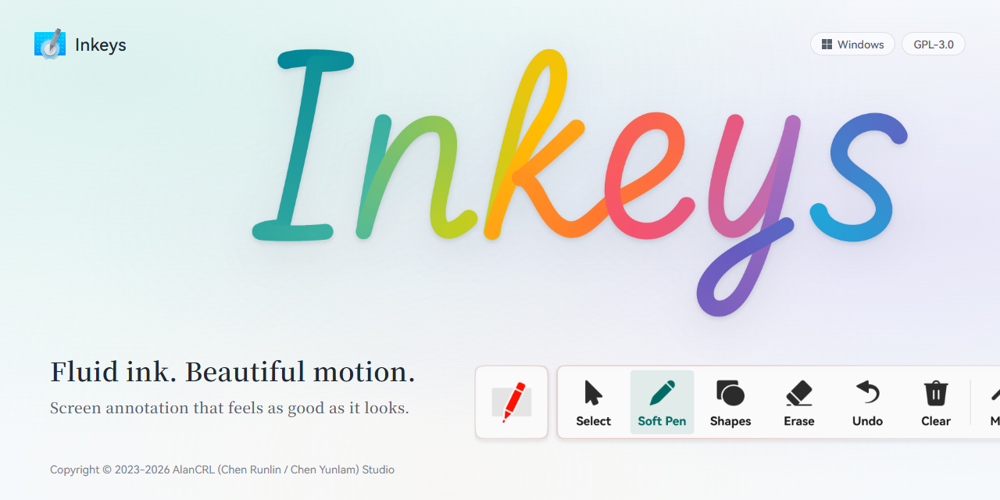
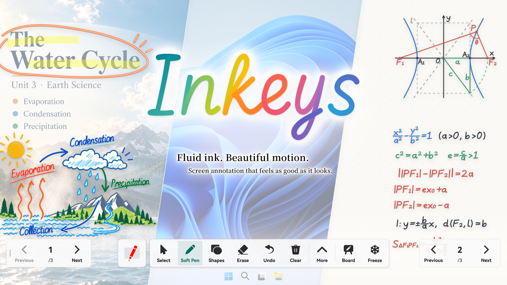
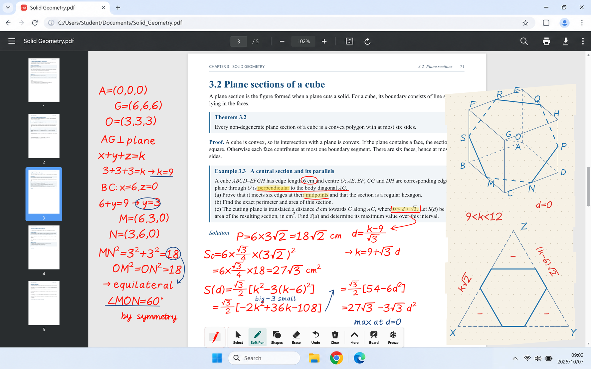
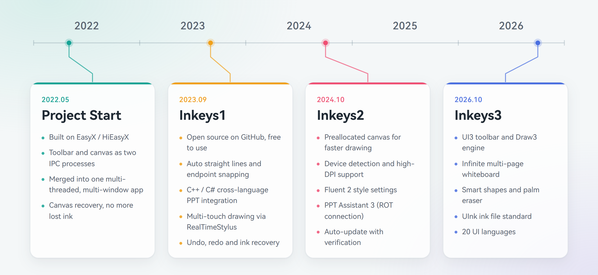

<picture>
  <source media="(prefers-color-scheme: dark)" srcset="GithubRes/hero-dark-en-US.png">
  
</picture>

 

<h1>Inkeys</h1>

**Fluid ink. Beautiful motion. Screen annotation that feels as good as it looks.**

Free & Open Source · Desktop Annotation · Free-form Whiteboard · PPT Presentation Markup

**English** | [简体中文](README_zh-CN.md) | [繁體中文](README_zh-TW.md)

[Download](https://www.inkeys.top/download) · [Website](https://www.inkeys.top) · FAQ · [GitCode Mirror](https://gitcode.com/alan16356/Inkeys)

   

Copyright © 2023-2026 AlanCRL (Chen Runlin / Chen Yunlam) Studio

 

**Inkeys is an open-source screen annotation app built for Windows. Whether you are annotating the desktop, writing on a whiteboard or presenting slides, you can pick up the pen and write freely at any moment. Inkeys3 brings the redesigned UI3 toolbar and the in-house Draw3 drawing engine, making every stroke more responsive and every interaction lighter. Features such as Super Topmost, the palm eraser and smart drawing make everyday use even easier.**  

Inkeys is optimized separately for **large touch screens** and **desktop use**, with drawing presets matched to each input device, including mouse, touch, screen pen and graphics tablet. For example, it models the physical size of the screen so that the pen-speed eraser, palm eraser and smart drawing always feel just right. Inkeys supports Windows 7 SP1 and later on x86, x64 and native ARM64, with multiple layers of compatibility fallback based on your hardware, giving the best experience on both new and older devices.

The all-new, in-house **Draw3 drawing engine** is driven by high-performance C++20 and Direct3D HLSL shaders for an exceptional drawing experience. High-performance RealTimeStylus input combined with an atomic data pipeline greatly reduces input latency, while a multi-buffer rendering architecture with dynamic dirty regions delivers very high frame rates. Real-time smoothing (tremor correction) and real-time stroke tips based on an ink timing model, together with ink prediction and pressure support, make every stroke look refined. Multiple pen types such as the soft pen, highlighter, laser pointer and brush, plus global multi-finger writing, broaden the ways you express yourself; the pen-speed eraser and palm eraser make erasing natural, and the newly added shapes and smart drawing push creative possibilities even further.

The redesigned **UI3 toolbar** makes every interaction light and natural. Delicate, interruptible spring animations and dynamic lighting that follows your interactions make every press and switch feel lively. It can float, dock to the bottom or sit centered as a bottom bar, and with stepless scaling, light and dark appearances and adjustable transparency, the toolbar moves the way you want. The new **settings interface** adopts the Fluent 2 design language and is built with Dear ImGui and ImFluent. It has a dynamic blurred background and smooth animations on Windows 10/11 while still running on Windows 7, and the interface now supports 20 languages that switch instantly without a restart.

Beyond desktop annotation, the **free-form whiteboard** offers an infinite canvas and multi-page boards with multiple background colors and dot or grid styles, and can be launched directly from a desktop shortcut. **PPT integration** works out of the box with no VSTO add-in required: thanks to our unique ROT-based connection, it connects reliably even on devices with broken COM registration; slideshows from different apps such as PowerPoint and WPS can run side by side and be switched freely. It can also take over the native annotation tools during a slideshow, saves ink with each slide, and fades the page controls when idle so they never cover your slides.

Inkeys started in 2022 and has been in development for more than four years. The main program now contains about 200,000 lines of in-house code plus about 50,000 lines of automated tests, and uses GitHub Actions for continuous integration that automates multi-architecture builds, code signing and releases, forming a mature project structure and development process. We strictly follow the GPLv3 license, maintain comprehensive Terms of Use, and collect telemetry anonymously and only to the minimum extent necessary, fully respecting user privacy. We also embrace the open-source spirit and are happy to exchange ideas with developers of similar projects and improve together. We could not have come this far without the support and feedback of our many users, and we sincerely thank everyone who uses Inkeys. We also thank SignPath for free open-source code signing, HelloGitHub for the recommendation, and the many websites and communities that support us. Since the Inkeys3 preview was released in October 2026, more than 2,500 users have tried it, and we believe this number will grow significantly after the official release.

## Gallery

<picture>
  <source media="(prefers-color-scheme: dark)" srcset="GithubRes/showcase-overview-dark.png">
  
</picture>

### Inkeys · Write Freely

Annotate freely on screen and give your ideas and explanations more possibilities.  
Switch to the whiteboard and let your thinking extend across the canvas; or follow your slides and write page by page as you present.  
Writing is no longer bound by the scene, and expression flows naturally.

 

<picture>
  <source media="(prefers-color-scheme: dark)" srcset="GithubRes/showcase-tools-dark.png">
  
</picture>

### Diverse Strokes, Free Expression

The hard pen is crisp, the soft pen has graceful stroke tips, the highlighter marks key points, and the laser pointer fades as you go.  
Together with basic shape tools, from quick circles to precise markup, every idea finds the right way to be expressed.

 

### Every Stroke Keeps Up with Your Thoughts

From quick sketches to detailed writing, the ink always follows the pen tip.  
The GPU-accelerated in-house drawing engine, with real-time smoothing, ink prediction and pressure processing, makes every start, turn and finish of a stroke smooth and natural.

 

### Crafted for Every Interaction

The in-house main toolbar makes every action light and natural.  
Delicate, interruptible spring animations and dynamic lighting that follows your interactions bring every press and switch to life.  
With stepless scaling, free positioning and docking, the toolbar moves as you wish. The settings interface adopts the Fluent 2 design language, combining beauty and practicality.

 

### From Desktop to Large Screen

Whether on a personal computer, a Windows tablet or a classroom touch display, you can write freely in a familiar way.  
Supports mouse, touch, screen pen and graphics tablet, runs on x86, x64 and native ARM64, and takes care of older Windows devices still in use.

 

## Timeline

<picture>
  <source media="(prefers-color-scheme: dark)" srcset="GithubRes/timeline-dark-en-US.png">
  
</picture>

> **About AI Agent Development**  
> Since July 2026, Inkeys has used AI agents in development, with a focus on prompt engineering and a well-defined agent development workflow. This has greatly shortened feature development cycles with no, or only a slight, impact on quality.

## Download & Install
[Official download page](https://www.inkeys.top/download) | [Cloud drive (no login)](https://www.123pan.com/s/duk9-n4dAd.html) | [GitHub Releases](https://github.com/Alan-CRL/Inkeys/releases)  

### System Requirements
- Windows 8 and later work out of the box.
- Windows 7 requires Service Pack 1 and the KB2670838 update ([details](https://www.inkeys.top/win7)).
- Supports x86, x64 and native ARM64.

### Interface Languages
Inkeys supports 20 interface languages and regions, switchable instantly in Settings.

Show language list

Simplified Chinese, Traditional Chinese (Taiwan), Traditional Chinese (Hong Kong), English (United States), English (United Kingdom), Japanese, Korean, German, French, Spanish (Spain), Spanish (Mexico), Italian, Portuguese (Brazil), Russian, Ukrainian, Polish, Romanian, Turkish, Indonesian, Vietnamese

## Feedback & Community
Bug reports and feature requests: [GitHub Issues](https://github.com/Alan-CRL/Inkeys/issues)  
Feedback form: [Click here](https://www.wjx.cn/vm/mqNTTRL.aspx#)  
Official forum: [Smart Teach Forum · Inkeys](https://forum.smart-teach.cn/t/inkeys)  
[Official QQ user group](https://qm.qq.com/cgi-bin/qm/qr?k=9V2l83dc0yP4UYeDF-NkTX0o7_TcYqlh&jump_from=webapi&authKey=LsLLUhb1KSzHYbc8k5nCQDqTtRcRUCEE3j+DdR9IgHaF/7JF7LLpY191hsiYEBz6): `618720802`  
Author's QQ: `2685549821`  
Author's email: `alan-crl@foxmail.com` `alancrl1007@gmail.com`

## Contributing
[Build Guide](GithubRes/CompilationProcess_en-US.md) | [Contributing Guide](CONTRIBUTING.md)

### Branches
- `main`: source code of Inkeys2.
- `dev`: source code of Inkeys3, under active development and may not build.

## License & Notices

### License
This project is licensed under the [GNU General Public License v3.0](LICENSE).

### Terms of Use
Using Inkeys requires agreeing to our [Inkeys Terms of Use](https://www.inkeys.top/tos/en-us) | [Mirror](./TOS/en-US.md)

### Code Signing Policy
<table>
  <tr>
    <td>
      
    </td>
    <td>
    Free code signing on Windows provided by <a href="https://signpath.io">SignPath.io</a>, certficate by <a href="https://signpath.org/">SignPath Foundation</a>
    </td>
  </tr> 
</table>

- Free code signing provided by [SignPath.io](https://about.signpath.io/), certificate by [SignPath Foundation](https://signpath.org/).
- Committers and reviewers: [Team members](https://github.com/Alan-CRL/Inkeys/graphs/contributors)
- Approver: [Alan-CRL](https://github.com/Alan-CRL)

## Third-Party Components
We thank the following third-party projects and their contributors. This section lists the third-party libraries that the Inkeys main program **currently uses** or **has used**. The License column uses SPDX identifiers; copyright notices are quoted verbatim from the license file shipped with each component, and components whose license text has no copyright line are marked. This is only a summary; the original license of each component prevails.

Show third-party components

| Component | License | Copyright | Usage |
| :--- | :--- | :--- | :--- |
| **[abseil/abseil-cpp](https://github.com/abseil/abseil-cpp)** | Apache-2.0 | The license text contains no copyright line | vcpkg |
| **[cameron314/concurrentqueue](https://github.com/cameron314/concurrentqueue)** | BSD-2-Clause OR BSL-1.0 | Copyright (c) 2013-2016, Cameron Desrochers. All rights reserved. | vcpkg |
| **[efficient/libcuckoo](https://github.com/efficient/libcuckoo)** | Apache-2.0 | Copyright (C) 2013, Carnegie Mellon University and Intel Corporation | vcpkg |
| **[FreeType](https://freetype.org)** | FTL OR GPL-2.0-or-later | Copyright 1996-2002, 2006 by David Turner, Robert Wilhelm, and Werner Lemberg | vcpkg |
| **[gabime/spdlog](https://github.com/gabime/spdlog)** | MIT | Copyright (c) 2016 - present, Gabi Melman and spdlog contributors. | vcpkg |
| **[martinus/unordered_dense](https://github.com/martinus/unordered_dense)** | MIT | Copyright (c) 2022 Martin Leitner-Ankerl | vcpkg |
| **[msgpack/msgpack-c](https://github.com/msgpack/msgpack-c)** | BSL-1.0 | Copyright (C) 2008-2015 FURUHASHI Sadayuki | vcpkg |
| **[Neargye/magic_enum](https://github.com/Neargye/magic_enum)** | MIT | Copyright (c) 2019 - 2024 Daniil Goncharov | vcpkg |
| **[opencv/opencv](https://github.com/opencv/opencv)** | Apache-2.0 | The license text contains no copyright line (see the upstream [COPYRIGHT](https://github.com/opencv/opencv/blob/4.10.0/COPYRIGHT) file) | vcpkg |
| **[open-source-parsers/jsoncpp](https://github.com/open-source-parsers/jsoncpp)** | MIT | Copyright (c) 2007-2010 Baptiste Lepilleur and The JsonCpp Authors | vcpkg |
| **[openssl/openssl](https://github.com/openssl/openssl)** | Apache-2.0 | The license text contains no copyright line | vcpkg |
| **[sammycage/lunasvg](https://github.com/sammycage/lunasvg)** | MIT | Copyright (c) 2020-2025 Samuel Ugochukwu &lt;sammycageagle@gmail.com&gt; | vcpkg |
| **[yhirose/cpp-httplib](https://github.com/yhirose/cpp-httplib)** | MIT | Copyright (c) 2017 yhirose | vcpkg |
| **[aksalj/hashlibpp](https://github.com/aksalj/hashlibpp)** | BSD-2-Clause | Copyright (c) 2007-2011 Benjamin Grüdelbach | Bundled source |
| └ MD5 implementation (RFC 1321, bundled in hashlib++) | RSA-MD | Copyright (C) 1991-2, RSA Data Security, Inc. Created 1991. All rights reserved. | Bundled source |
| └ SHA-1 implementation (RFC 3174, bundled in hashlib++) | See the license notice in the source file | Copyright (C) The Internet Society (2001). All Rights Reserved. | Bundled source |
| └ SHA-2 implementation (Aaron D. Gifford, bundled in hashlib++) | BSD-3-Clause | Copyright (c) 2000-2001, Aaron D. Gifford All rights reserved. | Bundled source |
| **[google/ink-stroke-modeler](https://github.com/google/ink-stroke-modeler)** | Apache-2.0 | Copyright 2022 Google LLC | Bundled source |
| **[lukaasm/ImFluent](https://github.com/lukaasm/ImFluent)** | MIT | Copyright (c) 2026 lukaasm | Bundled source |
| **[mohabouje/WinToast](https://github.com/mohabouje/WinToast)** | MIT | Copyright (C) 2016-2023 WinToast v1.3.0 - Mohammed Boujemaoui &lt;mohabouje@gmail.com&gt; | Bundled source |
| **[nothings/stb](https://github.com/nothings/stb)** | MIT OR Unlicense | Copyright (c) 2017 Sean Barrett | Bundled source |
| **[ocornut/imgui](https://github.com/ocornut/imgui)** | MIT | Copyright (c) 2014-2026 Omar Cornut | Bundled source |
| **[Zip Utils](https://www.codeproject.com/Articles/7530/Zip-Utils-Clean-Elegant-Simple-Cplusplus-Win)** | See the project page | No license file is bundled (source attributed to Lucian Wischik) | Bundled source |
| └ Info-ZIP (bundled in Zip Utils) | Info-ZIP | Copyright (c) 1990-1999 Info-ZIP. All rights reserved. | Bundled source |
| └ zlib (bundled in Zip Utils) | Zlib | Copyright (C) 1995-1998 Jean-loup Gailly and Mark Adler | Bundled source |
| └ unzip 0.15 (Gilles Vollant, bundled in Zip Utils) | See the license notice in the source file | Copyright 1998 Gilles Vollant | Bundled source |
| **[Alan-CRL/HiMsg](https://github.com/Alan-CRL/HiMsg)** | MIT | Copyright (c) 2026 Alan-CRL | Git submodule |
| **[Alan-CRL/DesktopDrawpadBlocker](https://github.com/Alan-CRL/DesktopDrawpadBlocker)** | GPL-3.0 | No license file is bundled | Distributed with the program |
| **[cmdwtf/imgui_toggle](https://github.com/cmdwtf/imgui_toggle)** | 0BSD | Copyright © 2022 nitz — chris marc dailey https://cmd.wtf | No longer used (source still in repository) |
| **Microsoft DirectX SDK (June 2010)** | Microsoft Software License Terms | No license file is bundled | No longer used (headers still in repository) |
| **[zouhuidong/HiEasyX](https://github.com/zouhuidong/HiEasyX)** | MIT | Copyright (c) 2022 zouhuidong | No longer used |
| **[EasyX](https://easyx.cn/)** | EasyX official license terms | No license file is bundled | No longer used |

For the **full notices** and license texts of the third-party components used by this software, see:

- **Main component notices**: [NOTICE](NOTICE)
- **Third-party license files**: [ThirdpartyLicenses](ThirdpartyLicenses/)

> Where the license terms of this project conflict or are inconsistent with the licenses of the above third-party components,  
> the specific terms of the corresponding third-party license prevail for the use, copying, modification and distribution of that component.

> Our use of third-party components does not constitute any claim of ownership over those projects.  
> When using the above third-party software, libraries or services independently, you should read and comply with their respective terms and licenses.

## Copyright Notice

Using Inkeys requires agreeing to our [Inkeys Terms of Use](https://www.inkeys.top/tos/en-us) | [Mirror](./TOS/en-US.md). The following is excerpted from the Terms of Use; the full Terms of Use prevail.

### Proprietary Intellectual Property

Except for the source code and third-party open-source components authorized under open-source licenses as described in Article IV of this Agreement, other intellectual property rights related to the Software, including but not limited to:

- The Software name, logo, icons (excluding parts of third-party icon fonts belonging to their copyright owners), interface design, and visual elements;
- The overall interaction design, layout, and organizational structure of the Software;
- Official documentation, manuals, help content, tutorials, sample data, demo videos, promotional materials, etc., released by the Software;
- Images, graphic materials, icons, and other design resources independently created by Us and provided with the Software, which are not subject to third-party proprietary license restrictions;

The copyright, trademark rights, patent rights, and other relevant rights of the above content belong to **Us (Inkeys Development Team)** or have been legally authorized by their rights holders.

Provided there is no conflict with applicable open-source licenses (e.g., GPLv3), without Our prior written permission, you may not in any way:

- Remove, hide, or alter copyright notices, trademarks, logos, or other rights notices displayed in the Software;
- Use names, logos, or branding elements identical or confusingly similar to "Inkeys" in a manner that may cause confusion;
- Use the Software's name, logo, or interface to promote products or services not associated with Us or not authorized by Us;
- Sell or distribute the Software and various intellectual property rights related to the Software for profit.

> If any statement regarding intellectual property rights in this Agreement conflicts with open-source licenses (e.g., GPLv3) within the scope of source code usage, the terms of the respective open-source license shall prevail regarding the source code part.

### Third-Party Fonts and Design Resources

The Software uses certain third-party fonts and icon fonts as design resources in its interface display, such as (including but not limited to):

- **HarmonyOS Sans** series fonts;
- **Noto Sans JP / Noto Sans KR** fonts;
- **Segoe Fluent Icons / Segoe Fluent UI** and other icon fonts or related icon sets;
- **Douyu Font** (no longer used).

Regarding the above third-party fonts and design resources, please understand and agree that:

1. **Ownership of Rights**  
   - The copyright, trademark rights, and other rights of the above fonts, icon fonts, and related design resources belong to their respective owners;  
   - We use them for interface display and other purposes of the Software only within the scope permitted by their respective licensing terms;  
   - Nothing in these Terms of Use should be construed as transferring or licensing any rights or interests in these third-party fonts or design resources to you.

2. **Restrictions on Your Use**  
   - You must not extract these third-party fonts or design resources from the Software independently for separate distribution, sale, rental, or download;  
   - If you wish to use the above fonts or icon fonts independently outside of the Software (including but not limited to commercial scenarios), you should consult and comply with the relevant licensing terms from their rights holders or official channels and obtain separate authorization if necessary;
   - For third-party design resources that We do not have the right to sublicense, We do not provide any form of sublicense commitment or legal guarantee to you.

3. **Relation to the Open Source Nature of the Software**  
   - The source code of the Software (within the scope of GPLv3) is open source;  
   - However, certain fonts, icon fonts, or other design resources contained in the Software may **not be licensed under an open-source license along with the source code**;  
   - If you redistribute or perform secondary development based on the Software, **it is your responsibility to verify and comply with the licensing terms of these third-party resources** and replace them with resources you are legally entitled to use if necessary.

### Copyright

Copyright © 2023–2026 **AlanCRL (Chen Runlin) Studio**  
All Rights Reserved (within the scope permitted by applicable open-source licenses).

Third-party fonts, icon fonts, and other resources subject to third-party licenses are the property of their respective rights holders.

## More

[Bilibili: 25H2 introduction video (older)](https://www.bilibili.com/video/BV17duZzYEsE/)  
[Bilibili: 24H2 introduction video (older)](https://www.bilibili.com/video/BV1Tz421z72e/)  
[Bilibili: 24H1 introduction video (older)](https://www.bilibili.com/video/BV1vJ4m147rN/)
