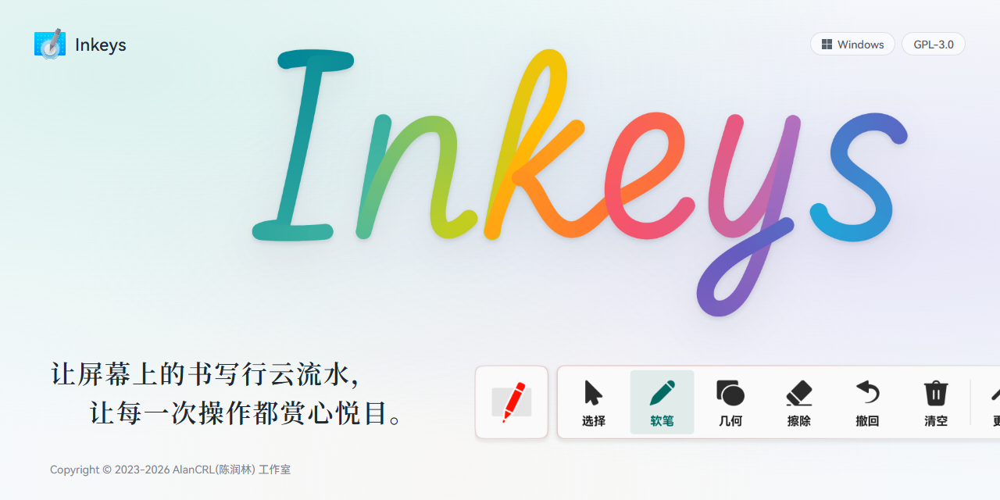
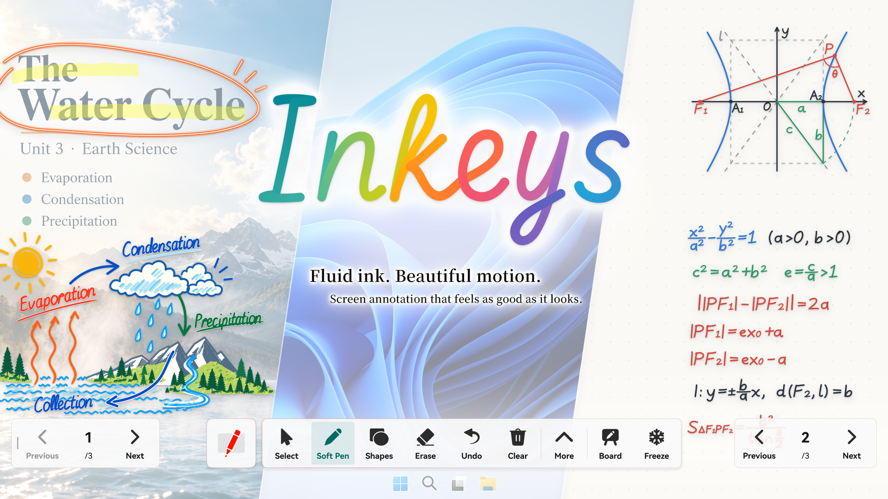
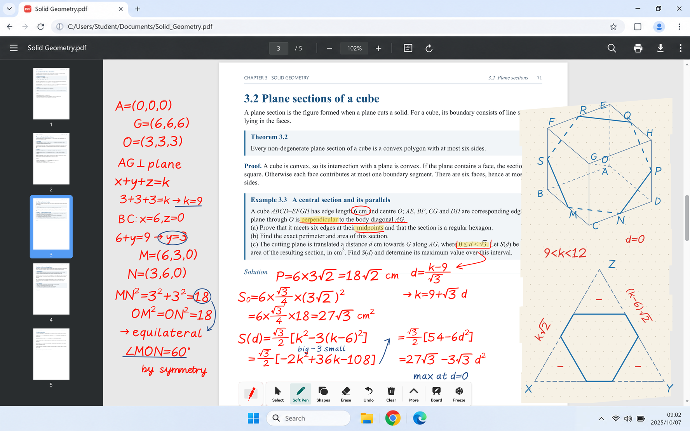
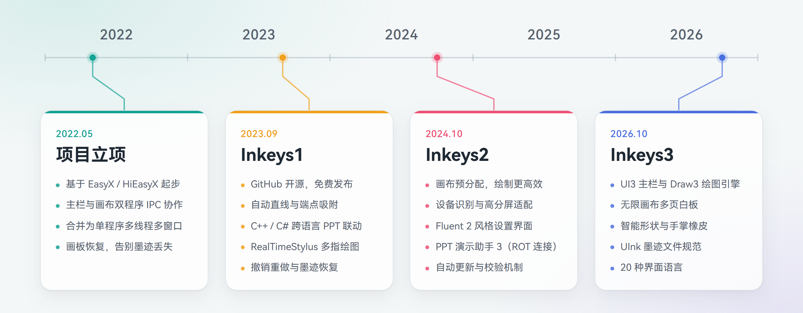

<picture>
  <source media="(prefers-color-scheme: dark)" srcset="GithubRes/hero-dark-zh-CN.png">
  
</picture>

 

<h1>智绘教Inkeys</h1>

**让屏幕上的书写行云流水，让每一次操作都赏心悦目。**

开源免费 · 桌面批注 · 自由白板 · PPT演示标注

[English](README.md) | **简体中文** | [繁體中文](README_zh-TW.md)

[下载](https://www.inkeys.top/download) · [官方网站](https://www.inkeys.top) · 常见问题 · [GitCode 镜像](https://gitcode.com/alan16356/Inkeys)

   

Copyright © 2023-2026 AlanCRL(陈润林) 工作室

 

**Inkeys 是一款专为 Windows 打造的开源屏幕批注软件，无论是桌面批注、白板板书还是 PPT 放映讲解，都能随时落笔、自由书写。Inkeys3 带来了全新设计的 UI3 主栏与自研的 Draw3 绘图引擎，让每一次书写更跟手、每一次操作更轻盈。此外，超级置顶、手掌橡皮、智能绘图等特色功能，也让日常使用更加省心。**  

软件针对**大屏触控**与**桌面交互**两种场景分别优化，并为鼠标、触摸、屏幕笔和数位板等不同输入设备匹配相应的绘制预设。例如，软件会根据屏幕的物理尺寸建立模型，让笔速橡皮、手掌橡皮和智能绘图的手感始终恰到好处。软件支持 Windows 7 SP1 及以上系统，兼容 x86、x64 与原生 ARM64 架构，并根据硬件情况提供多层兼容回退，无论新老设备都能获得最佳体验。

全新自研的 **Draw3 绘图引擎**，以 C++20 高性能实现与 Direct3D HLSL 着色器驱动，带来极致的绘图体验。RealTimeStylus 高性能输入搭配原子数据链路，大幅降低输入延迟；多缓冲层绘图架构配合动态脏区，带来极高的帧率。基于墨迹时间模型的实时平滑（手抖修正）与实时笔锋，再加上墨迹预测与压感支持，让每一笔都精致动人。软笔、荧光笔、激光笔、刷子等多种笔型与全局多指书写，丰富你的表达方式；笔速橡皮与手掌橡皮让擦除自然顺手，最新加入的丰富形状与智能绘图，则进一步拓展了创作的边界。

全新设计的 **UI3 主栏**，让每一次操作都轻盈自然。细腻且可打断的回弹动画、随交互流转的动态光影，让每一次按压与切换都充满灵动；支持悬浮、底部停靠与居中底栏，配合无级缩放、浅色与深色外观及透明度调节，让主栏随心而动。全新的**设置界面**融入 Fluent 2 设计语言，基于 Dear ImGui 与 ImFluent 打造，在 Windows 10／11 上拥有动态模糊背景与流畅动画，同时依然可以在 Windows 7 上运行；界面语言扩展至 20 种，无需重启即可即时切换。

除了桌面批注，**自由白板**提供无限画布与多页板书，支持多种背景颜色与点阵、网格样式，还能从桌面快捷方式一键启动；**PPT 演示联动**开箱即用，无需安装任何 VSTO 插件，借助独特的 ROT 连接方案，即使 COM 注册损坏的设备也能稳定连接；PowerPoint 与 WPS 等不同软件的放映可以同时共存、随意切换，还能接管放映中的原生批注，墨迹跟随幻灯片保存，翻页控件也会在闲置时自动淡化，不遮挡课件内容。

Inkeys 起源于 2022 年，至今已持续开发四年多。目前主程序自研代码约 20 万行，另有约 5 万行自动化测试，并通过 GitHub Actions 持续集成，自动完成多架构构建、代码签名与发布，形成了成熟的项目体系与开发流程。我们严格遵守 GPLv3 开源协议，制定了完善的使用条款，遥测仅在最小必要范围内匿名收集，充分尊重用户隐私；也始终秉持开源精神，乐于与同类项目开发者交流技术、共同进步。一路走来，离不开众多用户的支持与反馈，在此由衷感谢每一位使用 Inkeys 的你。同时也感谢 SignPath 提供的开源代码签名、HelloGitHub 的推荐，以及众多网站与社区的支持。Inkeys3 自 2026 年 10 月发布预览版本以来，已有超过 2500 位用户参与体验，相信正式版发布后，这个数字还会大幅增长。

## 图片集锦

<picture>
  <source media="(prefers-color-scheme: dark)" srcset="GithubRes/showcase-overview-dark.png">
  
</picture>

### Inkeys · 自由书写

在屏幕上自由批注，让想法与讲解拥有更多可能。  
切换至白板，让思路在画布上无限延展；或跟随课件放映，逐页书写、从容讲解。  
让书写不受场景限制，让表达自然延续。

 

<picture>
  <source media="(prefers-color-scheme: dark)" srcset="GithubRes/showcase-tools-dark.png">
  
</picture>

### 多样笔触，自由表达

硬笔清晰利落，软笔富有笔锋，荧光笔突出重点，激光笔随写随隐。  
配合多种基础图形工具，从随手圈画到精细标注，让不同的想法都能找到合适的表达方式。

 

### 每一笔，都跟得上思路

从快速勾画到细致书写，让笔迹始终紧随笔尖。  
GPU 加速的自研绘图引擎，配合实时平滑、墨迹预测与压感处理，让每一次起笔、转折与收笔都自然流畅。

 

### 为每一次交互精心打磨

自研的主工具栏界面，让每一次操作都轻盈自然。  
细腻且可打断的回弹动画、随交互流转的动态光影，让每一次按压与切换都充满灵动。  
配合无级缩放、自由定位与停靠，让工具栏随心而动。设置界面则融入 Fluent 2 设计语言，让美感与实用兼得。

 

### 从桌面到大屏，自在书写

无论是个人电脑、Windows 平板，还是教学触控大屏，都能以熟悉的方式自由书写。  
支持鼠标、触摸、屏幕笔与数位板，兼容 x86、x64 和原生 ARM64，并照顾仍在使用的旧版 Windows 设备。

 

## 时间线

<picture>
  <source media="(prefers-color-scheme: dark)" srcset="GithubRes/timeline-dark-zh-CN.png">
  
</picture>

> **关于 AI Agent 开发**  
> 自 2026 年 7 月起，Inkeys 引入 AI Agent 参与开发，并注重提示词工程与 Agent 开发流程的建设。在不影响或仅轻微影响质量的前提下，大幅缩短了功能的开发周期。

## 下载与安装
[官网下载页](https://www.inkeys.top/download) | [免登录云盘](https://www.123pan.com/s/duk9-n4dAd.html) | [Github Release 附件](https://github.com/Alan-CRL/Inkeys/releases)  

### 系统要求
- Windows 8 及以上系统可直接使用。
- Windows 7 需要 Service Pack 1，并安装 KB2670838 更新（[详细说明](https://www.inkeys.top/win7)）。
- 支持 x86、x64 与原生 ARM64 架构。

### 界面语言
支持 20 种界面语言与地区，可在设置中即时切换。

展开语言列表

简体中文、繁体中文（台湾）、繁体中文（香港）、英语（美国）、英语（英国）、日语、韩语、德语、法语、西班牙语（西班牙）、西班牙语（墨西哥）、意大利语、葡萄牙语（巴西）、俄语、乌克兰语、波兰语、罗马尼亚语、土耳其语、印度尼西亚语、越南语

## 反馈与交流
问题报告与功能建议：[GitHub Issues](https://github.com/Alan-CRL/Inkeys/issues)  
在线反馈问卷：[点击此处](https://www.wjx.cn/vm/mqNTTRL.aspx#)  
官方论坛：[智教联盟论坛 · Inkeys 板块](https://forum.smart-teach.cn/t/inkeys)  
[官方用户QQ群](https://qm.qq.com/cgi-bin/qm/qr?k=9V2l83dc0yP4UYeDF-NkTX0o7_TcYqlh&jump_from=webapi&authKey=LsLLUhb1KSzHYbc8k5nCQDqTtRcRUCEE3j+DdR9IgHaF/7JF7LLpY191hsiYEBz6)：`618720802`  
作者QQ：`2685549821`  
作者邮箱：`alan-crl@foxmail.com` `alancrl1007@gmail.com`

## 参与开发
[编译说明](GithubRes/CompilationProcess_zh-CN.md) | [贡献指南](CONTRIBUTING.md)

### 分支说明
- `main`：Inkeys2 的源码。
- `dev`：Inkeys3 的源码，持续开发中，可能无法构建。

## 许可与声明

### 许可证
本项目基于 [GNU General Public License v3.0](LICENSE) 获得许可。

### 使用条款
使用 智绘教Inkeys 需同意我们的 [智绘教Inkeys 使用条款](https://www.inkeys.top/tos/zh-cn) | [备用链接](./TOS/zh-CN.md)

### 代码签名策略
<table>
  <tr>
    <td>
      
    </td>
    <td>
    Free code signing on Windows provided by <a href="https://signpath.io">SignPath.io</a>, certficate by <a href="https://signpath.org/">SignPath Foundation</a>
    </td>
  </tr> 
</table>

- 由 [SignPath.io](https://about.signpath.io/) 提供免费代码签名，由 [SignPath Foundation](https://signpath.org/) 提供证书。
- 提交者和审阅者：[团队成员](https://github.com/Alan-CRL/Inkeys/graphs/contributors)
- 审批人：[Alan-CRL](https://github.com/Alan-CRL)

## 项目引用
我们在此对以下第三方项目及其贡献者表示感谢。本节列出 Inkeys 主程序**当前使用**和**曾经使用**的第三方代码库。许可证一栏为 SPDX 标识符；版权声明逐字摘自各组件随附的许可证文件，许可证文本中没有版权行的组件会注明。以上仅为摘要，具体约束以各组件的许可证原文为准。

展开第三方组件列表

| 组件 | 许可证 | 版权声明 | 使用方式 |
| :--- | :--- | :--- | :--- |
| **[abseil/abseil-cpp](https://github.com/abseil/abseil-cpp)** | Apache-2.0 | 许可证文本无版权行 | vcpkg |
| **[cameron314/concurrentqueue](https://github.com/cameron314/concurrentqueue)** | BSD-2-Clause OR BSL-1.0 | Copyright (c) 2013-2016, Cameron Desrochers. All rights reserved. | vcpkg |
| **[efficient/libcuckoo](https://github.com/efficient/libcuckoo)** | Apache-2.0 | Copyright (C) 2013, Carnegie Mellon University and Intel Corporation | vcpkg |
| **[FreeType](https://freetype.org)** | FTL OR GPL-2.0-or-later | Copyright 1996-2002, 2006 by David Turner, Robert Wilhelm, and Werner Lemberg | vcpkg |
| **[gabime/spdlog](https://github.com/gabime/spdlog)** | MIT | Copyright (c) 2016 - present, Gabi Melman and spdlog contributors. | vcpkg |
| **[martinus/unordered_dense](https://github.com/martinus/unordered_dense)** | MIT | Copyright (c) 2022 Martin Leitner-Ankerl | vcpkg |
| **[msgpack/msgpack-c](https://github.com/msgpack/msgpack-c)** | BSL-1.0 | Copyright (C) 2008-2015 FURUHASHI Sadayuki | vcpkg |
| **[Neargye/magic_enum](https://github.com/Neargye/magic_enum)** | MIT | Copyright (c) 2019 - 2024 Daniil Goncharov | vcpkg |
| **[opencv/opencv](https://github.com/opencv/opencv)** | Apache-2.0 | 许可证文本无版权行（版权声明见上游 [COPYRIGHT](https://github.com/opencv/opencv/blob/4.10.0/COPYRIGHT) 文件） | vcpkg |
| **[open-source-parsers/jsoncpp](https://github.com/open-source-parsers/jsoncpp)** | MIT | Copyright (c) 2007-2010 Baptiste Lepilleur and The JsonCpp Authors | vcpkg |
| **[openssl/openssl](https://github.com/openssl/openssl)** | Apache-2.0 | 许可证文本无版权行 | vcpkg |
| **[sammycage/lunasvg](https://github.com/sammycage/lunasvg)** | MIT | Copyright (c) 2020-2025 Samuel Ugochukwu &lt;sammycageagle@gmail.com&gt; | vcpkg |
| **[yhirose/cpp-httplib](https://github.com/yhirose/cpp-httplib)** | MIT | Copyright (c) 2017 yhirose | vcpkg |
| **[aksalj/hashlibpp](https://github.com/aksalj/hashlibpp)** | BSD-2-Clause | Copyright (c) 2007-2011 Benjamin Grüdelbach | 源码内置 |
| └ MD5 实现（RFC 1321，hashlib++ 内含） | RSA-MD | Copyright (C) 1991-2, RSA Data Security, Inc. Created 1991. All rights reserved. | 源码内置 |
| └ SHA-1 实现（RFC 3174，hashlib++ 内含） | 参见源码内许可声明 | Copyright (C) The Internet Society (2001). All Rights Reserved. | 源码内置 |
| └ SHA-2 实现（Aaron D. Gifford，hashlib++ 内含） | BSD-3-Clause | Copyright (c) 2000-2001, Aaron D. Gifford All rights reserved. | 源码内置 |
| **[google/ink-stroke-modeler](https://github.com/google/ink-stroke-modeler)** | Apache-2.0 | Copyright 2022 Google LLC | 源码内置 |
| **[lukaasm/ImFluent](https://github.com/lukaasm/ImFluent)** | MIT | Copyright (c) 2026 lukaasm | 源码内置 |
| **[mohabouje/WinToast](https://github.com/mohabouje/WinToast)** | MIT | Copyright (C) 2016-2023 WinToast v1.3.0 - Mohammed Boujemaoui &lt;mohabouje@gmail.com&gt; | 源码内置 |
| **[nothings/stb](https://github.com/nothings/stb)** | MIT OR Unlicense | Copyright (c) 2017 Sean Barrett | 源码内置 |
| **[ocornut/imgui](https://github.com/ocornut/imgui)** | MIT | Copyright (c) 2014-2026 Omar Cornut | 源码内置 |
| **[Zip Utils](https://www.codeproject.com/Articles/7530/Zip-Utils-Clean-Elegant-Simple-Cplusplus-Win)** | 参见项目页面 | 未随附许可证文件（源码署名 Lucian Wischik） | 源码内置 |
| └ Info-ZIP（Zip Utils 内含） | Info-ZIP | Copyright (c) 1990-1999 Info-ZIP. All rights reserved. | 源码内置 |
| └ zlib（Zip Utils 内含） | Zlib | Copyright (C) 1995-1998 Jean-loup Gailly and Mark Adler | 源码内置 |
| └ unzip 0.15（Gilles Vollant，Zip Utils 内含） | 参见源码内许可声明 | Copyright 1998 Gilles Vollant | 源码内置 |
| **[Alan-CRL/HiMsg](https://github.com/Alan-CRL/HiMsg)** | MIT | Copyright (c) 2026 Alan-CRL | Git 子模块 |
| **[Alan-CRL/DesktopDrawpadBlocker](https://github.com/Alan-CRL/DesktopDrawpadBlocker)** | GPL-3.0 | 未随附许可证文件 | 随程序分发 |
| **[cmdwtf/imgui_toggle](https://github.com/cmdwtf/imgui_toggle)** | 0BSD | Copyright © 2022 nitz — chris marc dailey https://cmd.wtf | 已不再使用（源码仍在仓库） |
| **Microsoft DirectX SDK (June 2010)** | Microsoft 软件许可条款 | 未随附许可证文件 | 已不再使用（头文件仍在仓库） |
| **[zouhuidong/HiEasyX](https://github.com/zouhuidong/HiEasyX)** | MIT | Copyright (c) 2022 zouhuidong | 已不再使用 |
| **[EasyX](https://easyx.cn/)** | EasyX 官方授权条款 | 未随附许可证文件 | 已不再使用 |

关于本软件使用的第三方组件的**完整声明**及其许可证文本，请查阅：

- **主要组件声明**：[NOTICE](NOTICE)
- **第三方许可证文件汇总**：[ThirdpartyLicenses](ThirdpartyLicenses/)

> 当本项目的许可条款与上述第三方组件的许可证存在冲突或不一致时，  
> 就相关第三方组件的使用、复制、修改和分发事宜，以相应第三方许可证的具体条款为准。

> 我们对第三方组件的使用不构成对其项目的任何所有权声明。  
> 您在独立使用上述第三方软件、库或服务时，仍应仔细阅读其各自的使用条款和许可证，并自行遵守。

## 版权声明

使用本软件需同意我们的 [智绘教Inkeys 使用条款](https://www.inkeys.top/tos/zh-cn) | [备用链接](./TOS/zh-CN.md)，以下内容摘自使用条款，完整内容以使用条款为准。

### 自有知识产权

除本协议第四条所述依据开源许可证授权的源代码和第三方开源组件外，本软件相关的其他各项知识产权，包括但不限于：

- 本软件名称、标识（Logo）、图标（不含第三方图标字体中属于其版权所有人的部分）、界面设计与视觉元素；
- 本软件的整体交互设计、版式布局、组织结构；
- 本软件官方发布的文档、说明书、帮助内容、教程、示例数据、演示视频、宣传材料等；
- 由我们独立创作并随软件一同提供，且不受第三方专有许可限制的图片、图形素材、图标等设计资源；

上述内容的著作权、商标权、专利权及其他相关权利，均归 **我们（智绘教Inkeys 开发团队）** 所有或已合法取得其权利人的授权。

在不与适用的开源许可证（例如 GPLv3）相冲突的前提下，未经我们事先书面许可，您不得以任何方式：

- 去除、隐藏或更改本软件中显示的版权声明、商标、标识或其他权利声明；
- 以可能造成混淆的方式使用与“智绘教Inkeys”相同或近似的名称、标识或品牌元素；
- 将本软件的名称、标识或界面等用于推广与我们不存在关联或未获我们授权的产品或服务；
- 出售或以盈利目的分发本软件及其与本软件相关的各项知识产权。

> 若本协议中关于知识产权的表述与开源许可证（如 GPLv3）在源代码使用范围内存在冲突，则就源代码部分优先适用相应开源许可证的条款。

### 第三方字体与设计资源

本软件在界面展示中使用了部分第三方字体和图标字体等设计资源，例如（包括但不限于）：

- **HarmonyOS Sans** 系列字体；
- **Noto Sans JP / Noto Sans KR** 字体；
- **Segoe Fluent Icons / Segoe Fluent UI** 等图标字体或相关图标集；
- **Douyu Font** 字体（已不再使用）。

关于上述第三方字体和设计资源，请您理解并同意：

1. **权利归属**  
   - 上述字体、图标字体及相关设计资源的著作权、商标权及其他权利，均归各自权利人所有；  
   - 我们仅在其各自授权条款允许的范围内，将其用于本软件的界面展示等用途；  
   - 本使用条款中的任何内容，均不应被理解为将这些第三方字体或设计资源的任何权益转让或授权给您。

2. **您的使用限制**  
   - 您不得将这些第三方字体或设计资源从本软件中单独抽取出来，作为独立资源另行分发、出售、出租或提供下载；  
   - 若您希望在本软件之外自行使用上述字体或图标字体（包括但不限于商用场景），应自行向其权利人或官方渠道查阅并遵守相应授权条款，并在必要时单独取得授权；
   - 对于我们无权再授权的第三方设计资源，我们不向您提供任何形式的再授权承诺或法律保证。

3. **与本软件开源属性的关系**  
   - 本软件的源代码（在 GPLv3 范围内）为开源；  
   - 但本软件中包含的某些字体、图标字体或其他设计资源可能 **不随源代码一起以开源许可证授权**；  
   - 若您基于本软件进行再发行或二次开发，**有责任自行确认和遵守这些第三方资源的授权条款**，必要时应替换为您有权合法使用的资源。

### 版权

Copyright © 2023–2026 **AlanCRL（陈润林）工作室**  
保留所有权利（在适用的开源许可证允许范围内）。

第三方字体、图标字体以及其他受第三方许可约束的资源，其版权和相关权利归各自权利人所有。

## 其他内容

[Bilibili 上的 25H2 版本介绍视频（较旧）](https://www.bilibili.com/video/BV17duZzYEsE/)  
[Bilibili 上的 24H2 版本介绍视频（较旧）](https://www.bilibili.com/video/BV1Tz421z72e/)  
[Bilibili 上的 24H1 版本介绍视频（较旧）](https://www.bilibili.com/video/BV1vJ4m147rN/)  
