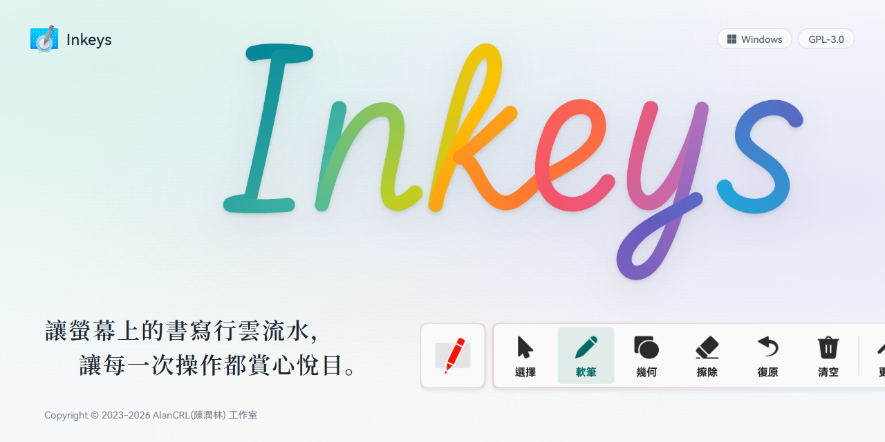
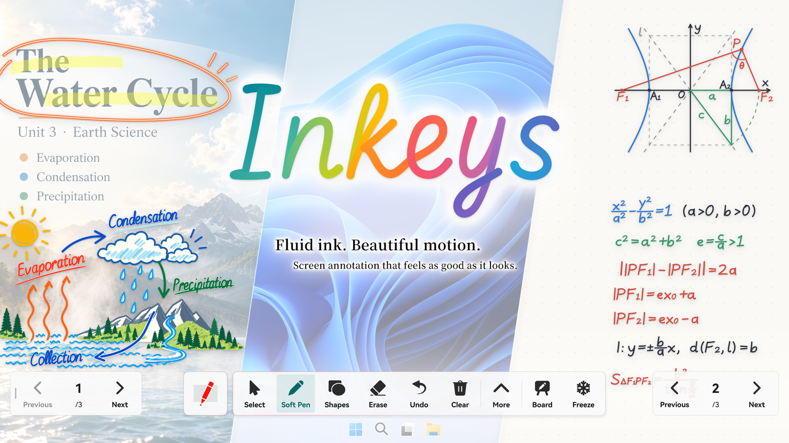
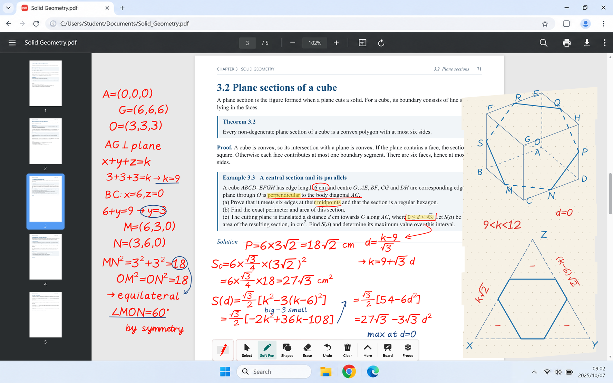
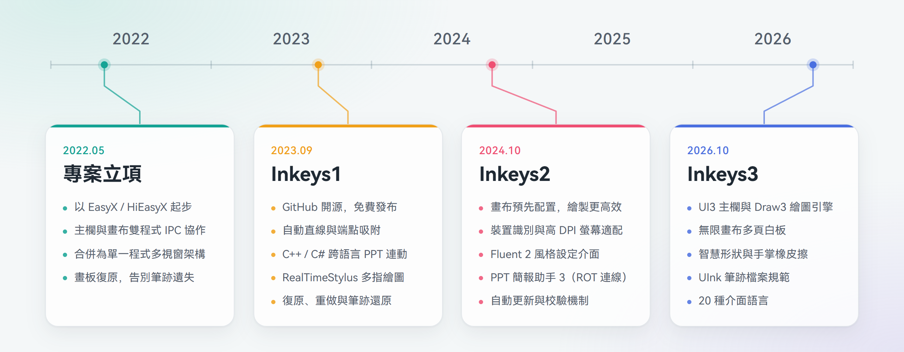

<picture>
  <source media="(prefers-color-scheme: dark)" srcset="GithubRes/hero-dark-zh-TW.png">
  
</picture>

 

<h1>Inkeys</h1>

**讓螢幕上的書寫行雲流水，讓每一次操作都賞心悅目。**

開源免費 · 桌面批註 · 自由白板 · PPT簡報標註

[English](README.md) | [简体中文](README_zh-CN.md) | **繁體中文**

[下載](https://www.inkeys.top/download) · [官方網站](https://www.inkeys.top) · 常見問題 · [GitCode 鏡像](https://gitcode.com/alan16356/Inkeys)

   

Copyright © 2023-2026 AlanCRL(陳潤林) 工作室

 

**Inkeys 是一款專為 Windows 打造的開源螢幕批註軟體，無論是桌面批註、白板板書還是 PPT 放映講解，都能隨時落筆、自由書寫。Inkeys3 帶來了全新設計的 UI3 主欄與自主研發的 Draw3 繪圖引擎，讓每一次書寫更跟手、每一次操作更輕盈。此外，超級置頂、手掌橡皮擦、智慧繪圖等特色功能，也讓日常使用更加省心。**  

軟體針對**大螢幕觸控**與**桌面互動**兩種情境分別最佳化，並為滑鼠、觸控、螢幕筆和繪圖板等不同輸入裝置配對相應的繪製預設。例如，軟體會依據螢幕的實體尺寸建立模型，讓筆速橡皮擦、手掌橡皮擦和智慧繪圖的手感始終恰到好處。軟體支援 Windows 7 SP1 及以上系統，相容 x86、x64 與原生 ARM64 架構，並依據硬體情況提供多層相容回退，無論新舊裝置都能獲得最佳體驗。

全新自主研發的 **Draw3 繪圖引擎**，以 C++20 高效能實作與 Direct3D HLSL 著色器驅動，帶來極致的繪圖體驗。RealTimeStylus 高效能輸入搭配原子資料鏈路，大幅降低輸入延遲；多緩衝層繪圖架構配合動態髒區，帶來極高的影格率。基於筆跡時間模型的即時平滑（手抖修正）與即時筆鋒，再加上筆跡預測與壓感支援，讓每一筆都精緻動人。軟筆、螢光筆、雷射筆、刷子等多種筆型與全域多指書寫，豐富你的表達方式；筆速橡皮擦與手掌橡皮擦讓擦除自然順手，最新加入的豐富形狀與智慧繪圖，則進一步拓展了創作的邊界。

全新設計的 **UI3 主欄**，讓每一次操作都輕盈自然。細膩且可中斷的回彈動畫、隨互動流轉的動態光影，讓每一次按壓與切換都充滿靈動；支援懸浮、底部停靠與置中底欄，配合無段縮放、淺色與深色外觀及透明度調整，讓主欄隨心而動。全新的**設定介面**融入 Fluent 2 設計語言，以 Dear ImGui 與 ImFluent 打造，在 Windows 10／11 上擁有動態模糊背景與流暢動畫，同時依然可以在 Windows 7 上執行；介面語言擴充至 20 種，無需重新啟動即可即時切換。

除了桌面批註，**自由白板**提供無限畫布與多頁板書，支援多種背景顏色與點陣、格線樣式，還能從桌面捷徑一鍵啟動；**PPT 簡報連動**開箱即用，無需安裝任何 VSTO 增益集，藉助獨特的 ROT 連線方案，即使 COM 註冊損壞的裝置也能穩定連線；PowerPoint 與 WPS 等不同軟體的放映可以同時共存、隨意切換，還能接管放映中的原生批註，筆跡跟隨投影片儲存，翻頁控制項也會在閒置時自動淡化，不遮擋簡報內容。

Inkeys 起源於 2022 年，至今已持續開發四年多。目前主程式自主研發程式碼約 20 萬行，另有約 5 萬行自動化測試，並透過 GitHub Actions 持續整合，自動完成多架構建置、程式碼簽章與發布，形成了成熟的專案體系與開發流程。我們嚴格遵守 GPLv3 開源授權條款，制定了完善的使用條款，遙測僅在最小必要範圍內匿名蒐集，充分尊重使用者隱私；也始終秉持開源精神，樂於與同類專案開發者交流技術、共同進步。一路走來，離不開眾多使用者的支持與回饋，在此由衷感謝每一位使用 Inkeys 的你。同時也感謝 SignPath 提供的開源程式碼簽章、HelloGitHub 的推薦，以及眾多網站與社群的支持。Inkeys3 自 2026 年 10 月發布預覽版本以來，已有超過 2500 位使用者參與體驗，相信正式版發布後，這個數字還會大幅成長。

## 圖片集錦

<picture>
  <source media="(prefers-color-scheme: dark)" srcset="GithubRes/showcase-overview-dark.png">
  
</picture>

### Inkeys · 自由書寫

在螢幕上自由批註，讓想法與講解擁有更多可能。  
切換至白板，讓思路在畫布上無限延展；或跟隨簡報放映，逐頁書寫、從容講解。  
讓書寫不受情境限制，讓表達自然延續。

 

<picture>
  <source media="(prefers-color-scheme: dark)" srcset="GithubRes/showcase-tools-dark.png">
  
</picture>

### 多樣筆觸，自由表達

硬筆清晰俐落，軟筆富有筆鋒，螢光筆突顯重點，雷射筆隨寫隨隱。  
配合多種基礎圖形工具，從隨手圈畫到精細標註，讓不同的想法都能找到合適的表達方式。

 

### 每一筆，都跟得上思路

從快速勾畫到細緻書寫，讓筆跡始終緊隨筆尖。  
GPU 加速的自主研發繪圖引擎，配合即時平滑、筆跡預測與壓感處理，讓每一次起筆、轉折與收筆都自然流暢。

 

### 為每一次互動精心打磨

自主研發的主工具列介面，讓每一次操作都輕盈自然。  
細膩且可中斷的回彈動畫、隨互動流轉的動態光影，讓每一次按壓與切換都充滿靈動。  
配合無段縮放、自由定位與停靠，讓工具列隨心而動。設定介面則融入 Fluent 2 設計語言，讓美感與實用兼得。

 

### 從桌面到大螢幕，自在書寫

無論是個人電腦、Windows 平板，還是教學觸控大螢幕，都能以熟悉的方式自由書寫。  
支援滑鼠、觸控、螢幕筆與繪圖板，相容 x86、x64 和原生 ARM64，並照顧仍在使用的舊版 Windows 裝置。

 

## 時間軸

<picture>
  <source media="(prefers-color-scheme: dark)" srcset="GithubRes/timeline-dark-zh-TW.png">
  
</picture>

> **關於 AI Agent 開發**  
> 自 2026 年 7 月起，Inkeys 引入 AI Agent 參與開發，並注重提示詞工程與 Agent 開發流程的建立。在不影響或僅輕微影響品質的前提下，大幅縮短了功能的開發週期。

## 下載與安裝
[官網下載頁](https://www.inkeys.top/download) | [免登入雲端硬碟](https://www.123pan.com/s/duk9-n4dAd.html) | [GitHub Release 附件](https://github.com/Alan-CRL/Inkeys/releases)  

### 系統需求
- Windows 8 及以上系統可直接使用。
- Windows 7 需要 Service Pack 1，並安裝 KB2670838 更新（[詳細說明](https://www.inkeys.top/win7)）。
- 支援 x86、x64 與原生 ARM64 架構。

### 介面語言
支援 20 種介面語言與地區，可在設定中即時切換。

展開語言列表

簡體中文、繁體中文（台灣）、繁體中文（香港）、英文（美國）、英文（英國）、日文、韓文、德文、法文、西班牙文（西班牙）、西班牙文（墨西哥）、義大利文、葡萄牙文（巴西）、俄文、烏克蘭文、波蘭文、羅馬尼亞文、土耳其文、印尼文、越南文

## 意見回饋與交流
問題回報與功能建議：[GitHub Issues](https://github.com/Alan-CRL/Inkeys/issues)  
線上回饋問卷：[點此前往](https://www.wjx.cn/vm/mqNTTRL.aspx#)  
官方論壇：[智教聯盟論壇 · Inkeys 板塊](https://forum.smart-teach.cn/t/inkeys)  
[官方使用者 QQ 群](https://qm.qq.com/cgi-bin/qm/qr?k=9V2l83dc0yP4UYeDF-NkTX0o7_TcYqlh&jump_from=webapi&authKey=LsLLUhb1KSzHYbc8k5nCQDqTtRcRUCEE3j+DdR9IgHaF/7JF7LLpY191hsiYEBz6)：`618720802`  
作者 QQ：`2685549821`  
作者電子郵件：`alan-crl@foxmail.com` `alancrl1007@gmail.com`

## 參與開發
[建置說明](BUILDING.md) | [貢獻指南](CONTRIBUTING.md)

### 分支說明
- `main`：Inkeys2 的原始碼。
- `dev`：Inkeys3 的原始碼，持續開發中，可能無法建置。

## 授權與聲明

### 授權條款
本專案依據 [GNU General Public License v3.0](LICENSE) 授權。

### 使用條款
使用 Inkeys 需同意我們的 [Inkeys Terms of Use](https://www.inkeys.top/tos/en-us) | [備用連結](./TOS/en-US.md)

### 程式碼簽章政策
<table>
  <tr>
    <td>
      
    </td>
    <td>
    Free code signing on Windows provided by <a href="https://signpath.io">SignPath.io</a>, certficate by <a href="https://signpath.org/">SignPath Foundation</a>
    </td>
  </tr> 
</table>

- 由 [SignPath.io](https://about.signpath.io/) 提供免費程式碼簽章，由 [SignPath Foundation](https://signpath.org/) 提供憑證。
- 提交者與審閱者：[團隊成員](https://github.com/Alan-CRL/Inkeys/graphs/contributors)
- 核准者：[Alan-CRL](https://github.com/Alan-CRL)

## 專案引用
我們在此對以下第三方專案及其貢獻者表示感謝。本節列出 Inkeys 主程式**目前使用**和**曾經使用**的第三方程式庫。授權條款一欄為 SPDX 識別碼；版權聲明逐字摘自各元件隨附的授權條款檔案，授權條款文字中沒有版權行的元件會註明。以上僅為摘要，具體約束以各元件的授權條款原文為準。

展開第三方元件列表

| 元件 | 授權條款 | 版權聲明 | 使用方式 |
| :--- | :--- | :--- | :--- |
| **[abseil/abseil-cpp](https://github.com/abseil/abseil-cpp)** | Apache-2.0 | 授權條款文字無版權行 | vcpkg |
| **[cameron314/concurrentqueue](https://github.com/cameron314/concurrentqueue)** | BSD-2-Clause OR BSL-1.0 | Copyright (c) 2013-2016, Cameron Desrochers. All rights reserved. | vcpkg |
| **[efficient/libcuckoo](https://github.com/efficient/libcuckoo)** | Apache-2.0 | Copyright (C) 2013, Carnegie Mellon University and Intel Corporation | vcpkg |
| **[FreeType](https://freetype.org)** | FTL OR GPL-2.0-or-later | Copyright 1996-2002, 2006 by David Turner, Robert Wilhelm, and Werner Lemberg | vcpkg |
| **[gabime/spdlog](https://github.com/gabime/spdlog)** | MIT | Copyright (c) 2016 - present, Gabi Melman and spdlog contributors. | vcpkg |
| **[martinus/unordered_dense](https://github.com/martinus/unordered_dense)** | MIT | Copyright (c) 2022 Martin Leitner-Ankerl | vcpkg |
| **[msgpack/msgpack-c](https://github.com/msgpack/msgpack-c)** | BSL-1.0 | Copyright (C) 2008-2015 FURUHASHI Sadayuki | vcpkg |
| **[Neargye/magic_enum](https://github.com/Neargye/magic_enum)** | MIT | Copyright (c) 2019 - 2024 Daniil Goncharov | vcpkg |
| **[opencv/opencv](https://github.com/opencv/opencv)** | Apache-2.0 | 授權條款文字無版權行（版權聲明見上游 [COPYRIGHT](https://github.com/opencv/opencv/blob/4.10.0/COPYRIGHT) 檔案） | vcpkg |
| **[open-source-parsers/jsoncpp](https://github.com/open-source-parsers/jsoncpp)** | MIT | Copyright (c) 2007-2010 Baptiste Lepilleur and The JsonCpp Authors | vcpkg |
| **[openssl/openssl](https://github.com/openssl/openssl)** | Apache-2.0 | 授權條款文字無版權行 | vcpkg |
| **[sammycage/lunasvg](https://github.com/sammycage/lunasvg)** | MIT | Copyright (c) 2020-2025 Samuel Ugochukwu &lt;sammycageagle@gmail.com&gt; | vcpkg |
| **[yhirose/cpp-httplib](https://github.com/yhirose/cpp-httplib)** | MIT | Copyright (c) 2017 yhirose | vcpkg |
| **[aksalj/hashlibpp](https://github.com/aksalj/hashlibpp)** | BSD-2-Clause | Copyright (c) 2007-2011 Benjamin Grüdelbach | 原始碼內建 |
| └ MD5 實作（RFC 1321，hashlib++ 內含） | RSA-MD | Copyright (C) 1991-2, RSA Data Security, Inc. Created 1991. All rights reserved. | 原始碼內建 |
| └ SHA-1 實作（RFC 3174，hashlib++ 內含） | 參見原始碼內授權聲明 | Copyright (C) The Internet Society (2001). All Rights Reserved. | 原始碼內建 |
| └ SHA-2 實作（Aaron D. Gifford，hashlib++ 內含） | BSD-3-Clause | Copyright (c) 2000-2001, Aaron D. Gifford All rights reserved. | 原始碼內建 |
| **[google/ink-stroke-modeler](https://github.com/google/ink-stroke-modeler)** | Apache-2.0 | Copyright 2022 Google LLC | 原始碼內建 |
| **[lukaasm/ImFluent](https://github.com/lukaasm/ImFluent)** | MIT | Copyright (c) 2026 lukaasm | 原始碼內建 |
| **[mohabouje/WinToast](https://github.com/mohabouje/WinToast)** | MIT | Copyright (C) 2016-2023 WinToast v1.3.0 - Mohammed Boujemaoui &lt;mohabouje@gmail.com&gt; | 原始碼內建 |
| **[nothings/stb](https://github.com/nothings/stb)** | MIT OR Unlicense | Copyright (c) 2017 Sean Barrett | 原始碼內建 |
| **[ocornut/imgui](https://github.com/ocornut/imgui)** | MIT | Copyright (c) 2014-2026 Omar Cornut | 原始碼內建 |
| **[Zip Utils](https://www.codeproject.com/Articles/7530/Zip-Utils-Clean-Elegant-Simple-Cplusplus-Win)** | 參見專案頁面 | 未隨附授權條款檔案（原始碼署名 Lucian Wischik） | 原始碼內建 |
| └ Info-ZIP（Zip Utils 內含） | Info-ZIP | Copyright (c) 1990-1999 Info-ZIP. All rights reserved. | 原始碼內建 |
| └ zlib（Zip Utils 內含） | Zlib | Copyright (C) 1995-1998 Jean-loup Gailly and Mark Adler | 原始碼內建 |
| └ unzip 0.15（Gilles Vollant，Zip Utils 內含） | 參見原始碼內授權聲明 | Copyright 1998 Gilles Vollant | 原始碼內建 |
| **[Alan-CRL/HiMsg](https://github.com/Alan-CRL/HiMsg)** | MIT | Copyright (c) 2026 Alan-CRL | Git 子模組 |
| **[Alan-CRL/DesktopDrawpadBlocker](https://github.com/Alan-CRL/DesktopDrawpadBlocker)** | GPL-3.0 | 未隨附授權條款檔案 | 隨程式散布 |
| **[cmdwtf/imgui_toggle](https://github.com/cmdwtf/imgui_toggle)** | 0BSD | Copyright © 2022 nitz — chris marc dailey https://cmd.wtf | 已不再使用（原始碼仍在儲存庫） |
| **Microsoft DirectX SDK (June 2010)** | Microsoft 軟體授權條款 | 未隨附授權條款檔案 | 已不再使用（標頭檔仍在儲存庫） |
| **[zouhuidong/HiEasyX](https://github.com/zouhuidong/HiEasyX)** | MIT | Copyright (c) 2022 zouhuidong | 已不再使用 |
| **[EasyX](https://easyx.cn/)** | EasyX 官方授權條款 | 未隨附授權條款檔案 | 已不再使用 |

關於本軟體使用的第三方元件的**完整聲明**及其授權條款文字，請查閱：

- **主要元件聲明**：[NOTICE](NOTICE)
- **第三方授權條款檔案彙整**：[ThirdpartyLicenses](ThirdpartyLicenses/)

> 當本專案的授權條款與上述第三方元件的授權條款存在衝突或不一致時，  
> 就相關第三方元件的使用、複製、修改和散布事宜，以相應第三方授權條款的具體條款為準。

> 我們對第三方元件的使用不構成對其專案的任何所有權聲明。  
> 您在獨立使用上述第三方軟體、程式庫或服務時，仍應仔細閱讀其各自的使用條款和授權條款，並自行遵守。

## 版權聲明

使用 Inkeys 需同意我們的 [Inkeys Terms of Use](https://www.inkeys.top/tos/en-us) | [備用連結](./TOS/en-US.md)。以下內容譯自使用條款，如有歧義，以英文版使用條款為準。

### 自有智慧財產權

除本協議第四條所述依據開源授權條款授權的原始碼和第三方開源元件外，本軟體相關的其他各項智慧財產權，包括但不限於：

- 本軟體名稱、標誌（Logo）、圖示（不含第三方圖示字型中屬於其版權所有人的部分）、介面設計與視覺元素；
- 本軟體的整體互動設計、版面配置、組織結構；
- 本軟體官方發布的文件、說明書、說明內容、教學、範例資料、示範影片、宣傳素材等；
- 由我們獨立創作並隨軟體一同提供，且不受第三方專有授權限制的圖片、圖形素材、圖示等設計資源；

上述內容的著作權、商標權、專利權及其他相關權利，均歸 **我們（Inkeys 開發團隊）** 所有或已合法取得其權利人的授權。

在不與適用的開源授權條款（例如 GPLv3）相衝突的前提下，未經我們事先書面許可，您不得以任何方式：

- 去除、隱藏或更改本軟體中顯示的版權聲明、商標、標誌或其他權利聲明；
- 以可能造成混淆的方式使用與「Inkeys」相同或近似的名稱、標誌或品牌元素；
- 將本軟體的名稱、標誌或介面等用於推廣與我們不存在關聯或未獲我們授權的產品或服務；
- 出售或以營利目的散布本軟體及其與本軟體相關的各項智慧財產權。

> 若本協議中關於智慧財產權的表述與開源授權條款（如 GPLv3）在原始碼使用範圍內存在衝突，則就原始碼部分優先適用相應開源授權條款的條款。

### 第三方字型與設計資源

本軟體在介面展示中使用了部分第三方字型和圖示字型等設計資源，例如（包括但不限於）：

- **HarmonyOS Sans** 系列字型；
- **Noto Sans JP / Noto Sans KR** 字型；
- **Segoe Fluent Icons / Segoe Fluent UI** 等圖示字型或相關圖示集；
- **Douyu Font** 字型（已不再使用）。

關於上述第三方字型和設計資源，請您理解並同意：

1. **權利歸屬**  
   - 上述字型、圖示字型及相關設計資源的著作權、商標權及其他權利，均歸各自權利人所有；  
   - 我們僅在其各自授權條款允許的範圍內，將其用於本軟體的介面展示等用途；  
   - 本使用條款中的任何內容，均不應被理解為將這些第三方字型或設計資源的任何權益轉讓或授權給您。

2. **您的使用限制**  
   - 您不得將這些第三方字型或設計資源從本軟體中單獨抽取出來，作為獨立資源另行散布、出售、出租或提供下載；  
   - 若您希望在本軟體之外自行使用上述字型或圖示字型（包括但不限於商用情境），應自行向其權利人或官方管道查閱並遵守相應授權條款，並在必要時單獨取得授權；
   - 對於我們無權再授權的第三方設計資源，我們不向您提供任何形式的再授權承諾或法律保證。

3. **與本軟體開源屬性的關係**  
   - 本軟體的原始碼（在 GPLv3 範圍內）為開源；  
   - 但本軟體中包含的某些字型、圖示字型或其他設計資源可能 **不隨原始碼一起以開源授權條款授權**；  
   - 若您基於本軟體進行再散布或二次開發，**有責任自行確認和遵守這些第三方資源的授權條款**，必要時應替換為您有權合法使用的資源。

### 版權

Copyright © 2023–2026 **AlanCRL（陳潤林）工作室**  
保留所有權利（在適用的開源授權條款允許範圍內）。

第三方字型、圖示字型以及其他受第三方授權約束的資源，其版權和相關權利歸各自權利人所有。

## 其他內容

[Bilibili 上的 25H2 版本介紹影片（較舊）](https://www.bilibili.com/video/BV17duZzYEsE/)  
[Bilibili 上的 24H2 版本介紹影片（較舊）](https://www.bilibili.com/video/BV1Tz421z72e/)  
[Bilibili 上的 24H1 版本介紹影片（較舊）](https://www.bilibili.com/video/BV1vJ4m147rN/)
